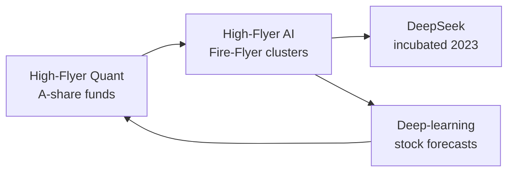

# High-Flyer

> **TL;DR**
>
> - One of China's largest quant funds (Hangzhou), trading A-shares with deep-learning models since 2016 and mostly long-only "index enhancement" products since 2024.
> - It built its own GPU clusters (Fire-Flyer) and incubated DeepSeek in 2023; DeepSeek researchers describe a 10,000-A100 Fire-Flyer cluster.
> - Results swing with crowded small-cap trades: +56.6% on average in 2025, a sharp drawdown in July 2026.

**Type:** Chinese quant hedge fund (private fund manager) · **Last verified:** 2026-11

| Field | Value |
|---|---|
| Type | Private fund manager regulated by AMAC since 2015–16; Hong Kong arm licensed by the SFC since 2019 `[Verified]` |
| Scale | More than RMB 70bn (about \$10B) in 2026; about RMB 90bn in September 2021 `[Reported]` |
| Horizon | Not disclosed; benchmark-relative equity books `[Reported]` |
| Known strategies | A-share index enhancement against CSI 500/1000-type benchmarks; market-neutral exited in 2024 `[Reported]` |
| Tech signals | Fire-Flyer II cost about RMB 1bn `[Verified]`; 10,000 PCIe A100 GPUs `[Verified]` |
| Confidence | Medium: firm site and paper solid; AUM, returns from press |
| Sources | Firm website; An et al. (2024); Bloomberg; Hedgeweek |

## What they do

The founders explored automated trading from 2008 and set up High-Flyer Quant in 2015 `[Verified]`. Its first deep-learning stock positions went live on 21 October 2016, and by end-2017 nearly all strategies used AI models `[Verified]`. It passed RMB 10bn in 2019 `[Verified]`. In late 2021, after its worst drawdown, it stopped taking new money and apologized to clients for [crowded](../../09-reference/glossary.md#crowding), mistimed trades `[Reported]`. Founder Liang Wenfeng holds a majority stake `[Reported]`.

## Strategy focus and approach

China's main quant product is index enhancement: a long-only portfolio that tries to beat an index such as the CSI 1000, the onshore cousin of [cross-sectional alpha](../../02-strategies/d-mid-frequency-alpha/cross-sectional-alpha-and-neutralization.md) without the short leg. High-Flyer left market-neutral in 2024 to focus on it `[Reported]`. Its forecasts come from [neural networks](../../03-algorithms/b-forecasting-models/neural-nets-and-sequence-models.md), drawing on over 10 PB of tick and macro data collected since 2008 `[Verified]`, an extreme case of [ML-driven alpha](../../02-strategies/c-statistical-arbitrage/ml-driven-short-horizon-alpha.md). Its reported products are onshore Chinese equity funds `[Reported]`; it is here as a comparison case.

## Fact vs lore

- **DeepSeek link.** Sourced: High-Flyer AI built Fire-Flyer II `[Verified]`; DeepSeek authors describe that cluster `[Verified]`; Liang has said DeepSeek was funded from High-Flyer's research budget `[Reported]`. Claims that trading itself runs on DeepSeek's language models are `[Lore]`.
- **Returns.** The 2025 average of 56.6% across funds comes from a data vendor, not audits `[Reported]`. In the week to 17 July 2026 its CSI 1000 fund lost 15.7% as AI-linked small caps reversed; peers averaged −14% `[Reported]`. This is the [crowding](../../02-strategies/e-risk-premia-and-factors/factor-timing-crowding-and-quant-winters.md) risk of similar models.

## Related pages

- [LLMs and foundation models in quant](../../03-algorithms/b-forecasting-models/llms-and-foundation-models-in-quant.md)
- [Two Sigma](two-sigma.md)

## Sources

- [Verified] High-Flyer (n.d.). "History" (2008–2022 milestones, Fire-Flyer I and II). <https://www.high-flyer.cn/en/history/> (accessed 2026-11)
- [Verified] High-Flyer (n.d.). "AI Driven Hedge Fund" (first deep-learning trade 2016-10-21; data volume; AMAC and SFC registrations). <https://www.high-flyer.cn/en/fund/> (accessed 2026-11)
- [Verified] An, W. et al. (DeepSeek-AI) (2024). "Fire-Flyer AI-HPC: A Cost-Effective Software-Hardware Co-Design for Deep Learning." SC'24; arXiv:2408.14158. <https://arxiv.org/abs/2408.14158> (accessed 2026-11)
- [Reported] Bloomberg via The Wealth Advisor (2021-12-30). "China's Top Quant Hedge Fund High-Flyer Apologizes for Loss." <https://www.thewealthadvisor.com/article/chinas-top-quant-hedge-fund-high-flyer-apologizes-loss> (accessed 2026-11)
- [Reported] Hedgeweek, citing Business Times and PaiPaiWang (2026-01-13). "High-Flyer posts 57% gain as China's quant hedge funds outperform." <https://www.hedgeweek.com/high-flyer-posts-57-gain-as-chinas-quant-hedge-funds-outperform/> (accessed 2026-11)
- [Reported] Enterprise, citing Bloomberg (2026-07-22). "China's quant funds post their worst week in more than two years on AI-stock reversal." <https://enterpriseam.com/ksa/2026/07/22/chinas-quant-funds-post-their-worst-week-in-more-than-two-years-on-ai-stock-reversal/> (accessed 2026-11)
- [Reported] Hedgeweek (2026-07-21). "China quant hedge funds hit by AI-led selloff as systematic strategies suffer sharp losses." <https://www.hedgeweek.com/china-quant-hedge-funds-hit-by-ai-led-selloff-as-systematic-strategies-suffer-sharp-losses/> (accessed 2026-11)
