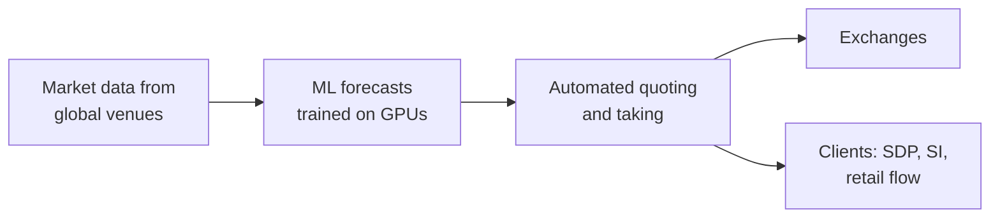

# Hudson River Trading

> **TL;DR**
>
> - Founded in 2002 by computer-science and math graduates. It began in US equities and is now a multi-asset quantitative trading firm with over 1,000 staff in 14 offices `[Verified]`.
> - Reported 2025 revenue was about \$12.3B, in line with Citadel Securities, and Q1 2026 set a record \$6.4B `[Reported]`.
> - Fully automated and research-engineering led. It trains ML models on GPU clusters and signed a multi-year NVIDIA Vera Rubin cloud deal with CoreWeave in 2026 `[Verified]`.

**Type:** proprietary algorithmic trading firm · **Last verified:** 2026-11

| Field | Value |
|---|---|
| Type | Private quantitative trading firm and liquidity provider `[Verified]` |
| Scale | ~\$12.3B net trading revenue in 2025 `[Reported]`; record \$6.4B in Q1 2026 `[Reported]`; 1,000+ employees `[Verified]` |
| Horizon | Microseconds to days `[Estimate]` (market making plus short-horizon forecasts) |
| Known strategies | [Equity market making](../../02-strategies/a-liquidity-provision/equity-market-making.md) · [Retail flow internalization](../../02-strategies/a-liquidity-provision/retail-flow-internalization.md) · [ML-driven short-horizon alpha](../../02-strategies/c-statistical-arbitrage/ml-driven-short-horizon-alpha.md) · [ETF market making](../../02-strategies/a-liquidity-provision/etf-market-making.md) |
| Tech signals | ML on GPU clusters; CoreWeave Vera Rubin NVL72 research platform (2026) `[Verified]` |
| Confidence | Medium: business lines from the firm; revenue from unnamed sources |
| Sources | Firm site, CoreWeave release, Reuters, Bloomberg (below) |

## What they do

HRT writes automated algorithms that quote and trade on nearly all of the world's electronic markets `[Verified]`. It describes a substantial footprint in US equities. It calls itself a top-ranked liquidity provider in US Treasuries, which is a firm claim `[Reported]`. Client businesses came later: a US single-dealer platform and a European systematic internaliser in 2018, then client market making in 2022 `[Verified]`. In 2025 it gained retail-wholesaling share, competing with Citadel Securities and Virtu `[Reported]`.

## Strategy focus and approach

HRT's public material stresses ML prediction trained on GPU clusters `[Verified]`. In the generic version of this approach, models learn short-horizon price moves from [order-book and trade-flow features](../../03-algorithms/f-market-making-and-hft-algorithms/order-book-and-trade-flow-signals.md). They are trained offline at scale, then run inside a latency-bound [trading loop](../../03-algorithms/f-market-making-and-hft-algorithms/anatomy-of-an-hft-trading-loop.md). The same forecasts can drive passive quoting in [market making](../../09-reference/glossary.md#market-making) or aggressive taking. The [ML short-horizon dossier](../../02-strategies/c-statistical-arbitrage/ml-driven-short-horizon-alpha.md) explains why compute became the bottleneck. How HRT splits P&L between making and taking is not disclosed.

## Fact vs lore

- **Lore:** "HRT trades X% of US stock volume." Figures quoted in the press run from about 5% to 10% and measure different things. The firm publishes no share `[Lore]`.
- **Fact:** HRT is private and files no public accounts, so every revenue figure comes from unnamed sources `[Reported]`.

## Related pages

- [ML-driven short-horizon alpha](../../02-strategies/c-statistical-arbitrage/ml-driven-short-horizon-alpha.md) · [Equity market making](../../02-strategies/a-liquidity-provision/equity-market-making.md) · [Neural nets and sequence models](../../03-algorithms/b-forecasting-models/neural-nets-and-sequence-models.md)
- [XTX Markets](xtx-markets.md) · [Jane Street](jane-street.md) · [Semiconductor lens](../../05-infrastructure/semiconductor-lens.md)

## Sources

- [Verified] Hudson River Trading (n.d.). "Who We Are" (founding, offices, headcount, client offerings). <https://www.hudsonrivertrading.com/about/> (accessed 2026-11)
- [Verified] Hudson River Trading (n.d.). "Liquidity" (US equities footprint, Treasury claim, SI). <https://www.hudsonrivertrading.com/liquidity/> (accessed 2026-11)
- [Verified] Hudson River Trading (n.d.). "Machine Learning at HRT." <https://www.hudsonrivertrading.com/machine-learning/> (accessed 2026-11)
- [Verified] CoreWeave (2026). "Hudson River Trading to Build Next-Gen Research Platform Powered by NVIDIA Vera Rubin NVL72 on CoreWeave Cloud." <https://coreweave.com/news/hudson-river-trading-to-build-next-gen-research-platform-powered-by-nvidia-vera-rubin-nvl72-on-coreweave-cloud> (accessed 2026-11)
- [Reported] Reuters via MarketScreener (2026-04-24). "Jane Street's \$40 billion trading haul tops rivals, sources say" (HRT and Citadel Securities 2025 figures). <https://www.marketscreener.com/news/jane-street-s-40-billion-trading-haul-tops-rivals-sources-say-ce7f59dfdf8ff52d> (accessed 2026-11)
- [Reported] Bloomberg (2026-05-11). "Hudson River Trading Notches Record \$6.4 Billion Quarterly Markets Haul." <https://www.bloomberg.com/news/articles/2026-05-11/hudson-river-trading-notches-record-6-4-billion-quarterly-markets-haul> (accessed 2026-11)
- [Reported] Global Trading (2025-09-11). "SIG and HRT lead 2025 retail volume and execution-quality gains." <https://www.globaltrading.net/?p=39575> (accessed 2026-11)
