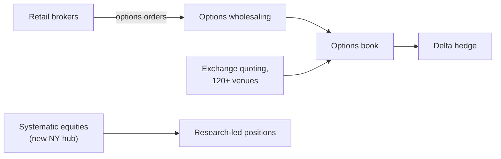

# IMC Trading

> **TL;DR**
>
> - Market maker founded in 1989 by two traders on the Amsterdam equity-options floor. It now has 2,070+ staff in 10 offices and trades on 120+ venues `[Verified]`.
> - 2025 was a record: net trading revenue rose 40% to \$3,120M and net profit reached \$968M. It also made its first debt issue, a \$500M term loan upsized to \$650M `[Verified]`.
> - Options are the core. It calls itself a top-3 global listed-options liquidity provider `[Reported]`, runs US options wholesaling and is lead market maker in 150+ US ETFs `[Verified]`.

**Type:** proprietary market maker (options-led) · **Last verified:** 2026-11

| Field | Value |
|---|---|
| Type | Principal market maker; CEO Michaël De Lathauwer, appointed 2025 `[Verified]` |
| Scale | Net trading revenue \$3,120M (2025) vs \$2,235M (2024); total equity \$2,581M `[Verified]` |
| Horizon | Microseconds for quoting, plus "research-led positions" `[Verified]` |
| Known strategies | [Options market making](../../02-strategies/a-liquidity-provision/options-market-making.md) · [Retail flow internalization](../../02-strategies/a-liquidity-provision/retail-flow-internalization.md) (options) · [ETF market making](../../02-strategies/a-liquidity-provision/etf-market-making.md) · [Equity market making](../../02-strategies/a-liquidity-provision/equity-market-making.md) |
| Tech signals | In-house systems "built from the chip up"; RL, deep learning and LLM research; NVIDIA partnership; stakes in McKay Brothers, MEMX and Clear Street `[Verified]` |
| Confidence | High for financials (published annual report); medium for strategy |
| Sources | IMC annual report release, firm pages, Bloomberg, Global Trading (below) |

## What they do

IMC quotes options, ETFs, stocks, futures and crypto, and sells liquidity off-screen to institutions `[Verified]`. Its US options wholesaling connects to every OCC-cleared venue `[Verified]`. With Citadel Securities, it led payments for US retail flow in early-2025 Rule 606 data `[Reported]`. It planned an energy-trading business from Aarhus for Q1 2026, and in August 2026 it opened a New York hub for Americas systematic equities `[Verified]`.

## Strategy focus and approach

Two engines. The first is [options market making](../../02-strategies/a-liquidity-provision/options-market-making.md): a [vol surface](../../03-algorithms/f-market-making-and-hft-algorithms/options-pricing-and-vol-surfaces-for-mm.md), automated quoting and [delta hedging](../../09-reference/glossary.md#delta-hedging). The second is retail options flow, bought because it is less informed than the screen. Buying it means paying [PFOF](../../09-reference/glossary.md#payment-for-order-flow-pfof) and accepting the inventory, then measuring [markouts](../../03-algorithms/f-market-making-and-hft-algorithms/adverse-selection-and-markouts.md). The new CEO's stated aim is a "more diversified, research-based" firm. The systematic-equities hub points the same way.

## Fact vs lore

- **Lore:** "Market makers' 2025 profits were a volatility windfall." Partly true. IMC credits record volumes and volatility bursts around AI, tariffs and digital assets `[Verified]`, but its costs rose 35% `[Reported]`.
- Rankings such as "top-3 in listed options" are self-reported `[Reported]`.

## Related pages

- [Options market making](../../02-strategies/a-liquidity-provision/options-market-making.md) · [Retail flow internalization](../../02-strategies/a-liquidity-provision/retail-flow-internalization.md) · [Hedging algorithms](../../03-algorithms/f-market-making-and-hft-algorithms/hedging-algorithms.md)
- [Optiver](optiver.md) · [Economics and revenue pools](../economics-and-revenue-pools.md)

## Sources

- [Verified] IMC (2026-03-25). "IMC launches 2025 annual report." <https://www.imc.com/eu/corporate-news/IMC-launches-2025-annual-report> (accessed 2026-11)
- [Verified] IMC (n.d.). "Who we are" (founding, headcount, venues). <https://www.imc.com/us/who-we-are> (accessed 2026-11)
- [Verified] IMC (n.d.). "Access our liquidity" (options rank claim, wholesaling, ETF LMM). <https://www.imc.com/us/access-our-liquidity> (accessed 2026-11)
- [Verified] IMC (n.d.). "What we do" (research, AI/ML, technology). <https://www.imc.com/us/what-we-do> (accessed 2026-11)
- [Verified] IMC (2026). Corporate news: New York systematic equities office (2026-08-11) and US market structure lead (2026-10-19). <https://www.imc.com/us/corporate-news> (accessed 2026-11)
- [Verified] IMC (n.d.). "Strategic Investments" (portfolio). <https://www.imc.com/us/strategic-investments> (accessed 2026-11)
- [Reported] Bloomberg (2026-03-26). "Market Maker IMC's Trading Revenue Rises 40% on Volatility Surge." <https://www.bloomberg.com/news/articles/2026-03-26/market-maker-imc-s-trading-revenue-rises-40-on-volatility-surge> (accessed 2026-11)
- [Reported] Global Trading (2025-05-27). "Payments for US retail flow reach record high, led by Citadel Securities and IMC." <https://www.globaltrading.net/?p=38554> (accessed 2026-11)
