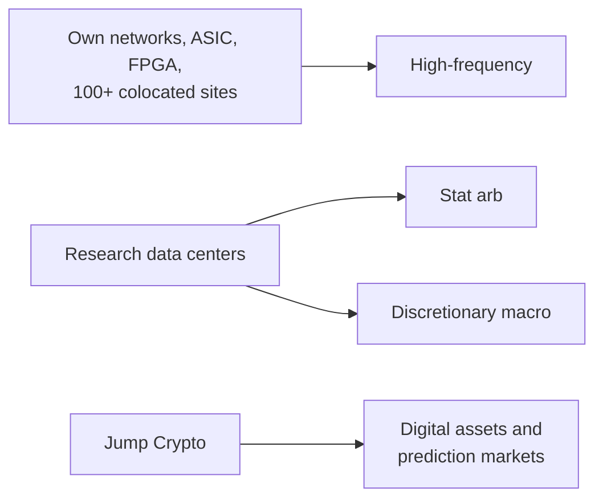

# Jump Trading

> **TL;DR**
>
> - A private Chicago firm founded in 1999 by two former CME pit traders `[Reported]`. Its strategies run from high-frequency trading through stat arb to discretionary macro, in equities, options, credit, commodities, futures and digital assets `[Verified]`.
> - It builds heavy infrastructure: three research data centers, more than 100 colocated sites near exchanges, and custom ASIC and FPGA hardware `[Verified]`.
> - Crypto shaped its recent record. A subsidiary paid \$123M to settle SEC TerraUSD charges in 2024 `[Verified]`, and in 2026 Jump took stakes in Polymarket and Kalshi in return for market making `[Reported]`.

**Type:** proprietary trading firm (HFT to macro) · **Last verified:** 2026-11

| Field | Value |
|---|---|
| Type | Private proprietary trading firm trading only its own capital `[Reported]` |
| Scale | Financials not disclosed; 10,000+ compute nodes, 5M+ simulations a day, hundreds of exchanges (firm) `[Verified]` |
| Horizon | Nanoseconds to macro horizons `[Verified]` (firm statement) |
| Known strategies | HFT, stat arb and discretionary macro (firm-stated) `[Verified]`; closest dossiers: [Latency arbitrage](../../02-strategies/b-speed-and-structural/latency-arbitrage.md) · [Lead-lag and cross-asset arbitrage](../../02-strategies/b-speed-and-structural/lead-lag-and-cross-asset-arbitrage.md) · [ML-driven short-horizon alpha](../../02-strategies/c-statistical-arbitrage/ml-driven-short-horizon-alpha.md) · [Stat arb](../../02-strategies/c-statistical-arbitrage/stat-arb-overview-and-history.md) |
| Tech signals | Custom ASIC and FPGA, proprietary networks, C++/Python/Go/Rust; Jump Crypto's Firedancer Solana validator, written in C `[Verified]` |
| Confidence | Medium-low: the firm describes capabilities, not P&L |
| Sources | Firm site, SEC order, press (below) |

## What they do

Jump trades its own money across asset classes. Its founders met as traders in the CME's Deutsche Mark futures pit `[Reported]`. Jump Crypto runs digital-asset trading and builds blockchain infrastructure. Jump Capital is a separate venture arm `[Verified]`.

## Strategy focus and approach

The firm states its core ML focus as finding alpha in high-volume, low-latency markets with a low signal-to-noise ratio `[Verified]`. That description maps onto three dossiers: [latency arbitrage](../../02-strategies/b-speed-and-structural/latency-arbitrage.md), [lead-lag](../../02-strategies/b-speed-and-structural/lead-lag-and-cross-asset-arbitrage.md) between futures and cash markets, and [short-horizon ML alpha](../../02-strategies/c-statistical-arbitrage/ml-driven-short-horizon-alpha.md). Which trades it runs is not disclosed. The hardware list shows where the money goes: [FPGA](../../09-reference/glossary.md#fpga) and ASIC [tick-to-trade](../../09-reference/glossary.md#tick-to-trade) paths, plus private networks between [colocated](../../09-reference/glossary.md#colocation) sites.

## Fact vs lore

- **Lore:** "Jump owns the fastest Chicago–New Jersey microwave links" `[Lore]`. The firm itself says only that it builds proprietary network infrastructure `[Verified]`.
- **Fact:** the SEC found that Tai Mo Shan, a Jump subsidiary, agreed in May 2021 to buy about \$20M of TerraUSD (UST) as it slipped below its \$1 peg. The SEC said this negligently misled investors about how well the "algorithmic" peg worked. The subsidiary paid \$123M without admitting or denying the findings (2024-12-20) `[Verified]`.

## Related pages

- [Latency arbitrage](../../02-strategies/b-speed-and-structural/latency-arbitrage.md) · [Lead-lag and cross-asset arbitrage](../../02-strategies/b-speed-and-structural/lead-lag-and-cross-asset-arbitrage.md) · [Anatomy of an HFT trading loop](../../03-algorithms/f-market-making-and-hft-algorithms/anatomy-of-an-hft-trading-loop.md)
- [Colocation, networks and the speed of light](../../05-infrastructure/colocation-networks-and-the-speed-of-light.md) · [Tower Research Capital](tower-research-capital.md)

## Sources

- [Verified] Jump Trading (n.d.). "Trading" (strategy range, asset classes). <https://www.jumptrading.com/trading> (accessed 2026-11)
- [Verified] Jump Trading (n.d.). "Technology" (data centers, colocation, ASIC and FPGA). <https://www.jumptrading.com/technology> (accessed 2026-11)
- [Verified] Jump Trading (n.d.). "Jump AI" (ML focus, compute scale). <https://www.jumptrading.com/ai-ml> (accessed 2026-11)
- [Verified] Jump Crypto (n.d.). "Firedancer." <https://jumpcrypto.com/firedancer/> (accessed 2026-11)
- [Verified] SEC (2024-12-20). Press release 2024-212 on the settled order against Tai Mo Shan Limited (TerraUSD, \$123M). <https://www.sec.gov/newsroom/press-releases/2024-212> (accessed 2026-11)
- [Reported] The Block (2024-12-21). "SEC fines Jump Trading subsidiary \$123 million for propping up TerraUSD stablecoin during depeg." <https://theblock.co/news/regulation/2024-12-21-sec-fines-jump-trading-subsidiary-123-million-for-propping-up-terrausd-stablecoin-during-depeg-332096> (accessed 2026-11)
- [Reported] The Block, citing Bloomberg (2026-02). "Jump Trading to serve as Polymarket and Kalshi market maker in exchange for stake." <https://www.theblock.co/post/389086/jump-trading-to-serve-as-polymarket-and-kalshi-market-maker-in-exchange-for-stake-bloomberg> (accessed 2026-11)
- [Reported] MarketsWiki (n.d.). "Jump Trading LLC" (founding and founders; industry wiki, secondary). <https://www.marketswiki.com/wiki/Jump_Trading> (accessed 2026-11)
