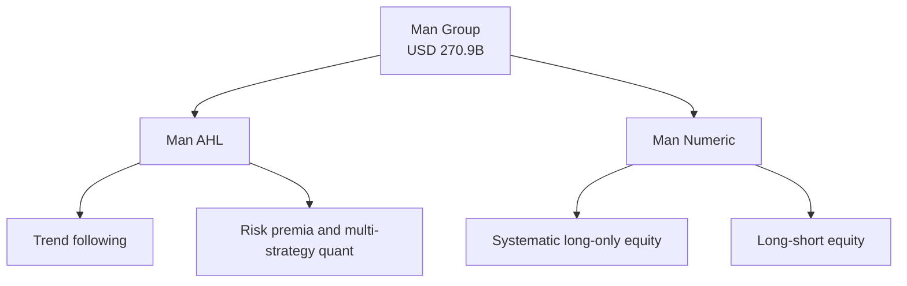

# Man Group (AHL / Numeric)

> **TL;DR**
>
> - A London-listed manager with \$270.9B of assets whose two quant engines are Man AHL (futures trend and multi-strategy quant) and Man Numeric (systematic stock selection).
> - Trend following made AHL famous, but systematic long-only equity is now far larger.
> - As a public company it discloses assets by product every quarter, which makes it the best-documented quant firm here.

**Type:** listed asset manager with systematic units · **Last verified:** 2026-11

| Field | Value |
|---|---|
| Type | Man Group plc, London Stock Exchange (EMG); quant units Man AHL and Man Numeric `[Verified]` |
| Scale | AUM \$270.9B at 30 Sep 2026 `[Verified]` |
| Horizon | AHL: days to months in futures; Numeric: weeks to months in stocks `[Estimate]` |
| Known strategies | Trend following, alternative risk premia, multi-strategy quant, systematic long-only and long-short equity `[Verified]` |
| Tech signals | Momentum models across 800+ markets `[Verified]`; in-house LLM tools for research `[Reported]` |
| Confidence | High: quarterly statements and firm pages |
| Sources | Man Group trading statements; man.com; Hedgeweek |

## What they do

Man AHL began in 1987 as a [CTA](../../09-reference/glossary.md#commodity-trading-advisor-cta); Man took a majority stake in 1989 and the rest in 1994 `[Verified]`. Numeric, a quant equity manager founded in 1989, was acquired in September 2014 `[Verified]`. At 31 March 2026, Man reported \$8.2B in trend-following, \$15.3B in risk premia and \$68.7B in systematic long-only equity, the last after a \$6.1B single-client redemption `[Verified]`. Robyn Grew is chief executive `[Verified]`.

## Strategy focus and approach

AHL's core is [trend following](../../02-strategies/g-futures-and-macro-context/trend-following-and-ctas.md): [time-series momentum](../../09-reference/glossary.md#time-series-momentum) across futures and FX, which CTAs typically size by [volatility targeting](../../09-reference/glossary.md#volatility-targeting). It has since grown into a multi-strategy quant business `[Verified]`, adding [risk premia](../../02-strategies/g-futures-and-macro-context/carry-and-cross-asset-risk-premia.md) and other models. Numeric runs [cross-sectional stock selection](../../02-strategies/d-mid-frequency-alpha/cross-sectional-alpha-and-neutralization.md) against benchmarks: long-only, active extension (partly short) and long-short `[Verified]`. Its research team tests new data and methods through a structured pipeline and an investment committee `[Verified]`. Man says an internal AI agent drafts, codes and backtests signal ideas, several dozen of which went live after human review `[Reported]` (see [LLMs in quant](../../03-algorithms/b-forecasting-models/llms-and-foundation-models-in-quant.md)).

## Fact vs lore

- **"Man is a trend follower."** Outdated: trend was about 4% of AUM in March 2026, against about 30% in systematic long-only equity `[Estimate]` (\$8.2B and \$68.7B of \$228.7B).
- **AI-generated alpha.** The agent proposes ideas; humans approve them. Independent evidence that LLMs find durable alpha at scale is lacking `[Lore]`.
- **Performance fees.** First-half 2026 core performance fees were \$207M, against \$67M a year earlier `[Verified]`: quant revenue is lumpy.

## Related pages

- [Factor investing fundamentals](../../02-strategies/e-risk-premia-and-factors/factor-investing-fundamentals.md)
- [Position sizing and risk budgeting](../../03-algorithms/d-portfolio-construction/position-sizing-and-risk-budgeting.md)
- [AQR Capital Management](aqr.md)

## Sources

- [Verified] Man Group plc (2026-10). "Trading statement for the quarter ended 30 September 2026." <https://www.man.com/news-centre/trading-statement-30-september-2026> (accessed 2026-11)
- [Verified] Man Group plc (2026-04-23). "Trading Statement for quarter ended 31 March 2026" (AUM by product category). RNS via Investegate. <https://www.investegate.co.uk/announcement/rns/man-group--emg/trading-statement-for-quarter-ended-31-march-2026-/9533708> (accessed 2026-11)
- [Verified] Man Group plc (2026-07-28). "Half year results for the period ended 30 June 2026." RNS via Investegate. <https://www.investegate.co.uk/announcement/rns/man-group--emg/half-year-results-for-the-period-ended-30-june/9689873> (accessed 2026-11)
- [Verified] Man Group (n.d.). "Man AHL" (history 1987/1989/1994; momentum programmes). <https://www.man.com/ahl> (accessed 2026-11)
- [Verified] Man Group (n.d.). "Man Numeric" (founding 1989; acquisition 2014; research process). <https://www.man.com/numeric> (accessed 2026-11)
- [Reported] Hedgeweek (2025-07-11), citing Bloomberg. "Man Group deploys agentic AI for quant signal discovery." <https://www.hedgeweek.com/man-group-deploys-agentic-ai-for-quant-signal-discovery/> (accessed 2026-11)
- [Verified] Moskowitz, T. J., Ooi, Y. H. & Pedersen, L. H. (2012). "Time Series Momentum." *Journal of Financial Economics* 104(2), 228–250. <https://doi.org/10.1016/j.jfineco.2011.11.003> (accessed 2026-11)
