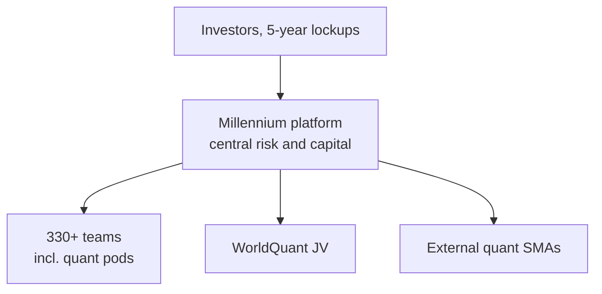

# Millennium (quant pods)

> **TL;DR**
>
> - One of the largest multi-manager "pod shops": hundreds of independent teams, each with its own capital, risk budget and stop-loss.
> - Quant exposure comes three ways: in-house systematic pods, a joint venture with WorldQuant, and mandates to outside quant managers.
> - What each quant pod trades is not disclosed.

**Type:** multi-manager hedge fund platform · **Last verified:** 2026-11

| Field | Value |
|---|---|
| Type | Multi-strategy platform, founded 1989; Israel Englander CEO since then `[Verified]` |
| Scale | About \$79B AUM, 330+ investment teams (late 2025) `[Reported]`; regulatory AUM \$720.8B, 6,670 employees (Form ADV, Aug 2026) `[Verified]` |
| Horizon | Intraday to months, varying by team `[Estimate]` |
| Known strategies | Fundamental equity, equity arbitrage, fixed income, commodities, credit and quantitative (mainly systematic, multi-asset) `[Reported]` |
| Tech signals | Not disclosed; the WorldQuant venture runs on Millennium's platform `[Reported]` |
| Confidence | High on structure and filings; low on pod-level strategy |
| Sources | Form ADV; firm website; Hedgeweek; Reuters |

## What they do

Millennium allocates capital to portfolio-manager teams, sets their risk limits and charges investors the teams' costs through [pass-through fees](../../09-reference/glossary.md#pass-through-fees) `[Reported]`. It returned 10.5% in 2025 `[Reported]`. In November 2025 it sold a 15% stake for about \$2B, valuing the manager near \$14B, its first outside sale; investor lockups now run five years `[Reported]`. Regulatory AUM is about nine times reported AUM `[Estimate]` (\$720.8B vs \$79B) because Form ADV counts gross, levered assets.

## Strategy focus and approach

On pod platforms a quant [pod](../../09-reference/glossary.md#pod) is typically a small team running its own systematic book (equity [stat arb](../../02-strategies/c-statistical-arbitrage/stat-arb-overview-and-history.md), futures) inside central limits on factor exposure and volatility, with capital following recent risk-adjusted P&L `[Reported]`; Millennium publishes no pod-level detail. Reported practice halves a team's capital at a 5% drawdown and usually ends it near 7.5% `[Reported]` (see [how firms combine strategies](../../02-strategies/h-cross-cutting/how-firms-combine-strategies.md)). The center adds diversification and leverage rather than a shared forecast `[Estimate]`.

Beyond in-house pods, WorldQuant Millennium Advisors, a joint venture with WorldQuant, managed nearly \$30B by July 2026, and WorldQuant ran about \$10B more for Millennium separately `[Reported]`. Its funds, such as "WMA Systematic Equity Alpha Long/Short", appear in Millennium's Form ADV `[Verified]`. It also funds outside quants through separately managed accounts; one with Engineers Gate (about \$1.5B of capital, \$3.6B levered) ended in March 2026 over liquidity terms `[Reported]`.

## Fact vs lore

- **"Millennium is a quant fund."** Unsupported: quant is one of six areas; its share of capital is not public.
- **Drawdown rules.** Widely reported, never published by the firm `[Reported]`.
- **Returns.** Annual figures come from people familiar with the funds, not audited disclosure `[Reported]`.

## Related pages

- [Position sizing and risk budgeting](../../03-algorithms/d-portfolio-construction/position-sizing-and-risk-budgeting.md)
- [Risk models](../../03-algorithms/d-portfolio-construction/risk-models.md)
- [Cubist Systematic Strategies](cubist.md)

## Sources

- [Verified] Millennium Management LLC (2026-08-25). Form ADV (Items 5.A and 5.F, Schedule A, Schedule D 7.B private funds incl. WorldQuant Millennium Advisors). SEC IAPD, CRD 158117. <https://reports.adviserinfo.sec.gov/reports/ADV/158117/PDF/158117.pdf> (accessed 2026-11)
- [Reported] Millennium Management (n.d.). "About" (investment areas: fundamental equity, equity arbitrage, fixed income, commodities, quantitative, credit); read via search-engine summary, direct access blocked. <https://www.mlp.com/about> (accessed 2026-11)
- [Reported] Hedgeweek, citing Bloomberg (2025-11-04). "Millennium sells \$2bn minority stake to diversify ownership." <https://www.hedgeweek.com/millennium-sells-2bn-minority-stake-to-diversify-ownership/> (accessed 2026-11)
- [Reported] Hedgeweek (2026-07-02). "WorldQuant Millennium Advisors grows assets to nearly \$30bn." <https://www.hedgeweek.com/worldquant-millennium-advisors-grows-assets-to-nearly-30bn/> (accessed 2026-11)
- [Reported] Hedgeweek, citing Bloomberg (2026-03-27). "Millennium and Engineers Gate to terminate SMA arrangement." <https://www.hedgeweek.com/millennium-and-engineers-gate-to-terminate-sma-arrangement/> (accessed 2026-11)
- [Reported] Reuters via Tiger Brokers (2026-01-02). "Top hedge funds led by D.E. Shaw, Bridgewater and Balyasny deliver big gains in 2025." <https://www.itiger.com/news/2600609750> (accessed 2026-11)
- [Reported] eFinancialCareers (n.d.). Article on Millennium jobs and stop-loss practice, citing the Wall Street Journal. <https://www.efinancialcareers.com/news/millennium-hedge-fund-jobs> (accessed 2026-11)
