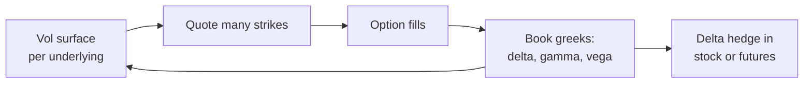

# Optiver

> **TL;DR**
>
> - Amsterdam market maker founded in 1986. It trades listed derivatives, cash equities, ETFs, bonds and FX from 11 offices `[Verified]`.
> - It publishes results: 2025 net trading income was €4.556B (+30%) and net profit €1.769B, with 2,233 full-time staff `[Verified]`.
> - In 2026 it is pushing into US single-stock options, hiring 40 New York traders `[Reported]`, and expanding into European power and gas through Northpool `[Verified]`.

**Type:** proprietary market maker (derivatives-led) · **Last verified:** 2026-11

| Field | Value |
|---|---|
| Type | Principal market maker trading its own capital; CEO Jan Boomaars `[Verified]` |
| Scale | Net trading income €4.556B (2025) vs €3.494B (2024); equity €5.490B; 1M+ instruments priced, 10M+ trades a day `[Verified]` |
| Horizon | Microseconds for quotes; days to months for option risk `[Estimate]` |
| Known strategies | [Options market making](../../02-strategies/a-liquidity-provision/options-market-making.md) · [ETF market making](../../02-strategies/a-liquidity-provision/etf-market-making.md) · [Equity market making](../../02-strategies/a-liquidity-provision/equity-market-making.md) |
| Tech signals | Low-latency C++ (CppCon 2017) `[Verified]`; slow models arming fast FPGA/ASIC triggers `[Reported]`; stakes in McKay Brothers and JapanNext `[Verified]` |
| Confidence | High for financials; medium for strategy detail |
| Sources | Annual results, firm news, CFTC, talks, press (below) |

## What they do

Optiver quotes options, futures, ETFs and stocks on many exchanges at its own risk. It calls itself one of the largest derivatives and ETF market makers `[Reported]`. In 2025 it opened a New York office and moved into new US asset classes `[Verified]`. It also invests in market infrastructure, including Optimal, a new US listed-options execution platform `[Verified]`. In October 2026 it began making markets in autocallable ETFs `[Verified]`.

## Strategy focus and approach

The core is [options market making](../../02-strategies/a-liquidity-provision/options-market-making.md). Each underlying gets a [volatility surface](../../03-algorithms/f-market-making-and-hft-algorithms/options-pricing-and-vol-surfaces-for-mm.md), and the firm quotes thousands of strikes around it. The book's delta is [hedged](../../03-algorithms/f-market-making-and-hft-algorithms/hedging-algorithms.md), while gamma and vega are managed in aggregate. Its engineers describe the reflex behind the [risk controls](../../03-algorithms/f-market-making-and-hft-algorithms/algorithmic-risk-controls.md): if anything looks wrong, pull all orders first `[Verified]`.

## Fact vs lore

- **Fact:** in 2012 Optiver paid \$14M to settle CFTC charges of manipulating, and attempting to manipulate, NYMEX crude oil, heating oil and gasoline futures in March 2007 by trading heavily into the close `[Verified]`.
- **Lore:** "Optiver dominates US options." In US single-stock options it has long trailed Citadel Securities and Susquehanna, hence the 2026 hiring push `[Reported]`.

## Related pages

- [Options market making](../../02-strategies/a-liquidity-provision/options-market-making.md) · [Options market maker walkthrough](../../03-algorithms/h-end-to-end-walkthroughs/walkthrough-options-market-maker.md) · [Anatomy of an HFT trading loop](../../03-algorithms/f-market-making-and-hft-algorithms/anatomy-of-an-hft-trading-loop.md)
- [IMC Trading](imc.md) · [Susquehanna (SIG)](susquehanna-sig.md)

## Sources

- [Verified] Optiver (2026-03-31). "Optiver reports robust financial results for 2025." <https://optiver.com/optiver-reports-robust-financial-results-for-2025> (accessed 2026-11)
- [Verified] Optiver (2026-11-03). "Optiver completes acquisition of majority stake in Northpool." <https://optiver.com/insights/news/optiver-completes-acquisition-northpool/> (accessed 2026-11)
- [Verified] Optiver (2026-10-05). "Optiver expands market making into autocallable ETFs." <https://optiver.com/insights/news/optiver-expands-market-making-into-autocallable-etfs/> (accessed 2026-11)
- [Verified] CFTC (2012-04). Release 6239-12: Optiver entities and traders ordered to pay \$14 million in the NYMEX energy futures manipulation case. <https://www.cftc.gov/PressRoom/PressReleases/6239-12> (accessed 2026-11)
- [Verified] Cook, C. (2017). "When a Microsecond Is an Eternity: High Performance Trading Systems in C++." CppCon 2017 (Optiver). <https://isocpp.org/blog/2018/09/cppcon-2017-when-a-microsecond-is-an-eternity-high-performance-trading-syst> (accessed 2026-11)
- [Reported] Orosz, G., Klaric, I. & Spevack, J. (2026-08-11). "Software engineering at a proprietary trading company: Optiver." *The Pragmatic Engineer*. <https://newsletter.pragmaticengineer.com/p/optiver> (accessed 2026-11)
- [Reported] Bloomberg Government (2026-05). "Optiver Boosts Stock Option Competition for Citadel, Susquehanna." <https://news.bgov.com/capital-markets/optiver-boosts-stock-option-competition-for-citadel-susquehanna> (accessed 2026-11)
