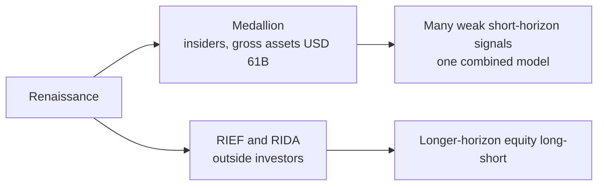

# Renaissance Technologies

> **TL;DR**
>
> - Medallion, an insider-owned fund, runs many short-horizon signals as one model; it has the best long record in quant.
> - Its famous returns come from a book, not audited disclosure, and their compounding is disputed.
> - Outside investors get slower funds with ordinary results.

**Type:** quant hedge fund, single centralized model · **Last verified:** 2026-11

| Field | Value |
|---|---|
| Type | Systematic hedge fund; founder Jim Simons died in 2024 `[Verified]` |
| Scale | Regulatory AUM \$96.4B; 310 staff (Form ADV, July 2026) `[Verified]` |
| Horizon | Medallion: 87% of positions held under three months (2007–09) `[Verified]`; RIEF longer |
| Known strategies | Short-horizon [statistical arbitrage](../../09-reference/glossary.md#statistical-arbitrage) in equities, futures trading `[Reported]` |
| Tech signals | 26–39 million trades a year in one account set `[Verified]` |
| Confidence | Medium: filings solid; strategy detail second-hand |
| Sources | Form ADV; Senate report; Bloomberg; Cornell |

## What they do

The July 2026 Form ADV lists Medallion Holdings at \$61.2B of gross assets, 80% owned by the firm and insiders, RIEF at \$21.8B and the RIDA/RIDGE pool at \$4.2B `[Verified]`. Gross assets include leverage: in 2016 Bloomberg reported Medallion's equity capped at \$9–10B, profits paid out twice a year and fees as high as 5% and 44% `[Reported]`. The last outside investors left Medallion in 2005 `[Reported]`. Peter Brown, chairman, has been co-CEO with David Lippe since July 2024 `[Verified]`.

## Strategy focus and approach

Medallion is the archetype of a centralized quant fund: dozens of strategies run as one system, not as competing [pods](../../09-reference/glossary.md#pod) `[Reported]`. Brown has said strong signals get traded away, so the firm hunts for many weak ones `[Reported]`: [alpha combination](../../03-algorithms/b-forecasting-models/alpha-combination-and-ensembling.md) at scale. Equities reportedly earn most of the profit at 4–5x leverage, and the firm studies its own market impact closely `[Reported]`. A 2014 Senate report found hundreds of thousands of trades a day, run through bank basket options that allowed leverage up to 20:1 `[Verified]`. RIEF, a slower long-short fund, lost 19% in 2020 as Medallion gained 76%; it was up 12.3% in 2026 through October `[Reported]`.

## Fact vs lore

- **Medallion returns.** Zuckerman (2019) reported about 66% a year gross and 39% net for 1988–2018, analyzed by Cornell (2020) `[Reported]`. These are arithmetic averages; Guo and Liu (2024, preprint) estimate compounded gross returns below 35% `[Verified]`. No audited series is public.
- **"Never loses."** In the [2007 quant quake](../../02-strategies/h-cross-cutting/strategy-failure-gallery.md) Medallion reportedly lost a fifth of its capital in days, then ended the year up 85.9% `[Reported]`.
- **Taxes.** Senate staff estimated over \$6B of tax avoided via basket options `[Verified]`; Renaissance called them lawful `[Reported]`.

## Related pages

- [Stat arb: overview and history](../../02-strategies/c-statistical-arbitrage/stat-arb-overview-and-history.md)
- [ML-driven short-horizon alpha](../../02-strategies/c-statistical-arbitrage/ml-driven-short-horizon-alpha.md)
- [How firms combine strategies](../../02-strategies/h-cross-cutting/how-firms-combine-strategies.md)
- [Transaction cost and impact models](../../03-algorithms/d-portfolio-construction/transaction-cost-and-impact-models.md)

## Sources

- [Verified] Renaissance Technologies LLC (2026-07-01). Form ADV, other-than-annual amendment (Items 5.A–5.F, Schedule A, Schedule D 7.B). SEC IAPD, CRD 106661. <https://reports.adviserinfo.sec.gov/reports/ADV/106661/PDF/106661.pdf> (accessed 2026-11)
- [Verified] US Senate Permanent Subcommittee on Investigations (2014-07-22, updated 2014-09-30). "Abuse of Structured Financial Products: Misusing Basket Options to Avoid Taxes and Leverage Limits." Staff report. <https://www.hsgac.senate.gov/wp-content/uploads/imo/media/doc/REPORT-Abuse%20of%20Structured%20Financial%20Products%20(Basket%20Options)%20(7-22-14,%20updated%209-30-14).pdf> (accessed 2026-11)
- [Verified] Simons Foundation (2024-05-10). "Simons Foundation Co-Founder, Mathematician and Investor Jim Simons Dies at 86." <https://www.simonsfoundation.org/2024/05/10/simons-foundation-co-founder-mathematician-and-investor-jim-simons-dies-at-86/> (accessed 2026-11)
- [Reported] Burton, K. (2016-11-21). "How Renaissance's Medallion Fund Became Finance's Blackest Box." Bloomberg Markets (syndicated). <https://www.bloombergquint.com/markets/how-renaissance-s-medallion-fund-became-finance-s-blackest-box> (accessed 2026-11)
- [Reported] Zuckerman, G. (2019). *The Man Who Solved the Market: How Jim Simons Launched the Quant Revolution.* Portfolio/Penguin, ISBN 9780735217980. <https://openlibrary.org/isbn/9780735217980> (accessed 2026-11)
- [Verified] Cornell, B. (2020). "Medallion Fund: The Ultimate Counterexample?" *Journal of Portfolio Management* 46(4), 156–159. <https://doi.org/10.3905/jpm.2020.1.128> (accessed 2026-11)
- [Verified] Guo, S. & Liu, Q. (2024). "Is the annualized compounded return of Medallion over 35%?" arXiv:2405.10917 (preprint). <https://arxiv.org/abs/2405.10917> (accessed 2026-11)
- [Reported] Hedgeweek, citing Bloomberg (2026-11-11). "Renaissance Technologies gains 6% in October as hedge fund peers suffer losses." <https://www.hedgeweek.com/news/renaissance-technologies-gains-6-in-october-as-hedge-fund-peers-suffer-losses> (accessed 2026-11)
- [Reported] Bloomberg via BNN Bloomberg (2021). "Renaissance Clients Pull Out After Firm's Rotten Run of Results." <https://www.bnnbloomberg.ca/renaissance-clients-pull-out-after-firm-s-rotten-run-of-results-1.1560482> (accessed 2026-11)
- [Reported] Accounting Today, citing Bloomberg (2014-07). "Renaissance Avoided More Than \$6 Billion Tax, Senators Say." <https://www.accountingtoday.com/news/renaissance-avoided-more-than-6-billion-tax-senators-say> (accessed 2026-11)
