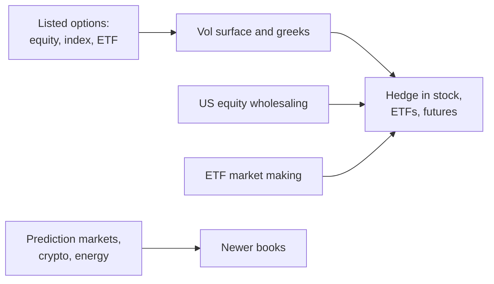

# Susquehanna (SIG)

> **TL;DR**
>
> - Founded in 1987 by college friends who traded on the Philadelphia Stock Exchange floor, drawing on quantitative skills and poker experience. It has 3,500+ staff in 16+ offices `[Verified]`.
> - Options are the core business: it calls itself one of the largest options market participants globally. It also makes ETF markets, wholesales US equities and trades prediction markets, crypto and energy `[Verified]`.
> - Private, with no financials disclosed. It is also a large private investor, reportedly holding about 15% of ByteDance `[Reported]`.

**Type:** proprietary trading firm (options-led) · **Last verified:** 2026-11

| Field | Value |
|---|---|
| Type | Proprietary trading firm trading its own capital at its own risk `[Verified]` |
| Scale | Not disclosed; 3,500+ employees `[Verified]` |
| Horizon | Microseconds for quotes; weeks to months for option inventory `[Estimate]` |
| Known strategies | [Options market making](../../02-strategies/a-liquidity-provision/options-market-making.md) · [ETF market making](../../02-strategies/a-liquidity-provision/etf-market-making.md) · [Retail flow internalization](../../02-strategies/a-liquidity-provision/retail-flow-internalization.md) |
| Tech signals | Machine learning and quantitative research on vast datasets (firm statement) `[Verified]` |
| Confidence | Medium-low: business lines are firm-stated; nothing financial is public |
| Sources | Firm site, Global Trading, press (below) |

## What they do

Susquehanna specializes in exchange-listed equity, index and ETF options worldwide. It also calls itself one of the largest wholesale liquidity providers in US equities `[Reported]` (firm claim). In 2025 it led gains in US retail volume and execution quality `[Reported]`. Its Susquehanna Predictions unit provides liquidity in regulated event contracts `[Verified]`. Venture and growth-equity arms invest separately `[Verified]`.

## Strategy focus and approach

The franchise is [options market making](../../02-strategies/a-liquidity-provision/options-market-making.md) across thousands of underlyings. That means a [volatility surface](../../03-algorithms/f-market-making-and-hft-algorithms/options-pricing-and-vol-surfaces-for-mm.md) per name, quotes skewed by inventory, delta [hedged](../../03-algorithms/f-market-making-and-hft-algorithms/hedging-algorithms.md) in stock, ETFs or futures, and vega carried as a book. The [walkthrough](../../03-algorithms/h-end-to-end-walkthroughs/walkthrough-options-market-maker.md) shows that P&L in numbers. Wholesaling adds retail stock flow, a second source of inventory to hedge. The culture treats trading as decisions under uncertainty: new hires learn through strategy games and decision science `[Verified]`.

## Fact vs lore

- **Fact, not lore:** the poker and game-theory origin story is the firm's own account `[Verified]`.
- **ByteDance:** the roughly 15% stake traces to 2020 press reports and is not confirmed by SIG `[Reported]`. When the TikTok US joint venture closed in January 2026, an SIG managing director, Mark Dooley, joined its board `[Reported]`.
- Profit figures for SIG that circulate online have no public source `[Lore]`.

## Related pages

- [Options market making](../../02-strategies/a-liquidity-provision/options-market-making.md) · [Volatility risk premium and vol arb](../../02-strategies/f-volatility-and-derivatives/volatility-risk-premium-and-vol-arb.md) · [Options pricing and vol surfaces](../../03-algorithms/f-market-making-and-hft-algorithms/options-pricing-and-vol-surfaces-for-mm.md)
- [Optiver](optiver.md) · [IMC Trading](imc.md) · [Citadel Securities](citadel-securities.md)

## Sources

- [Verified] Susquehanna (n.d.). Home page (headcount, offices, ML statement). <https://sig.com/> (accessed 2026-11)
- [Verified] Susquehanna (n.d.). "Quantitative Trading" (products; options as core business). <https://sig.com/what-we-do/quantitative-trading/> (accessed 2026-11)
- [Verified] Susquehanna (n.d.). "Who We Are" (founding story, game-based training). <https://sig.com/who-we-are/> (accessed 2026-11)
- [Verified] Susquehanna (n.d.). "Susquehanna Predictions." <https://sig.com/predictions/> (accessed 2026-11)
- [Reported] Global Trading (2025-09-11). "SIG and HRT lead 2025 retail volume and execution-quality gains." <https://www.globaltrading.net/?p=39575> (accessed 2026-11)
- [Reported] Technical.ly (2026). Report on Susquehanna's seat on the TikTok US joint-venture board. <https://technical.ly/civic-news/susquehanna-international-group-jeff-yass-tiktok-board/> (accessed 2026-11)
- [Reported] TechCrunch (2025-12-30). "Here's what you should know about the US TikTok deal." <https://techcrunch.com/2025/12/30/heres-whats-you-should-know-about-the-us-tiktok-deal> (accessed 2026-11)
