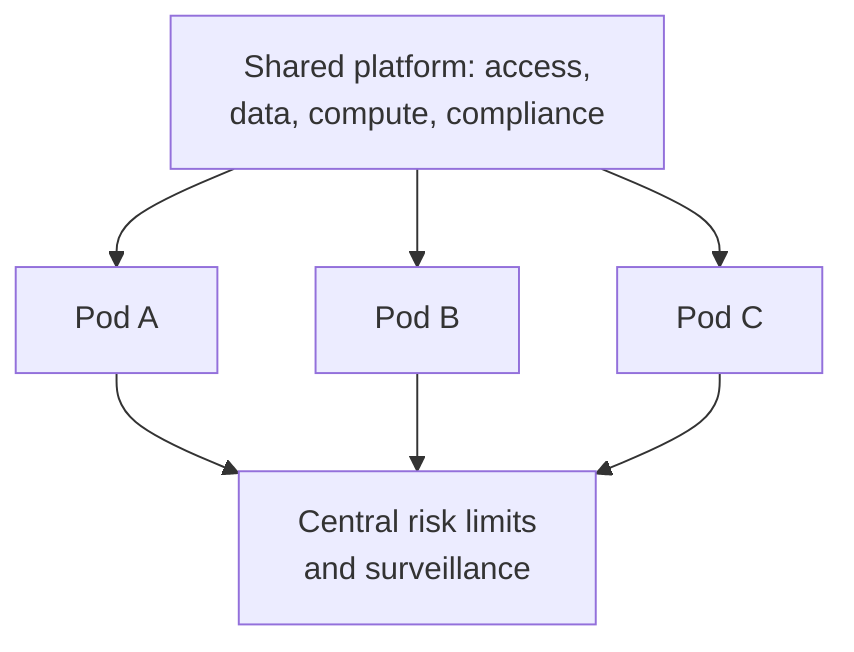

# Tower Research Capital

> **TL;DR**
>
> - New York proprietary firm, over 25 years old, built as a "team of teams": dozens of independent trading and research pods on one shared platform `[Verified]`.
> - It also sells client liquidity: US equities and ETFs, two European systematic internalisers, and OTC spot FX `[Verified]`.
> - In 2019 it paid a then-record \$67.4M to settle CFTC charges, alongside a DOJ deferred prosecution agreement, over spoofing by former traders in 2012–2013 `[Verified]`.

**Type:** proprietary trading platform (internal pods) · **Last verified:** 2026-11

| Field | Value |
|---|---|
| Type | Proprietary trading firm; chairman Mark Gorton, CEO Albert An `[Verified]` |
| Scale | Financials not disclosed; founded 1998 `[Reported]` |
| Horizon | "Any time horizon" across pods `[Verified]`; best known for high-frequency trading `[Reported]` |
| Known strategies | On-exchange [equity market making](../../02-strategies/a-liquidity-provision/equity-market-making.md) and FX liquidity provision `[Verified]`; other pod strategies undisclosed. Its HFT reputation suggests [latency arbitrage](../../02-strategies/b-speed-and-structural/latency-arbitrage.md) and [lead-lag](../../02-strategies/b-speed-and-structural/lead-lag-and-cross-asset-arbitrage.md) trades `[Lore]` |
| Tech signals | ML, wireless telecommunication and hardware acceleration in its engineering roles `[Verified]` |
| Confidence | Low-medium: structure verified, strategy mix inferred |
| Sources | Firm site, CFTC and DOJ releases (below) |

## What they do

Tower supplies market access, data, compute, risk management and compliance. Systematic portfolio managers build their own teams and strategies on top of that `[Verified]`. The pods trade "a massive range" of asset classes, products, regions and venues `[Verified]`. A liquidity-provision arm streams disclosed prices to counterparties, including ETF block trading `[Verified]`.

## Strategy focus and approach

There is no house strategy. Tower's book is the sum of its pods, so the firm is a [pod](../../09-reference/glossary.md#pod) platform like a multi-manager hedge fund, but trading its own capital. The [combining strategies page](../../02-strategies/h-cross-cutting/how-firms-combine-strategies.md) explains the economics. The platform's value is shared fixed cost: one set of exchange connections, data and compute spread over dozens of teams. Its biggest risk is the one the 2019 case shows. One team's conduct becomes the firm's liability, so [risk controls](../../03-algorithms/f-market-making-and-hft-algorithms/algorithmic-risk-controls.md) and surveillance must see every pod's orders.

## Fact vs lore

- **Fact:** the CFTC order covered [spoofing](../../09-reference/glossary.md#spoofing) in E-mini futures. It required \$32.6M of restitution, \$10.5M of disgorgement and a \$24.4M penalty. The orders were split into many randomly sized pieces to hide the pattern `[Verified]`.
- **Lore:** "Tower is the fastest HFT shop." Speed rankings are unpublished and unverifiable `[Lore]`.

## Related pages

- [How firms combine strategies](../../02-strategies/h-cross-cutting/how-firms-combine-strategies.md) · [Algorithmic risk controls](../../03-algorithms/f-market-making-and-hft-algorithms/algorithmic-risk-controls.md) · [Latency arbitrage](../../02-strategies/b-speed-and-structural/latency-arbitrage.md)
- [Rules that shape strategies](../../06-risk-and-regulation/rules-that-shape-strategies.md) · [Millennium (quant pods)](millennium.md) · [Jump Trading](jump-trading.md)

## Sources

- [Verified] Tower Research Capital (n.d.). Home page ("team of teams", pods). <https://www.tower-research.com/> (accessed 2026-11)
- [Verified] Tower Research Capital (n.d.). "About Us" (leadership, 25-year history). <https://www.tower-research.com/about> (accessed 2026-11)
- [Verified] Tower Research Capital (n.d.). "Liquidity Provision" (US equities and ETFs, European SIs, FX). <https://www.tower-research.com/liquidity-provision> (accessed 2026-11)
- [Verified] Tower Research Capital (n.d.). "Careers" (pod asset coverage, engineering focus). <https://www.tower-research.com/careers> (accessed 2026-11)
- [Verified] CFTC (2019-11-07). Release 8074-19: Tower Research Capital LLC to pay \$67.4 million for spoofing. <https://www.cftc.gov/PressRoom/PressReleases/8074-19> (accessed 2026-11)
- [Verified] U.S. Department of Justice (2019). "Tower Research Capital LLC Deferred Prosecution Agreement." <https://www.justice.gov/criminal/criminal-vns/tower-research-capital-llc-deferred-prosecution-agreement> (accessed 2026-11)
- [Reported] Wikipedia (n.d.). "Tower Research Capital" (founding year; secondary, flagged). <https://en.wikipedia.org/wiki/Tower_Research_Capital> (accessed 2026-11)
