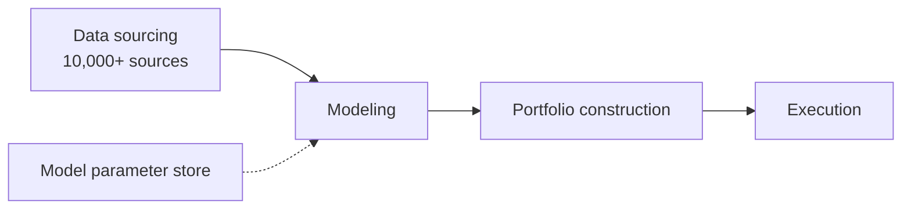

# Two Sigma

> **TL;DR**
>
> - A data-heavy systematic manager with \$80B+ under management and a market-making arm.
> - In 2025 it paid a \$90M SEC penalty after one employee's unreviewed model changes moved client returns by hundreds of millions.
> - As of August 2026 its co-founders were in arbitration over who runs the firm.

**Type:** systematic hedge fund and asset manager · **Last verified:** 2026-11

| Field | Value |
|---|---|
| Type | Systematic manager; also a broker-dealer, real estate and private equity arms `[Verified]` |
| Scale | \$80B+ AUM, ~1,700 people `[Verified]`; regulatory AUM \$232.8B (Form ADV, March 2026) `[Verified]` |
| Horizon | Not disclosed; strategies run across asset classes `[Verified]` |
| Known strategies | Systematic signals from large data sets; market making, intraday alpha, options, wholesale market making `[Verified]` |
| Tech signals | 10,000+ data sources, 380+ PB of storage (firm figures) `[Verified]` |
| Confidence | High on scale and legal matters; low on strategies |
| Sources | Firm website; Form ADV; SEC order (via law-firm summary); Hedgeweek |

## What they do

John Overdeck and David Siegel founded the firm in 2001 `[Verified]`. It describes a four-step pipeline: data sourcing and preparation, modeling, portfolio construction and execution `[Verified]`. Two Sigma Securities [makes markets](../../09-reference/glossary.md#market-making) and trades intraday alpha in equities, futures and ETFs, trades options and runs wholesale market making `[Verified]` (see [equity market making](../../02-strategies/a-liquidity-provision/equity-market-making.md)).

## Strategy focus and approach

The firm's identity is the data stack: thousands of raw data sets turned into features, then [machine-learned forecasts](../../02-strategies/c-statistical-arbitrage/ml-driven-short-horizon-alpha.md) (see [alternative data](../../02-strategies/d-mid-frequency-alpha/alternative-data.md)). Its published research shows the style: a Gaussian mixture over 17 factors that labels four market [regimes](../../03-algorithms/b-forecasting-models/regime-detection.md) `[Verified]`. The SEC case shows the operating model: models read parameters from a shared database, and one employee's edits to 14 models moved different funds' returns in opposite directions `[Reported]`. It is the standard [pipeline](../../03-algorithms/there-is-no-single-algorithm.md) at industrial scale. Specific signals, horizons and fund returns are not public.

## Fact vs lore

- **"The models run themselves."** No. Per the January 2025 SEC order, the edits ran from November 2021 to August 2023; some funds gained over \$400M and others lost about \$165M versus the unaltered models `[Reported]`. Staff had flagged open write access to the parameters since March 2019 `[Reported]`. Two Sigma repaid clients about \$165M and paid a \$90M penalty without admitting or denying the findings `[Reported]`. The lesson is model governance (see [live monitoring](../../03-algorithms/g-live-trading/live-monitoring-and-pnl-attribution.md)).
- **Leadership.** The founders stepped back as co-CEOs in 2024 `[Reported]`. The March 2026 Form ADV says Siegel named Seth Platt co-CEO, which is disputed, and that Platt's move to fire co-CEO Carter Lyons went to dispute resolution `[Verified]`. Two further arbitrations began in August 2026 `[Reported]`.
- **"Top-5 supercomputer."** A firm claim, not independently verified.

## Related pages

- [Cross-sectional alpha and neutralization](../../02-strategies/d-mid-frequency-alpha/cross-sectional-alpha-and-neutralization.md)
- [Feature engineering](../../03-algorithms/a-data-and-signals/feature-engineering.md)
- [Algorithmic risk controls](../../03-algorithms/f-market-making-and-hft-algorithms/algorithmic-risk-controls.md)

## Sources

- [Verified] Two Sigma (n.d.). Homepage and "Investment Management" pages (AUM, headcount, data sources, storage, process). <https://www.twosigma.com/businesses/investment-management/> (accessed 2026-11)
- [Verified] Two Sigma Investments, LP (2026-03-31). Form ADV annual amendment (Item 5.F; Schedule A; Schedule D Miscellaneous on executive officers). SEC IAPD, CRD 137137. <https://reports.adviserinfo.sec.gov/reports/ADV/137137/PDF/137137.pdf> (accessed 2026-11)
- [Reported] Morrison Foerster (2025-02-26). "Top 5 SEC Enforcement Developments for January 2025" (summary of the SEC's 2025-01-16 order against Two Sigma). <https://www.mofo.com/resources/insights/250226-top-5-sec-enforcement-developments> (accessed 2026-11)
- [Verified] Two Sigma (n.d.). "Securities: Systematic Trading and Market Making" (business lines). <https://www.twosigma.com/businesses/securities/> (accessed 2026-11)
- [Verified] Botte, A. & Bao, D. (2021). "A Machine Learning Approach to Regime Modeling." Two Sigma Street View. <https://www.twosigma.com/articles/a-machine-learning-approach-to-regime-modeling/> (accessed 2026-11)
- [Reported] Hedgeweek, citing Bloomberg (2026-04-02). "Two Sigma co-CEO resigned due to 'governance challenges'." <https://www.hedgeweek.com/two-sigma-co-ceo-resigned-due-to-governance-challenges/> (accessed 2026-11)
- [Reported] Hedgeweek, citing Bloomberg (2026-08-28). "Two Sigma founders face new arbitration battle." <https://www.hedgeweek.com/news/two-sigma-founders-face-new-arbitration-battle> (accessed 2026-11)
