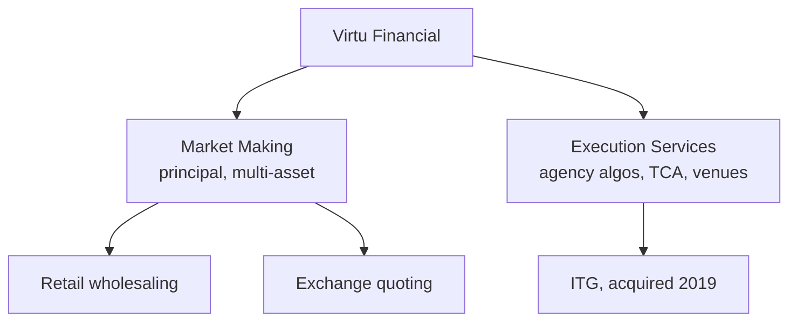

# Virtu Financial

> **TL;DR**
>
> - The one large US electronic market maker with public, audited accounts. FY2025 adjusted net trading income (ANTI) was \$2,145M, of which Market Making was \$1,666M `[Reported]`.
> - Two segments: principal Market Making, retail wholesaling included, and agency Execution Services, which absorbed ITG in 2019 `[Verified]`.
> - Current as of 2026-11: Aaron Simons has been CEO since August 2025, Q3 2026 ANTI rose 51% to \$704M, and the board approved moving incorporation from Delaware to Texas `[Reported]`.

**Type:** listed market maker and agency broker · **Last verified:** 2026-11

| Field | Value |
|---|---|
| Type | Public company (VIRT) with market-making and agency-execution segments `[Verified]` |
| Scale | FY2025 trading income, net \$2,436.7M; ANTI \$2,145M (Market Making \$1,666M, Execution Services \$479M); net income \$912.3M `[Reported]` |
| Horizon | Milliseconds to intraday; a hedged, high-turnover book `[Estimate]` |
| Known strategies | [Equity market making](../../02-strategies/a-liquidity-provision/equity-market-making.md) · [Retail flow internalization](../../02-strategies/a-liquidity-provision/retail-flow-internalization.md) · [ETF market making](../../02-strategies/a-liquidity-provision/etf-market-making.md) · agency [execution algorithms](../../03-algorithms/e-execution-algorithms/execution-algorithms-overview.md) |
| Tech signals | Agency algorithms, TCA and EMS products from ITG `[Reported]`; one losing day in 1,238 (2009–2013, IPO filing) `[Reported]` |
| Confidence | High for financials (SEC filings); low for strategy detail |
| Sources | 10-K, 10-Q and 8-K filings, SEC litigation, press (below) |

## What they do

Virtu commits capital as principal across equities, ETFs, fixed income, currencies and commodities. KCG, bought on 2017-07-20, added market making, agency execution and venues `[Verified]`. With Citadel Securities, Virtu handled over 70% of US retail flow in 2019–2022 data, making it the other giant [wholesaler](../../09-reference/glossary.md#wholesaler) `[Reported]`. ITG, bought on 2019-03-01 for about \$1.0B, fed Execution Services: algorithms, [TCA](../../03-algorithms/e-execution-algorithms/transaction-cost-analysis.md), workflow tools and venues `[Verified]`.

## Strategy focus and approach

The model is many tiny, hedged trades. Revenue scales with volume and volatility rather than capital: Q3 2026 ANTI averaged about \$11.0M a day, against \$7.4M a year earlier `[Reported]`. That is the [equity market making](../../02-strategies/a-liquidity-provision/equity-market-making.md) income statement at scale. Spread capture and retail segmentation earn the revenue, [adverse selection](../../03-algorithms/f-market-making-and-hft-algorithms/adverse-selection-and-markouts.md) is the cost of goods sold, and [risk controls](../../03-algorithms/f-market-making-and-hft-algorithms/algorithmic-risk-controls.md) cap inventory.

## Fact vs lore

- **Lore:** "Market making is riskless." **Fact:** the one-losing-day statistic covered 2009–2013 and reflects many small, diversified bets `[Reported]`. Virtu does not disclose daily P&L today, and its then-CEO said touting the record had backfired `[Reported]`.
- The SEC's 2023 information-barriers suit settled in December 2025 for \$2.5M. Virtu neither admitted nor denied, and the remaining claims were dismissed `[Reported]`.

## Related pages

- [Equity market making](../../02-strategies/a-liquidity-provision/equity-market-making.md) · [Retail flow internalization](../../02-strategies/a-liquidity-provision/retail-flow-internalization.md) · [Execution algorithms overview](../../03-algorithms/e-execution-algorithms/execution-algorithms-overview.md)
- [Economics and revenue pools](../economics-and-revenue-pools.md) · [Citadel Securities](citadel-securities.md)

## Sources

- [Verified] Virtu Financial, Inc. (2026-02). Form 10-K for fiscal year 2025. *SEC EDGAR*. <https://www.sec.gov/Archives/edgar/data/1592386/000159238626000009/virt-20251231.htm> (accessed 2026-11)
- [Reported] Virtu Financial (2026). Fourth quarter and full year 2025 results release. <https://ir.virtu.com/static-files/9eb593ae-ae7d-42bb-baa3-e0cbaa179c6b> (accessed 2026-11)
- [Reported] Virtu Financial (2026-11-05). "Virtu Announces Third Quarter 2026 Results" (Form 8-K exhibit 99.1; ANTI, Texas redomestication). <https://www.sec.gov/Archives/edgar/data/0001592386/000110465926123022/tm2629046d1_ex99-1.htm> (accessed 2026-11)
- [Verified] Virtu Financial, Inc. (2020-02). Form 10-K for fiscal year 2019 (KCG and ITG closing dates). <https://www.sec.gov/Archives/edgar/data/0001592386/000159238620000003/virtufinancial12-31x19.htm> (accessed 2026-11)
- [Reported] Virtu Financial (2025-07). "Virtu Financial Announces Retirement of Douglas Cifu and Names Aaron Simons as New CEO." <https://ir.virtu.com/news-releases/news-release-details/virtu-financial-announces-retirement-douglas-cifu-and-names> (accessed 2026-11)
- [Reported] NBER conference paper (2023), study of US retail wholesaler concentration using 2019–2022 data. <https://conference.nber.org/conf_papers/f187847/f187847.pdf> (accessed 2026-11)
- [Reported] Alston & Bird (2025-12-17). Advisory on the SEC–Virtu settlement over customer information controls. <https://www.alston.com/en/insights/publications/2025/12/sec-virtu-customer-mnpi-controls> (accessed 2026-11)
- [Reported] Business Insider (2014). Coverage of Virtu Financial's S-1: one losing trading day in 1,238. <https://businessinsider.in/everyones-talking-about-the-high-frequency-trading-firm-that-just-had-1-day-of-trading-losses-in-1238-days/amp_articleshow/31849923.cms> (accessed 2026-11)
- [Reported] Bloomberg (2014-06-04). "Virtu Touting Near-Perfect Record of Profits Backfired, CEO Says." <https://www.bloomberg.com/news/articles/2014-06-04/virtu-touting-near-perfect-record-of-profits-backfired-ceo-says> (accessed 2026-11)
