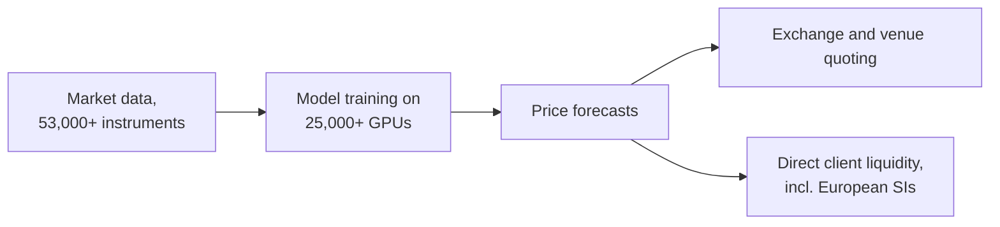

# XTX Markets

> **TL;DR**
>
> - London algorithmic trading firm founded in 2015 `[Reported]` by Alex Gerko, previously head of FX trading at GSA Capital and now co-CEO `[Reported]`. It produces ML price forecasts for 53,000+ instruments across equities, fixed income, currencies, commodities and crypto `[Verified]`.
> - Few people, enormous compute: about 300 employees, over 25,000 GPUs and over 1 exabyte of storage, and it is building its own data centres in Finland `[Verified]`.
> - Its 2025 net revenue across three UK entities was £3.93B (+43%) and profit £1.71B, per Companies House filings `[Reported]`. Its systematic internaliser ranked first in European ELP volume for 2025 `[Verified]`.

**Type:** non-bank electronic liquidity provider · **Last verified:** 2026-11

| Field | Value |
|---|---|
| Type | Principal trading on exchanges and alternative venues, plus direct client liquidity `[Verified]` |
| Scale | £3.93B combined net revenue in 2025 `[Reported]`; ~\$250bn daily traded volume and ~300 staff (firm) `[Verified]`; ~£13M revenue per employee `[Estimate]` (£3.93B ÷ 300) |
| Horizon | Short-horizon forecasts, seconds to hours `[Estimate]` |
| Known strategies | [ML-driven short-horizon alpha](../../02-strategies/c-statistical-arbitrage/ml-driven-short-horizon-alpha.md) · [Equity market making](../../02-strategies/a-liquidity-provision/equity-market-making.md) |
| Tech signals | 25,000+ GPU research cluster; TernFS, an exabyte-scale in-house file system (2025); Kajaani data centre with 22.5MW of IT power in phase one `[Verified]` |
| Confidence | Medium-high: UK filings plus firm statements |
| Sources | Firm site and releases, Companies House coverage, FT (below) |

## What they do

XTX uses its forecasts to trade on exchanges and alternative venues, and to offer liquidity directly to clients worldwide `[Verified]`. Its UK and EU systematic internalisers traded €177bn of European cash equities with clients in 2025, an average of €693M a day. It ranked first among electronic liquidity providers in five of the past six years `[Verified]`.

## Strategy focus and approach

This is forecast-first [market making](../../09-reference/glossary.md#market-making). Statistical models forecast prices for tens of thousands of instruments, and quotes and hedges follow the forecasts `[Verified]`. The firm says these are deep learning models that need large-scale compute `[Verified]`; the [feature engineering](../../03-algorithms/a-data-and-signals/feature-engineering.md) and [neural nets](../../03-algorithms/b-forecasting-models/neural-nets-and-sequence-models.md) cards show the generic toolkit. The [ML short-horizon dossier](../../02-strategies/c-statistical-arbitrage/ml-driven-short-horizon-alpha.md) covers the mechanics. A client stream pays only if the forecast anticipates [adverse selection](../../09-reference/glossary.md#adverse-selection).

## Fact vs lore

- **Lore:** "XTX has no traders, only machines." The firm describes its staff as researchers, developers and technologists `[Verified]`. Whether discretionary overrides exist is not public `[Lore]`.
- **Fact:** profits sit in UK entities that pay dividends to a Cayman holding company, £1.78B in 2025 `[Reported]`. XTX has welcomed growing US appetite for order-by-order competition in off-exchange retail flow `[Verified]`.

## Related pages

- [ML-driven short-horizon alpha](../../02-strategies/c-statistical-arbitrage/ml-driven-short-horizon-alpha.md) · [Neural nets and sequence models](../../03-algorithms/b-forecasting-models/neural-nets-and-sequence-models.md) · [Retail flow internalization](../../02-strategies/a-liquidity-provision/retail-flow-internalization.md)
- [Hudson River Trading](hudson-river-trading.md) · [Semiconductor lens](../../05-infrastructure/semiconductor-lens.md)

## Sources

- [Verified] XTX Markets (n.d.). Home page (instruments, GPUs, storage, volume, headcount). <https://www.xtxmarkets.com/> (accessed 2026-11)
- [Verified] XTX Markets (2026-01-28). "XTX Markets Tops ELP SI Ranking" (citing Rosenblatt). <https://www.xtxmarkets.com/news/2026-xtx-markets-tops-elp-si-ranking> (accessed 2026-11)
- [Verified] XTX Markets (2025-01-22). "XTX Markets plans to invest over €1bn in large-scale data centre project in Finland." <https://files.xtxmarkets.com/publications/kajaani/index.html> (accessed 2026-11)
- [Verified] XTX Markets (2025-09). "TernFS: an exabyte scale, multi-region distributed filesystem." *XTX Tech Blog*. <https://www.xtxmarkets.com/tech/2025-ternfs/> (accessed 2026-11)
- [Reported] Finance Magnates (2026-04-03). "XTX Markets Revenue Rises 43% to £3.93 Billion in 2025." <https://www.financemagnates.com/forex/brokers/xtx-markets-revenue-rises-43-to-393-billion-in-2025/> (accessed 2026-11)
- [Reported] Bloomberg (2026-04-02). "Gerko's XTX Markets Earnings Rise 33% on Global Trading Surge." <https://www.bloomberg.com/news/articles/2026-04-02/gerko-s-xtx-markets-earnings-rise-33-on-global-trading-surge> (accessed 2026-11)
- [Reported] Rosenblatt Securities (n.d.). "Alex Gerko" (EMSC speaker biography: founder and co-CEO, formerly head of FX trading at GSA Capital). <https://www.rblt.com/emsc-biography/alex-gerko> (accessed 2026-11)
- [Reported] Wikipedia (n.d.). "XTX Markets" (founding year; secondary, flagged). <https://en.wikipedia.org/wiki/XTX_Markets> (accessed 2026-11)
- [Reported] Financial Times (2025-01). "XTX Markets to build vast data centre in Finland." <https://www.ft.com/content/a9989e23-3033-4ff9-97dc-815f360a6955> (accessed 2026-11)
