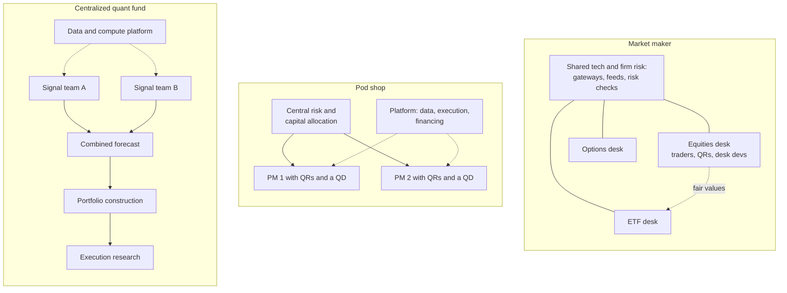

# Roles, teams and careers

> **TL;DR**
>
> - Five core roles: the **quant researcher** (QR) finds and validates signals, the **quant trader** (QT) runs strategies live, the **quant developer** (QD) turns research into production code, the **software engineer** (SWE) builds shared infrastructure, and the **portfolio manager** (PM) owns capital and a P&L. Titles vary by firm.
> - Three ways to organize: market makers run product desks on shared technology; pod shops run PM-led teams with their own P&L; centralized funds run signal teams that feed one model.
> - Pay structure follows the org chart. Few figures are public: Jane Street's 2025 pay pool was reportedly \$9.38B `[Reported]`, and star pod PMs have been offered packages above \$100M `[Reported]`.
> - To place someone quickly, ask who owns the P&L they work on.

**Level:** Core · **Read time:** ~6 min · **Last verified:** 2026-11

## The roles

| Role | Owns | Produces | Judged by |
|---|---|---|---|
| Quant researcher (QR) | hypotheses, signals, models | backtests, [alpha](../09-reference/glossary.md#alpha) signals, research notes | out-of-sample [IC](../03-algorithms/a-data-and-signals/evaluating-signals.md), marginal contribution to the combined forecast, live P&L |
| Quant trader (QT) | live strategies, parameters, limits, exceptions | parameter changes, risk decisions, post-trade reviews | P&L, [markouts](../03-algorithms/f-market-making-and-hft-algorithms/adverse-selection-and-markouts.md), risk discipline |
| Quant developer (QD) | the team's code: simulators, feature pipelines, strategy logic | research-to-production handoffs, [backtesting engines](../03-algorithms/c-validation-and-backtesting/backtesting-engines.md) | correctness, speed of iteration |
| Software engineer (SWE) | shared systems: feed handlers, order gateways, FPGAs, data and compute platforms | infrastructure every desk uses | latency, uptime, throughput ([tech stacks](../05-infrastructure/trading-and-research-tech-stacks.md)) |
| Portfolio manager (PM) | capital and a P&L | positions, risk, hiring | [Sharpe ratio](../09-reference/glossary.md#sharpe-ratio), drawdown against limits, capacity |

Around them sit risk managers, execution researchers, data engineers who source and clean datasets, and compliance. The lines blur in practice. A market maker's "trader" usually supervises automated systems and often writes code; a QR at a small firm also ships production code `[Lore]`.

## Three ways to organize

**Market maker.** Teams are cut by product and region: US equities, ETFs, options, futures. Each desk mixes traders, researchers and desk developers. A central group owns exchange gateways, market data and [pre-trade risk checks](../03-algorithms/f-market-making-and-hft-algorithms/algorithmic-risk-controls.md). Strategies run as continuous automated loops ([M1](../03-algorithms/f-market-making-and-hft-algorithms/anatomy-of-an-hft-trading-loop.md)); people tune parameters and handle exceptions such as halts, corporate actions and new listings. Desks depend on each other: the ETF desk needs the equity desk's [fair values](../03-algorithms/f-market-making-and-hft-algorithms/fair-value-and-microprice.md). That is one reason firm-wide bonus pools are common `[Lore]`.

**Pod shop.** A PM leads a small team, often a few QRs and a developer `[Lore]`, with its own signals, optimizer and P&L. The platform supplies data, a risk model, execution and financing. Central risk allocates capital and enforces drawdown stops; Millennium reportedly halves a PM's capital after a 5% loss and is likely to part ways near 7.5% `[Reported]`. The PM is paid a share of the pod's own P&L, commonly said to be 15–20% `[Lore]`, and pays the team from it.

**Centralized quant fund.** Research groups are cut by signal type or horizon. Their forecasts feed one [alpha combination](../03-algorithms/b-forecasting-models/alpha-combination-and-ensembling.md) model, then a portfolio-construction team and an execution team. A core platform owns data and compute. Researchers often see only part of the model `[Lore]`. Credit is assigned by attribution, which pushes researchers toward signals uncorrelated with what the model already has.

The trade-off between the last two models is old. Sharpe (1981) and van Binsbergen, Brandt and Koijen (2008) analyze what a firm loses by splitting a portfolio among independent managers `[Verified]`. Pods buy accountability and independent ideas; one book saves the costs of duplicated hedges and offsetting trades ([how firms combine strategies](../02-strategies/h-cross-cutting/how-firms-combine-strategies.md)).

## Pay: what is public

Almost nothing is disclosed. The figures below are press reports from unnamed sources.

| Firm type | Structure | Public data point |
|---|---|---|
| Market maker | discretionary bonus from a firm-wide pool `[Lore]` | Jane Street's 2025 pool was reportedly \$9.38B, more than double 2024, about \$2.68M per employee on roughly 3,500 staff `[Reported]`; that is about 24% of its reported revenue `[Estimate]` |
| Pod shop | formula payout on own pod P&L `[Lore]` | multi-managers have offered star PMs packages above \$100M over several years (2025) `[Reported]`; Bloomberg reported \$120M offers in 2023 `[Reported]` |
| Centralized fund | discretionary, by attributed contribution `[Lore]` | not disclosed |

An average is not a typical salary: a few large bonuses dominate it. Structure shapes behavior. A shared pool rewards sharing models across desks. A pod payout rewards guarding ideas and hedging every factor, because the PM keeps a share of gains but not of losses ([pod economics](../02-strategies/h-cross-cutting/how-firms-combine-strategies.md)). Attribution rewards orthogonal signals.

## Using this in conversation

"Who owns the P&L you work on?" places a person in one question. A QR at a centralized fund may never see a dollar figure for their own signal. A pod PM knows theirs to the basis point. A market-making trader thinks in edge per share and [markouts](../09-reference/glossary.md#markout). More openers are in the [questions to ask](../07-conversation-playbook/questions-to-ask.md) page.

## Related pages

- [Taxonomy of quant firms](taxonomy-of-quant-firms.md)
- [How firms combine strategies](../02-strategies/h-cross-cutting/how-firms-combine-strategies.md)
- [Alpha combination and ensembling](../03-algorithms/b-forecasting-models/alpha-combination-and-ensembling.md)
- [Anatomy of an HFT trading loop](../03-algorithms/f-market-making-and-hft-algorithms/anatomy-of-an-hft-trading-loop.md)
- [Trading and research tech stacks](../05-infrastructure/trading-and-research-tech-stacks.md)
- [How to talk to a quant](../07-conversation-playbook/how-to-talk-to-a-quant.md)

## Sources

- [Reported] Bloomberg Law (2026-05-01). "Jane Street's Pay Pool More Than Doubled to \$9.4 Billion in 2025" (per-employee average from syndicated coverage of the same report). <https://news.bloomberglaw.com/securities-law/jane-streets-pay-pool-more-than-doubled-to-9-4-billion-in-2025> (accessed 2026-11)
- [Reported] Reuters via MarketScreener (2026-04-24). "Jane Street's \$40 billion trading haul tops rivals, sources say." <https://www.marketscreener.com/news/jane-street-s-40-billion-trading-haul-tops-rivals-sources-say-ce7f59dfdf8ff52d> (accessed 2026-11)
- [Reported] Hedgeweek (2025-06). "Multi-manager hedge funds escalate talent war arms race with nine-figure pay packages" (citing the Wall Street Journal). <https://www.hedgeweek.com/multi-manager-hedge-funds-escalate-talent-war-arms-race-with-nine-figure-pay-packages/> (accessed 2026-11)
- [Reported] Advisor Perspectives, republishing Bloomberg (2023-06-02). "Hedge Funds at War for Top Traders Dangle \$120 Million Payouts." <https://www.advisorperspectives.com/articles/2023/06/02/hedge-fund-top-traders-dangle-120-million-payouts-bloomberg> (accessed 2026-11)
- [Reported] Business Insider via AOL (2024-10-02). "The strategy a \$69 billion hedge fund uses to make sure it never loses money in the stock market" (citing the Wall Street Journal). <https://www.aol.com/strategy-69-billion-hedge-fund-193733084.html> (accessed 2026-11)
- [Verified] Sharpe, W. F. (1981). "Decentralized Investment Management." *Journal of Finance* 36(2), 217–234. <https://doi.org/10.1111/j.1540-6261.1981.tb00436.x> (accessed 2026-11)
- [Verified] van Binsbergen, J. H., Brandt, M. W. & Koijen, R. S. J. (2008). "Optimal Decentralized Investment Management." *Journal of Finance* 63(4), 1849–1895. <https://doi.org/10.1111/j.1540-6261.2008.01376.x> (accessed 2026-11)
