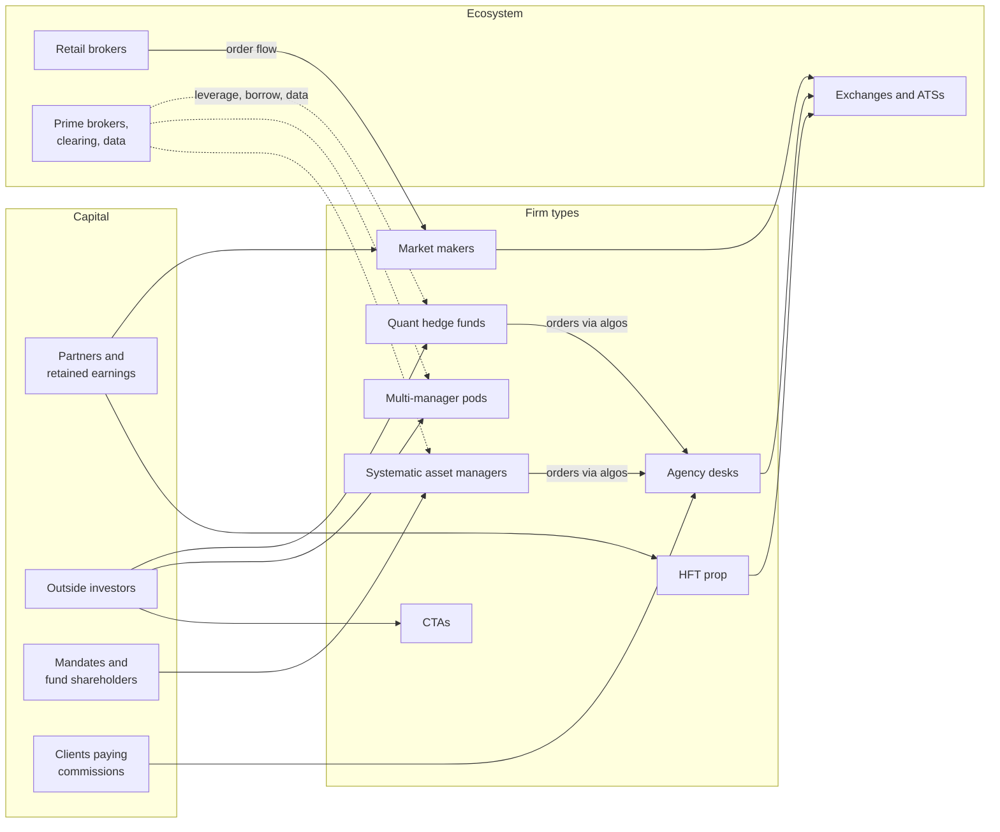

# Taxonomy of quant firms

> **TL;DR**
>
> - Seven kinds of firm trade US equities quantitatively, surrounded by an ecosystem that sells them access, data, leverage and plumbing. Their math overlaps a lot. What separates them is **whose capital is at risk and how the decision-makers get paid**.
> - Own-capital firms (market makers, HFT prop) are limited by volume and speed, not by money, so they rarely take outside investors. Fee-earning funds are limited by market impact, which makes capacity a negotiation between manager and investor.
> - Each type gravitates to particular strategy families: market makers to liquidity provision, HFT prop to speed and structure, quant funds and pods to stat arb and mid-frequency alpha, asset managers and CTAs to risk premia and trend.
> - The lines blur. In 2025, non-bank liquidity providers earned more from proprietary trading than from market making `[Reported]`.

**Level:** Core · **Read time:** ~7 min · **Last verified:** 2026-11

[The big picture](../00-start-here/the-big-picture.md) maps firm types by horizon and edge. This page explains why each sits where it does: capital source sets the horizon, the horizon sets the edge, and pay structure sets behavior.

## The types at a glance

| Type | Capital source | Who decides, and how they are paid | Horizon | Edge | Strategy families it runs | Profiles |
|---|---|---|---|---|---|---|
| Electronic market makers ([proprietary trading firms](../09-reference/glossary.md#proprietary-trading-firm)) | partners' and retained capital, plus bonds; Virtu is listed | traders and researchers, paid from a firm-wide bonus pool `[Lore]` | µs to minutes; little inventory at the close | liquidity provision · speed · structural | [Equity MM](../02-strategies/a-liquidity-provision/equity-market-making.md) · [ETF MM](../02-strategies/a-liquidity-provision/etf-market-making.md) · [options MM](../02-strategies/a-liquidity-provision/options-market-making.md) · [retail internalization](../02-strategies/a-liquidity-provision/retail-flow-internalization.md) · [auctions](../02-strategies/a-liquidity-provision/auctions-and-closing-liquidity.md) | [Citadel Securities](firm-profiles/citadel-securities.md) · [Virtu](firm-profiles/virtu-financial.md) · [Jane Street](firm-profiles/jane-street.md) · [Optiver](firm-profiles/optiver.md) · [IMC](firm-profiles/imc.md) · [SIG](firm-profiles/susquehanna-sig.md) · [XTX](firm-profiles/xtx-markets.md) |
| HFT prop (liquidity-taking) | own capital | small strategy teams, often paid on their own P&L `[Lore]` | µs to seconds | speed · structural | [Latency arbitrage](../02-strategies/b-speed-and-structural/latency-arbitrage.md) · [lead-lag](../02-strategies/b-speed-and-structural/lead-lag-and-cross-asset-arbitrage.md) · [ETF and index arb](../02-strategies/b-speed-and-structural/etf-and-index-arbitrage.md) · [fee and microstructure](../02-strategies/b-speed-and-structural/fee-and-microstructure-driven-strategies.md) | [HRT](firm-profiles/hudson-river-trading.md) · [Jump](firm-profiles/jump-trading.md) · [Tower](firm-profiles/tower-research-capital.md) |
| Quant hedge funds (centralized) | outside investors and employees | firm earns a performance fee; staff bonuses follow attributed contribution `[Lore]` | minutes to weeks | informational · behavioral | [Stat arb](../02-strategies/c-statistical-arbitrage/stat-arb-overview-and-history.md) · [ML short-horizon alpha](../02-strategies/c-statistical-arbitrage/ml-driven-short-horizon-alpha.md) · [cross-sectional alpha](../02-strategies/d-mid-frequency-alpha/cross-sectional-alpha-and-neutralization.md) · [alternative data](../02-strategies/d-mid-frequency-alpha/alternative-data.md) · [NLP and LLM signals](../02-strategies/d-mid-frequency-alpha/nlp-and-llm-signals.md) | [Renaissance](firm-profiles/renaissance-technologies.md) · [D. E. Shaw](firm-profiles/de-shaw.md) · [Two Sigma](firm-profiles/two-sigma.md) · [High-Flyer](firm-profiles/high-flyer.md) |
| Multi-manager quant [pods](../09-reference/glossary.md#pod) | outside investors, usually paying [pass-through fees](../09-reference/glossary.md#pass-through-fees) | each PM keeps a share of the pod's own P&L `[Lore]` under drawdown stops `[Reported]` | hours to weeks | informational · behavioral, strictly market-neutral | [Factor-residual reversion](../02-strategies/c-statistical-arbitrage/factor-residual-mean-reversion.md) · [short-term reversal](../02-strategies/c-statistical-arbitrage/short-term-cross-sectional-reversal.md) · [earnings and events](../02-strategies/d-mid-frequency-alpha/earnings-and-event-driven.md) · [analyst revisions](../02-strategies/d-mid-frequency-alpha/analyst-revisions-and-sentiment.md) · [flow-driven](../02-strategies/d-mid-frequency-alpha/flow-driven-strategies.md) | [Millennium](firm-profiles/millennium.md) · [Cubist](firm-profiles/cubist.md) |
| Systematic asset managers | institutional mandates, mutual funds, ETFs | management fees on assets, some performance fees | weeks to months | risk premium · behavioral | [Factor investing](../02-strategies/e-risk-premia-and-factors/factor-investing-fundamentals.md) · [momentum](../02-strategies/e-risk-premia-and-factors/momentum.md) · [value, quality, low vol](../02-strategies/e-risk-premia-and-factors/value-quality-low-vol.md) · [fundamental signals](../02-strategies/d-mid-frequency-alpha/fundamental-quant-signals.md) | [AQR](firm-profiles/aqr.md) · [Man Group (Numeric)](firm-profiles/man-group.md) |
| [CTAs](../09-reference/glossary.md#commodity-trading-advisor-cta) / managed futures | outside investors | management and performance fees | weeks to months | behavioral · risk premium | [Trend following](../02-strategies/g-futures-and-macro-context/trend-following-and-ctas.md) · [carry](../02-strategies/g-futures-and-macro-context/carry-and-cross-asset-risk-premia.md) | [Man Group (AHL)](firm-profiles/man-group.md) |
| Agency execution (bank and broker algo desks) | the broker's balance sheet; little principal risk | commissions; client retention | an order's life: minutes to days | none sought: minimize the client's cost | [Execution algorithms](../03-algorithms/e-execution-algorithms/execution-algorithms-overview.md) · [closing auctions](../02-strategies/a-liquidity-provision/auctions-and-closing-liquidity.md) | — |

Classifications follow public descriptions `[Reported]`. Volatility strategies ([VRP and vol arb](../02-strategies/f-volatility-and-derivatives/volatility-risk-premium-and-vol-arb.md), [dispersion](../02-strategies/f-volatility-and-derivatives/dispersion-and-correlation-trading.md)) sit with options market makers and multi-strategy funds.

## Capital source decides the rest

**Own capital.** A market maker's revenue is capped by volume and spread, not equity: it turns its balance sheet over many times a day. Jane Street reported members' equity of about \$29.9B at end-2024, against \$20.5B of net trading revenue that year `[Reported]`. Outside equity is rare and strategic: Citadel Securities sold a \$1.15B minority stake to Sequoia and Paradigm in January 2022 `[Reported]`. Jane Street borrows instead; it issued \$1.35B of senior secured notes in April 2025 `[Reported]`. Owners keep all the upside, so they protect the franchise.

**Outside investors.** A fund's revenue is fees on assets, so it can grow with capital even while the return on each dollar falls. That puts [capacity](../09-reference/glossary.md#capacity) at the center of the manager-investor relationship ([economics page](economics-and-revenue-pools.md)). Investors can redeem, so drawdowns threaten the business: pods stop out PMs, and centralized funds cut risk book-wide. Renaissance resolved the conflict by removing outsiders from its Medallion fund, which has been open only to employees since the mid-2000s `[Reported]`. Economically, Medallion is closer to a prop firm.

**Mandates and commissions.** Asset managers are paid on assets and judged against benchmarks, so tracking error binds and they harvest slow, high-capacity premia. Agency desks are paid per share to execute someone else's decision; their scorecard is [transaction cost analysis](../09-reference/glossary.md#transaction-cost-analysis-tca), their conflict the broker's own venues and flow.

## What kills each type

- **Market makers** fail through [adverse selection](../09-reference/glossary.md#adverse-selection) and operational accidents, not directional bets. Knight Capital lost over \$460M in about 45 minutes in 2012 `[Verified]` ([failure gallery](../02-strategies/h-cross-cutting/strategy-failure-gallery.md)).
- **HFT prop** fails when it loses the speed race; second place earns almost nothing. Latency races cost global equity markets about \$5B a year, mostly won by a few firms `[Verified]`.
- **Quant hedge funds** fail through crowding and decay. In August 2007, funds holding similar positions lost together `[Verified]`.
- **Pods** fail when supposedly independent PMs draw down at the same time, or when investors balk at pass-through costs ([how firms combine strategies](../02-strategies/h-cross-cutting/how-firms-combine-strategies.md)).
- **Systematic asset managers** fail slowly, through long factor droughts. HML fell 51% from January 2017 to September 2020 `[Verified]` ([quant winters](../02-strategies/e-risk-premia-and-factors/factor-timing-crowding-and-quant-winters.md)).
- **CTAs** bleed in choppy, trendless years ([trend dossier](../02-strategies/g-futures-and-macro-context/trend-following-and-ctas.md)).
- **Agency desks** fail through fee compression and lost client trust. ITG paid \$20.3M in 2015 over a secret desk that used dark-pool subscribers' order information `[Verified]`.

## The ecosystem

| Supplier | Sells | Why it matters for strategies |
|---|---|---|
| Exchanges and ATSs | execution, [colocation](../09-reference/glossary.md#colocation), proprietary feeds, rebates | fee tiers set a market maker's unit economics ([fees and rebates](../01-market-structure/fees-rebates-and-ticks.md)) |
| Data vendors | market data, fundamentals, alternative data, risk models | point-in-time history is a barrier to entry; MSCI Barra and Axioma (now part of SimCorp) supply standard [risk models](../03-algorithms/d-portfolio-construction/risk-models.md) `[Reported]` |
| Prime brokers | leverage, stock borrow, financing, crowding reports | borrow cost and availability cap short books ([shorting and financing](../01-market-structure/shorting-financing-and-settlement.md)) |
| Clearing firms and CCPs | clearing, margin | volatility turns into same-day margin calls |
| Retail brokers | order flow, for [payment for order flow](../09-reference/glossary.md#payment-for-order-flow-pfof) | the raw material of [retail internalization](../02-strategies/a-liquidity-provision/retail-flow-internalization.md) |
| Technology vendors | FPGAs, network cards, microwave links, GPUs | the speed race ([semiconductor lens](../05-infrastructure/semiconductor-lens.md)) |

Exchanges increasingly behave like data and software companies; their acquisitions are on the [M&A page](competitive-dynamics-and-ma.md).

## Where the lines blur

- **Market makers take directional risk.** Coalition Greenwich put non-bank liquidity providers' 2025 trading revenue at about \$114B: \$84.3B from proprietary trading and \$30.2B from market making `[Reported]`.
- **One brand, two firms.** Citadel, the hedge fund, and Citadel Securities, the market maker, are separate companies `[Reported]` ([profile](firm-profiles/citadel-securities.md)).
- **One manager, several types.** Man Group runs AHL, a trend-following CTA, and Numeric, a systematic equity manager `[Reported]` ([profile](firm-profiles/man-group.md)).

## Related pages

- [The big picture](../00-start-here/the-big-picture.md)
- [Economics and revenue pools](economics-and-revenue-pools.md)
- [Roles, teams and careers](roles-teams-and-careers.md)
- [How firms combine strategies](../02-strategies/h-cross-cutting/how-firms-combine-strategies.md)
- [Strategy comparison matrix](../02-strategies/h-cross-cutting/strategy-comparison-matrix.md)
- [How quants evaluate a strategy](../02-strategies/how-quants-evaluate-a-strategy.md)
- [Firm profiles](firm-profiles/index.md)

## Sources

- [Reported] Hedgeweek (2026). "Non-bank trading firms surge as Jane Street and Citadel Securities drive record \$114bn revenue pool" (Crisil Coalition Greenwich data). <https://www.hedgeweek.com/non-bank-trading-firms-surge-as-jane-street-and-citadel-securities-drive-record-114bn-revenue-pool/> (accessed 2026-11)
- [Reported] FI Desk (2025-04). "Jane Street issues US\$1.35 billion bond as market makers bulk up balance sheets" (members' equity and 2024 revenue from the offering memorandum). <https://www.fi-desk.com/jane-street-issues-us1-35-billion-bond-as-market-makers-bulk-up-balance-sheets/> (accessed 2026-11)
- [Reported] Cahill Gordon & Reindel (2025-04-25). "Cahill Represents Initial Purchasers in Jane Street's \$1.35 Billion Notes Offering." <https://www.cahill.com/news/firm-news/2025-04-25-cahill-represents-initial-purchasers-in-jane-streets-135-billion-notes-offering> (accessed 2026-11)
- [Reported] The TRADE (2022-01-11). "Citadel Securities receives \$1.15 billion investment from Sequoia and Paradigm." <https://www.thetradenews.com/citadel-securities-receives-1-15-billion-investment-from-sequoia-and-paradigm/> (accessed 2026-11)
- [Reported] Morningstar (2020). "Medallion Fund Is Like No Other" (Rekenthaler Report; outside investors cashed out in the mid-2000s, citing Bloomberg). <https://www.morningstar.com/columns/rekenthaler-report/medallion-fund-is-like-no-other> (accessed 2026-11)
- [Verified] SEC (2013-10-16). In the Matter of Knight Capital Americas LLC, Release No. 34-70694. <https://www.sec.gov/litigation/admin/2013/34-70694.pdf> (accessed 2026-11)
- [Verified] Aquilina, M., Budish, E. & O'Neill, P. (2022). "Quantifying the High-Frequency Trading 'Arms Race'." *Quarterly Journal of Economics* 137(1), 493–564. <https://doi.org/10.1093/qje/qjab032> (accessed 2026-11)
- [Verified] Khandani, A. E. & Lo, A. W. (2011). "What happened to the quants in August 2007? Evidence from factors and transactions data." *Journal of Financial Markets* 14(1), 1–46. <https://doi.org/10.1016/j.finmar.2010.07.005> (accessed 2026-11)
- [Verified] French, K. R. "Data Library: Fama/French 3 factors," monthly through 2026-09 (HML drawdown is our computation). <https://mba.tuck.dartmouth.edu/pages/faculty/ken.french/data_library.html> (accessed 2026-11)
- [Verified] SEC (2015-08-12). "SEC charges ITG with operating secret trading desk and misusing dark pool subscriber trading information." Press release 2015-164. <https://www.sec.gov/news/pressrelease/2015-164.html> (accessed 2026-11)
- [Verified] SimCorp. "Axioma factor risk models" (product page). <https://www.simcorp.com/solutions/axioma-solutions/axioma-factor-risk-models> (accessed 2026-11)
