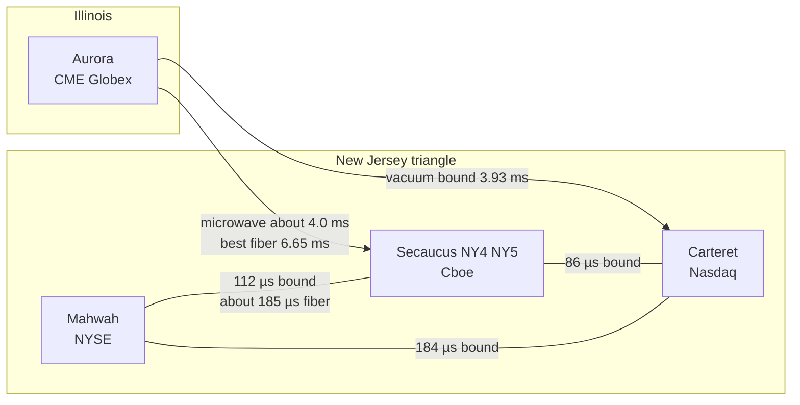

# Colocation, networks and the speed of light

> **TL;DR**
>
> - US equities trade in a triangle of New Jersey data centers: NYSE in Mahwah, Nasdaq in Carteret, Cboe in Secaucus. US equity-index futures trade in Aurora, Illinois. Colocation means renting rack space next to the matching engine.
> - Light covers 1 km in 3.34 µs in air or vacuum but takes about 4.9 µs in glass fiber. Microwave between Chicago and New Jersey (about 4 ms one way) therefore beats the best 2010-era fiber (6.65 ms) by more than 2.5 ms.
> - Today's best radio routes sit within a few percent of the physical limit, so the race is over the last microseconds and over weather, not new physics.
> - Millimeter wave and free-space optics serve short hops; hollow-core fiber gives fiber's reliability at nearly radio speed, so far on short routes.

**Level:** Core · **Read time:** ~6 min · **Last verified:** 2026-11

Distance is the one cost no software removes. These are the numbers behind [latency arbitrage](../02-strategies/b-speed-and-structural/latency-arbitrage.md), [lead-lag arbitrage](../02-strategies/b-speed-and-structural/lead-lag-and-cross-asset-arbitrage.md) and the [HFT loop](../03-algorithms/f-market-making-and-hft-algorithms/anatomy-of-an-hft-trading-loop.md).

## Where the matching engines are

| Venue group | Primary data center | Confidence |
|---|---|---|
| NYSE group (NYSE, Arca, National and others) | ICE's Mahwah, New Jersey data center, opened for trading in 2010 | `[Verified]` ICE site; opening date `[Reported]` |
| Nasdaq exchanges | Equinix NY11, Carteret, New Jersey | `[Reported]` |
| Cboe US equities (BZX, BYX, EDGX, EDGA) and Cboe options | Equinix NY5, Secaucus, New Jersey; points of presence in NY4 and NY6; backup in Chicago | `[Verified]` Cboe connectivity manual, Oct 2026 |
| CME Globex (E-mini futures) | CyrusOne, Aurora, Illinois, under a 15-year sale-leaseback from 2016 | `[Verified]` CME |

[Colocation](../09-reference/glossary.md#colocation) buys three things: rack space and power in the exchange's building, a cross-connect to the exchange's network, and the exchange's binary [direct feeds](../09-reference/glossary.md#direct-feed). Inside the building a meter of fiber adds about 4.9 ns, so exchanges equalize cable lengths: Cboe engineers every cross-connect from NY4, NY5 or NY6 to the same latency to its gateways in NY5 `[Verified]`. Colocated firms race on their own hardware, not on rack position.

## The arithmetic

Light in vacuum travels 299,792 km/s, so 1 km takes 3.336 µs. Radio in air is within 0.03% of that. Standard fiber has a refractive index of about 1.47, so light in glass covers 1 km in about 4.90 µs, 47% slower. Real fiber also follows roads and rail rather than the great circle.

| Route (one way) | Great-circle distance | Light in vacuum or air | Fiber on the straight line (n = 1.47) | Published routes `[Reported]` unless tagged |
|---|---|---|---|---|
| Aurora (CME) – Carteret (Nasdaq) | 1,178 km | 3.93 ms | 5.78 ms | fiber 6.65 ms (Spread Networks, 2010) and best microwave estimated at 4.03 ms (2012), both from Laughlin et al. `[Verified]` |
| Aurora – Secaucus (NY5) | 1,188 km | 3.96 ms | 5.82 ms | microwave 4.056 ms (McKay Brothers, 2015) |
| Mahwah (NYSE) – Secaucus | 33.5 km | 112 µs | 164 µs | fiber ~185 µs (half of a 370 µs round trip, Zayo) |
| Mahwah – Carteret | 55.0 km | 184 µs | 270 µs | fiber ~320 µs (half of 640 µs, Zayo) |
| Carteret – Secaucus (NY4) | 25.8 km | 86 µs | 126 µs | fiber ~150 µs (half of 299 µs, Zayo) |
| Slough (LD4) – Frankfurt (FR2) | 675 km | 2.25 ms | 3.31 ms | fiber ~4.15 ms; microwave ~2.4 ms (2013 vendor claims) |

*Distances, vacuum and straight-line fiber times, and the speed column of the media table below, are `[Estimate]`: haversine distances between approximate site coordinates (±1–2 km in New Jersey, a few µs), multiplied by 3.336 µs/km and 4.90 µs/km. The Aurora–Carteret figure matches the 1,179 km and 3.93 ms in Laughlin, Aguirre and Grundfest `[Verified]`.*

Cross-checks: Spread's 6.65 ms implies about 1,357 km of glass, roughly 15% longer than the great circle, and Zayo's Mahwah–Secaucus fiber shows a similar detour `[Estimate]`. McKay's 4.056 ms radio route is 2.4% above the vacuum bound, the cost of tower placement and repeaters `[Estimate]`. Laughlin et al. measured a 3 ms fall in Chicago–New York one-way latency from April 2010 to August 2012, first from straighter fiber, then from microwave in the 6–11 GHz bands `[Verified]`.

## Media: what each one is for

| Medium | Speed vs vacuum | Bandwidth | Weather | Typical use |
|---|---|---|---|---|
| Standard fiber | ~68% | very high | immune | full feeds, order traffic, backup |
| [Microwave](../09-reference/glossary.md#microwave-network) | ~99.97% in air | low; select data only | rain fade | trigger data between cities, such as futures prices to New Jersey |
| Millimeter wave and free-space optics | same as microwave | higher than microwave | worse in rain and fog | short hops inside New Jersey or Chicago |
| Hollow-core fiber | close to 100% (light travels in air inside the core) | high | immune | short metro routes so far |

The evidence for each row:

- **Radio carries little data.** Quincy Data, which launched its microwave data service alongside McKay Brothers, distributes select market data from about ten exchange sources rather than whole feeds `[Reported]`. Firms send a trigger, not the book.
- **Weather is a risk factor.** When rain disrupts Chicago–New Jersey microwave links, adverse selection of liquidity providers falls and liquidity improves (Shkilko and Sokolov 2020) `[Verified]`.
- **Short hops.** ICE sells Mahwah–Secaucus and Mahwah–Carteret routes built by Anova Financial Networks from millimeter-wave radio and free-space optics `[Verified]`. McKay advertised millimeter-wave service among New Jersey colocation centers in 2015 `[Reported]`.
- **Hollow-core fiber.** In 2021 euNetworks reported a hollow-core route to the London Stock Exchange over 30% faster than existing fiber routes, using Lumenisity's cable, which the maker said saves about 3 µs per km round trip `[Reported]`. On a fiber right-of-way like Spread's 1,357 km, hollow core would take about 4.5 ms, still slower than microwave but immune to rain `[Estimate]`. Public reports describe metro routes, such as euNetworks' Basildon–London build, rather than intercity links `[Reported]`.

## What this means for strategies

- **Futures lead, cash follows.** E-mini prices formed in Aurora reach New Jersey about 4 ms later, so every New Jersey quote in correlated stocks and ETFs is briefly stale ([lead-lag](../09-reference/glossary.md#lead-lag)). That gap drives [latency arbitrage](../02-strategies/b-speed-and-structural/latency-arbitrage.md) and the defensive cancels in [equity market making](../02-strategies/a-liquidity-provision/equity-market-making.md).
- **The triangle matters within New Jersey.** A sweep on Nasdaq is visible in Secaucus about 86 µs later at best, longer than a colocated firm needs to cancel. Cross-venue [fair value](../03-algorithms/f-market-making-and-hft-algorithms/fair-value-and-microprice.md) is always computed from slightly old data.
- **The SIP is slower still.** The [SIP](../09-reference/glossary.md#sip) gathers quotes centrally and redistributes them, so [direct-feed](../01-market-structure/nbbo-and-market-data.md) users see NBBO changes first.
- **Near the bound, gains are microseconds:** better tower sites, faster repeaters, FPGA endpoints. The rent moved into towers and engineers rather than vanishing, as Budish, Cramton and Shim predicted `[Verified]`.

## Related pages

- [Latency arbitrage](../02-strategies/b-speed-and-structural/latency-arbitrage.md) · [Lead-lag and cross-asset arbitrage](../02-strategies/b-speed-and-structural/lead-lag-and-cross-asset-arbitrage.md) · [Equity market making](../02-strategies/a-liquidity-provision/equity-market-making.md)
- [M1 Anatomy of an HFT trading loop](../03-algorithms/f-market-making-and-hft-algorithms/anatomy-of-an-hft-trading-loop.md) · [M2 Fair value and microprice](../03-algorithms/f-market-making-and-hft-algorithms/fair-value-and-microprice.md)
- [NBBO and market data](../01-market-structure/nbbo-and-market-data.md)
- [How infrastructure constrains algorithms](how-infrastructure-constrains-algorithms.md) · [A semiconductor lens](semiconductor-lens.md)

## Sources

- [Verified] Laughlin, G., Aguirre, A. & Grundfest, J. (2014). "Information Transmission between Financial Markets in Chicago and New York." *Financial Review* 49(2), 283–312. <https://arxiv.org/abs/1302.5966> (accessed 2026-11)
- [Verified] Cboe (2026-10-27). "Cboe Titanium U.S. Equities/Options Connectivity Manual," version 10.4.33. <https://cdn.cboe.com/resources/techspec/technical-specifications-cboe-titanium-u-s-equitiesoptions-connectivity-manual.md> (accessed 2026-11)
- [Verified] CME Group. "FAQ: Data Center Sale Leaseback." <https://www.cmegroup.com/trading/colocation/faq-data-center-sale-leaseback.html> (accessed 2026-11)
- [Verified] ICE. "Wireless: New Jersey Metro" (Mahwah–Secaucus and Mahwah–Carteret routes). <https://www.theice.com/market-data/connectivity-and-feeds/wireless/new-jersey-metro> (accessed 2026-11)
- [Reported] Data Center Knowledge (2010-08-09). "NYSE Opens Mahwah Data Center." <https://www.datacenterknowledge.com/archives/2010/08/09/nyse-opens-mahwah-data-center> (accessed 2026-11)
- [Reported] Data Center Knowledge (2021). "Nasdaq's Shift to Cloud Commits to New Jersey, Avoiding Big Trader Hassle." <https://www.datacenterknowledge.com/cloud/nasdaqs-shift-cloud-commits-new-jersey-avoiding-big-trader-hassle> (accessed 2026-11)
- [Reported] McKay Brothers and Quincy Data (2015-06-02). "Live at NY5: McKay Brothers and Quincy Data Expand Lowest Known Latency Footprint." <https://quincy-data.com/media/20150602-live-at-ny5-mckay-brothers-and-quincy-data-expand-lowest-kno> (accessed 2026-11)
- [Reported] Zayo (n.d.). "New Jersey Triangle: Route Overview" (round-trip fiber latencies). <https://www.zayo.com/wp-content/uploads/NJ-Triangle-Latency-Overview.pdf> (accessed 2026-11)
- [Reported] Flanagan, T. (2013-01-21). "Microwave Offers Low Latency Alternative to Fiber." *Markets Media*. <https://articles.marketsmedia.com/microwave-offers-low-latency-alternative-to-fiber> (accessed 2026-11)
- [Reported] euNetworks (2021-04-14). "euNetworks deploys Lumenisity Limited CoreSmart hollowcore fibre cable in London." <https://eunetworks.com/news/eunetworks-deploys-lumenisity-limited-coresmart-hollowcore-fibre-cable-in-london> (accessed 2026-11)
- [Reported] Capacity Media (n.d.). "euNetworks adds hollowcore fibre to Basildon–London route." <https://capacitymedia.com/article/2b55dw37oxulng5pw9728/news/eunetworks-adds-14km-hollowcore-fibre-to-basildon-london-route> (accessed 2026-11)
- [Verified] Shkilko, A. & Sokolov, K. (2020). "Every Cloud Has a Silver Lining: Fast Trading, Microwave Connectivity, and Trading Costs." *Journal of Finance* 75(6), 2899–2927. <https://doi.org/10.1111/jofi.12969> (accessed 2026-11)
- [Verified] Budish, E., Cramton, P. & Shim, J. (2015). "The High-Frequency Trading Arms Race: Frequent Batch Auctions as a Market Design Response." *Quarterly Journal of Economics* 130(4), 1547–1621. <https://doi.org/10.1093/qje/qjv027> (accessed 2026-11)
