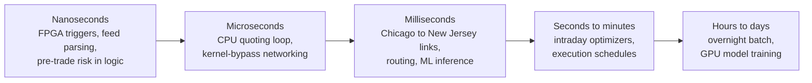
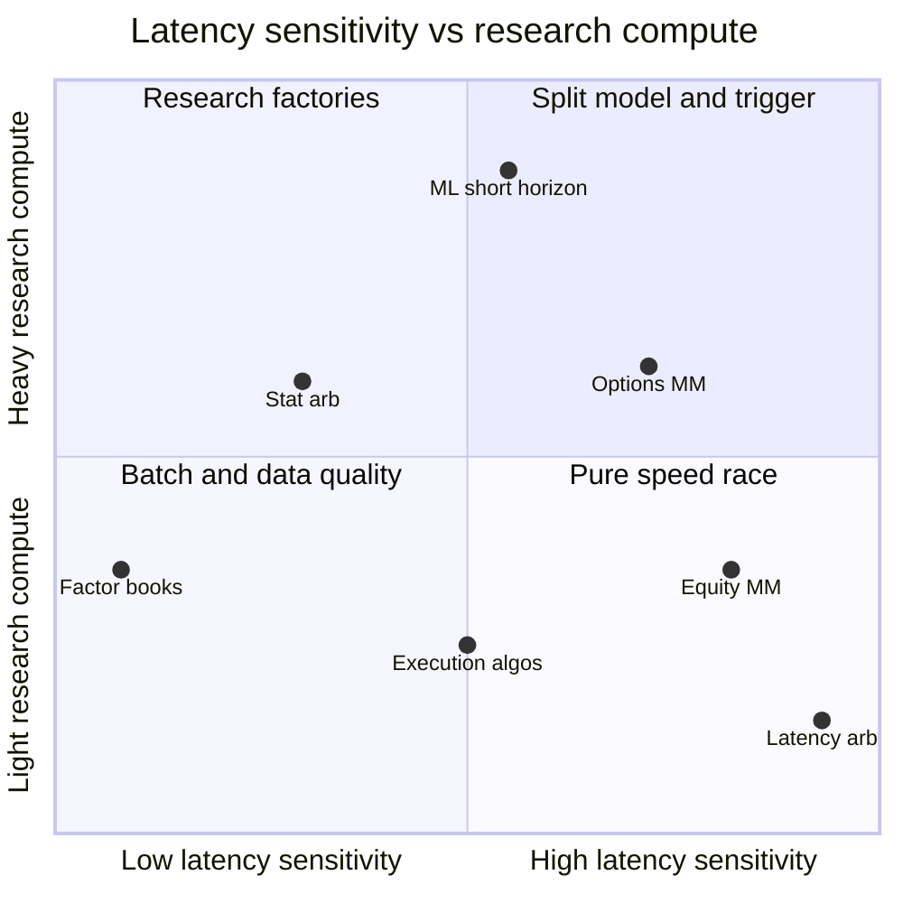

# How infrastructure constrains algorithms

> **TL;DR**
>
> - Every strategy has a decision budget: the time it can spend between seeing information and acting on it. Budgets run from tens of nanoseconds (latency arbitrage) to a whole night (daily factor books), and the budget decides which algorithms are allowed at all.
> - FPGAs run simple, fixed logic in nanoseconds; CPUs run branchy logic in microseconds; GPUs run huge batched math over milliseconds to days. Hence the standard design: slow models arm fast triggers.
> - In the fastest strategies, rank against rivals matters more than absolute speed. In slow ones, data quality and research compute bind first.
> - Infrastructure is a fixed cost. Only strategies with enough volume can carry it, which is one reason speed businesses concentrate in a few firms.

**Level:** Core · **Read time:** ~6 min · **Last verified:** 2026-11

Infrastructure is like a fab: a fixed investment that decides which products a firm can make at all. Without colocation and FPGAs there is no [latency arbitrage](../09-reference/glossary.md#latency-arbitrage); without a large GPU cluster, [ML-driven short-horizon alpha](../02-strategies/c-statistical-arbitrage/ml-driven-short-horizon-alpha.md) is hard. The inside of the fastest loop is in [M1 Anatomy of an HFT trading loop](../03-algorithms/f-market-making-and-hft-algorithms/anatomy-of-an-hft-trading-loop.md).

## Latency budgets by strategy

The budget is how long one decision may take before the opportunity is gone or a rival has acted. Stage splits are `[Estimate]`, scaled from the sourced endpoints in M1 and the dossiers.

| Strategy | Decision budget | Where the time goes | What binds first |
|---|---|---|---|
| [Latency arbitrage](../02-strategies/b-speed-and-structural/latency-arbitrage.md) | tens of ns (FPGA) to ~2.5 µs (best software), wire to wire; races won by a modal 5–10 µs in London data `[Verified]` | parsing the trigger packet, deciding, encoding the order; ~4 ms of Chicago–New Jersey transport for futures triggers | rank against the fastest rival; network path |
| [Equity](../02-strategies/a-liquidity-provision/equity-market-making.md) and [ETF market making](../02-strategies/a-liquidity-provision/etf-market-making.md) | ~1–10 µs per quote update; ns for FPGA cancel triggers | feed decode, book build, fair value, risk check, serialization (a 100-byte frame takes 80 ns at 10 Gb/s) | p99 tail latency in bursts, such as the open |
| [Options market making](../02-strategies/a-liquidity-provision/options-market-making.md) | µs per quote, but one underlying tick reprices hundreds to thousands of series | surface re-evaluation and message volume; OPRA planned for a peak of 13.575M messages per 100 ms by July 2026 `[Verified]` | throughput and exchange message caps, not single-message speed |
| [Lead-lag and cross-asset](../02-strategies/b-speed-and-structural/lead-lag-and-cross-asset-arbitrage.md) | milliseconds between cities | propagation: about 4 ms Chicago to New Jersey by microwave versus 6.65 ms on the best 2010 fiber `[Verified]` | path length; rain on radio links |
| [ML short-horizon alpha](../02-strategies/c-statistical-arbitrage/ml-driven-short-horizon-alpha.md) (seconds to minutes) | ~10 µs to 10 ms per prediction `[Estimate]` | feature updates and model inference, usually on CPU | model size against freshness |
| [Execution algorithms](../03-algorithms/e-execution-algorithms/execution-algorithms-overview.md) and [smart order routing](../03-algorithms/e-execution-algorithms/smart-order-routing.md) | µs to ms per child order; schedules over minutes to hours | venue round trips, waiting for fills | fill probability and impact, rarely raw speed |
| [Factor-residual stat arb](../02-strategies/c-statistical-arbitrage/factor-residual-mean-reversion.md) (intraday to days) | seconds to minutes | risk-model update, optimizer solve | data freshness and the cost model |
| [Cross-sectional](../02-strategies/d-mid-frequency-alpha/cross-sectional-alpha-and-neutralization.md) and [factor](../02-strategies/e-risk-premia-and-factors/factor-investing-fundamentals.md) books | overnight batch, hours | data cleaning, model fits, an optimizer that solves 3,000 names in seconds | [point-in-time data](../03-algorithms/a-data-and-signals/point-in-time-data-and-cleaning.md) quality and research compute |

Each rung of the ladder is roughly a thousand times slower than the one before, and allows that much more computation per decision.

## FPGA vs CPU vs GPU: who does what, and why

| Hardware | Latency per decision | Good at | Limits | Typical jobs |
|---|---|---|---|---|
| [FPGA](../09-reference/glossary.md#fpga) | tens of ns; 13.9 ns minimum in a vendor-commissioned 2024 STAC-T0 run `[Verified]` | fixed pipelines with deterministic timing; acting at line rate | small logic budgets (AMD's trading card: 780K LUTs, 1,680 DSP slices `[Verified]`); slow build-and-verify cycles `[Lore]` | feed handlers, stale-quote triggers, pre-trade risk checks, timestamping |
| CPU core | ~2.5 µs software [tick-to-trade](../09-reference/glossary.md#tick-to-trade) at best `[Verified]` | branchy logic, many symbols, fast iteration | caches, interrupts and the operating system cause tail spikes | the main quoting loop, hedging, routing, intraday optimizers |
| GPU | a PCIe round trip plus a kernel launch costs several to tens of µs before any math `[Estimate]` | dense linear algebra over large batches | wasteful at batch size 1; timing varies run to run | training neural nets, research backtests, Monte Carlo, overnight risk |
| ASIC | below FPGA, at much higher fixed cost | the same fixed logic, faster and cooler | long design cycles; logic frozen at tape-out | rare; a 2026 profile of Optiver mentions some loops on one FPGA or ASIC `[Reported]` |

GPUs stay out of the hot path because the fastest loop handles one event at a time: there is no batch to spread the transfer cost over, and a few microseconds of overhead lose the race. They earn their keep upstream. XTX Markets reports over 25,000 GPUs `[Verified]`, and Jane Street says neural networks are used heavily in many of its strategies `[Verified]`; that compute trains models ([tech stacks](trading-and-research-tech-stacks.md)).

## How the constraint reshapes the algorithm

- **Slow models arm fast triggers.** A large model, refit offline or every few seconds, writes thresholds and lookup tables; the hot path compares one number with a threshold. Optiver describes this split `[Reported]`, and [M1](../03-algorithms/f-market-making-and-hft-algorithms/anatomy-of-an-hft-trading-loop.md) shows it in code.
- **Linear and distilled models win in the fast path.** A [microprice](../03-algorithms/f-market-making-and-hft-algorithms/fair-value-and-microprice.md) plus a few [order-book signals](../03-algorithms/f-market-making-and-hft-algorithms/order-book-and-trade-flow-signals.md) is a dot product. A large network is distilled or moved to a slower horizon `[Lore]`.
- **Throughput beats latency in options.** On most events the market maker moves a few [volatility-surface](../03-algorithms/f-market-making-and-hft-algorithms/options-pricing-and-vol-surfaces-for-mm.md) parameters and reprices the most exposed series first `[Lore]`.
- **Risk checks must be as fast as the loop.** A check that runs after the order has left is a log, not a control; hence inline gates in FPGA logic or C++ ([M9](../03-algorithms/f-market-making-and-hft-algorithms/algorithmic-risk-controls.md)).
- **Slow strategies spend the budget on data.** An overnight book gains more from cleaner [point-in-time data](../09-reference/glossary.md#point-in-time-data) and better [cost models](../03-algorithms/d-portfolio-construction/transaction-cost-and-impact-models.md) than from any network upgrade.

## The economics: speed is a fixed cost

Links, colocation, FPGA engineers and GPU clusters are mostly fixed costs, so they create operating leverage: in the illustrative [latency arbitrage](../02-strategies/b-speed-and-structural/latency-arbitrage.md) book, doubling the win rate more than quadruples net profit. Laughlin et al. estimated that cutting Chicago–New York latency cost over \$500 million in build-out plus five years of operations `[Verified]`. Carrying that bill takes volume across many strategies, one reason a handful of firms dominate the fastest markets ([taxonomy of quant firms](../04-industry-and-firms/taxonomy-of-quant-firms.md)).

*Placement is illustrative `[Estimate]`: relative positions, not measurements.*

## Related pages

- [M1 Anatomy of an HFT trading loop](../03-algorithms/f-market-making-and-hft-algorithms/anatomy-of-an-hft-trading-loop.md) · [M9 Algorithmic risk controls](../03-algorithms/f-market-making-and-hft-algorithms/algorithmic-risk-controls.md)
- [Latency arbitrage](../02-strategies/b-speed-and-structural/latency-arbitrage.md) · [Equity market making](../02-strategies/a-liquidity-provision/equity-market-making.md) · [Options market making](../02-strategies/a-liquidity-provision/options-market-making.md)
- [ML-driven short-horizon alpha](../02-strategies/c-statistical-arbitrage/ml-driven-short-horizon-alpha.md)
- [Colocation, networks and the speed of light](colocation-networks-and-the-speed-of-light.md) · [Trading and research tech stacks](trading-and-research-tech-stacks.md) · [A semiconductor lens](semiconductor-lens.md)

## Sources

- [Verified] Aquilina, M., Budish, E. & O'Neill, P. (2022). "Quantifying the High-Frequency Trading 'Arms Race'." *Quarterly Journal of Economics* 137(1), 493–564. <https://www.nber.org/papers/w29011> (accessed 2026-11)
- [Verified] Laughlin, G., Aguirre, A. & Grundfest, J. (2014). "Information Transmission between Financial Markets in Chicago and New York." *Financial Review* 49(2), 283–312. <https://arxiv.org/abs/1302.5966> (accessed 2026-11)
- [Verified] Cook, C. (2017). "When a Microsecond Is an Eternity: High Performance Trading Systems in C++." CppCon 2017 (Optiver), slides. <https://github.com/CppCon/CppCon2017/blob/master/Presentations/When%20a%20Microsecond%20Is%20an%20Eternity/When%20a%20Microsecond%20Is%20an%20Eternity%20-%20Carl%20Cook%20-%20CppCon%202017.pdf> (accessed 2026-11)
- [Verified] AMD (2024-06-27). "AMD Sets STAC Benchmark World Record for Fastest Electronic Trade Execution" (STAC-T0, with Exegy; vendor-commissioned). <https://www.amd.com/en/blogs/2024/amd-sets-stac-benchmark-world-record-for-fastest-e.html> (accessed 2026-11)
- [Verified] AMD (2023-09-27). "AMD Unveils Purpose-Built, FPGA-Based Accelerator for Ultra-Low Latency Electronic Trading" (Alveo UL3524). <https://ir.amd.com/news-events/press-releases/detail/1158/amd-unveils-purpose-built-fpga-based-accelerator-for> (accessed 2026-11)
- [Verified] SIAC for the OPRA Participants (2025-09-15). "Revised OPRA Capacity Projections." <https://cdn.opraplan.com/documents/notices/OPRA_Capacity_Projections_Update_0925.pdf> (accessed 2026-11)
- [Verified] XTX Markets (n.d.). Company website (research cluster of over 25,000 GPUs). <https://www.xtxmarkets.com/> (accessed 2026-11)
- [Verified] Maczka, S. (2026-10-13). "Flex Model: an event-driven feature engineering system." *Jane Street Blog*. <https://blog.janestreet.com/flex-model-an-event-driven-feature-engineering-system/> (accessed 2026-11)
- [Reported] Orosz, G., Klaric, I. & Spevack, J. (2026-08-11). "Software engineering at a proprietary trading company: Optiver." *The Pragmatic Engineer*. <https://newsletter.pragmaticengineer.com/p/optiver> (accessed 2026-11)
