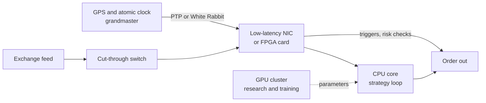

# A semiconductor lens

> **TL;DR**
>
> - Trading buys silicon in two very different ways. Production buys small volumes of the lowest-latency parts: FPGAs, specialist NICs, cut-through switches, precision clocks. Research buys GPUs, CPUs and storage at data-center scale.
> - The latency niche is concentrated: AMD (Xilinx and Solarflare) and Altera, now 51% owned by Silver Lake, for FPGAs; AMD and NVIDIA (Mellanox) for NICs. AMD even sells trading-specific FPGA cards.
> - Trading ASICs exist but are rare and undisclosed. GPU demand from quant research is real and growing: XTX reports over 25,000 GPUs, and High-Flyer's Fire-Flyer 2 cluster held 10,000 A100s.
> - No credible public figure sizes "trading silicon" as a market. Treat it as a demanding, high-margin showcase niche, not a volume driver.

**Level:** Deep dive · **Read time:** ~5 min · **Last verified:** 2026-11

## Where trading touches silicon

| Component | Main suppliers in trading | Why traders care | Confidence |
|---|---|---|---|
| [FPGA](../09-reference/glossary.md#fpga) | AMD (Xilinx, acquisition completed 2022-02-14); Altera (Intel sold 51% to Silver Lake, closed September 2025; Intel keeps 49%) | nanosecond, deterministic logic for feeds, triggers, risk checks | `[Verified]` AMD and Altera releases |
| Trading-specific FPGA cards | AMD Alveo UL3524 (September 2023: custom 16 nm Virtex UltraScale+, under 3 ns transceiver latency, 64 transceivers) and UL3422 (October 2024, slimmer card on the same FPGA) | the vendor redesigned transceivers for this one market | `[Verified]` (vendor claims) |
| Low-latency NICs | AMD Solarflare (Xilinx bought Solarflare in 2019); NVIDIA networking (Mellanox, acquired for about \$7B, completed 2020) | kernel-bypass software stacks and hardware timestamps | `[Verified]` NVIDIA; Solarflare deal `[Reported]` |
| Switches | cut-through Ethernet switches; Cboe's own access layer lists Arista models | every hop adds latency; exchanges publish their switch models | `[Verified]` Cboe manual |
| ASICs | undisclosed | below FPGA latency at much higher fixed cost; a 2026 Optiver profile mentions loops on one FPGA or ASIC | `[Reported]` |
| GPUs | NVIDIA dominant in published deployments | model training, research backtests | see below |
| Timing | GPS-disciplined grandmasters, PTP, White Rabbit | measuring and ordering events across machines | see below |

## FPGA and NIC consolidation, read as M&A

The latency stack has been rolled up by the two big compute vendors. Xilinx bought Solarflare (2019), AMD bought Xilinx (2022), and NVIDIA bought Mellanox (2020) `[Verified]` for AMD and NVIDIA, `[Reported]` for Solarflare. The deal announcements pitched data-center computing and networking, not trading `[Verified]`. Trading is a small customer set with extreme requirements that doubles as a reference account `[Lore]`. Altera went the other way: Intel sold control to Silver Lake in 2025. Altera now calls itself the largest pure-play FPGA company `[Verified]` (company claim). For a trading firm, consolidation means fewer independent roadmaps and real lock-in. FPGA designs, toolchains and kernel-bypass APIs do not port cleanly between vendors `[Lore]`.

## GPU demand from quant and AI research

- **XTX Markets** reports over 25,000 GPUs and a data center under construction in Finland `[Verified]` (firm statement).
- **High-Flyer**, the Chinese quant fund, is credited with DeepSeek-AI on Fire-Flyer 2, a cluster built in 2021 with 10,000 PCIe A100 GPUs. The 2024 paper reports performance near NVIDIA's DGX-A100 at about half the cost and 40% less energy `[Verified]` (the paper's own claims). The [High-Flyer profile](../04-industry-and-firms/firm-profiles/high-flyer.md) covers the firm's link to DeepSeek.
- **Hudson River Trading** signed a multi-year deal in 2026 to run NVIDIA Vera Rubin NVL72 systems on CoreWeave `[Verified]`.
- **Jane Street** writes that neural networks are used heavily in many of its strategies `[Verified]`.

These are research clusters, priced and run like AI-lab infrastructure ([tech stacks](trading-and-research-tech-stacks.md)). They compete for the same accelerators and power as AI labs, so a quant firm's GPU plan faces the same supply constraints.

## Timing: from PTP to White Rabbit

- **Requirement.** Under MiFID II RTS 25, high-frequency traders' clocks must stay within 100 µs of UTC with 1 µs timestamp granularity `[Verified]`. US CAT rules require industry members' clocks within 50 ms of NIST `[Verified]`. Both are loose next to what firms need internally `[Lore]`.
- **Practice.** To compute [markouts](../09-reference/glossary.md#markout) and tick-to-trade in nanoseconds, firms discipline NIC clocks with the Precision Time Protocol (PTP, IEEE 1588) from GPS-fed grandmasters `[Lore]`.
- **White Rabbit.** Developed at CERN and folded into IEEE 1588-2019 as its high-accuracy profile, it delivers sub-nanosecond sync over fiber `[Reported]`. A Safran case study says Deutsche Börse used it to timestamp traffic across more than 500 colocation ports `[Reported]` (vendor source).

## Questions a chip-industry diligence team could ask

1. What share of a vendor's FPGA or NIC revenue comes from trading, and is it disclosed? It usually is not.
2. Does the trading customer use vendor IP, such as a feed handler, or only the bare device? The answer decides switching costs.
3. How exposed is the latency franchise to market-design changes, such as [speed bumps](../09-reference/glossary.md#speed-bump), batch auctions or exchanges moving matching engines to the cloud?
4. For GPU demand, is the firm buying, leasing (CoreWeave-style) or building its own sites?

## Related pages

- [How infrastructure constrains algorithms](how-infrastructure-constrains-algorithms.md) · [Colocation, networks and the speed of light](colocation-networks-and-the-speed-of-light.md) · [Trading and research tech stacks](trading-and-research-tech-stacks.md)
- [M1 Anatomy of an HFT trading loop](../03-algorithms/f-market-making-and-hft-algorithms/anatomy-of-an-hft-trading-loop.md)
- [Latency arbitrage](../02-strategies/b-speed-and-structural/latency-arbitrage.md) · [ML-driven short-horizon alpha](../02-strategies/c-statistical-arbitrage/ml-driven-short-horizon-alpha.md)
- [High-Flyer](../04-industry-and-firms/firm-profiles/high-flyer.md) · [XTX Markets](../04-industry-and-firms/firm-profiles/xtx-markets.md)

## Sources

- [Verified] AMD (2022-02-14). "AMD Completes Acquisition of Xilinx." <https://www.amd.com/en/newsroom/press-releases/2022-2-14-amd-completes-acquisition-of-xilinx.html> (accessed 2026-11)
- [Verified] Altera (2025-09-15). "Altera Closes Silver Lake Investment to Become World's Largest Pure-play FPGA Solutions Provider." <https://www.nasdaq.com/press-release/altera-closes-silver-lake-investment-become-worlds-largest-pure-play-fpga-solutions> (accessed 2026-11)
- [Reported] Benzinga via Yahoo Finance (2025-09). "Intel Wraps Up Altera Stake Sale In Bid To Streamline Business." <https://finance.yahoo.com/news/intel-wraps-altera-stake-sale-131139122.html> (accessed 2026-11)
- [Verified] NVIDIA (2020). "NVIDIA Completes Acquisition of Mellanox, Creating Major Force Driving Next-Gen Data Centers." <https://nvidianews.nvidia.com/news/nvidia-completes-acquisition-of-mellanox-creating-major-force-driving-next-gen-data-centers> (accessed 2026-11)
- [Reported] HPCwire (2019-07-31). "Xilinx-Solarflare Deal Closes, Combines FPGAs, High-Performance Networks." <https://www.hpcwire.com/2019/07/31/xilinx-solarflare-deal-closes-combines-fpgas-high-performance-networks/> (accessed 2026-11)
- [Verified] AMD (2023-09-27). "AMD Unveils Purpose-Built, FPGA-Based Accelerator for Ultra-Low Latency Electronic Trading." <https://ir.amd.com/news-events/press-releases/detail/1158/amd-unveils-purpose-built-fpga-based-accelerator-for> (accessed 2026-11)
- [Verified] AMD (2024-10-14). "AMD Expands Alveo Portfolio with Launch of World's Fastest Electronic Trading Accelerator in Slim Form Factor." <https://www.amd.com/en/newsroom/press-releases/2024-10-14-amd-expands-alveo-portfolio-with-launch-of-world-s.html> (accessed 2026-11)
- [Verified] Cboe (2026-10-27). "Cboe Titanium U.S. Equities/Options Connectivity Manual," version 10.4.33. <https://cdn.cboe.com/resources/techspec/technical-specifications-cboe-titanium-u-s-equitiesoptions-connectivity-manual.md> (accessed 2026-11)
- [Verified] An, W. et al. (2024). "Fire-Flyer AI-HPC: A Cost-Effective Software-Hardware Co-Design for Deep Learning." arXiv:2408.14158. <https://arxiv.org/abs/2408.14158> (accessed 2026-11)
- [Verified] XTX Markets (n.d.). Company website (over 25,000 GPUs; data centre in Finland). <https://www.xtxmarkets.com/> (accessed 2026-11)
- [Verified] Maczka, S. (2026-10-13). "Flex Model: an event-driven feature engineering system." *Jane Street Blog*. <https://blog.janestreet.com/flex-model-an-event-driven-feature-engineering-system/> (accessed 2026-11)
- [Verified] CoreWeave (2026). "Hudson River Trading to Build Next-Gen Research Platform Powered by NVIDIA Vera Rubin NVL72 on CoreWeave Cloud." <https://coreweave.com/news/hudson-river-trading-to-build-next-gen-research-platform-powered-by-nvidia-vera-rubin-nvl72-on-coreweave-cloud> (accessed 2026-11)
- [Verified] Commission Delegated Regulation (EU) 2017/574 (RTS 25), Annex, Table 2 (clock accuracy). <https://www.legislation.gov.uk/eur/2017/574/annex> (accessed 2026-11)
- [Verified] FINRA Rule 6820, "Clock Synchronization." <https://www.finra.org/rules-guidance/rulebooks/finra-rules/6820> (accessed 2026-11)
- [Reported] Safran Navigation & Timing (n.d.). "Deutsche Börse deploys White Rabbit solution" (vendor case study). <https://www.orolia.com/deutsche-borse-deploys-white-rabbit-solution/> (accessed 2026-11)
- [Reported] Computer Weekly (n.d.). "Developed for Big Science in Europe, highly accurate time protocols ensure fair trading in finance." <https://www.computerweekly.com/feature/Developed-for-Big-Science-in-Europe-highly-accurate-time-protocols-ensure-fair-trading-in-finance> (accessed 2026-11)
- [Reported] Orosz, G., Klaric, I. & Spevack, J. (2026-08-11). "Software engineering at a proprietary trading company: Optiver." *The Pragmatic Engineer*. <https://newsletter.pragmaticengineer.com/p/optiver> (accessed 2026-11)
