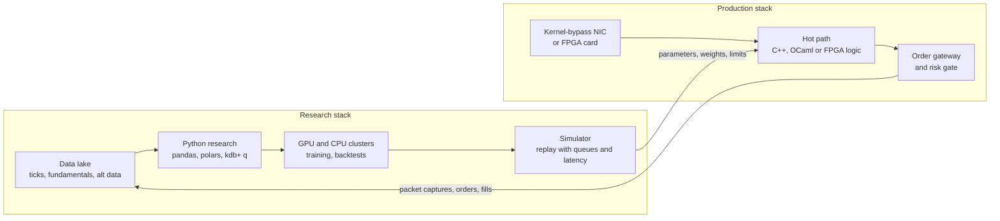

# Trading and research tech stacks

> **TL;DR**
>
> - A quant firm runs two stacks. Production is small, fast and deterministic: C++ (or OCaml, or FPGA logic), kernel-bypass networking, pinned cores. Research is large and flexible: Python, columnar data stores, GPU clusters.
> - The interface between them is narrow: research ships parameters and model weights; production ships back logs of every packet, order and fill.
> - Jane Street is the best-documented exception to "C++ everywhere": OCaml is its primary language, with Python second for data analysis and machine learning `[Verified]`.
> - The costliest failures sit at the seam: research code that is not the code that trades, and simulators that ignore queues and latency.

**Level:** Core · **Read time:** ~6 min · **Last verified:** 2026-11

## Two stacks, one firm

In the standard design the arrows are the whole contract `[Lore]`: research hands production numbers rather than calling into it, and production logs everything for the next refit rather than waiting on research. This is the [slow-model, fast-trigger](how-infrastructure-constrains-algorithms.md#how-the-constraint-reshapes-the-algorithm) split in software form.

## Production: the hot path

| Layer | Common choices | Why | Evidence |
|---|---|---|---|
| Language | C++ | control of memory layout, no garbage-collection pauses, mature low-latency idioms | Optiver's CppCon 2017 talk on sub-µs C++ `[Verified]` |
| | OCaml at Jane Street | the firm calls OCaml its primary development platform and writes "everything that we can" in it, trading systems included; it maintains its own compiler extensions (OxCaml) for performance work | Jane Street technology page and OxCaml site `[Verified]` |
| | Java with one business-logic thread | LMAX reported about 6 million orders per second on one thread | Fowler (2011) `[Verified]` |
| | Rust | memory safety without a garbage collector; visible mainly in newer and crypto trading firms' hiring and in data vendors | job postings and vendor blogs `[Reported]`; adoption at large established HFTs is not publicly documented `[Lore]` |
| Networking | [Kernel bypass](../09-reference/glossary.md#kernel-bypass): AMD Solarflare Onload (sockets-compatible), TCPDirect, ef_vi (raw frames); DPDK | the kernel network stack adds microseconds and jitter; bypass lets a pinned core poll the NIC directly | AMD documents all three APIs `[Verified]`; AMD's own tests show about 0.8–1.0 µs ping-pong latency on its X3522 card, lowest with ef_vi `[Reported]`; DPDK is a Linux Foundation packet-processing project `[Verified]` |
| FPGA cards | AMD Alveo UL3524 and UL3422; vendor frameworks such as Exegy's | parsing, triggers and risk checks in tens of ns | AMD says the UL3524 was "already deployed by leading trading firms" at launch `[Verified]` (vendor claim) |
| Operating system | pinned cores, isolated CPUs, huge pages, busy polling, no allocation on the hot path | remove sources of tail latency | Cook (2017) `[Verified]`; specific settings `[Lore]` |
| Time | PTP-disciplined NIC hardware timestamps | measure [tick-to-trade](../09-reference/glossary.md#tick-to-trade) and [markouts](../09-reference/glossary.md#markout) in ns | see [semiconductor lens](semiconductor-lens.md) |

Two design rules follow from [M1](../03-algorithms/f-market-making-and-hft-algorithms/anatomy-of-an-hft-trading-loop.md). First, the core is single-threaded and deterministic, so a recorded day replays to identical orders. Second, the risk gate is part of production, not a separate service that can be bypassed ([M9](../03-algorithms/f-market-making-and-hft-algorithms/algorithmic-risk-controls.md)).

## Research: the factory

| Component | Common choices | Evidence |
|---|---|---|
| Tick database | kdb+, a columnar in-memory time-series database driven by the vector language q, long used in capital markets | KX product page `[Verified]`; prevalence at banks and HFTs `[Lore]` |
| Analysis language | Python with NumPy and pandas; polars, an analytical query engine written in Rust | Jane Street says most of its traders and researchers think and write in Python, its second major language and primary tool for data analysis and ML `[Verified]`; polars README `[Verified]` |
| Compute | GPU clusters for training; large CPU farms for backtests | XTX Markets reports over 25,000 GPUs `[Verified]`, and in 2025 described tens of thousands of high-end GPUs, hundreds of thousands of CPUs and hundreds of petabytes of storage `[Verified]`; Hudson River Trading signed a multi-year deal for NVIDIA Vera Rubin systems on CoreWeave in 2026 `[Verified]` |
| Storage | columnar files on distributed filesystems or object stores | XTX open-sourced TernFS, its in-house exabyte-scale filesystem, in September 2025 `[Verified]` |
| Data discipline | [point-in-time](../03-algorithms/a-data-and-signals/point-in-time-data-and-cleaning.md) snapshots, versioned datasets | see D1; firm specifics `[Lore]` |

For the reader with a hardware background: research demand is the GPU and storage business; production demand is the NIC, FPGA and switch business. They grow for different reasons, and only research spend scales with model size.

## Simulation and backtest infrastructure

Two kinds of simulator, matched to two budgets (details in [V2 Backtesting engines](../03-algorithms/c-validation-and-backtesting/backtesting-engines.md)):

- **Vectorized backtests** for daily and intraday books: a panel of returns and positions, costs from a [transaction-cost model](../03-algorithms/d-portfolio-construction/transaction-cost-and-impact-models.md). Fast enough to run thousands of variants, which is exactly why [multiple-testing](../03-algorithms/c-validation-and-backtesting/overfitting-and-multiple-testing.md) haircuts are needed.
- **Event-driven replay** for market making and execution: captured packets are fed through a [matching engine](https://github.com/FrankHuang94/quant_trading_claude/tree/main/labs/01-matching-engine-order-book) model with [queue position](../03-algorithms/f-market-making-and-hft-algorithms/queue-position-and-order-placement.md), venue latency and fees. The best version runs the production strategy code itself against the replay `[Lore]`, so research and production cannot drift apart.

The seam is where money is lost. A model that looked good in Python but is reimplemented in C++ can differ in rounding, feature timing or missing-data handling. Firms counter with shared libraries across research and production (Jane Street's single-language approach is one answer), replay tests that must match production byte for byte, and staged capital ramps for new models ([L2](../03-algorithms/g-live-trading/alpha-decay-detection-and-model-retirement.md)) `[Lore]`.

## Related pages

- [M1 Anatomy of an HFT trading loop](../03-algorithms/f-market-making-and-hft-algorithms/anatomy-of-an-hft-trading-loop.md) · [V2 Backtesting engines](../03-algorithms/c-validation-and-backtesting/backtesting-engines.md) · [V3 Backtest pitfalls](../03-algorithms/c-validation-and-backtesting/backtest-pitfalls.md)
- [ML-driven short-horizon alpha](../02-strategies/c-statistical-arbitrage/ml-driven-short-horizon-alpha.md) · [F3 Neural nets and sequence models](../03-algorithms/b-forecasting-models/neural-nets-and-sequence-models.md)
- [Equity market making](../02-strategies/a-liquidity-provision/equity-market-making.md)
- [How infrastructure constrains algorithms](how-infrastructure-constrains-algorithms.md) · [A semiconductor lens](semiconductor-lens.md)

## Sources

- [Verified] Jane Street (n.d.). "Technology" (OCaml as primary development platform). <https://www.janestreet.com/technology/> (accessed 2026-11)
- [Verified] Trangez, N. (2026-06-15). "Using OxCaml to implement type-safe reference counting between OCaml and Python." *Jane Street Blog*. <https://blog.janestreet.com/oxcaml-typesafe-reference-counting-python/> (accessed 2026-11)
- [Verified] OxCaml (n.d.). "OxCaml" (Jane Street's production compiler and OCaml extensions). <https://oxcaml.org/> (accessed 2026-11)
- [Verified] Cook, C. (2017). "When a Microsecond Is an Eternity: High Performance Trading Systems in C++." CppCon 2017 (Optiver), slides. <https://github.com/CppCon/CppCon2017/blob/master/Presentations/When%20a%20Microsecond%20Is%20an%20Eternity/When%20a%20Microsecond%20Is%20an%20Eternity%20-%20Carl%20Cook%20-%20CppCon%202017.pdf> (accessed 2026-11)
- [Verified] Fowler, M. (2011-07-12). "The LMAX Architecture." <https://martinfowler.com/articles/lmax.html> (accessed 2026-11)
- [Verified] AMD (2026). "Onload User Guide" (UG1586; Onload, TCPDirect and ef_vi). <https://docs.amd.com/r/en-US/ug1586-onload-user/Notes-on-Latency-and-Payload-Graphs> (accessed 2026-11)
- [Reported] AMD (n.d.). "AMD Low Latency Solutions: AMD EPYC 9005 and AMD Alveo X3" (white paper; vendor-measured latencies). <https://www.amd.com/content/dam/amd/en/documents/epyc-technical-docs/white-papers/amd-low-latency-solutions-amd-epyc-9005-amd-alveo-x3.pdf> (accessed 2026-11)
- [Verified] DPDK Project (n.d.). "About DPDK." <https://www.dpdk.org/about/> (accessed 2026-11)
- [Verified] AMD (2023-09-27). "AMD Unveils Purpose-Built, FPGA-Based Accelerator for Ultra-Low Latency Electronic Trading." <https://ir.amd.com/news-events/press-releases/detail/1158/amd-unveils-purpose-built-fpga-based-accelerator-for> (accessed 2026-11)
- [Verified] KX (n.d.). "kdb+." <https://kx.com/products/kdb/> (accessed 2026-11)
- [Verified] Polars (n.d.). README: "an analytical query engine written in Rust." <https://github.com/pola-rs/polars> (accessed 2026-11)
- [Verified] XTX Markets (2025-09). "TernFS: an exabyte scale, multi-region distributed filesystem." *XTX Tech Blog*. <https://www.xtxmarkets.com/tech/2025-ternfs/> (accessed 2026-11)
- [Verified] XTX Markets (n.d.). Company website (research cluster of over 25,000 GPUs). <https://www.xtxmarkets.com/> (accessed 2026-11)
- [Verified] CoreWeave (2026). "Hudson River Trading to Build Next-Gen Research Platform Powered by NVIDIA Vera Rubin NVL72 on CoreWeave Cloud." <https://coreweave.com/news/hudson-river-trading-to-build-next-gen-research-platform-powered-by-nvidia-vera-rubin-nvl72-on-coreweave-cloud> (accessed 2026-11)
- [Reported] Databento (2025-08-22). "Rust vs C++ for trading systems: lessons from building market data and trading products." <https://databento.com/blog/rust-vs-cpp> (accessed 2026-11)
