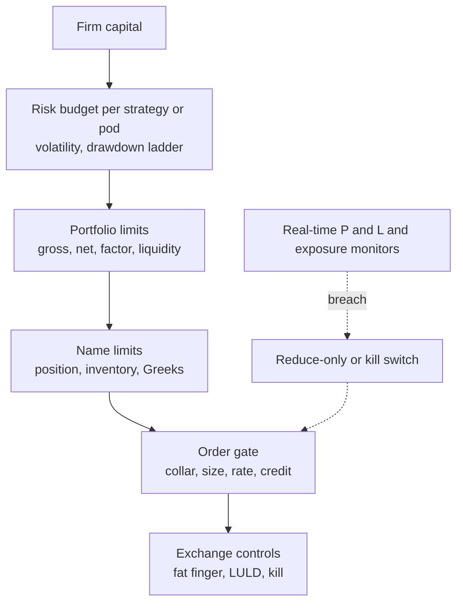
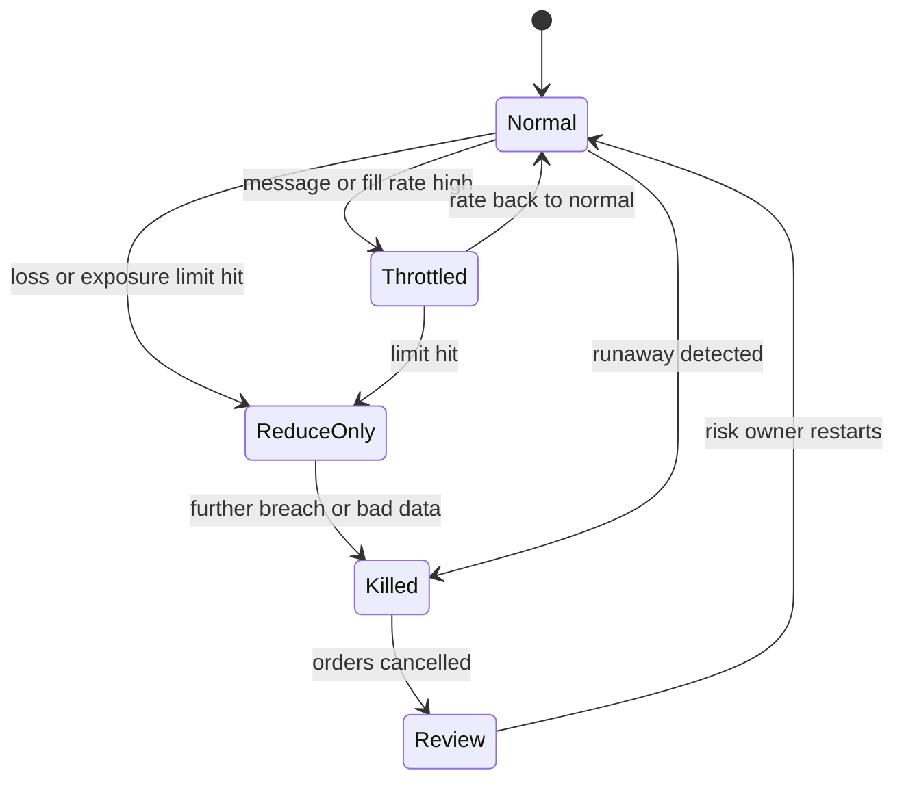

# Risk management at quant firms

> **TL;DR**
>
> - Risk management is a stack of limits, each assuming the one above has failed: per-order checks, per-name positions, gross and net notional, factor exposures, liquidity, losses, and finally a kill switch.
> - Quant books are built to be neutral, so most limits cap what the strategy did not mean to own: market beta, sectors, styles such as momentum, and crowded names.
> - Multi-manager platforms add drawdown ladders: Millennium reportedly halves a PM's capital at a 5% loss and is likely to part ways near 7.5% `[Reported]`.
> - Stress tests replay real crises against today's book: August 2007, May 2010, August 2015, March 2020, January 2021, August 2024.
> - Model risk, the chance that the model or its code is wrong, causes as many disasters as market moves. Knight Capital lost over \$460M to dead code in 45 minutes `[Verified]`.

**Level:** Core · **Read time:** ~7 min · **Last verified:** 2026-11

In accounting language, a quant firm's risk function is an internal-control system over a balance sheet that turns over in hours. Limits are preventive controls, monitors and P&L attribution are detective controls, and kill switches and capital cuts are corrective ones ([M9](../03-algorithms/f-market-making-and-hft-algorithms/algorithmic-risk-controls.md) uses the same frame). The difference from a corporate controller is speed: many controls must act automatically, in microseconds, without a human.

## The limit stack

Setting values vary by firm and are rarely published. The ranges below are illustrative `[Lore]` unless tagged.

| Limit | What it caps | Illustrative setting | Enforced where | Main users |
|---|---|---|---|---|
| Per-order | price collar, size, notional, message rate | collar 1–5% from reference; Cboe default max order 25,000 shares `[Verified]` | inline pre-trade gate, broker, exchange | everyone; required by Rule 15c3-5 `[Verified]` |
| Position per name | shares or \$ held in one stock | 0.5–2% of gross market value (GMV); well under one day's volume | pre-trade and end of day | stat arb, factor books |
| Inventory per name | market maker's net position | a few minutes of normal volume | inline, with quote skew | [market making](../09-reference/glossary.md#market-making) |
| Gross and net notional | GMV and net long or short | net near zero for market-neutral books; gross set by capital and leverage | firm risk system | all |
| Factor exposure | beta, sectors, styles (momentum, value, size), country | beta within ±0.05–0.1; sector net within ±1–3% of GMV; style tilts under ~0.25 standard deviations | [risk model](../03-algorithms/d-portfolio-construction/risk-models.md) and optimizer constraints | [cross-sectional](../02-strategies/d-mid-frequency-alpha/cross-sectional-alpha-and-neutralization.md), [stat arb](../02-strategies/c-statistical-arbitrage/stat-arb-overview-and-history.md), pods |
| Risk budget | ex-ante volatility | e.g. 4–8% annualized per pod | risk model, daily | [pods](../09-reference/glossary.md#pod), multi-strategy funds |
| Liquidity | days to exit at a participation cap | under 1–3 days at 10–20% of volume | pre-trade and daily | mid-frequency books |
| Greeks | delta, gamma, vega per underlying and by expiry | set per desk | real time | [options market making](../02-strategies/a-liquidity-provision/options-market-making.md) |
| Loss | daily, monthly, peak-to-trough | stop new risk at a daily loss; capital cut at a drawdown | real time and daily | all |

Factor limits are the quant-specific layer. A stat-arb book that is accidentally long momentum is a factor bet in disguise. In August 2007 crowded books with similar exposures lost together ([quant quake](../09-reference/glossary.md#quant-quake); Khandani and Lo 2011 `[Verified]`). The [risk models](../03-algorithms/d-portfolio-construction/risk-models.md) card shows how exposures are measured; [position sizing and risk budgeting](../03-algorithms/d-portfolio-construction/position-sizing-and-risk-budgeting.md) shows how budgets become position sizes.

## Pod drawdown rules at multi-managers

Multi-manager platforms combine many independent [pods](../09-reference/glossary.md#pod) and police each one by its P&L. The rules are reported, not published. Millennium reportedly halves a PM's capital at a 5% loss on allocated capital and is likely to part ways at 7.5% `[Reported]`; other accounts put the exit near 10% `[Lore]`. Simulations in [how firms combine strategies](../02-strategies/h-cross-cutting/how-firms-combine-strategies.md) show such a stop fires within a year for about 20% of zero-skill pods but also about 4% of Sharpe-1 pods at 4% volatility `[Estimate]`. The stop caps damage cheaply but detects skill poorly. It also pushes PMs toward low volatility and tight factor neutrality, because a factor drawdown counts the same as a stock-picking one.

## Stress tests

A stress test asks what today's book would lose in a past or imagined crisis. Three methods are common `[Lore]`: replay historical factor and price moves on current positions; shock factors by *k* standard deviations, with correlations pushed toward one; and add the cost of exiting at stressed volume. The scenarios come from the [strategy failure gallery](../02-strategies/h-cross-cutting/strategy-failure-gallery.md):

| Scenario | What it shocks | Books it hits hardest |
|---|---|---|
| August 2007 quant quake | crowded long-short equity factors unwinding together | stat arb, multi-factor |
| 6 May 2010 Flash Crash | liquidity vanishing in minutes | market makers, stop-loss and hedging logic |
| 24 August 2015 | 1,278 LULD halts, 1,058 of them in 327 ETPs `[Verified]` | ETF arbitrage, ETF market making |
| 5 February 2018 | VIX close from 17.31 to 37.32 in a day (FRED data) `[Verified]` | short volatility |
| March 2020 | deleveraging and funding stress | everything levered |
| January 2021 meme squeeze | short squeezes in crowded shorts | short books, reversal |
| 5 August 2024 | yen-carry unwind; VIX near 66 pre-market `[Verified]` | carry, short volatility, crowded momentum |

Algorithm stress tests matter too. MiFID II's RTS 6 requires EU algorithmic firms to test, at least yearly, that systems and controls survive twice the peak message and trading volume of the past six months `[Verified]`.

## Kill switches and automated controls

A [kill switch](../09-reference/glossary.md#kill-switch) cancels working orders and blocks new ones, often still allowing risk-reducing orders. FIA's 2024 best-practice paper calls it a last resort behind layered pre-trade controls. It recommends granular switches, per trading system, that the risk owner can operate and the trader cannot override `[Verified]`. RTS 6 requires the ability to cancel any or all unexecuted orders immediately `[Verified]`. Good designs fail safe: on lost connectivity, stale data or a breached loss limit, quotes come down first ([M1](../03-algorithms/f-market-making-and-hft-algorithms/anatomy-of-an-hft-trading-loop.md), [M9](../03-algorithms/f-market-making-and-hft-algorithms/algorithmic-risk-controls.md)).

## Model risk

US bank supervisors define model risk as losses from models that are wrong or misused. Their guidance, SR 11-7, asks for independent validation, effective challenge and ongoing monitoring `[Verified]`. Hedge funds are not bound by it, but quant firms run similar controls under other names `[Lore]`:

- **Research review.** Out-of-sample tests, [multiple-testing](../03-algorithms/c-validation-and-backtesting/overfitting-and-multiple-testing.md) haircuts, and a check against [backtest pitfalls](../03-algorithms/c-validation-and-backtesting/backtest-pitfalls.md).
- **Staged deployment.** Paper trading, then small capital, then scale; new code on one server or symbol first.
- **Live monitoring.** Realized against expected P&L, [P&L attribution](../03-algorithms/g-live-trading/live-monitoring-and-pnl-attribution.md), and [alpha-decay](../03-algorithms/g-live-trading/alpha-decay-detection-and-model-retirement.md) tests that retire models.
- **Code risk.** Knight Capital is the canonical case: new code reached seven of eight servers, and a repurposed flag woke dead logic on the eighth. In about 45 minutes it built roughly \$3.5B of unintended longs and \$3.15B of shorts, and lost over \$460M `[Verified]`. No check compared orders out with fills in.

## Who owns risk

Most firms separate the trader or PM, who owns P&L, from an independent risk team that sets and enforces limits `[Lore]`. At broker-dealers the market access rule makes this formal: pre-trade controls under the firm's direct and exclusive control, and an annual CEO certification `[Verified]` ([rules that shape strategies](rules-that-shape-strategies.md)).

## Related pages

- [M9 Algorithmic risk controls](../03-algorithms/f-market-making-and-hft-algorithms/algorithmic-risk-controls.md) · [P1 Risk models](../03-algorithms/d-portfolio-construction/risk-models.md) · [P7 Position sizing and risk budgeting](../03-algorithms/d-portfolio-construction/position-sizing-and-risk-budgeting.md)
- [How firms combine strategies](../02-strategies/h-cross-cutting/how-firms-combine-strategies.md) · [Strategy failure gallery](../02-strategies/h-cross-cutting/strategy-failure-gallery.md)
- [Factor timing, crowding and quant winters](../02-strategies/e-risk-premia-and-factors/factor-timing-crowding-and-quant-winters.md)
- [L1 Live monitoring and P&L attribution](../03-algorithms/g-live-trading/live-monitoring-and-pnl-attribution.md) · [L2 Alpha decay detection and model retirement](../03-algorithms/g-live-trading/alpha-decay-detection-and-model-retirement.md)
- [Rules that shape strategies](rules-that-shape-strategies.md)

## Sources

- [Verified] U.S. SEC (2013-10-16). *In the Matter of Knight Capital Americas LLC*, Release No. 34-70694. <https://www.sec.gov/litigation/admin/2013/34-70694.pdf> (accessed 2026-11)
- [Reported] Business Insider via AOL (2024-10-02). "The strategy a \$69 billion hedge fund uses to make sure it never loses money in the stock market" (citing the Wall Street Journal). <https://www.aol.com/strategy-69-billion-hedge-fund-193733084.html> (accessed 2026-11)
- [Verified] Khandani, A. E. & Lo, A. W. (2011). "What happened to the quants in August 2007? Evidence from factors and transactions data." *Journal of Financial Markets* 14(1), 1–46. <https://doi.org/10.1016/j.finmar.2010.07.005> (accessed 2026-11)
- [Verified] FIA (2024-07). "Best Practices for Automated Trading Risk Controls and System Safeguards." <https://fia.org/sites/default/files/2024-07/FIA_WP_AUTOMATED%20TRADING%20RISK%20CONTROLS_FINAL_0.pdf> (accessed 2026-11)
- [Verified] Commission Delegated Regulation (EU) 2017/589 (RTS 6), Articles 10, 12 and 15. <https://www.legislation.gov.uk/eur/2017/589/contents> (accessed 2026-11)
- [Verified] Board of Governors of the Federal Reserve System & OCC (2011-04-04). "Supervisory Guidance on Model Risk Management," SR 11-7. <https://www.federalreserve.gov/boarddocs/srletters/2011/sr1107.htm> (accessed 2026-11)
- [Verified] Cboe (2026-10-05). "Cboe Titanium U.S. Equities BOE Specification," version 2.4.58 (default risk-control settings). <https://cdn.cboe.com/resources/techspec/technical-specifications-cboe-titanium-u-s-equities-boe-specification.md> (accessed 2026-11)
- [Verified] U.S. SEC (2010-11-03). "Risk Management Controls for Brokers or Dealers with Market Access," Release No. 34-63241. <https://www.sec.gov/rules/final/2010/34-63241.pdf> (accessed 2026-11)
- [Verified] Todorov, K. & Vilkov, G. (2024-10-29). "Anatomy of the VIX spike in August 2024." *BIS Bulletin* 95. <https://www.bis.org/publ/bisbull95.htm> (accessed 2026-11)
- [Verified] Federal Reserve Bank of St. Louis. "CBOE Volatility Index: VIX (VIXCLS)." FRED. <https://fred.stlouisfed.org/series/VIXCLS> (accessed 2026-11)
- [Verified] SEC Staff (2015-12). "Research Note: Equity Market Volatility on August 24, 2015." <https://www.sec.gov/marketstructure/research/equity_market_volatility.pdf> (accessed 2026-11)
- [Verified] Bank for International Settlements (2018-03-11). "The equity market turbulence of 5 February: the role of exchange-traded volatility products." *BIS Quarterly Review*, March 2018, box. <https://www.bis.org/publ/qtrpdf/r_qt1803t.htm> (accessed 2026-11)
