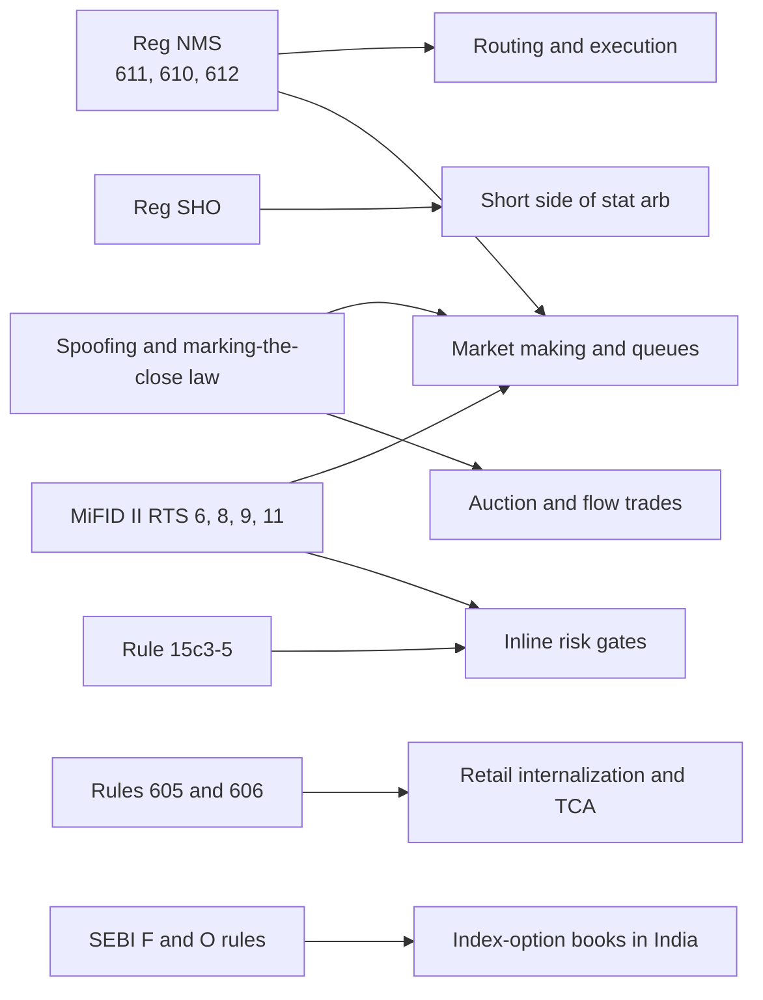
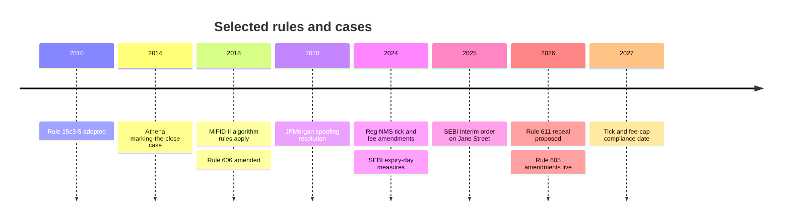

# Rules that shape strategies

> **TL;DR**
>
> - A handful of rules decide how strategies are built: Reg NMS sets routing, ticks and fees; Reg SHO sets the cost of the short side; Rule 15c3-5 puts risk checks in the order path; anti-manipulation law draws the line between cancelling quotes and spoofing.
> - US market structure is in flux as of 2026-11. The half-penny tick and the 10-mil access-fee cap are delayed to November 2027, and the SEC has proposed repealing the trade-through rule `[Verified]`.
> - Enforcement turns on intent and effect, not on cancel rates. Cases range from a \$1M marking-the-close settlement (Athena, 2014) to JPMorgan's \$920M spoofing resolution (2020) `[Verified]`.
> - Outside the US, MiFID II regulates algorithms directly (testing, kill functions, market-making obligations, tick sizes). India's SEBI tightened index-option rules in 2024–2025 and in July 2025 impounded ₹4,843.57 crore from Jane Street entities over alleged expiry-day manipulation, which the firm disputes `[Reported]`.

**Level:** Core · **Read time:** ~8 min · **Last verified:** 2026-11

Only rules that change a strategy's P&L, design or risk are here. Plumbing is in [module 01](../01-market-structure/life-of-a-stock-order.md); dated statuses are tracked in [recent changes](../01-market-structure/recent-changes.md).

## The map

| Rule | What it requires | Strategies most affected | Status as of 2026-11 |
|---|---|---|---|
| [Reg NMS](../09-reference/glossary.md#regulation-nms) Rule 611 | no trade-throughs of protected quotes; sweeps via ISOs | [smart order routing](../03-algorithms/e-execution-algorithms/smart-order-routing.md), [latency arbitrage](../02-strategies/b-speed-and-structural/latency-arbitrage.md), [market making](../02-strategies/a-liquidity-provision/equity-market-making.md) | in force; repeal proposed June 2026 `[Verified]` |
| Reg NMS 610(c), 612 and the 2024 amendments | access-fee cap, minimum tick, round lots | market making, [fee-driven strategies](../02-strategies/b-speed-and-structural/fee-and-microstructure-driven-strategies.md), queue strategies | half-penny tick and 10-mil cap delayed to Nov 2027 `[Verified]`; tiered round lots live since 2025-11-03 `[Reported]` |
| [Reg SHO](../09-reference/glossary.md#regulation-sho) | locate, short-sale circuit breaker, close-out of fails | short legs of [stat arb](../02-strategies/c-statistical-arbitrage/stat-arb-overview-and-history.md), [reversal](../02-strategies/c-statistical-arbitrage/short-term-cross-sectional-reversal.md), [event-driven](../02-strategies/d-mid-frequency-alpha/earnings-and-event-driven.md) | in force; Form SHO reporting deferred to 2028 `[Reported]` |
| Rule 15c3-5 | broker pre-trade risk controls | everyone with market access, above all HFT and market makers | adopted 2010, in force `[Verified]` |
| Anti-manipulation | no spoofing, layering or marking the close | market making, [order-book signals](../03-algorithms/f-market-making-and-hft-algorithms/order-book-and-trade-flow-signals.md), [closing-auction](../02-strategies/a-liquidity-provision/auctions-and-closing-liquidity.md) and [flow-driven](../02-strategies/d-mid-frequency-alpha/flow-driven-strategies.md) trades | enforced case by case |
| [Rule 605](../09-reference/glossary.md#rule-605) and Rule 606 | execution-quality and routing disclosure | [retail internalization](../02-strategies/a-liquidity-provision/retail-flow-internalization.md), [TCA](../03-algorithms/e-execution-algorithms/transaction-cost-analysis.md) | 605 amendments live 2026-08-01 `[Verified]` |
| MiFID II algorithmic-trading rules | testing, kill functions, market-making agreements, order-to-trade ratios, tick sizes, clocks | EU and UK market making and HFT | in force since 2018 `[Reported]` |
| SEBI index-derivative rules | fewer weekly expiries, larger contracts, expiry-day margins, position limits | Indian index-options market making and expiry-day strategies | live; Jane Street case pending `[Reported]` |

## Reg NMS: routing, ticks and fees

Rule 611 forbids executing through a better protected quote elsewhere, so routers sweep with [intermarket sweep orders](../09-reference/glossary.md#intermarket-sweep-order-iso), and every sweep is a race trigger for latency arbitrage. Rule 610(c) caps access fees at 30 mils, which sets the economics of [maker-taker](../09-reference/glossary.md#maker-taker) rebates. Rule 612 bans sub-penny quotes in stocks priced \$1 or more, which makes queues long in [tick-constrained stocks](../09-reference/glossary.md#tick-constrained-stock).

The 2024 amendments, adopted 2024-09-18, would add a \$0.005 tick for tick-constrained stocks and cut the cap to 10 mils. Compliance was first delayed to 2026-11-02, then to the first business day of November 2027 `[Verified]`. On the same day as the second delay, the SEC proposed rescinding Rule 611 and the locked-and-crossed-markets provision (Release 34-105655; 91 FR 36656) `[Verified]`; comments closed 2026-08-17 `[Reported]`. Chairman Atkins said staff would also review 610(c) and 612 `[Verified]`. **Which strategies:** queue value and rebate capture in [equity market making](../02-strategies/a-liquidity-provision/equity-market-making.md), routing logic ([E4](../03-algorithms/e-execution-algorithms/smart-order-routing.md)), trigger counts in latency arbitrage; see [fees, rebates and ticks](../01-market-structure/fees-rebates-and-ticks.md).

## Reg SHO: the cost of being short

Rule 203(b) requires a locate before a short sale, with an exception for bona fide market making `[Verified]`. Rule 201 allows shorts only above the national best bid for the rest of the day and the next day after a stock falls 10% `[Verified]`. Rule 204 forces the close-out of failed deliveries. **Which strategies:** the short legs of [factor-residual](../02-strategies/c-statistical-arbitrage/factor-residual-mean-reversion.md) and [pairs](../02-strategies/c-statistical-arbitrage/pairs-trading-and-cointegration.md) books, where [hard-to-borrow](../09-reference/glossary.md#hard-to-borrow) names carry fees and recall risk; short-term reversal and earnings strategies, which cannot hit bids after a crash. Mechanics are in [shorting, financing and settlement](../01-market-structure/shorting-financing-and-settlement.md).

## Rule 15c3-5: the market access rule

Broker-dealers with market access must run automated pre-trade controls: credit and capital thresholds, erroneous-order checks and regulatory checks. The checks must be under the broker's direct and exclusive control, and the CEO certifies them every year `[Verified]`. The SEC's first case under the rule followed Knight Capital's 2012 loss of over \$460M, with a \$12M penalty `[Verified]`. **Which strategies:** every automated book; it is why the [HFT loop's](../03-algorithms/f-market-making-and-hft-algorithms/anatomy-of-an-hft-trading-loop.md) risk gate is inline ([M9](../03-algorithms/f-market-making-and-hft-algorithms/algorithmic-risk-controls.md)).

## Spoofing, layering and marking the close

US commodities law defines [spoofing](../09-reference/glossary.md#spoofing) as bidding or offering with intent to cancel before execution `[Verified]`; in securities the same conduct is pursued as manipulation under the Exchange Act. Market makers cancel most orders legally: the line is intent at placement, not the cancel rate.

| Year | Case | Conduct | Outcome |
|---|---|---|---|
| 2014 | Athena Capital Research (SEC) | an algorithm traded in the final seconds to move Nasdaq closing prices, in 2009, at times over 70% of volume in those seconds | \$1M penalty, settled without admitting or denying `[Verified]` |
| 2015 | Navinder Sarao (CFTC) | E-mini spoofing, including around the 2010 Flash Crash | charged `[Reported]` |
| 2017 | Avalon FA and Lek Securities (SEC) | layering in US stocks, alleged profits about \$21M | charged `[Verified]` |
| 2019 | Tower Research Capital (DOJ, CFTC) | futures spoofing, 2012–2013 | \$67.4M; deferred prosecution agreement `[Verified]` |
| 2020 | JPMorgan (DOJ, CFTC) | spoofing in precious-metals futures and US Treasuries | over \$920M; deferred prosecution agreement `[Verified]` |

**Which strategies:** market makers keep records showing why orders were placed and cancelled `[Lore]`; [order-book signals](../03-algorithms/f-market-making-and-hft-algorithms/order-book-and-trade-flow-signals.md) must discount size that may be fake; [closing-auction](../02-strategies/a-liquidity-provision/auctions-and-closing-liquidity.md) and [index-rebalance](../02-strategies/d-mid-frequency-alpha/flow-driven-strategies.md) traders need a non-price-setting reason for trading near the print. Athena shows that an algorithm built to win the close can itself be the violation.

## Rules 605 and 606: disclosure that moves flow

Amended Rule 605 brings larger brokers into monthly execution-quality reporting and adds finer size buckets and time-to-execution measures; compliance began 2026-08-01 `[Verified]`. Rule 606, amended in 2018, requires quarterly public reports on held-order routing, including payments and rebates by venue. On request, brokers must also give institutional customers a routing and fill report on their not-held orders `[Verified]`. **Which strategies:** [wholesalers](../09-reference/glossary.md#wholesaler) compete on 605 statistics for retail flow; buy-side desks use 606 reports to audit brokers' [execution algorithms](../03-algorithms/e-execution-algorithms/execution-algorithms-overview.md).

## MiFID II: rules written for algorithms

The EU regulates algorithms directly. A firm is a high-frequency trader if it averages at least 2 messages per second in one instrument, or 4 across all instruments on a venue `[Verified]`. RTS 6 requires conformance testing, annual self-assessment, stress tests at twice the past six months' peak volumes, kill functionality, and pre-trade price collars and order, value and message limits `[Verified]`. RTS 8 requires a firm whose quoting meets a market-making test (firm two-sided quotes for at least 50% of continuous trading hours, on half the trading days in a month) to sign a market-making agreement with the venue `[Verified]`. RTS 9 has venues compute each member's ratio of unexecuted orders to trades `[Verified]`. RTS 11 sets minimum ticks by liquidity band (average daily trades) and price `[Verified]`. **Which strategies:** European market making carries quoting obligations, order-to-trade ratios cap aggressive requoting, and the tick regime sets queue value.

## SEBI: index options and the Jane Street order

SEBI's circular of 2024-10-01 limited weekly expiries to one benchmark index per exchange and raised the minimum contract value to ₹15 lakh. It added a 2% extreme-loss margin on short options on expiry day, all from 2024-11-20. Upfront premium collection and the end of calendar-spread margin offsets on expiry day followed from 2025-02-01, and intraday position-limit monitoring from 2025-04-01 `[Verified]`. In 2025 SEBI fixed expiries to Tuesday (NSE) or Thursday (BSE) from 2025-09-01 and moved position limits to delta-based, entity-level caps `[Reported]`.

On 2025-07-03 SEBI issued an interim ex parte order against four Jane Street entities. It alleged that on expiry days between January 2023 and March 2025 they bought Bank Nifty constituents and futures in the morning while building bearish options positions, then sold in the afternoon `[Reported]`. SEBI impounded ₹4,843.57 crore (about \$566M) as alleged unlawful gains. Jane Street deposited it on 2025-07-14 and trading restrictions were lifted from 2025-07-21, subject to conditions `[Reported]`. Jane Street disputes the findings and appealed to the Securities Appellate Tribunal; as of 2026-11 no final ruling on the merits had been reported `[Reported]`. **Which strategies:** index-options market making and expiry-day volatility selling in India. The broader lesson for US books: a regulator may treat ordinary cash trades as manipulation when they move a settlement price that a much larger derivatives position references. That is relevant to [index arbitrage](../02-strategies/b-speed-and-structural/etf-and-index-arbitrage.md), [closing auctions](../02-strategies/a-liquidity-provision/auctions-and-closing-liquidity.md) and [dispersion](../02-strategies/f-volatility-and-derivatives/dispersion-and-correlation-trading.md).

## Related pages

- [Recent changes (as of 2026-11)](../01-market-structure/recent-changes.md) · [Fees, rebates and ticks](../01-market-structure/fees-rebates-and-ticks.md) · [Shorting, financing and settlement](../01-market-structure/shorting-financing-and-settlement.md)
- [M9 Algorithmic risk controls](../03-algorithms/f-market-making-and-hft-algorithms/algorithmic-risk-controls.md) · [E4 Smart order routing](../03-algorithms/e-execution-algorithms/smart-order-routing.md)
- [Fee- and microstructure-driven strategies](../02-strategies/b-speed-and-structural/fee-and-microstructure-driven-strategies.md) · [Auctions and closing liquidity](../02-strategies/a-liquidity-provision/auctions-and-closing-liquidity.md) · [Options market making](../02-strategies/a-liquidity-provision/options-market-making.md)
- [Risk management at quant firms](risk-management-at-quant-firms.md)

## Sources

- [Verified] SEC (2024). Release 34-101070, "Regulation NMS: Minimum Pricing Increments, Access Fees, and Transparency of Better Priced Orders." <https://www.federalregister.gov/documents/2024/10/08/2024-21867/regulation-nms-minimum-pricing-increments-access-fees-and-transparency-of-better-priced-orders> (accessed 2026-11)
- [Verified] SEC (2026-06-11). Release 34-105656, order granting temporary exemptive relief from Rules 610(c) and 612. <https://www.sec.gov/files/rules/exorders/2026/34-105656.pdf> (accessed 2026-11)
- [Verified] SEC (2026-06-17). "The Trade-Through Rule and Locked and Crossed Markets Provisions of Regulation NMS" (proposed rule; 91 FR 36656). <https://www.federalregister.gov/documents/2026/06/17/2026-12163/the-trade-through-rule-and-locked-and-crossed-markets-provisions-of-regulation-nms> (accessed 2026-11)
- [Verified] Morrison Foerster (2026-06-12). "SEC Proposes Landmark Rollback of Core Regulation NMS Requirements." <https://www.mofo.com/resources/insights/260612-sec-proposes-landmark-rollback-of-core-regulation> (accessed 2026-11)
- [Verified] 17 CFR 242.203 and 242.201 (Reg SHO locate rule and circuit breaker). eCFR. <https://www.ecfr.gov/current/title-17/section-242.203> (accessed 2026-11)
- [Verified] U.S. SEC (2010-11-03). "Risk Management Controls for Brokers or Dealers with Market Access," Release No. 34-63241. <https://www.sec.gov/rules/final/2010/34-63241.pdf> (accessed 2026-11)
- [Verified] U.S. SEC (2013-10-16). *In the Matter of Knight Capital Americas LLC*, Release No. 34-70694. <https://www.sec.gov/litigation/admin/2013/34-70694.pdf> (accessed 2026-11)
- [Verified] 7 U.S.C. § 6c(a)(5)(C) (spoofing). Legal Information Institute. <https://www.law.cornell.edu/uscode/text/7/6c> (accessed 2026-11)
- [Verified] U.S. SEC (2014-10-16). "SEC Charges New York-Based High Frequency Trading Firm With Fraudulent Trading to Manipulate Closing Prices," press release 2014-229. <https://www.sec.gov/news/press-release/2014-229> (accessed 2026-11)
- [Reported] U.S. CFTC (2015-04-21). "CFTC Charges U.K. Resident Navinder Singh Sarao and His Company Nav Sarao Futures Limited PLC with Price Manipulation and Spoofing." Press release 7156-15. <https://www.cftc.gov/PressRoom/PressReleases/7156-15> (accessed 2026-11)
- [Verified] U.S. SEC (2017-03-10). "SEC Charges Firms Involved in Layering, Manipulation Schemes," press release 2017-63. <https://www.sec.gov/news/press-release/2017-63> (accessed 2026-11)
- [Verified] U.S. DOJ (2019-11). "Tower Research Capital LLC Agrees to Pay \$67 Million in Connection with Commodities Fraud Scheme." <https://www.justice.gov/opa/pr/tower-research-capital-llc-agrees-pay-67-million-connection-commodities-fraud-scheme> (accessed 2026-11)
- [Verified] U.S. DOJ (2020-09-29). "JPMorgan Chase & Co. Agrees To Pay \$920 Million in Connection with Schemes to Defraud Precious Metals and U.S. Treasuries Markets." <https://www.justice.gov/opa/pr/jpmorgan-chase-co-agrees-pay-920-million-connection-schemes-defraud-precious-metals-and-us> (accessed 2026-11)
- [Verified] SEC (2025-10-02). "Extension of Compliance Date for Disclosure of Order Execution Information" (Rule 605 to 2026-08-01; 90 FR 47552). <https://www.federalregister.gov/documents/2025/10/02/2025-19316/extension-of-compliance-date-for-disclosure-of-order-execution-information> (accessed 2026-11)
- [Verified] SEC (2018-11-19). "Disclosure of Order Handling Information" (Rule 606 amendments; 83 FR 58338). <https://www.federalregister.gov/documents/2018/11/19/2018-24423/disclosure-of-order-handling-information> (accessed 2026-11)
- [Verified] Commission Delegated Regulations (EU) 2017/565 Art. 19 (HFT definition), 2017/589 (RTS 6), 2017/578 (RTS 8), 2017/566 (RTS 9), 2017/588 (RTS 11), as published on legislation.gov.uk. <https://www.legislation.gov.uk/eur/2017/589/contents> (accessed 2026-11)
- [Verified] SEBI (2024-10-01). "Measures to Strengthen Equity Index Derivatives Framework for Increased Investor Protection and Market Stability," circular SEBI/HO/MRD/TPD-1/P/CIR/2024/132 (text via TaxGuru). <https://www.sebi.gov.in/legal/circulars/oct-2024/measures-to-strengthen-equity-index-derivatives-framework-for-increased-investor-protection-and-market-stability_87208.html> (accessed 2026-11)
- [Reported] Moneylife (2025-06). "NSE Equity F&O Contracts To Expire on Tuesdays, BSE on Thursdays from 1st September." <https://www.moneylife.in/article/nse-equity-fo-contracts-to-expire-on-tuesdays-bse-on-thursdays-from-1st-september/77434.html> (accessed 2026-11)
- [Reported] SCC Online Blog (2025-09-03). "SEBI Intraday Position Limits." <https://www.scconline.com/blog/post/2025/09/03/sebi-equity-derivatives-intraday-limits-2025/> (accessed 2026-11)
- [Reported] Kansal, V. (2025-07). "Jane Street and the Expiry Day Trap: Unpacking SEBI's Crackdown on Algorithmic Manipulation in India." *Oxford Business Law Blog*. <https://blogs.law.ox.ac.uk/oblb/blog-post/2025/07/jane-street-and-expiry-day-trap-unpacking-sebis-crackdown-algorithmic> (accessed 2026-11)
- [Reported] Business Today (2026-02-25). "Jane Street vs Sebi: SAT adjourns hearing in market manipulation case." <https://www.businesstoday.in/markets/story/jane-street-vs-sebi-sat-adjourns-hearing-in-market-manipulation-case-517925-2026-02-25> (accessed 2026-11)
- [Reported] LiveLaw (2026-10). "SAT Reserves Order On Jane Street's Plea Over SEBI's Non-Disclosure Of Relevant Documents." <https://www.livelawbiz.com/securities-law/sat/securities-appellate-tribunal-reserves-order-jane-street-challenge-sebi-non-disclosure-relevant-documents-555493> (accessed 2026-11)
