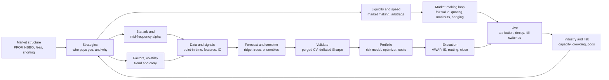

# Elevator explanations

> **TL;DR**
>
> - 74 concepts, each in two spoken lengths: a 30-second version (about 50 words) and a 2-minute version (about 130 words). 66 of them are strategies or algorithms.
> - Each 30-second version answers three questions: what it is, who pays for it and how it breaks. The 2-minute version adds the mechanism, one or two sourced numbers and the honest caveat.
> - Numbers carry the same confidence tags as the deep-dive pages. Say the tag out loud when it matters: "that's an academic backtest," "that's lore."
> - Every concept ends with a link to the page that explains it properly. Read that page before you use the 2-minute version on someone who runs the strategy.

**Level:** Core · **Read time:** ~60 min in full; 1–2 min per concept · **Last verified:** 2026-11

## How to use this page

- **Two listeners.** The 30-second version is for your CFO or a board: no formulas, one number, the economic point. The 2-minute version is for a quant: it names the model, the parameter that matters and the failure mode, so they hear that you know where the problems are.
- **Always name the counterparty.** Explanations land better when they say who is on the other side and why they accept the price. Quants weigh that line more than any other ([how quants evaluate a strategy](../02-strategies/how-quants-evaluate-a-strategy.md)).
- **Learn the beats, not the words.** Each version has three or four beats (what, why it pays, the number, how it fails). Memorize those and the one number; rebuild the sentences on the fly.
- **Quote numbers the way the pages do.** Sharpe ratios are annualized and say gross or net, period and source type. "Synthetic lab" marks a number from this KB's [labs](../labs.md): it shows a mechanism, not a real-world level.
- **Don't add firm gossip.** Firm-specific claims stop at what the [firm profiles](../04-industry-and-firms/firm-profiles/index.md) source. If a quant asks what you think their firm does, the right answer is a question ([how to talk to a quant](how-to-talk-to-a-quant.md)).

The concept map shows how the four sections connect: market structure sets the rules, strategies say who pays, the pipeline turns that into trades, and the industry layer decides how much capital each idea gets.

## Contents

| Section | Concepts |
|---|---|
| Strategies (30) | [Equity market making](#equity-market-making) · [ETF market making](#etf-market-making) · [Options market making](#options-market-making) · [Retail flow internalization](#retail-flow-internalization) · [Closing auction liquidity](#closing-auction-liquidity) · [Latency arbitrage](#latency-arbitrage) · [Lead-lag](#lead-lag-and-cross-asset-arbitrage) · [ETF and index arbitrage](#etf-and-index-arbitrage) · [Fee and microstructure strategies](#fee-and-microstructure-strategies) · [Statistical arbitrage](#statistical-arbitrage) · [Pairs trading](#pairs-trading-and-cointegration) · [Factor-residual reversion](#factor-residual-mean-reversion) · [Short-term reversal](#short-term-reversal) · [Intraday patterns](#intraday-patterns-and-seasonality) · [ML short-horizon alpha](#ml-driven-short-horizon-alpha) · [Cross-sectional alpha](#cross-sectional-alpha-and-neutralization) · [Fundamental signals](#fundamental-quant-signals) · [PEAD](#post-earnings-announcement-drift-pead) · [Analyst revisions](#analyst-revisions-and-sentiment) · [Index events and flows](#flow-driven-and-index-event-trading) · [Alternative data](#alternative-data) · [NLP and LLM signals](#nlp-and-llm-signals) · [Factor investing](#factor-investing) · [Momentum](#momentum) · [Value, quality, low vol](#value-quality-and-low-volatility) · [Quant winters](#factor-timing-and-quant-winters) · [Volatility risk premium](#volatility-risk-premium) · [Dispersion](#dispersion-and-correlation-trading) · [Trend following](#trend-following) · [Carry](#carry) |
| Algorithms and pipeline (36) | [The pipeline](#the-pipeline-there-is-no-single-algorithm) · [Point-in-time data](#point-in-time-data) · [Feature engineering](#feature-engineering) · [Signal transforms](#signal-transforms-and-neutralization) · [IC and the Fundamental Law](#information-coefficient-and-the-fundamental-law) · [Ridge regression](#ridge-and-regularized-regression) · [Boosted trees](#gradient-boosted-trees) · [Alpha combination](#alpha-combination) · [Regime detection](#regime-detection) · [Purged CV](#purged-cross-validation) · [Backtest pitfalls](#backtest-pitfalls) · [Deflated Sharpe](#deflated-sharpe-ratio) · [Risk models](#factor-risk-models) · [Covariance shrinkage](#covariance-shrinkage) · [MVO](#mean-variance-optimization) · [Risk parity and HRP](#risk-parity-and-hrp) · [Impact models](#market-impact-and-cost-models) · [Trading toward the aim](#trading-toward-the-aim) · [Kelly and vol targeting](#kelly-sizing-and-volatility-targeting) · [VWAP, TWAP, POV](#vwap-twap-and-pov) · [IS and Almgren-Chriss](#implementation-shortfall-and-almgren-chriss) · [Smart order routing](#smart-order-routing) · [Close and dark algos](#closing-auction-and-dark-pool-algos) · [TCA](#transaction-cost-analysis) · [HFT loop](#the-hft-trading-loop) · [Microprice](#fair-value-and-microprice) · [OFI](#order-flow-imbalance) · [Avellaneda-Stoikov](#avellaneda-stoikov-quoting) · [Markouts](#markouts-and-adverse-selection) · [Queue position](#queue-position) · [Delta hedging](#delta-hedging) · [Vol surfaces](#volatility-surfaces) · [Kill switches](#kill-switches-and-risk-controls) · [P&L attribution](#pl-attribution) · [Alpha decay](#alpha-decay-and-model-retirement) · [Reinforcement learning](#reinforcement-learning) |
| Market structure (4) | [Payment for order flow](#payment-for-order-flow) · [NBBO and the SIP](#nbbo-and-the-sip) · [Maker-taker and tick size](#maker-taker-fees-and-tick-size) · [Short selling and T+1](#short-selling-reg-sho-and-t1) |
| Industry and risk (4) | [Who pays you](#who-pays-you-the-six-edge-sources) · [Capacity](#capacity) · [Crowding](#crowding) · [Pods versus one book](#pods-versus-one-book) |

## Strategies

### Equity market making

**30 seconds.** An electronic market maker quotes a bid and an offer in thousands of stocks all day and earns the gap, plus exchange rebates, on each round trip. Its real cost is the trader who knows more and picks off a stale quote. Net, it keeps roughly a tenth of a cent per share `[Estimate]`, on enormous volume.

**2 minutes.** Think of a retailer with a razor-thin gross margin and huge unit volume. Revenue is the half-spread captured on each fill, plus rebates. Cost of goods is [adverse selection](../09-reference/glossary.md#adverse-selection): fills against informed traders, after which the price moves against you. The best public case is Menkveld's 2013 study of one high-frequency market maker in Dutch stocks: about €1.55 of spread per trade net of fees, minus €0.68 lost on positions, for €0.88 a trade and an annualized gross Sharpe of 9.35 on the capital it used `[Verified]`. The edge is not the quoting formula. It is an accurate fair value, cancelling stale quotes before they get hit, and low cost per share. It fails three ways: toxic-flow spikes, technology errors (Knight Capital lost over \$460 million in about 45 minutes in 2012 `[Verified]`) and volatility events when everyone pulls quotes at once.

→ Deep dive: [Equity market making](../02-strategies/a-liquidity-provision/equity-market-making.md)

### ETF market making

**30 seconds.** An ETF market maker quotes the fund off its own fair value, built from the underlying basket, index futures and related ETFs. It hedges each fill at once and, at the end of the day, creates or redeems fund shares with the issuer to go flat. It earns a couple of basis points on very large volume.

**2 minutes.** An ETF has a second market behind the exchange. [Authorized participants](../09-reference/glossary.md#authorized-participant) can deliver a basket of stocks to the issuer and receive new ETF shares, or the reverse. That [creation and redemption](../09-reference/glossary.md#creation-and-redemption) channel caps how far the price can drift from the basket. It also lets a market maker sell ETF shares it doesn't own, hedge with the basket or a future, and square up at the close. Margins are thin and scale is concentrated: Flow Traders earned €485.8 million of net trading income on €1,940 billion of ETP value traded in 2025, about 2.5 basis points `[Reported]`. When the basket is stale or shut, as in bond ETFs in March 2020, the ETF becomes the price and the market maker prices the fund, not its stale NAV. It fails when hedges can't be priced, as on 24 August 2015.

→ Deep dive: [ETF market making](../02-strategies/a-liquidity-provision/etf-market-making.md)

### Options market making

**30 seconds.** Options market makers quote thousands of contracts per stock, all priced off one fitted volatility surface. They earn the edge between their price and theoretical value, hedge the stock exposure within seconds and warehouse the volatility risk. Retail short-dated options are the main flow; overnight gaps and volatility spikes are the main danger.

**2 minutes.** Write it as an income statement. Revenue is edge: the trade price minus your theoretical value. The stock exposure, delta, is [hedged](../09-reference/glossary.md#delta-hedging) within seconds. What remains is gamma and vega. On a short option, theta earned minus gamma paid nets out to implied volatility versus realized, and vega is a mark-to-market on the surface. Costs are hedging, exchange fees and payment for order flow. The flow is mostly retail: over 60% of volume by one academic estimate `[Verified]`, and same-day-expiry options reached a record 66.2% of S&P 500 index option volume in July 2026 `[Verified]`. The technical core is the [volatility surface](../09-reference/glossary.md#volatility-surface): one smooth, arbitrage-free function that prices every strike and expiry consistently. Practitioner lore puts net Sharpe at 3 to 10 for diversified flow books `[Lore]`. It fails on gaps: one session can erase weeks of theta.

→ Deep dive: [Options market making](../02-strategies/a-liquidity-provision/options-market-making.md)

### Retail flow internalization

**30 seconds.** Retail brokers send customers' market orders to a handful of [wholesalers](../09-reference/glossary.md#wholesaler). The wholesaler pays for the flow, fills it as principal at or better than the best exchange price, and keeps a fraction of a cent a share. It can afford both because retail orders rarely predict the next price move.

**2 minutes.** The business is segmentation. An exchange must price for its average counterparty, including the fastest and best-informed. A wholesaler knows which broker sent the order and that retail flow is mostly uninformed, so it can fill inside the spread and still earn money. In accounting terms, it is customer-level pricing instead of a list price. It is concentrated: the SEC found that six wholesalers received over 90% of individual investors' marketable orders `[Verified]`. Execution quality varies by broker, too: round-trip costs for identical orders ranged from 0.07% to 0.46% across six brokerage accounts in one study `[Verified]`. The failure mode is retail turning correlated. In one week of January 2021, GameStop's off-exchange share of dollar volume fell from 62.6% to 32.8%, consistent with wholesalers internalizing less of a one-way crowd `[Verified]`.

→ Deep dive: [Retail flow internalization](../02-strategies/a-liquidity-provision/retail-flow-internalization.md)

### Closing auction liquidity

**30 seconds.** Index funds and benchmarked managers must trade at the official 4 p.m. closing price, whatever it is. When their buy and sell orders don't balance, the exchange publishes the imbalance and someone with balance sheet takes the other side. That provider earns a small price concession, which usually reverses within a day.

**2 minutes.** The close is one call auction, and it keeps growing: about 3% of US dollar volume in 2010, a record 9.4% of notional in Q2 2024 and around 20% on index rebalance days `[Reported]`. After the order cutoff (3:50 p.m. on NYSE, 3:55 on Nasdaq) exchanges publish [imbalance](../09-reference/glossary.md#auction-imbalance) messages, and new orders may only offset the imbalance. That is the provider's moment. If index funds need to buy \$2 billion more than is offered, the clearing price rises, the provider sells into it, and on average the concession reverts quickly and almost completely (Bogousslavsky and Muravyev 2023) `[Verified]`. The edge per share is small. The risks are overnight inventory through news, and imbalances that turn out to be informed rather than mechanical. Keep one line clear: absorbing an imbalance is liquidity provision; trading to move the close is manipulation.

→ Deep dive: [Auctions and closing liquidity](../02-strategies/a-liquidity-provision/auctions-and-closing-liquidity.md)

### Latency arbitrage

**30 seconds.** When news moves the fair price, say an S&P futures tick in Chicago, some quotes in New Jersey stay stale for a few microseconds. [Latency arbitrage](../09-reference/glossary.md#latency-arbitrage) is the race to trade against them before they are cancelled. It is not a forecast; it is being first. The fastest firm wins most races.

**2 minutes.** The best data comes from London, where Aquilina, Budish and O'Neill used exchange message logs to see every race. Winners beat the first loser by a modal 5 to 10 microseconds, races were about 20% of FTSE 100 volume, and the implied tax on trading was about half a basis point of volume, roughly \$5 billion a year across global equity markets `[Verified]`. Who pays? First the market maker whose cancel lost the race. Then, because market makers price that risk into their spreads, every investor. That is why it is controversial: it is a transfer, not price discovery. Capacity is measured in P&L, not capital, because the edge is rank in the race; second place earns close to nothing `[Lore]`. Countermeasures work only venue by venue, such as IEX delaying every inbound message by 350 microseconds `[Verified]`.

→ Deep dive: [Latency arbitrage](../02-strategies/b-speed-and-structural/latency-arbitrage.md)

### Lead-lag and cross-asset arbitrage

**30 seconds.** Prices are discovered first in the cheapest, most liquid instrument, usually E-mini S&P futures, then spread to ETFs, stocks and ADRs. [Lead-lag](../09-reference/glossary.md#lead-lag) trading prices each follower off the leader's move, then takes stale quotes or skews its own. The fast end is a race; the slow end is a statistical forecast.

**2 minutes.** The academic anchor is Hasbrouck (2003): most price discovery for US large-cap indexes happens in E-mini futures `[Verified]`. So when futures jump, SPY should follow, then the stocks, each scaled by its beta. At the millisecond end this is latency arbitrage on the Chicago to New Jersey route, where microwave links run within about 2% of the speed of light `[Estimate]`. Those windows shrank from roughly 100 milliseconds in 2005 to single digits by 2011 `[Verified]`. At seconds to minutes it becomes a forecasting problem with more capacity: the follower lags because its liquidity is thin or its quoters update slowly. Market makers use the same signal defensively, shading quotes before the follower moves. Stale quoters and resting orders in the follower pay. Practitioner estimates put seconds-to-minutes books at gross Sharpe 2 to 4 and net 1 to 2 `[Estimate]`.

→ Deep dive: [Lead-lag and cross-asset arbitrage](../02-strategies/b-speed-and-structural/lead-lag-and-cross-asset-arbitrage.md)

### ETF and index arbitrage

**30 seconds.** One index exposure trades in several wrappers: the stocks, the ETF and the futures. Arbitrage keeps them within a few basis points of each other. If the ETF trades rich to its basket, sell the ETF, buy the stocks and create new fund shares. It only pays outside your all-in cost band.

**2 minutes.** It is really three trades. [ETF arbitrage](../09-reference/glossary.md#etf-arbitrage): ETF versus basket, closed by creation and redemption with the issuer. [Index arbitrage](../09-reference/glossary.md#index-arbitrage): futures versus basket, where fair value is spot plus financing minus dividends, so the basis is effectively a financing rate quoted in basis points. And ETF versus constituents, traded statistically. Each lives inside a no-arbitrage band set by the cheapest arbitrageur's costs: the spread on hundreds of stocks, creation fees (SPY's is the lower of \$3,000 or 10 basis points of a creation unit `[Verified]`), financing and borrow. Trade inside your band and you lose. The interesting cases are when the basket can't trade: halts, closed foreign markets, frozen bond markets. Then the ETF is the price, and the "arbitrage" is a risky view on the basket. US industry P&L is perhaps \$0.3 to \$2 billion a year `[Estimate]`.

→ Deep dive: [ETF and index arbitrage](../02-strategies/b-speed-and-structural/etf-and-index-arbitrage.md)

### Fee and microstructure strategies

**30 seconds.** Exchange fee schedules and order-type rules create small, legal edges. A market maker in a one-cent-spread stock may earn as much from rebates and queue position as from the spread itself. These strategies optimize where and how orders rest. They are worth tens of millions a year to a large firm, not billions.

**2 minutes.** The idea: the displayed price is not the real price; the fee-adjusted price is. On a [maker-taker](../09-reference/glossary.md#maker-taker) venue the resting order earns a rebate. On an [inverted venue](../09-reference/glossary.md#inverted-venue) the maker pays instead, which buys a spot at the front of the queue at the same displayed price. So the effective price grid is finer than a penny, and routers rank venues net of fees. Firms monetize this through [rebate capture](../09-reference/glossary.md#rebate-capture) in tick-constrained names, by paying for priority when queues are long, and with order types such as midpoint and odd-lot orders. A rough size: 4 to 8 hundredths of a cent of net edge per share on a few hundred million shares a day, or \$10 to \$100 million a year for a large market maker `[Estimate]`. And the line to keep straight: optimizing fees and queues is legal; spoofing, layering and wash trades are not.

→ Deep dive: [Fee- and microstructure-driven strategies](../02-strategies/b-speed-and-structural/fee-and-microstructure-driven-strategies.md)

### Statistical arbitrage

**30 seconds.** [Stat arb](../09-reference/glossary.md#statistical-arbitrage) holds thousands of small long and short positions in stocks that look temporarily mispriced relative to their peers, neutral to the market, sectors and styles. Positions last hours to about ten days. Mostly it is paid for absorbing other investors' temporary price pressure: liquidity provision on a slower clock.

**2 minutes.** It started at Morgan Stanley in the mid-1980s with an industry-group reversal system, and D. E. Shaw, founded in 1988, carried it into the hedge-fund era `[Reported]`. The modern version ranks 1,000 to 3,000 stocks on many weak signals, hedges factor exposures with a risk model and trades through a cost-aware optimizer. The academic record shows real but decaying profits. Khandani and Lo found that a simple contrarian strategy's average daily return fell from 1.38% in 1995 to 0.13% in 2007, so it needed about 9-to-1 leverage to match its 1998 returns `[Verified]`. That is the signature risk. Thin edges invite leverage, and leverage turns crowding into forced selling: when one fund liquidates, everyone holding the same positions is marked down together. Practitioners quote diversified books at net Sharpe 1 to 3 `[Lore]`; there is no audited public figure.

→ Deep dive: [Stat arb: overview and history](../02-strategies/c-statistical-arbitrage/stat-arb-overview-and-history.md)

### Pairs trading and cointegration

**30 seconds.** Pick two stocks that historically move together, like two oil majors. When the gap between them widens unusually, buy the laggard, short the leader and wait for it to close. It is the two-stock version of stat arb. Choosing the pairs is the hard part; most apparent pairs are coincidences.

**2 minutes.** The classic study is Gatev, Goetzmann and Rouwenhorst (2006): pairs matched on price distance earned up to 11% a year before costs from 1962 to 2002, with profits falling after 1988 `[Verified]`. After realistic costs, the simple version has been largely unprofitable since 2002 `[Verified]`. The more rigorous selection tests for [cointegration](../09-reference/glossary.md#cointegration): whether the spread is stationary, reverting to a mean instead of wandering off. The trap is multiple testing. Screen hundreds of candidates and many pass by chance; in a synthetic lab, about 94% of same-sector pairs passing a 5% test were false. Economically, you are paid by someone selling one stock for reasons unrelated to its twin, such as a liquidation or index deletion. When the gap is news, a takeover or a fraud, the counterparty is informed and you are the one paying. Stops are insurance, not alpha.

→ Deep dive: [Pairs trading and cointegration](../02-strategies/c-statistical-arbitrage/pairs-trading-and-cointegration.md)

### Factor-residual mean reversion

**30 seconds.** Strip out what the market, the sector and other common factors explain about each stock's return. The leftover, the [residual](../09-reference/glossary.md#residual-return), tends to reverse over days. Buy stocks whose residual fell unusually far, short those that rose, and hedge the factors. It is the industrial-scale version of pairs trading.

**2 minutes.** The reference is Avellaneda and Lee (2010). They extracted 15 statistical factors by [principal components](../09-reference/glossary.md#principal-component-analysis-pca), modeled each stock's cumulative residual as a mean-reverting process, and traded when its standardized distance from equilibrium, the [s-score](../09-reference/glossary.md#s-score), passed 1.25. Net of 10 basis points of round-trip costs, the Sharpe was 1.44 over 1997–2007 but only 0.9 in 2003–07 `[Verified]`: an academic backtest that decayed. Holds of about a week make it a turnover machine, trading 40 to 60 times the book a year `[Estimate]`. So it lives or dies on costs. A \$1 billion book trades roughly \$200 million a day, and spread plus impact approaches the edge around that size, which caps the plain signal at perhaps \$100 million to \$1 billion of gross book `[Estimate]`. It is crowded, too: in August 2007 their backtests lost 5% to 10% in days, then recovered `[Verified]`.

→ Deep dive: [Factor-residual mean reversion](../02-strategies/c-statistical-arbitrage/factor-residual-mean-reversion.md)

### Short-term reversal

**30 seconds.** Last week's losers tend to beat last week's winners next week. It is one of the oldest anomalies, and it is a fee for absorbing temporary price pressure. It has the best gross Sharpe of the classic anomalies and the worst net, because it trades the book 50 to 100 times a year.

**2 minutes.** Three papers in 1990, by Lehmann, Jegadeesh, and Lo and MacKinlay, documented [short-term reversal](../09-reference/glossary.md#short-term-reversal). The economics are liquidity provision: someone sold hard last week for reasons other than information, and you buy at a discount. That is why expected returns rise with the VIX (Nagel 2012) `[Verified]`: when liquidity is scarce, providers are paid more. The decay is stark. Ken French's one-month reversal factor had a gross Sharpe of 0.92 in 1963–1991 and 0.01 in 2010–2026 `[Verified]` (our computation), and it lost 18% in 2025 `[Verified]`. What survives is the refined version: reversal of residual returns, excluding moves that came with news, blended into a multi-signal book where its trades net against other signals' trades. It fails when liquidity providers need liquidity themselves, as in August 2007 and March 2020.

→ Deep dive: [Short-term cross-sectional reversal](../02-strategies/c-statistical-arbitrage/short-term-cross-sectional-reversal.md)

### Intraday patterns and seasonality

**30 seconds.** Trading has a daily shape: volume and volatility peak at the open and the close, and the closing auction alone prints roughly 5 to 10% of volume `[Reported]`. Some returns have a calendar too. Firms mostly use these patterns to time execution and as model features, not as standalone bets.

**2 minutes.** Three patterns are worth knowing. First, the U-shape: volume and volatility peak at the open and close, and spreads are widest at the open, which is why a VWAP algorithm is mostly a volume-curve forecaster. Second, intraday momentum: Baltussen and coauthors found that the return from the prior close to 3:30 p.m. predicts the last half-hour in over 60 futures markets from 1974 to 2020, linked to dealers' and leveraged ETFs' hedging `[Verified]`. Third, night versus day: Lou, Polk and Skouras (2019) found momentum profits accrue overnight and other strategies' profits intraday, a tug of war between clienteles. Calendar effects such as turn-of-month and the pre-FOMC drift are real but small, and several have faded. Standalone net Sharpes are modest, perhaps 0.3 to 0.8 `[Lore]`. The bigger payoff is timing the whole book's execution.

→ Deep dive: [Intraday patterns and seasonality](../02-strategies/c-statistical-arbitrage/intraday-patterns-and-seasonality.md)

### ML-driven short-horizon alpha

**30 seconds.** Large teams forecast each stock's return relative to its peers over the next few minutes to a day, from hundreds of features, with boosted trees and neural nets. Each prediction barely beats a coin flip. The money comes from making thousands of them a day and keeping trading costs below the edge.

**2 minutes.** The numbers are humbling. A good short-horizon signal has a rank [information coefficient](../09-reference/glossary.md#information-coefficient-ic) of 0.01 to 0.05: the correlation between your forecast and what happens next. Breadth does the work, because the information ratio scales with the square root of the number of independent bets. The hard parts are not the model architecture. They are the label (exactly what you predict, net of which factors), validation that doesn't leak the future, retraining as markets shift, and resisting overfitting. Costs belong inside the objective, because turnover runs 50 to 200% of the book a day `[Estimate]`. Academic ML stat arb on the S&P 500 earned over 0.45% a day before costs in 1992–2015, shrinking over time `[Reported]`. Impact caps capacity at perhaps \$200 million to \$2 billion of gross book `[Estimate]`. Failures come from regime breaks, crowded unwinds and backtests that learned noise.

→ Deep dive: [ML-driven short-horizon alpha](../02-strategies/c-statistical-arbitrage/ml-driven-short-horizon-alpha.md)

### Cross-sectional alpha and neutralization

**30 seconds.** The canonical quant equity book ranks 1,000 to 3,000 stocks against each other every day on many weak signals, then holds the top against the bottom for days to weeks, with near-zero market, sector and style exposure. Any one signal is barely better than chance; diversification across signals and stocks makes the Sharpe.

**2 minutes.** Walk it as a pipeline. Raw signals, called alphas, are cleaned: outliers clipped, values turned into ranks or z-scores. Then [neutralized](../09-reference/glossary.md#neutralization): each day, regress out beta, industry and style exposures and keep the residual, so the book bets on stock-specific views, not on the market or on value. Then combined into one forecast and fed, with a risk model and a cost model, into an optimizer that outputs trades. The design logic is the Fundamental Law: information ratio is roughly transfer coefficient times IC times the square root of breadth. Practitioners quote diversified books at gross Sharpe 1.5 to 3 and net 1 to 2 `[Lore]`. It fails through costs (it trades 10 to 40% of the book a day), crowding, and decay: published signals lose about 58% of their return after publication `[Verified]`.

→ Deep dive: [Cross-sectional alpha and neutralization](../02-strategies/d-mid-frequency-alpha/cross-sectional-alpha-and-neutralization.md)

### Fundamental quant signals

**30 seconds.** Fundamental quant turns an analyst's judgments from the financial statements (is it cheap, are earnings backed by cash, is management over-investing) into ratios computed identically for 3,000 stocks and ranked within sector. It is slow, cheap to trade and high-capacity, but crowded and decayed.

**2 minutes.** The core families will sound familiar from the CFA: value (book-to-market, earnings yield, EV to EBITDA), profitability (gross profits over assets), accruals (earnings not backed by cash flow), asset growth, and earnings-quality composites. The hard part is not the ratio; it is knowing when each number became public. Databases restate history, filings arrive weeks after the quarter ends, and a backtest that uses the restated figure has quietly looked into the future. That is where [point-in-time data](../09-reference/glossary.md#point-in-time-data) matters most. Economically, these signals are part risk premium and part behavioral, since investors extrapolate growth and fixate on headline earnings. Single academic long-short factors earned gross Sharpe of roughly 0.3 to 0.5 since 1963 `[Estimate]`, weaker after publication, and the accruals anomaly has largely faded. Capacity is large because the book turns over only one to three times a year.

→ Deep dive: [Fundamental quant signals](../02-strategies/d-mid-frequency-alpha/fundamental-quant-signals.md)

### Post-earnings announcement drift (PEAD)

**30 seconds.** After a big earnings surprise, the stock tends to keep drifting the same way for weeks, as if investors under-react. The classic quant event trade buys positive surprises and shorts negative ones. It is famous and contested, and trading costs around the announcement eat much of the edge.

**2 minutes.** The surprise is standardized: actual minus expected earnings, scaled by the volatility of past surprises, known as SUE. Bernard and Thomas (1989) found about 4.2% over 60 trading days for top-minus-bottom surprise deciles in 1974–1985 `[Reported]`. The behavioral story is inattention: [PEAD](../09-reference/glossary.md#post-earnings-announcement-drift-pead) is stronger when many firms report on the same day, or on Fridays. Then the debate. Martineau (2022) finds the drift gone in non-microcap stocks since 2006 `[Verified]`; papers in 2025 dispute that, so treat it as open. Neighbouring event trades share the machinery: the earnings-announcement premium, reversal of pre-announcement liquidity pressure, and merger arbitrage, which is in effect selling insurance against a deal breaking. The practical problem is execution. Entries cluster on the days when spreads are widest and gaps largest, so a thin edge disappears unless the cost model is honest.

→ Deep dive: [Earnings and event-driven](../02-strategies/d-mid-frequency-alpha/earnings-and-event-driven.md)

### Analyst revisions and sentiment

**30 seconds.** Analysts update earnings estimates slowly and in herds, so one upward revision tends to be followed by more, and prices drift with them. Revision momentum is one of the most durable mid-frequency signals. Short interest, news sentiment and options-market signals add faster, more crowded information.

**2 minutes.** The revision signal is simple: the net change in consensus estimates over the last one to three months, scaled by price or by the spread of estimates. It works because analysts anchor on their prior and move gradually, and investors anchored on the stale consensus under-react. Recommendation changes move prices on the day and drift afterwards, especially downgrades, but trading them alone has not been reliably profitable after costs `[Verified]`. Short interest reads the footprints of informed short sellers; the same crowded shorts are the squeeze candidates. Options give a fast read because informed traders favor them: in Xing, Zhang and Zhao's study, steep put skew predicted underperformance, worth about 10.9% a year risk-adjusted and gross in 1996–2005 `[Verified]`. News and social sentiment decay within days. Inside a composite, practitioners credit these signals with 0.2 to 0.5 of net Sharpe `[Lore]`.

→ Deep dive: [Analyst revisions and sentiment](../02-strategies/d-mid-frequency-alpha/analyst-revisions-and-sentiment.md)

### Flow-driven and index-event trading

**30 seconds.** Some investors must trade on a rule or a calendar, whatever the price: index funds at [reconstitution](../09-reference/glossary.md#index-reconstitution), pensions rebalancing, funds meeting redemptions, dealers hedging. Flow traders position early and take the other side. Because the rules are public, the edge is crowded and has been shrinking for decades.

**2 minutes.** The textbook case is an S&P 500 addition. Index funds must buy at the close on the effective date, so the stock rises between announcement and inclusion. Greenwood and Sammon (2025) put the inclusion effect at 7.4% in the 1990s and under 1% in the 2010s `[Verified]`: arbitrageurs front-ran it until it shrank and moved earlier. Petajisto estimated that index funds paid at least 21 to 28 basis points a year in the S&P 500 and 38 to 77 in the Russell 2000 over 1990–2005 `[Verified]`. The current calendar: Russell now reconstitutes twice a year, and the December 2026 changes take effect after the close on 11 December `[Verified]`. Index funds pay because zero tracking error matters more to them than price. The risk is that everyone reads the same methodology, so crowding sets the price of the trade.

→ Deep dive: [Flow-driven strategies](../02-strategies/d-mid-frequency-alpha/flow-driven-strategies.md)

### Alternative data

**30 seconds.** [Alternative data](../09-reference/glossary.md#alternative-data) is anything that estimates a company's numbers before it reports them: card transactions, app usage, satellite counts of parking lots, job postings, scraped prices. Mostly it is a revenue nowcast ahead of earnings. The edge lives in the data plumbing, and legal review comes first.

**2 minutes.** The best-known evidence: satellite counts of retailers' parking lots earned about 4 to 5% over the three days around earnings in 2011–2017 `[Reported]`. But the work is mostly unglamorous. A card panel covers a biased slice of consumers, so you correct for its composition. Brands must be mapped to tickers through mergers. You need history as it was delivered, not as the vendor later backfilled it, or the backtest is fiction. Then legal: is anything material non-public, and was the data obtained with consent? App Annie paid a \$10 million SEC penalty in 2021 over how its data was derived `[Verified]`. The economics look like fixed-cost capex: most buyers spend \$0.5 to \$2.5 million a year on data `[Reported]`, against sleeves of perhaps \$50 to \$500 million `[Estimate]`, so each dataset has a break-even fund size. Edges shrink as vendors add clients.

→ Deep dive: [Alternative data](../02-strategies/d-mid-frequency-alpha/alternative-data.md)

### NLP and LLM signals

**30 seconds.** Text becomes numbers: first word lists, then trained classifiers, now large language models scoring news, earnings calls and filings. It works on three clocks: news over seconds to days, call tone over weeks, filing changes over months. The signature trap is a model that has already read what happened next.

**2 minutes.** "Lazy Prices" found that firms whose annual-report language changed a lot from last year later underperformed, worth up to 188 basis points a month of alpha in 1995–2014, gross `[Verified]`. Lopez-Lira and Tang, in the *Journal of Financial Economics* (2026), show that GPT scores of headlines predict next-day returns, and that the edge shrinks as adoption rises. Now the trap. A model trained on text through 2023 has read about 2023's outcomes, so a backtest before its training cutoff is contaminated by [look-ahead bias](../09-reference/glossary.md#look-ahead-bias). Clean tests use time-stamped models or post-cutoff data only; a 2026 preprint doing that found a gross Sharpe of 3.2 before costs on 2013–2024 headlines `[Verified]`, so the leak is real but not the whole story. Slow text has capacity but is crowded, and companies now write for machine readers.

→ Deep dive: [NLP and LLM signals](../02-strategies/d-mid-frequency-alpha/nlp-and-llm-signals.md) · [LLMs and foundation models in quant](../03-algorithms/b-forecasting-models/llms-and-foundation-models-in-quant.md)

### Factor investing

**30 seconds.** A factor is a long-short rule, like cheap minus expensive or recent winners minus losers, whose return many stocks share. Factors pay as compensation for risk, as a persistent behavioral mispricing, or because some investors are constrained. Single factors are weak; diversifying across them is where the Sharpe comes from.

**2 minutes.** The history is a series of reclassifications: CAPM, then Fama and French's three factors in 1993, Carhart's momentum in 1997, five factors and the q-factor model in 2015. Each step turned yesterday's "alpha" into beta anyone can buy cheaply. The numbers, from Ken French's data, gross and academic, 1963 to 2026: value's Sharpe was 0.34, momentum's 0.50 and profitability's 0.37; an equal-risk mix reached 0.71, but only 0.23 since 2007 `[Verified]` (our computation). A live multi-asset style fund, AQR's Style Premia Alternative, has netted about 0.54 since 2013 `[Verified]`. Construction choices such as breakpoints, weighting and price lags move results almost as much as the idea itself. The "factor zoo" debate asks how many of 400-plus published anomalies are real. Both camps agree that published returns shrink by about half.

→ Deep dive: [Factor investing fundamentals](../02-strategies/e-risk-premia-and-factors/factor-investing-fundamentals.md)

### Momentum

**30 seconds.** Buy the past year's winners, short the losers, skipping the most recent month. It earned about 1% a month in the original study and survived publication, across countries and asset classes. The price is crashes: when beaten-down, high-beta losers rebound sharply, momentum can lose half its value in a few months.

**2 minutes.** Jegadeesh and Titman (1993) found about 1% a month over 1965–1989 `[Verified]`. The skipped month is there because one-month returns reverse; that is the short-term reversal effect. [Momentum](../09-reference/glossary.md#momentum) shows up across industries, countries, bonds, currencies and commodities, and it is negatively correlated with value. The bad news: the US momentum factor's gross Sharpe was 0.46 since 1927 but only 0.14 since 2000 `[Verified]` (our computation from French's data). Its [crashes](../09-reference/glossary.md#momentum-crash) are the worst of any major factor, minus 74% in July–August 1932 and minus 49% in March–May 2009 `[Verified]`, both when markets bounced off a bottom and the shorted losers soared. Crashes are partly predictable from volatility, so scaling exposure by recent volatility roughly doubled the Sharpe in our replication. Capacity is large because it trades only five to eight times a year.

→ Deep dive: [Momentum](../02-strategies/e-risk-premia-and-factors/momentum.md)

### Value, quality and low volatility

**30 seconds.** Three questions per stock: is it cheap, is it a good business, is it boring? Value, quality and low volatility buy the yeses and short the noes. They pay for different reasons and are only weakly correlated, so the combination is sturdier than any one. Value's long drawdown is the cautionary tale.

**2 minutes.** Value is paid for distress risk and for investors' habit of extrapolating glamour stocks' growth. Quality, meaning profitable, stable, conservatively financed companies, looks underpriced relative to what the accounts say it is worth. [Low volatility](../09-reference/glossary.md#low-volatility-anomaly) works because many investors can't use leverage, so they buy high-beta stocks instead and overpay for them. Long-run gross Sharpe ratios, academic: value 0.34, profitability 0.37, quality-minus-junk 0.48, betting-against-beta 0.70 `[Verified]` (our computation from French and AQR data). The cautionary tale: the Fama–French value factor fell 58% from December 2006 to September 2020, then gained 68% to December 2022 `[Verified]`. Whether intangibles such as R&D and brands broke book value as a yardstick is still debated. Capacity is large. The risks are crowding, especially in long-only quality and minimum-volatility products, and drawdowns that last most of a decade.

→ Deep dive: [Value, quality and low volatility](../02-strategies/e-risk-premia-and-factors/value-quality-low-vol.md)

### Factor timing and quant winters

**30 seconds.** Factor books suffer two kinds of pain: fast crowded unwinds that last days, like August 2007, and slow droughts that last years, like the 2018–2020 "quant winter." They need different defenses. [Factor timing](../09-reference/glossary.md#factor-timing) sounds obvious and mostly disappoints; diversification and volatility targeting do most of the work.

**2 minutes.** The fast kind is a liquidity event. Many funds hold similar positions with leverage; one sells, prices move, the others' risk limits trigger, and the selling feeds on itself. The defenses are less leverage, less crowded signal variants, and rules agreed in advance about when to hold. The slow kind is a premium drought: value lagged for most of a decade. The defense there is diversification and patience. On timing, the evidence splits: Asness and coauthors (2017) find value-spread timing adds little beyond a static mix, while Haddad, Kozak and Santosh (2020) find substantial gains `[Verified]`. Bounded tilts plausibly add 0 to 0.2 of gross Sharpe `[Estimate]`: an overlay, not a strategy. The behavioral lesson of quant winters: investors who sold at the bottom locked in losses that patient, unlevered holders later recovered.

→ Deep dive: [Factor timing, crowding and quant winters](../02-strategies/e-risk-premia-and-factors/factor-timing-crowding-and-quant-winters.md)

### Volatility risk premium

**30 seconds.** Index options usually price in more volatility than actually arrives. Selling that insurance, through short variance swaps, hedged straddles or put writing, earns many small gains and rare huge losses. It persists because pensions and insurers must buy protection, and it pays out exactly when you least want to be short.

**2 minutes.** From 1990 to 2026 the VIX averaged 19.4 against 15.3 for the volatility realized over the following month, and exceeded it on 86% of days `[Verified]` (our computation). That gap is the [variance risk premium](../09-reference/glossary.md#variance-risk-premium). Selling it is writing insurance: monthly returns are heavily negatively skewed, and the bad months are 2008, February 2018, March 2020 and April 2025. On 5 February 2018 the VIX more than doubled in a day, from 17.3 to 37.3 `[Verified]`. Short one-month S&P 500 variance at the VIX shows a gross Sharpe of about 1.2 over 1990–2026 in our computation `[Estimate]`; net of costs and tail hedges, practitioners talk about 0.3 to 0.8 `[Lore]`. The premium's CAPM alpha has shrunk toward zero since about 2010 `[Verified]` as more sellers arrived. The question for any seller: what does the book do on a 1987-style day?

→ Deep dive: [Volatility risk premium and vol arb](../02-strategies/f-volatility-and-derivatives/volatility-risk-premium-and-vol-arb.md)

### Dispersion and correlation trading

**30 seconds.** Index volatility is roughly average stock volatility times average correlation. So selling index options and buying options on the member stocks is a bet that stocks will move together less than the market expects. It harvests a correlation premium, and it is short a crisis, when everything moves together.

**2 minutes.** Why a premium? Index puts pay exactly when diversification fails, so pensions and insurers overpay for them, while covered-call writers sell single-stock volatility cheaply. [Implied correlation](../09-reference/glossary.md#implied-correlation) for the S&P 500 averaged 39.5% against 32.5% realized in 1996–2012, with the gap shrinking after 2001 `[Verified]`. Driessen, Maenhout and Vilkov (2009) show the risk is priced but hard to harvest after frictions `[Verified]`: every roll pays bid-ask on 30 to 50 single-stock option legs. The crisis risk shows in Cboe's three-month implied correlation index: 90 on 16 March 2020 and a record low of 7.2 in July 2026 `[Verified]`. In 2024–2026 [dispersion](../09-reference/glossary.md#dispersion-trading) was crowded and very profitable, and some funds reportedly flipped to "reverse dispersion" `[Reported]`. A record-low reading means cheap crash insurance, or a crowded short. Practitioners quote net Sharpe 0.3 to 0.8 over a cycle `[Lore]`.

→ Deep dive: [Dispersion and correlation trading](../02-strategies/f-volatility-and-derivatives/dispersion-and-correlation-trading.md)

### Trend following

**30 seconds.** [Trend followers](../09-reference/glossary.md#trend-following) buy futures that have been rising and short those that have been falling, across 50 to 150 markets, sized so each carries equal risk. They bleed in choppy markets and earn in long moves, hence "crisis alpha." For an equity quant they are a diversifier and a source of index-futures flow.

**2 minutes.** The evidence is long. Moskowitz, Ooi and Pedersen found [time-series momentum](../09-reference/glossary.md#time-series-momentum) in all 58 futures they tested, and a study going back to 1880 found positive returns in every decade `[Verified]`. Unlike stock momentum, which ranks assets against each other, this asks whether each market is above its own past. The payoff is convex, like owning a straddle: a long move either way pays; a sharp V-shaped reversal hurts. Live returns trail backtests. The SG Trend Index made 27.4% in 2022, lost 4.2% in 2023, made about 2.4% in each of 2024 and 2025, and 15.8% in 2026 to September `[Reported]`. Since 2000 it has compounded about 5.75% a year with a 20.6% maximum drawdown `[Reported]`. The lesson for everyone else is [volatility targeting](../09-reference/glossary.md#volatility-targeting): positions sized by one over volatility. Industry assets were about \$354 billion in Q2 2026 `[Reported]`.

→ Deep dive: [Trend following and CTAs](../02-strategies/g-futures-and-macro-context/trend-following-and-ctas.md)

### Carry

**30 seconds.** [Carry](../09-reference/glossary.md#carry) is what a position earns if prices don't move: the interest-rate gap in currencies, roll yield in commodities, yield plus roll-down in bonds, dividends minus financing in equity futures. Long high-carry, short low-carry has worked in every asset class studied. It is paid for crash risk.

**2 minutes.** One formula covers every asset class: carry equals spot minus futures, divided by futures. Koijen, Moskowitz, Pedersen and Vrugt found long-short carry earned a gross Sharpe of about 0.74 within the average asset class and 1.1 diversified across classes, 1972–2012 `[Verified]`, an academic backtest. Why does it pay? You are selling insurance: hedgers pay to offload price risk, and carry loses in every class at once in global recessions. AUD/JPY fell 46% in three months of 2008 `[Verified]`, about 11 years of carry gone. For a US equity quant carry matters as context: a cross-asset hedge, a risk-on or risk-off regime input, and a hidden correlation inside multi-strategy funds. The August 2024 yen carry unwind, which the BIS sized at about ¥40 trillion (\$250 billion) of positions beforehand `[Verified]`, hit equity quant books too.

→ Deep dive: [Carry and cross-asset risk premia](../02-strategies/g-futures-and-macro-context/carry-and-cross-asset-risk-premia.md)

## Algorithms and pipeline

### The pipeline: there is no single algorithm

**30 seconds.** Asking a quant firm "what's your algorithm?" is like asking a bank for its spreadsheet. A firm runs a pipeline of dozens of algorithms, each answering one narrow question: what is the fair price, what will this stock do relative to its peers, how risky is the book, how do I buy without moving the price.

**2 minutes.** The same chain shows up everywhere: data, signals, a forecast, validation, portfolio construction, execution, then live monitoring that feeds back into research. What changes is the clock speed. A market maker closes that loop in microseconds, and its bottleneck is fair value and latency. A stat-arb book closes it daily, and its bottleneck is the trade-off between forecast and cost. A factor manager closes it monthly; its bottleneck is data quality and patience. Five canonical pipelines cover most US equity quant trading: the HFT market-making loop, short-horizon stat arb, mid-frequency cross-sectional equity, the systematic factor manager and agency execution. The edge rarely lives in one clever model. It lives in the joints between stages, such as forecast against cost model, and in unglamorous plumbing. A better question than "what's your algorithm?" is "which stage is your binding constraint?"

→ Deep dive: [There is no single algorithm](../03-algorithms/there-is-no-single-algorithm.md) · [Algorithm map](../03-algorithms/algorithm-map.md)

### Point-in-time data

**30 seconds.** Every data point needs two dates: the period it describes and the moment it became public. Backtests must use the second. Most fake alpha comes from violating that rule: using restated financials, forgetting companies that went bust, or mishandling splits, mergers and ticker changes.

**2 minutes.** Accountants know the problem: a restated income statement is not what the market saw on the original filing date. A point-in-time database keeps every version with its publication timestamp, and the backtest does an "as-of" join: for each stock and decision time, take the latest record public strictly before the decision, plus a safety lag. Four errors cause most fake alpha: as-restated fundamentals, [survivorship bias](../09-reference/glossary.md#survivorship-bias) from dropping dead stocks, unadjusted corporate actions, and broken identifier maps when tickers change. The dead-stock problem is large. When a stock delists, its final return is often missing, and missing usually means bad. The standard fix imputes minus 30% for NYSE and Amex stocks and minus 55% for Nasdaq stocks (Shumway 1997; Shumway and Warther 1999) `[Verified]`. With that fix, the famous Nasdaq small-cap effect disappears.

→ Deep dive: [Point-in-time data and cleaning](../03-algorithms/a-data-and-signals/point-in-time-data-and-cleaning.md)

### Feature engineering

**30 seconds.** A feature is one number per stock per day, computable only from data public before the trade, that might predict returns: past returns over several windows, volatility, liquidity, valuation ratios, analyst expectations. The craft is making features comparable across stocks, correctly lagged and robust to bad data.

**2 minutes.** A few families carry most of the signal; in Gu, Kelly and Xiu's 2020 study of machine learning on US stocks, momentum, liquidity and volatility features dominated `[Verified]`. The craft has four parts. Make features scale-free, so a \$5 stock and a \$500 stock compare: returns, not prices; turnover, not raw volume. Lag them correctly, often by a full session after the information became public. Express them relative to peers, because the target is relative return. And make them robust to outliers and bad prints. Feature libraries run from 101 formulaic price-volume "alphas" to 300-plus academic characteristics. The warning: more features mostly add leakage risk and multiple-testing risk, not alpha. A team that proudly mentions 5,000 features should also say how it stops a model from finding the 50 that worked by accident.

→ Deep dive: [Feature engineering](../03-algorithms/a-data-and-signals/feature-engineering.md)

### Signal transforms and neutralization

**30 seconds.** A raw signal is dirty. Transforms turn it into a comparable score: clip the outliers, convert to a rank or z-score, strip out unintended bets on the market, industries and styles, smooth it so it doesn't churn, and scale it into an expected return the optimizer can use.

**2 minutes.** Order matters. [Winsorize](../09-reference/glossary.md#winsorization) first, meaning clip extreme values, or a single bad print sets everyone's scale. Then rank or [z-score](../09-reference/glossary.md#z-score) within each day's cross-section. Then neutralize: each day, regress the scores on beta, 60 to 70 industry dummies and a handful of style factors, and keep the residual. That ensures a "quality" signal isn't secretly a bet on tech or on low beta. Smoothing, usually an exponential average with a [half-life](../09-reference/glossary.md#half-life) near the signal's own, gives up a little predictive power for much less turnover. Finally, the optimizer needs expected returns, not scores. Grinold's rule is alpha equals IC times volatility times score `[Verified]`. Illustrative: a stock two standard deviations attractive, with 2% daily residual volatility and a daily IC of 0.02, gets an expected excess return of 8 basis points for the next day.

→ Deep dive: [Signal transforms](../03-algorithms/a-data-and-signals/signal-transforms.md)

### Information coefficient and the Fundamental Law

**30 seconds.** The information coefficient, or IC, is the correlation between a signal and what stocks actually did next, measured across stocks each day. Real single signals score 0.005 to 0.03: barely better than a coin flip. The Fundamental Law says skill times the square root of breadth gives the information ratio, so many small edges add up.

**2 minutes.** IC is to a quant what a hit rate is to an analyst, but continuous. Each day you correlate the signal with subsequent residual returns across, say, 2,000 stocks. Grinold's [Fundamental Law](../09-reference/glossary.md#fundamental-law-of-active-management) (1989) ties it together: the information ratio is approximately IC times the square root of [breadth](../09-reference/glossary.md#breadth), the number of independent bets a year `[Verified]`. Illustrative: an IC of 0.02 on 2,000 stocks rebalanced monthly gives 0.02 times the square root of 24,000, about 3, before costs and constraints. In practice bets are not independent and constraints bite, so multiply by a transfer coefficient of 0.3 to 0.8. Two warnings. Overlapping return windows inflate t-statistics, so use Newey–West corrections. And a new signal earns weight only if its IR beats its correlation with the book times the book's IR.

→ Deep dive: [Evaluating signals](../03-algorithms/a-data-and-signals/evaluating-signals.md)

### Ridge and regularized regression

**30 seconds.** The workhorse equity forecaster is still a linear regression of next-period returns on standardized signals, with the coefficients shrunk toward zero. That shrinkage, called ridge, lasso or elastic net, trades a little bias for much less noise, which matters when returns are mostly noise.

**2 minutes.** How noisy? In Gu, Kelly and Xiu (2020), the best monthly out-of-sample R-squared for individual stocks was 0.40%, from a neural net `[Verified]`. Daily, 0.05 to 0.25% counts as good `[Estimate]`. At that signal-to-noise ratio, ordinary least squares fits noise and its coefficients swing from year to year; on about 900 predictors, plain OLS had a negative out-of-sample R-squared `[Verified]`. Ridge penalizes the size of the coefficients, which pulls correlated signals toward a shared weight instead of letting them fight. The penalty strength is the key knob. Choose it by purged, walk-forward cross-validation on rank IC, never by random K-fold, which leaks the future. A point for the CFO: a linear model is auditable, since each coefficient can be explained, so many teams keep it as the baseline even where trees win.

→ Deep dive: [Linear models and regularization](../03-algorithms/b-forecasting-models/linear-models-and-regularization.md)

### Gradient-boosted trees

**30 seconds.** Gradient-boosted trees, in libraries like LightGBM and XGBoost, are the default nonlinear model for tabular stock data. They build hundreds of small decision trees, each correcting the errors of the ones before, and find thresholds and interactions automatically. In finance the winning settings are deliberately weak and heavily regularized.

**2 minutes.** The appeal is interactions. A value signal may only work in stocks with heavy analyst coverage, or momentum only when volatility is low; trees find those splits without being told. In Gu, Kelly and Xiu, trees and neural nets reached monthly out-of-sample R-squared of 0.33 to 0.40%, against 0.16% for a three-characteristic OLS `[Verified]`. But financial data are noisy and nonstationary, so practitioners run shallow trees (depth 3 to 6), learning rates of 0.01 to 0.05, minimum leaf sizes in the thousands of observations, subsampling, and early stopping on time-ordered validation. Two traps. Feature importance by "gain" misleads, and even SHAP values split credit arbitrarily among correlated substitutes. And trees exploit leakage more eagerly than linear models: in a synthetic lab, shuffled cross-validation nearly doubled a tree model's apparent IC. Often the target matters more than tuning.

→ Deep dive: [Tree ensembles](../03-algorithms/b-forecasting-models/tree-ensembles.md)

### Alpha combination

**30 seconds.** A firm may run 10 to 1,000 signals. The combiner turns them into one forecast per stock, weighting each by its skill net of its overlap with the others, with weights stable enough to survive estimation error. Simple, shrunk weights usually beat clever ones out of sample.

**2 minutes.** [Alpha combination](../09-reference/glossary.md#alpha-combination) has a ladder of methods, each estimating more parameters: equal weight, weights by each signal's historical IC, ridge or mean-variance on the signals' covariance, then nonlinear meta-models. Ridge is a sensible middle: as its penalty goes to zero it becomes mean-variance, as the penalty grows it approaches IC weighting, and it pulls near-duplicate signals toward a shared weight. A common mistake is plain IC weighting of correlated signals: three versions of momentum each get full weight, so momentum is counted three times. Another is weighting a fast signal by its raw IC when trading costs eat most of it; weight by the alpha that survives costs. In a synthetic lab, ridge almost matched the ideal combination, while equal weight, diluted by noise signals, captured under 60% of it.

→ Deep dive: [Alpha combination and ensembling](../03-algorithms/b-forecasting-models/alpha-combination-and-ensembling.md)

### Regime detection

**30 seconds.** A regime is a persistent market state, such as calm or stressed. Regime detection estimates, each day, the probability that we are in each state, using only data available that day. Firms mostly use it defensively, to cut risk or switch strategies off, and rarely to forecast returns.

**2 minutes.** Volatility clusters, and regime models exploit that persistence. From 1990 to November 2026 the VIX closed above 30 on 7.9% of days, and after such a close it stayed above 30 the next day 87% of the time `[Verified]` (computed from FRED data). The toolkit: [hidden Markov models](../09-reference/glossary.md#hidden-markov-model-hmm) with two or three states, change-point detectors, simple volatility filters and clustering. A typical model expects a regime to last 20 to 100 days. The trap is hindsight. "Smoothed" regime probabilities use the whole sample, future included, and official recession dates arrive months late. A backtest that uses either looks brilliant. The honest version uses filtered probabilities and adds hysteresis, so the model doesn't flip back and forth on noise. Evidence that regime timing improves return forecasts is contested; for scaling risk it is more convincing.

→ Deep dive: [Regime detection](../03-algorithms/b-forecasting-models/regime-detection.md)

### Purged cross-validation

**30 seconds.** Ordinary cross-validation shuffles data into random folds. In finance that leaks the future, because a five-day return label overlaps its neighbors and features persist. [Purged cross-validation](../09-reference/glossary.md#purged-cross-validation) removes training observations whose labels overlap the test period and leaves a gap after it, so the model can't peek.

**2 minutes.** Take daily data with a five-day forward return as the label. Monday's label shares four days with Tuesday's. Shuffle them into different folds and the model is tested on near-copies of rows it trained on, so the score is inflated. The fixes, popularized by López de Prado (2018): walk forward in time; purge training dates whose labels overlap the test window; and add an [embargo](../09-reference/glossary.md#embargo), a buffer after each test block of roughly 1% of the sample or the feature's memory. [Combinatorial purged CV](../09-reference/glossary.md#combinatorial-purged-cross-validation-cpcv) goes further, producing many backtest paths instead of one. The leak scales with model flexibility. In a synthetic lab, a tree model's IC was 0.127 with shuffled folds and 0.076 purged, while ridge barely changed. Last point: tune hyperparameters inside the training folds, or the test set gets used twice.

→ Deep dive: [Time-series cross-validation](../03-algorithms/c-validation-and-backtesting/time-series-cross-validation.md)

### Backtest pitfalls

**30 seconds.** Almost every backtest error pushes results the same way: up. Data and timing mistakes invent returns; cost, borrow and capacity mistakes inflate real ones; statistical mistakes inflate confidence. The audit question is not whether a backtest is optimistic, but by how much, and why.

**2 minutes.** The headline evidence: McLean and Pontiff (2016) found that 97 published predictors lost 26% of their return out of sample and 58% after publication `[Verified]`. Across 888 Quantopian algorithms, backtest Sharpe explained under 2.5% of the variation in out-of-sample Sharpe `[Reported]`. The usual suspects: look-ahead bias, survivorship bias, trading at a price you could not have gotten (such as the same close that generated the signal), ignoring borrow costs, which in [hard-to-borrow](../09-reference/glossary.md#hard-to-borrow) names run 5 to 50% a year, and assuming you can trade small, illiquid stocks at size. The standard stress tests are simple. Double the cost assumption, lag the signal one more day, cap positions at a few percent of daily volume. If the Sharpe collapses, it was never there. Then haircut the result for the number of things you tried.

→ Deep dive: [Backtest pitfalls](../03-algorithms/c-validation-and-backtesting/backtest-pitfalls.md) · [Backtesting engines](../03-algorithms/c-validation-and-backtesting/backtesting-engines.md)

### Deflated Sharpe ratio

**30 seconds.** Try enough strategies and the best backtest looks great by luck alone. The deflated Sharpe ratio asks: given how many things you tried, what is the probability that the winner's true Sharpe is above zero? It is the auditor's question: show me the population, not the sample management picked.

**2 minutes.** Simple arithmetic makes the point. Five years of daily data pin down an annualized Sharpe only to about plus or minus 0.45. So if you test 100 strategies with zero true skill, the best is expected to show a Sharpe of about 1.13. Bailey and López de Prado's [deflated Sharpe ratio](../09-reference/glossary.md#deflated-sharpe-ratio) (2014) corrects for that. It raises the hurdle for the number of trials, the variance across them and non-normal returns, then reports the probability that true skill clears the luck hurdle; 0.95 is a common pass mark `[Lore]`. A cousin, the [probability of backtest overfitting](../09-reference/glossary.md#probability-of-backtest-overfitting-pbo), measures how often the in-sample winner lands below the median out of sample. Harvey and Liu (2015) haircut a Sharpe of 1.0 over ten years, with 100 tests, to 0.44 `[Verified]`. Every correction depends on an honest trial count, research graveyard included.

→ Deep dive: [Overfitting and multiple testing](../03-algorithms/c-validation-and-backtesting/overfitting-and-multiple-testing.md)

### Factor risk models

**30 seconds.** A [risk model](../09-reference/glossary.md#risk-model) forecasts how 3,000 stocks move together using a few dozen shared factors (market, industries, size, value, momentum) plus one stock-specific risk number each. It turns millions of unknown correlations into a few thousand estimable ones, and it splits risk into factor bets and stock picks.

**2 minutes.** Why it's needed: a covariance matrix for 3,000 stocks has about 4.5 million distinct entries, and a year of daily returns supplies 756,000 numbers. You cannot estimate it directly. A [factor model](../09-reference/glossary.md#factor-model) assumes stocks co-move only through shared exposures. Three families: fundamental, in the Barra tradition, with industries and styles and factor returns from a daily cross-sectional regression; statistical, from principal components; and hybrids. The craft is in the time-series details: shorter half-lives for volatilities than for correlations, autocorrelation adjustments, a volatility-regime correction, shrunk specific risk. Think of it as a chart of accounts for risk, which P&L attribution later reconciles against. Grade it on optimized portfolios, because an optimizer seeks out the model's blind spots. And watch alignment: alpha the model cannot see looks diversifiable, so the optimizer overloads it.

→ Deep dive: [Risk models](../03-algorithms/d-portfolio-construction/risk-models.md)

### Covariance shrinkage

**30 seconds.** With 500 stocks and one year of daily returns, the sample covariance matrix cannot even be inverted, and its extremes are systematically wrong. Shrinkage pulls it toward a simple, stable target in proportion to how noisy it is. The optimizer then stops betting on estimation errors.

**2 minutes.** The problem in one line: with more stocks than days, the sample covariance is singular; with 500 stocks and 252 days its rank is at most 251. Near that ratio, the smallest eigenvalues, the "safest" portfolio directions, are estimated too small and the largest too big, so an optimizer loads up on combinations that look riskless and aren't. Random-matrix theory sizes the noise: in a classic study of 406 S&P 500 stocks, 94% of correlation eigenvalues fell inside the band pure noise would produce `[Verified]`. The fixes: linear shrinkage toward a target with a data-chosen intensity ([Ledoit–Wolf](../09-reference/glossary.md#ledoit-wolf-shrinkage)); factor models, which are structured shrinkage; clipping noise eigenvalues; nonlinear shrinkage. Exponential weighting tracks change, but its effective sample is about 2.9 half-lives and must stay well above the number of stocks. So volatilities get short half-lives and correlations long ones.

→ Deep dive: [Covariance estimation and shrinkage](../03-algorithms/d-portfolio-construction/covariance-estimation-and-shrinkage.md)

### Mean-variance optimization

**30 seconds.** [Mean-variance optimization](../09-reference/glossary.md#mean-variance-optimization-mvo) picks the portfolio that maximizes expected return minus a penalty for risk and a charge for trading costs, subject to constraints such as market and sector neutrality and position caps. It is the heart of most quant equity books, and it is only as good as its inputs.

**2 minutes.** The objective is forecast alpha times weights, minus risk aversion times portfolio variance, minus transaction costs. Constraints include dollar, beta and sector neutrality, name caps, gross leverage, participation limits and turnover. It is a convex problem, so 3,000 names solve in seconds. The famous flaw: unconstrained, the answer is the inverse covariance times alpha, a noisy inverse times noisy forecasts. The optimizer bets hardest exactly where the estimates are most wrong; Michaud (1989) called it "error maximization." So the inputs matter more than the solver: alphas scaled as IC times volatility times score, a factor risk model instead of a raw covariance, realistic costs. Constraints act as shrinkage but eat forecast: realized performance typically runs at 0.3 to 0.8 of what the unconstrained Fundamental Law promises, the transfer coefficient. Risk aversion and cost aversion are tuned by backtest, not set from theory.

→ Deep dive: [Mean-variance optimization](../03-algorithms/d-portfolio-construction/mean-variance-optimization.md)

### Risk parity and HRP

**30 seconds.** When return forecasts are too noisy to trust, drop them and allocate by risk instead. [Risk parity](../09-reference/glossary.md#risk-parity) gives each asset or strategy an equal share of portfolio risk. Hierarchical risk parity first clusters similar assets, then splits risk between clusters. Both trade a precise-looking, fragile answer for a biased, stable one.

**2 minutes.** The CFO version: if your ROI forecasts are worthless, budget by headcount. Equal dollars are not equal risk; in a 60/40 stock-bond mix almost all the risk is equity. Risk parity solves for weights where each asset contributes the same variance; with two assets that is just inverse volatility. Because the answer is bond-heavy, a 10% volatility target typically needs about 2 times leverage, and it suffers when stocks and bonds fall together, as in 2022. Hierarchical risk parity, from López de Prado (2016), builds a tree from correlations, orders similar assets together and splits weight top-down, so it never inverts the covariance matrix. In his simulation, minimum variance had 72% more out-of-sample variance than HRP `[Verified]`, though that is the author's own Monte Carlo, not live data.

→ Deep dive: [Alternatives to MVO](../03-algorithms/d-portfolio-construction/alternatives-to-mvo.md)

### Market impact and cost models

**30 seconds.** A cost model prices a trade in advance: commissions and fees, half the bid-ask spread, and [market impact](../09-reference/glossary.md#market-impact), the price move your own trading causes. Impact grows with the square root of size: double the order and cost per share rises about 41%, so total dollars nearly triple. The optimizer nets this against alpha.

**2 minutes.** The [square-root law](../09-reference/glossary.md#square-root-law) is one of the most robust facts in finance: impact is roughly a constant of order one, times daily volatility, times the square root of your order as a share of daily volume. Illustrative: trading 5% of daily volume in a stock with 2% daily volatility costs roughly 15 to 30 basis points of impact on average, plus a few basis points of spread and commission. Because costs grow faster than linearly with size, they set capacity: alpha grows in proportion to size, total cost like size to the power 1.5. The practitioner point: calibrate on your own fills. On \$1.7 trillion of its own live trades, AQR found costs an order of magnitude below earlier academic estimates `[Verified]`, though it trades patiently.

→ Deep dive: [Transaction cost and impact models](../03-algorithms/d-portfolio-construction/transaction-cost-and-impact-models.md)

### Trading toward the aim

**30 seconds.** With trading costs, jumping to today's ideal portfolio every day is a mistake: you pay to chase signals that will change tomorrow. Gârleanu and Pedersen's answer is to aim in front of the target, leaning toward slow-decaying signals, and [trade only part of the way there](../09-reference/glossary.md#trading-toward-the-aim) each day.

**2 minutes.** First, the aim is not today's optimal portfolio; it is a weighted average of today's and the ones you expect to want in future. Slow signals persist, so they keep most of their weight; fast signals fade before you could recover the cost of trading on them, so they are shrunk. Second, each day you trade a fixed fraction of the gap between where you are and the aim. That fraction depends on costs and risk aversion, not on how fast the alpha decays. For an accountant: each trade is capex and alpha is its revenue; a fast signal is a project whose revenue stops before the spend is recovered. In practice, linear costs add no-trade bands and constraints break the closed form, so desks solve the multi-period problem numerically.

→ Deep dive: [Multi-period optimization and trading toward the aim](../03-algorithms/d-portfolio-construction/multi-period-and-trading-toward-aim.md)

### Kelly sizing and volatility targeting

**30 seconds.** Sizing decides survival more than forecasting does. Volatility targeting scales each position by one over its volatility, so every bet carries a set amount of risk. The [Kelly criterion](../09-reference/glossary.md#kelly-criterion) gives the growth-maximizing leverage, but it is so sensitive to an overstated Sharpe that practitioners run a quarter to half of it, or less.

**2 minutes.** Start with volatility targeting: a 2%-volatility bond future and a 40%-volatility gas future get the same risk, so the bond gets 20 times the notional. Kelly says growth-optimal leverage is expected excess return divided by variance. Illustrative: 7% excess return at 10% volatility gives Kelly leverage of 7 times. Half Kelly keeps three-quarters of the growth at half the volatility. The trap: if the true Sharpe is half the backtested one, a routine haircut, then "full Kelly" is twice true Kelly, where expected growth is zero and a halving of capital becomes near certain. Stop-losses help when returns trend and cost money in a random walk (Kaminski and Lo 2014) `[Verified]`. Volatility targeting's own weakness: estimates lag, so it de-risks after the shock, and correlations spike just when diversification is needed.

→ Deep dive: [Position sizing and risk budgeting](../03-algorithms/d-portfolio-construction/position-sizing-and-risk-budgeting.md)

### VWAP, TWAP and POV

**30 seconds.** Three simple answers to "how much should I trade now?" for a non-urgent order. [TWAP](../09-reference/glossary.md#twap) slices evenly by the clock. [VWAP](../09-reference/glossary.md#vwap) follows a forecast of the day's volume curve. POV trades a fixed [percentage](../09-reference/glossary.md#participation-rate) of whatever volume actually prints. A VWAP engine is mostly a volume forecaster.

**2 minutes.** US volume is U-shaped by time of day, and the closing auction alone took a record 9.4% of notional in Q2 2024 `[Reported]`. So a VWAP algorithm forecasts the intraday volume curve from 20 to 60 days of history and spreads the order in proportion, including a slice for the close. POV, also called participation, reacts: if volume surges it speeds up; if the stock is quiet it may not finish. TWAP ignores volume, which makes it predictable. For a CFO, the benchmark matters most. Beating VWAP is easy if you trade with the market, because your own trades help set the benchmark, and it can hide a large part of the true cost measured from the price when you decided to trade. In a synthetic lab, POV finished the order on only 61% of days.

→ Deep dive: [VWAP, TWAP and POV](../03-algorithms/e-execution-algorithms/vwap-twap-pov.md) · [Execution algorithms overview](../03-algorithms/e-execution-algorithms/execution-algorithms-overview.md)

### Implementation shortfall and Almgren-Chriss

**30 seconds.** Implementation shortfall measures execution against the price when you decided to trade, unfilled shares included. Almgren and Chriss turned the dilemma into math: trading fast costs impact, trading slowly costs risk because the price may run away. The optimal schedule front-loads the order according to how risk-averse you are.

**2 minutes.** Perold (1988) defined [implementation shortfall](../09-reference/glossary.md#implementation-shortfall) as the gap between a paper portfolio at decision prices and the real one. The [Almgren–Chriss](../09-reference/glossary.md#almgren-chriss-model) model (2001) minimizes expected shortfall plus a risk-aversion parameter times its variance. With linear impact the solution runs holdings down along a hyperbolic-sine curve; with zero risk aversion it is TWAP, a straight line. In a synthetic lab with a \$500 million order at half of daily volume over five days, TWAP expected 46 basis points of cost with a standard deviation of 254, while a risk-averse schedule expected 96 with a standard deviation of 110. That is the execution frontier: you pay expected cost to buy certainty. Real IS algorithms expose an urgency dial, cap participation, adapt to price moves and route dark and lit. How urgent to be depends on how fast your alpha decays.

→ Deep dive: [Implementation shortfall and Almgren-Chriss](../03-algorithms/e-execution-algorithms/implementation-shortfall-and-almgren-chriss.md)

### Smart order routing

**30 seconds.** A US stock trades on 18 exchanges, about 33 alternative trading systems and wholesalers `[Reported]`. A [smart order router](../09-reference/glossary.md#smart-order-routing-sor) decides where each child order goes, in what size and order type, for the best all-in price: spread, plus fees, minus rebates, plus what the price does after you are filled.

**2 minutes.** Think procurement. Unit price is the quote adjusted for fees, delivery risk is fill probability, and the defect rate is the [markout](../09-reference/glossary.md#markout): how far the price moves against you right after the fill. A venue that fills you every time may be filling you because the price is about to move, so high fill rates often signal toxicity. Aggressive orders typically ping dark midpoint pools first, then hit every displayed quote at once with [intermarket sweep orders](../09-reference/glossary.md#intermarket-sweep-order-iso). Passive orders go where fill odds, rebate and toxicity net out best. A good router learns venue quality from its own fills and forgets stale data. In a synthetic lab, a fill-chasing router cost 2.83 basis points against 1.48 for one that learned from markouts. Rules are in flux: the SEC proposed repealing the trade-through rule in June 2026 `[Verified]`.

→ Deep dive: [Smart order routing](../03-algorithms/e-execution-algorithms/smart-order-routing.md)

### Closing auction and dark-pool algos

**30 seconds.** Large orders want liquidity without advertising it. Two places to hide: the closing auction (one price, huge volume) and [dark pools](../09-reference/glossary.md#dark-pool), which don't display orders and usually cross at the midpoint. Close algos size auction orders before the cutoff; dark algos rest hidden orders while guarding against being picked off.

**2 minutes.** For the close, an algorithm forecasts the auction's size, typically 5 to 10% of daily volume and about 20% on rebalance days, caps its order at 10 to 20% of the expected print, and submits [market-on-close](../09-reference/glossary.md#market-on-close-moc) or limit-on-close orders before the cutoff: 3:50 p.m. on NYSE, 3:55 on Nasdaq. For dark pools: [midpoint pegs](../09-reference/glossary.md#midpoint-peg) and conditional orders across several pools and block venues, with minimum fill sizes so a predator can't probe with 100-share orders. The core tension is selection. Dark fills are not a random sample; you tend to get filled when the other side knows something. So judge venues by markouts, not fill rates. Leakage is the hidden cost: in 2016 Barclays and Credit Suisse paid \$70 million and \$84.3 million to settle SEC and New York charges over their dark pools `[Verified]`.

→ Deep dive: [Auction, close and dark-liquidity algos](../03-algorithms/e-execution-algorithms/auction-close-and-dark-liquidity-algos.md)

### Transaction cost analysis

**30 seconds.** [Transaction cost analysis](../09-reference/glossary.md#transaction-cost-analysis-tca) is variance analysis for trading. Before the trade it forecasts cost and picks the strategy. After, it measures what execution really cost against the decision price, attributes it to delay, spread, impact and timing, and recalibrates the cost model. The choice of benchmark decides the verdict.

**2 minutes.** The honest benchmark is the [arrival price](../09-reference/glossary.md#arrival-price): the mid when the order reached the desk. Shortfall against arrival splits into delay, spread, market move, impact, timing, opportunity cost on unfilled shares, and fees, each with an owner: the portfolio manager for delay, the trader for timing, the broker for impact. VWAP is a weaker benchmark, one you can beat by trading passively with the market while still losing to arrival. The statistics matter for anyone comparing brokers. One order's cost has a standard deviation of 50 to 150 basis points, against differences between brokers of a few basis points. So you need hundreds to thousands of orders per comparison, market-adjusted, and ideally random allocation across brokers, which is what "algo wheels" do; 36% of buy-side desks use them `[Reported]`. Post-trade results then recalibrate the pre-trade model, closing the loop.

→ Deep dive: [Transaction cost analysis](../03-algorithms/e-execution-algorithms/transaction-cost-analysis.md)

### The HFT trading loop

**30 seconds.** A market maker's system is one tight event loop: a market-data packet arrives, the order book updates, fair value is recomputed, quotes are decided, risk checks run, and an order goes out. Fills come back later and update inventory and hedges. The best loops take a few microseconds, or less.

**2 minutes.** The budget: [tick-to-trade](../09-reference/glossary.md#tick-to-trade), from packet in to order out, is about 2.5 microseconds in very good software and tens of nanoseconds on [FPGAs](../09-reference/glossary.md#fpga), reprogrammable chips that put the logic in hardware `[Verified]`. But rank matters more than absolute speed: in a race you only need to beat the next firm. The design rules follow. Models are fitted offline and pushed in as parameters; the hot path does only arithmetic and table lookups, with no training and no memory allocation. The core is single-threaded and deterministic, so a recorded day replays to identical orders, which makes testing and post-mortems possible. Exchange limits shape it too, such as message-rate caps per connection. The chip-industry angle: the hot path is a latency-bound pipeline, so its engineering looks more like network-switch design than data science.

→ Deep dive: [Anatomy of an HFT trading loop](../03-algorithms/f-market-making-and-hft-algorithms/anatomy-of-an-hft-trading-loop.md)

### Fair value and microprice

**30 seconds.** A market maker quotes around [fair value](../09-reference/glossary.md#fair-value), not the midpoint. If the bid shows 10,000 shares and the offer only 500, the next move is probably up. The microprice adjusts the mid for that imbalance, learning from data how much of the lean actually comes true over the next few price changes.

**2 minutes.** Start with the weighted mid: lean the mid toward the thin side by the imbalance times the half-spread. It overreacts, because imbalances often fail to resolve the way they look. Stoikov's 2018 [microprice](../09-reference/glossary.md#microprice) estimates from historical data the expected mid a few price changes ahead, given today's imbalance and spread, so it learns how much of the lean to trust. The honest result is modest. In a synthetic lab the microprice cut next-move forecast error by only 3.5% versus the plain mid, while the naive weighted mid was 41% worse than the mid. Beyond about ten seconds, nothing based on the book alone beats the mid. That is why production fair values add other ingredients, each shrunk toward zero: recent trade flow, and leads from futures or the ETF. The book is a clue, not the information itself.

→ Deep dive: [Fair value and microprice](../03-algorithms/f-market-making-and-hft-algorithms/fair-value-and-microprice.md)

### Order-flow imbalance

**30 seconds.** [Order-flow imbalance](../09-reference/glossary.md#order-flow-imbalance-ofi) measures net buying pressure at the top of the book: new bids and cancelled offers count as buying, new offers and cancelled bids as selling. Over short windows it explains most of the price change. The catch: explaining the current move is not predicting the next one.

**2 minutes.** Cont, Kukanov and Stoikov (2014) showed that over 10-second intervals the mid-price change is approximately OFI divided by twice the market depth. In 50 S&P 500 stocks, OFI explained 65% of price variance, against 32% for trade imbalance alone `[Verified]`. That is a fine description of how prices form: queues get eaten or replenished. But it is contemporaneous. In a synthetic lab, OFI explained 70% of the same 10-second move and only 4.5% of the next one, and a strategy that crossed the spread on it lost 1.44 ticks per round trip. So who uses it? Market makers, who get it for free: lean quotes, cancel before being run over, size down. [Order-book imbalance](../09-reference/glossary.md#order-book-imbalance) is its static cousin; trade imbalance and cross-asset flow complete the family. VPIN, a "flow toxicity" gauge, is contested.

→ Deep dive: [Order-book and trade-flow signals](../03-algorithms/f-market-making-and-hft-algorithms/order-book-and-trade-flow-signals.md)

### Avellaneda-Stoikov quoting

**30 seconds.** The [Avellaneda–Stoikov model](../09-reference/glossary.md#avellaneda-stoikov-model) tells a market maker where to put its bid and offer given its inventory. Long inventory, so lower both quotes: more likely to sell, less likely to buy. Quotes center on a "reservation price" that leans against inventory, with a spread set by risk and fill rates.

**2 minutes.** The [reservation price](../09-reference/glossary.md#reservation-price) is the mid minus inventory times risk aversion times variance times time remaining: the more you own, the less you value the next share. The optimal spread around it adds a term for how quickly fill probability falls as you quote wider. Guéant, Lehalle and Fernandez-Tapia (2013) derived a closed-form version with no end-of-day clock and with hard inventory limits, closer to practice. The model's lesson is inventory control, not profit. In a synthetic lab, [GLFT](../09-reference/glossary.md#glft-model) quoting earned about what naive quoting earned, \$95 against \$94 an hour, at a fifth of the risk. Add informed traders and profit fell to \$42; cancelling stale quotes faster lifted it back to \$68, while widening the spread barely helped. That matches practitioner lore: fair value and an adverse-selection floor matter more than the formula `[Lore]`.

→ Deep dive: [Quoting and inventory control](../03-algorithms/f-market-making-and-hft-algorithms/quoting-and-inventory-control.md)

### Markouts and adverse selection

**30 seconds.** A markout marks each fill to the market a little later. If I bought at \$10.00 and the mid is \$9.98 a minute later, that fill lost two cents. Averaged over many fills, markouts reveal which flow is informed. Market makers use them to price clients, choose venues and set spreads.

**2 minutes.** The definition: side times the mid at some horizon after the fill, minus the fill price. At zero horizon it is the spread you captured; the decay after that is adverse selection. The theory is Glosten and Milgrom: uninformed traders pay a spread that covers the market maker's losses to informed ones. In a synthetic lab, informed flow looked profitable at one second but ended at minus 1.46 basis points at 60 seconds, while noise flow ended at plus 2.13. So the horizon matters: from 50 milliseconds to 5 minutes, depending on the business. Segment markouts by counterparty, venue, order type, time of day and size, and you learn where to quote tight and where to step back. Wholesalers price retail flow this way. The public version is the [realized spread](../09-reference/glossary.md#realized-spread) in [Rule 605](../09-reference/glossary.md#rule-605) execution-quality reports, amended from August 2026 `[Reported]`.

→ Deep dive: [Adverse selection and markouts](../03-algorithms/f-market-making-and-hft-algorithms/adverse-selection-and-markouts.md)

### Queue position

**30 seconds.** Exchanges fill resting orders by price, then by time. In stocks whose spread is pinned at one cent, nobody can improve the price, so the front of the queue is valuable: more fills, and better ones. Order placement decides whether to stay, move, improve the price or simply take liquidity.

**2 minutes.** A resting order is worth its fill probability times what a fill earns: half-spread, plus rebate, plus markout. Both get worse the further back you sit. Fills at the back of a long queue are disproportionately informed, because an order that eats through everyone ahead of you is usually large and motivated. In a synthetic lab, priority in a large-tick stock was worth about half a tick, 56 cents per 100 shares, more than a market maker's typical net margin. Your [queue position](../09-reference/glossary.md#queue-position) has to be estimated: exactly with order-by-order feeds, with a model of cancellations from feeds that show only totals per price. That is why [tick size](../09-reference/glossary.md#tick-size) reform matters: the half-penny tick, deferred to November 2027 `[Verified]`, would reset queue economics in many stocks.

→ Deep dive: [Queue position and order placement](../03-algorithms/f-market-making-and-hft-algorithms/queue-position-and-order-placement.md)

### Delta hedging

**30 seconds.** Hedging buys lower P&L variance at the cost of trading. An options market maker holds stock exposure, delta, which it trades away in the underlying or a future. Hedging more often shrinks the variance of hedging error but costs more and does not raise expected profit. The art is deciding when.

**2 minutes.** Treat hedging as a cost center: costs are a recurring expense, residual risk is earnings volatility. A delta-hedged short option earns theta and pays gamma, so what remains is the bet that realized volatility comes in below implied. Between rebalances the hedge goes stale, leaving a mean-zero error whose standard deviation falls with the square root of the number of rebalances (Boyle and Emanuel 1980), while costs keep growing. With a thin edge, costs win early: in a synthetic lab, hedging every 15 minutes cost more than the quoted edge. So the timing rule matters: a fixed clock, a band on net delta, or a utility-optimal band (Whalley and Wilmott). Net exposures across all books first, then hedge in the cheapest correlated instrument at a minimum-variance [hedge ratio](../09-reference/glossary.md#hedge-ratio). And only options can hedge gamma and vega; stock fixes delta alone.

→ Deep dive: [Hedging algorithms](../03-algorithms/f-market-making-and-hft-algorithms/hedging-algorithms.md)

### Volatility surfaces

**30 seconds.** Black–Scholes is the quoting language, not the model. Traders convert option prices into implied volatility, one scale across all strikes and expiries. The real model is the volatility surface: a smooth, arbitrage-free fit of implied vol by strike and expiry that prices every listed option consistently, even ones with no usable quote.

**2 minutes.** Equity smiles slope down: since the 1987 crash, out-of-the-money index puts have carried higher implied volatility than calls (Derman 1999) `[Verified]`, and vols vary by expiry, the term structure. A market maker fits a smooth curve per expiry, with parametric forms like SVI or with splines, to filtered quotes. It checks for static arbitrage, such as a call spread priced below zero, and sets theoretical value from the fit. Two speeds: refit every second to minute; reprice thousands of series on every tick of the underlying, under a rule for how vols move with spot, "sticky strike" or "sticky delta." In a synthetic lab, a naive parabola missed the wings by 1.25 vol points and SVI by 0.12; on far out-of-the-money options that gap separates edge from loss. Quotes then skew around theoretical value for inventory and flow.

→ Deep dive: [Options pricing and vol surfaces for market making](../03-algorithms/f-market-making-and-hft-algorithms/options-pricing-and-vol-surfaces-for-mm.md)

### Kill switches and risk controls

**30 seconds.** Automated trading needs automated brakes. Controls sit in layers: inside the strategy, at the firm's gateway, at the exchange and market-wide, each assuming the one before has failed. They block bad orders before they leave, and a [kill switch](../09-reference/glossary.md#kill-switch) cancels everything when something goes wrong.

**2 minutes.** For anyone who has done SOX: pre-trade checks are preventive controls, monitors are detective, the kill switch is corrective. Under the SEC's [Market Access Rule](../09-reference/glossary.md#market-access-rule), Rule 15c3-5, broker-dealers with market access must automatically reject orders that breach credit or capital thresholds or price and size limits, or that look duplicative, and the CEO certifies the controls annually `[Verified]`. Why it matters: on 1 August 2012, Knight Capital's misconfigured software turned 212 retail orders into over 4 million executions in 154 stocks in 45 minutes, and lost over \$460 million `[Verified]`. Design principles: controls run inline and independent of strategy code. Typical checks are price collars a few percent from a reference, maximum order sizes, message-rate limits, and position and loss limits. And good controls are strict on the way in and generous on the way out: cancels and risk-reducing orders always pass.

→ Deep dive: [Algorithmic risk controls](../03-algorithms/f-market-making-and-hft-algorithms/algorithmic-risk-controls.md) · [Risk management at quant firms](../06-risk-and-regulation/risk-management-at-quant-firms.md)

### P&L attribution

**30 seconds.** [Attribution](../09-reference/glossary.md#pl-attribution) splits P&L into lines, each with an owner and an expected value: factor bets, stock-specific alpha, trading costs against the cost model, and each signal's share. In a market-neutral book, alpha should show up in the stock-specific line. If the money came from factors, it was luck or a hidden bet.

**2 minutes.** It is segment reporting plus budget-versus-actual variance analysis. For a quant equity book, P&L equals the sum of dollar factor exposures times factor returns, plus specific P&L, plus trading P&L. Each line has a budget: specific P&L positive on average, factor P&L near zero if the book is neutral, costs close to the model. When the variance sits in the wrong line, you know where to look: a beta leak, a style tilt, the stock picks or the execution. For a market maker, the same idea reads as an income statement: spread capture plus rebates, minus adverse selection, plus or minus inventory P&L, minus hedging costs and fees. Monitoring sits on top: exposures, limit usage, fill rates, latency and model drift, wired to alerts someone acts on.

→ Deep dive: [Live monitoring and P&L attribution](../03-algorithms/g-live-trading/live-monitoring-and-pnl-attribution.md)

### Alpha decay and model retirement

**30 seconds.** Signals decay through publication, crowding, capacity limits and market-structure change. The hard part is telling [decay](../09-reference/glossary.md#alpha-decay) from a bad run, because live evidence is so noisy. Good monitors stack weak evidence and retire signals in stages, like a credit watch list, with humans making the final call.

**2 minutes.** For an accountant it is a goodwill impairment test: the signal was booked at its backtested value, and each period live evidence tests whether that carrying value is impaired. The difficulty is statistical. The standard error of an annualized Sharpe ratio is roughly one over the square root of the number of years, so telling a true Sharpe of 1.0 from zero at two standard errors takes about four years. Waiting for proof means funding a dead signal; acting on noise means firing a good one. So monitors combine weak evidence: rolling IC t-statistics, a CUSUM alarm that fires on a persistent shift in cumulative signal P&L, a Bayesian Sharpe estimate that starts from a haircut backtest, and crowding and capacity checks. Retirement is staged: watch, down-weight, freeze, retire. Alarms trigger a human review, not an automatic kill.

→ Deep dive: [Alpha decay detection and model retirement](../03-algorithms/g-live-trading/alpha-decay-detection-and-model-retirement.md)

### Reinforcement learning

**30 seconds.** Reinforcement learning learns a policy, a rule from situation to action, that maximizes cumulative reward when today's action changes tomorrow's situation. That fits execution, market making and hedging, where inventory carries over. In trading it is promising and hard, and confirmed mainly in bank execution, not as a hedge-fund profit engine.

**2 minutes.** The fit is real: an execution algorithm's choice to trade now changes how much is left and where the price is. Key papers: Nevmyvaka, Feng and Kearns (2006) on execution, Spooner and coauthors (2018) on market making, and Buehler and coauthors (2019) on "deep hedging," which learns hedges under realistic costs. Most beat simple baselines, not production algorithms. It is hard for four reasons: markets are non-stationary; simulators cannot show how the market reacts to you; agents exploit simulator flaws, learning to game the backtest; and there is only one history to learn from. Reported production use is mostly bank execution, such as J.P. Morgan's LOXM in 2017 `[Reported]`. Claims that RL drives a quant fund's profits are lore. A good question for a quant: what is your simulator, and how do you know the agent isn't exploiting it?

→ Deep dive: [Reinforcement learning in trading](../03-algorithms/g-live-trading/reinforcement-learning-in-trading.md)

## Market structure

### Payment for order flow

**30 seconds.** [Payment for order flow](../09-reference/glossary.md#payment-for-order-flow-pfof) is when a wholesaler pays a retail broker to send it customers' orders. The wholesaler fills them at or better than the best exchange price and still profits, because retail orders rarely predict price moves. It is why US retail trading is commission-free, and why it is controversial.

**2 minutes.** Follow the money. A retail market order goes from the app to a wholesaler, not to an exchange. The wholesaler pays the broker a fraction of a cent per share, more for options, gives the customer some [price improvement](../09-reference/glossary.md#price-improvement) against the [NBBO](../09-reference/glossary.md#nbbo), and keeps the rest of the spread. It works because retail flow is less toxic: its markouts are benign. Scale: over \$4.9 billion of equity and options PFOF in 2025, from brokers' Rule 606 disclosures `[Reported]`, with options about two-thirds of the total `[Verified]`. The critique is conflict of interest: does the broker route for the payment or for the best fill? The defense is measurable price improvement and zero commissions. The SEC's 2022 proposal to send retail orders to auctions was withdrawn in June 2025 `[Verified]`, while the EU's exemptions for PFOF ended in June 2026 `[Reported]`.

→ Deep dive: [Venues and retail flow](../01-market-structure/venues-and-retail-flow.md)

### NBBO and the SIP

**30 seconds.** The NBBO is the best displayed bid and offer across all US exchanges. The securities information processors, the [SIPs](../09-reference/glossary.md#sip), compute it centrally and publish it. Serious traders compute their own, faster, from [direct exchange feeds](../09-reference/glossary.md#direct-feed). That gap, a fraction of a millisecond, is the raw material of latency arbitrage.

**2 minutes.** Two facts make this matter. First, the NBBO is the legal reference price: best execution, wholesalers' price improvement and the [trade-through rule](../09-reference/glossary.md#trade-through-rule) all key off it. Second, there are two views of it. The SIP gathers top-of-book from every exchange in one place; direct feeds come from each exchange's data center separately. A colocated firm computing its own NBBO sees changes roughly 0.2 to 0.5 milliseconds sooner `[Estimate]`, mostly because of geography and an extra hop, not slow processing. Direct feeds also carry full depth, often order by order, which you need to track queue position. The rules are mid-change: price-tiered [round lots](../09-reference/glossary.md#round-lot) went live in November 2025, the best [odd-lot](../09-reference/glossary.md#odd-lot) quotes joined the SIP in late April 2026, and odd-lot depth is deferred to 2028 `[Reported]`. Separately, the SEC has proposed repealing the trade-through rule itself.

→ Deep dive: [NBBO and market data](../01-market-structure/nbbo-and-market-data.md)

### Maker-taker fees and tick size

**30 seconds.** Most US exchanges pay a rebate to resting orders and charge a fee to the orders that take them, capped at 0.30 cents a share. In stocks whose spread is stuck at one cent, the fee schedule and the queue decide who trades. The SEC voted to cut the cap and the tick; both are delayed to 2027.

**2 minutes.** Mechanics: the maker posts a limit order and earns up to about 0.29 cents a share; the taker pays up to the 0.30-cent [access fee](../09-reference/glossary.md#access-fee) cap; the exchange keeps the difference `[Verified]`. For a market maker in a [tick-constrained stock](../09-reference/glossary.md#tick-constrained-stock), the rebate can be a third or more of gross margin `[Estimate]`. The critique is that rebates distort routing, since brokers may route customer orders for the rebate rather than the fill. The SEC's 2024 amendments would cut the cap to 0.10 cents and introduce a half-penny tick for tick-constrained stocks priced at \$1 or more. Compliance has been delayed twice and now sits at the first business day of November 2027 `[Verified]`. Price-tiered round lots, from the same package, have been live since November 2025 `[Reported]`. Rule 612 bans sub-penny quotes, not sub-penny executions.

→ Deep dive: [Fees, rebates and ticks](../01-market-structure/fees-rebates-and-ticks.md)

### Short selling, Reg SHO and T+1

**30 seconds.** To short a US stock, your broker must first locate shares to borrow; you pay a floating borrow fee, and the lender can recall them. Most large caps cost a fraction of a percent a year to borrow; a thin tail of hard-to-borrow names costs 5 to 50% or more. Trades settle one business day later.

**2 minutes.** [Regulation SHO](../09-reference/glossary.md#regulation-sho) sets the rules. Rule 203 requires a [locate](../09-reference/glossary.md#locate) before the short sale. Rule 201, the [alternative uptick rule](../09-reference/glossary.md#alternative-uptick-rule), restricts shorts to prices above the best bid for the rest of the day and the next after a 10% drop. Rule 204 forces the close-out of failed deliveries. [T+1 settlement](../09-reference/glossary.md#t1-settlement), live since 28 May 2024 `[Verified]`, compressed every step. Why quants care: borrow cost is skewed, and that expensive tail is often exactly where the "alpha" in short signals sits, so a backtest that ignores borrow fees is optimistic. In an illustrative book, financing spreads plus borrow fees took about 29% of gross alpha `[Estimate]`. Two transparency rules, Form SHO short-position reporting and Rule 10c-1a securities-lending reporting, are deferred to 2028 `[Reported]`.

→ Deep dive: [Shorting, financing and settlement](../01-market-structure/shorting-financing-and-settlement.md) · [Rules that shape strategies](../06-risk-and-regulation/rules-that-shape-strategies.md)

## Industry and risk

### Who pays you: the six edge sources

**30 seconds.** Every strategy is a claim that someone will keep paying you. Quants classify the payer by edge source: a risk premium, a behavioral bias, a structural or regulatory constraint, better information, liquidity provision, or speed. If you can't name the payer and why they accept the price, assume the backtest is lying.

**2 minutes.** The six sources line up with horizon. At microseconds to seconds it is speed and liquidity provision: you are paid for immediacy, or for being first. At days to weeks it is liquidity provision on a slower clock, plus informational and behavioral edges such as under-reaction to news. At months and longer it is [risk premia](../09-reference/glossary.md#risk-premium) and behavioral biases, such as value's distress risk or momentum's under-reaction. Structural edges come from rules: index funds that must trade at the close, or fee schedules. The source tells you how the strategy dies. Risk premia die in crashes, then recover. Behavioral and informational edges decay as others learn them. Speed edges die by technology or rule change. A useful screen when someone pitches a strategy: who is the counterparty, why do they accept the price, and what would make them stop?

→ Deep dive: [How quants evaluate a strategy](../02-strategies/how-quants-evaluate-a-strategy.md) · [Strategies: the map](../02-strategies/index.md)

### Capacity

**30 seconds.** [Capacity](../09-reference/glossary.md#capacity) is how much money a strategy can run before trading costs eat the edge. Because market impact grows with the square root of trade size, costs grow faster than profits as you scale. Fast strategies have small capacity, measured in P&L; slow ones like momentum can run tens of billions.

**2 minutes.** The logic: alpha in dollars grows in proportion to size, but impact cost grows like size to the power 1.5. So net profit rises, peaks and then falls; break-even is where it hits zero. An AQR study using its own execution data estimated US break-even fund sizes of \$103 billion for size, \$83 billion for value and \$52 billion for momentum, on 1998–2011 costs `[Verified]`. Rivals share that capacity, so it is an upper bound for any one firm. For market making and latency arbitrage, capital is not the constraint at all; capacity is a fixed P&L pool, like the roughly \$5 billion a year global latency-arbitrage estimate `[Verified]`. A quick test: breakeven cost equals gross alpha divided by turnover. If the modeled cost is within a factor of two of breakeven, be nervous.

→ Deep dive: [How quants evaluate a strategy](../02-strategies/how-quants-evaluate-a-strategy.md) · [Strategy comparison matrix](../02-strategies/h-cross-cutting/strategy-comparison-matrix.md)

### Crowding

**30 seconds.** [Crowding](../09-reference/glossary.md#crowding) is when many funds hold the same positions because they read the same papers, buy the same data and use the same risk models. It is invisible in calm markets and lethal in stressed ones: when one crowded fund sells, everyone else's positions get marked down, which can force them to sell too.

**2 minutes.** August 2007, the [quant quake](../09-reference/glossary.md#quant-quake), is the case study. Over a few days, market-neutral stat-arb and factor books lost heavily with no news, while the index barely moved. Khandani and Lo's model strategy lost 6.85% unlevered over 7 to 9 August and made back 5.92% on the 10th `[Verified]`. Survival depended on leverage and on rules agreed in advance, not on the signal. Crowding can't be observed directly, so firms use proxies: short interest, valuation spreads, comomentum (the excess correlation among momentum stocks), overlap with published factors, and prime brokers' crowding reports `[Reported]`. For a multi-manager platform it is the central risk, because pods drawing on the same talent and data raise correlation across the book. The lessons: size by stress loss, not volatility, and measure crowding as a risk factor.

→ Deep dive: [Factor timing, crowding and quant winters](../02-strategies/e-risk-premia-and-factors/factor-timing-crowding-and-quant-winters.md) · [Strategy failure gallery](../02-strategies/h-cross-cutting/strategy-failure-gallery.md)

### Pods versus one book

**30 seconds.** A pod shop hires many independent portfolio-manager teams, gives each capital and strict drawdown limits, and combines their P&L. A centralized quant fund instead merges all signals into one forecast and one optimizer. Pods buy talent and fast failure detection; one book saves costs by netting trades before they happen.

**2 minutes.** The math of a platform is correlation, not brilliance. Combine many [pods](../09-reference/glossary.md#pod), each with Sharpe S and average pairwise correlation rho, and the book's Sharpe can never exceed S divided by the square root of rho. Illustrative: with pods at 0.8 and a correlation of 0.05, the ceiling is about 3.6; at 0.2 it is 1.8. That is why crowding across pods is a platform's central risk. Capital follows drawdowns: Millennium reportedly halves a manager's capital at a 5% loss and is likely to part ways near 7.5% `[Reported]`. Such stops cap damage but detect skill poorly. For investors, [pass-through](../09-reference/glossary.md#pass-through-fees) expenses typically run 3 to 10% of net assets `[Reported]`, and the platform pays winning pods even in a flat year. A centralized fund nets one signal's buy against another's sell before either costs money.

→ Deep dive: [How firms combine strategies](../02-strategies/h-cross-cutting/how-firms-combine-strategies.md) · [Taxonomy of quant firms](../04-industry-and-firms/taxonomy-of-quant-firms.md)

## Related pages

- [How to talk to a quant](how-to-talk-to-a-quant.md): the stance behind these explanations; ask about approach, not alpha.
- [Questions to ask](questions-to-ask.md): follow-ups by strategy family and pipeline stage.
- [Mock conversations](mock-conversations.md): these explanations used in six realistic dialogues.
- [Faux pas and naive questions](faux-pas-and-naive-questions.md): what not to say after the elevator pitch.
- [Strategies: the map](../02-strategies/index.md) and [algorithm map](../03-algorithms/algorithm-map.md): where each concept sits.
- [Myths vs reality](../08-calibration/myths-vs-reality.md): claims to avoid repeating.

## Sources

Every figure above is taken from the linked deep-dive page, which carries the primary sources and the reasoning behind each tag. Five canonical references sit underneath many of these explanations:

- [Verified] Grinold, R. C. (1989). "The Fundamental Law of Active Management." *Journal of Portfolio Management* 15(3), 30–37. <https://doi.org/10.3905/jpm.1989.409211> (accessed 2026-11)
- [Verified] Avellaneda, M. & Stoikov, S. (2008). "High-frequency trading in a limit order book." *Quantitative Finance* 8(3), 217–224. <https://doi.org/10.1080/14697680701381228> (accessed 2026-11)
- [Verified] Almgren, R. & Chriss, N. (2001). "Optimal execution of portfolio transactions." *Journal of Risk* 3(2), 5–39. <https://doi.org/10.21314/JOR.2001.041> (accessed 2026-11)
- [Verified] McLean, R. D. & Pontiff, J. (2016). "Does Academic Research Destroy Stock Return Predictability?" *Journal of Finance* 71(1), 5–32. <https://doi.org/10.1111/jofi.12365> (accessed 2026-11)
- [Verified] Bailey, D. H. & López de Prado, M. (2014). "The Deflated Sharpe Ratio: Correcting for Selection Bias, Backtest Overfitting, and Non-Normality." *Journal of Portfolio Management* 40(5), 94–107. <https://doi.org/10.3905/jpm.2014.40.5.094> (accessed 2026-11)
