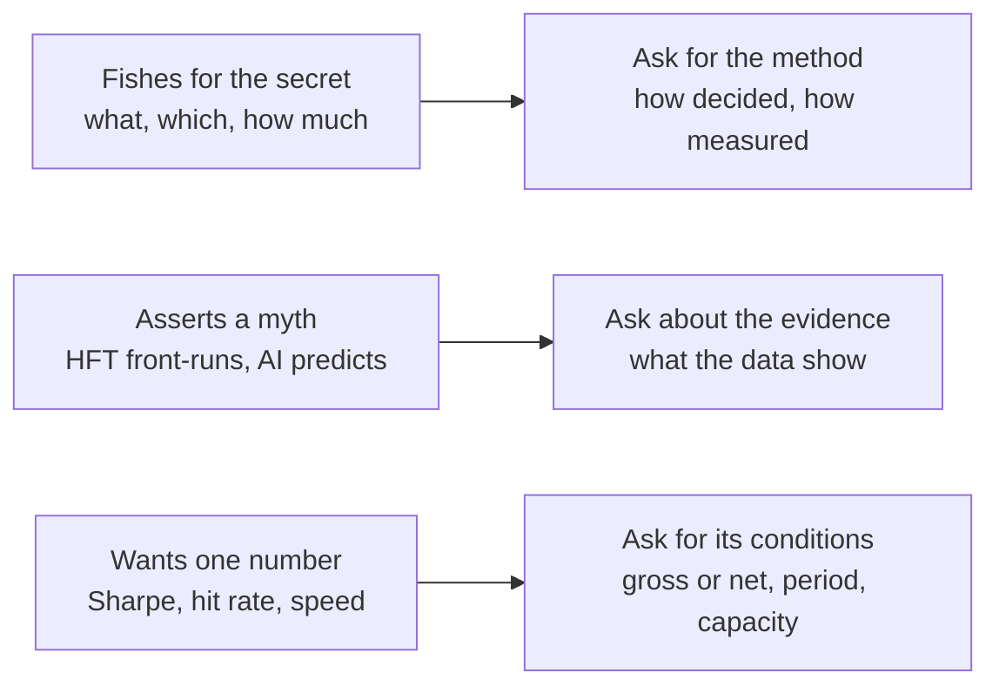

# Faux pas and naive questions

> **TL;DR**
>
> - Most naive questions fail in one of three ways: they **fish for the secret** (signals, positions, P&L), they **assert a myth** (HFT front-runs, AI predicts stocks), or they **ask for one number** stripped of its conditions (Sharpe, hit rate, speed).
> - Each has a fix: ask for the method, ask about the evidence, or ask for the conditions (gross or net, period, capacity).
> - Below are 24 common ones, each with why it lands badly and a better question that shows you know the mechanics.

**Level:** Core · **Read time:** ~6 min · **Last verified:** 2026-11

## Three ways to fail, three repairs

None of these is offensive; they mark you as an outsider, and answers drop to the question's level. See also [questions to ask](questions-to-ask.md) and [myths vs reality](../08-calibration/myths-vs-reality.md).

## Fishing for the secret

| Naive | Why it lands badly | Better |
|---|---|---|
| "What's your algorithm?" | There is no single algorithm: a firm runs dozens of models across a pipeline ([no single algorithm](../03-algorithms/there-is-no-single-algorithm.md)), all proprietary. | "Where does most of your edge come from: signal, portfolio construction or execution?" |
| "What's your Sharpe?" | Confidential, and meaningless without gross or net, period and capacity. | "What net Sharpe is realistic for this kind of strategy, and how fast does it fall with size?" ([evaluating a strategy](../02-strategies/how-quants-evaluate-a-strategy.md)) |
| "What are you long right now?" | Positions *are* the strategy, and discussing them raises compliance flags. | "How concentrated is a typical book: number of names, largest position as a share of capital?" ([sizing](../03-algorithms/d-portfolio-construction/position-sizing-and-risk-budgeting.md)) |
| "How much did your desk make?" | Desk P&L is the most guarded number in the building. | "In a normal year, how does P&L split between spread, rebates and inventory?" ([attribution](../03-algorithms/g-live-trading/live-monitoring-and-pnl-attribution.md)) |
| "Which lookback do you use?" | Parameters are the strategy; firms litigate over less (Jane Street v. Millennium, settled 2024 `[Reported]`). | "How sensitive are results to the lookback; do you blend several speeds?" ([trend following](../02-strategies/g-futures-and-macro-context/trend-following-and-ctas.md)) |
| "Where's the market going?" | Most quant books hedge out market direction; they have no house view. | "Which market conditions hurt your strategy class most?" ([regime detection](../03-algorithms/b-forecasting-models/regime-detection.md)) |

## Misreading the business

| Naive | Why it lands badly | Better |
|---|---|---|
| "HFT is front-running, right?" | Front-running means trading ahead of a customer order you hold, which FINRA Rule 5320 bars `[Verified]`; market makers react to public quotes. The fair critique is narrower: HFTs trade *with* long institutional orders once they detect them `[Verified]` ([van Kervel and Menkveld 2019](https://doi.org/10.1111/jofi.12759)). | "How do you read the evidence that HFTs trade alongside large institutional orders?" ([latency arbitrage](../02-strategies/b-speed-and-structural/latency-arbitrage.md)) |
| "Market making is free money: you collect the spread." | Adverse selection eats much of it. In Menkveld's data, €1.55 of spread per trade netted €0.88 after €0.68 of position losses `[Verified]`. | "What share of spread capture goes to adverse selection?" ([markouts](../03-algorithms/f-market-making-and-hft-algorithms/adverse-selection-and-markouts.md)) |
| "So you predict whether stocks go up?" | Many never forecast direction: market makers sell immediacy, stat arb is market-neutral, factor funds harvest premia. | "Is your edge a forecast, a service, or a premium for bearing risk?" ([strategy map](../02-strategies/index.md)) |
| "Why not just scale it up?" | [Market impact](../09-reference/glossary.md#market-impact) grows roughly with the square root of size, so net alpha shrinks as assets grow. | "Where does your capacity curve bend?" ([cost models](../03-algorithms/d-portfolio-construction/transaction-cost-and-impact-models.md)) |
| "Which hedge fund are you?" (to a prop firm) | [Proprietary trading firms](../09-reference/glossary.md#proprietary-trading-firm) risk only their own capital and have no outside investors. | "Is the capital your own or clients'?" ([taxonomy](../04-industry-and-firms/taxonomy-of-quant-firms.md)) |
| "Renaissance does it; why can't you?" | Medallion is closed and capacity-limited. In 2020 it reportedly gained 76% while Renaissance's public RIEF fund lost 19% `[Reported]`. | "What separates capacity-limited strategies from scalable ones?" ([Renaissance](../04-industry-and-firms/firm-profiles/renaissance-technologies.md)) |

## Statistics and backtests

| Naive | Why it lands badly | Better |
|---|---|---|
| "The backtest Sharpe is 3, so it works." | Selection across trials inflates it. Across 888 Quantopian algorithms, backtest Sharpe explained under 2.5% of live Sharpe (R² < 0.025) `[Verified]`. | "How many variants were tried, and what does the [deflated Sharpe](../09-reference/glossary.md#deflated-sharpe-ratio) say?" ([overfitting](../03-algorithms/c-validation-and-backtesting/overfitting-and-multiple-testing.md)) |
| "Why not just buy the backtest?" | Backtests are cheap to make and easy to overfit; the value is the data, process and execution that survive live. | "What did live trading teach you that the backtest never did?" ([backtest pitfalls](../03-algorithms/c-validation-and-backtesting/backtest-pitfalls.md)) |
| "A 52% hit rate is barely better than a coin flip." | Small edges on many independent bets add up: information ratio ≈ IC × √breadth ([fundamental law](../09-reference/glossary.md#fundamental-law-of-active-management)). | "What are your IC and breadth, and how much survives costs?" ([evaluating signals](../03-algorithms/a-data-and-signals/evaluating-signals.md)) |
| "More features must make the model better." | With low signal-to-noise, extra features mostly add ways to overfit. | "How does a new feature earn its place?" ([feature engineering](../03-algorithms/a-data-and-signals/feature-engineering.md)) |
| "Why not just use stop-losses?" | Stops cost money under a random walk and help only when returns trend (Kaminski and Lo 2014) `[Verified]`; they hurt mean-reversion books most. | "What de-grossing rules do you run, and how did they behave in August 2007?" ([quant winters](../02-strategies/e-risk-premia-and-factors/factor-timing-crowding-and-quant-winters.md)) |
| "You lost money last month, so the model is broken." | A strategy with an annual Sharpe of 1 loses in about 4 months out of 10 `[Estimate]` (monthly Sharpe 1/√12 ≈ 0.29; P(loss) ≈ 39%, assuming normal returns). | "Was that drawdown inside what your risk model expected?" ([alpha decay](../03-algorithms/g-live-trading/alpha-decay-detection-and-model-retirement.md)) |

## AI and technology

| Naive | Why it lands badly | Better |
|---|---|---|
| "Can't you just use ChatGPT to predict stocks?" | LLM headline scores show modest predictability that shrinks as adoption spreads, and pre-cutoff backtests suffer look-ahead (Lopez-Lira and Tang 2026) `[Verified]`. | "Where do LLMs help you most: signals, research tooling, or both?" ([LLMs in quant](../03-algorithms/b-forecasting-models/llms-and-foundation-models-in-quant.md)) |
| "Is it all deep learning now?" | Regularized linear models and tree ensembles still carry much production alpha in noisy, shifting data `[Lore]`. | "Where do nonlinear models beat ridge for you after costs?" ([linear models](../03-algorithms/b-forecasting-models/linear-models-and-regularization.md)) |
| "How fast are you, nanoseconds?" | Latency figures are guarded, and speed matters for only some strategies. | "Which of your strategies are latency-sensitive, and which are not?" ([HFT loop](../03-algorithms/f-market-making-and-hft-algorithms/anatomy-of-an-hft-trading-loop.md)) |
| "Why not run it all in the cloud?" | Latency-sensitive trading runs [colocated](../09-reference/glossary.md#colocation) beside exchange engines; cloud and GPU clusters serve research. | "What runs colocated, and what goes to your research clusters?" ([infrastructure](../05-infrastructure/how-infrastructure-constrains-algorithms.md)) |

## Ethics and reputation

| Naive | Why it lands badly | Better |
|---|---|---|
| "Isn't PFOF a kickback that rips off retail?" | States a contested question as fact. Retail orders do get price improvement; the debate is over how much. | "What do the new Rule 605 statistics show about retail price improvement?" ([retail internalization](../02-strategies/a-liquidity-provision/retail-flow-internalization.md)) |
| "Didn't HFTs cause the Flash Crash?" | The CFTC-SEC report traced the trigger to a large E-mini sell program; the most active HFTs kept trading as before but did not absorb the selling (Kirilenko et al. 2017) `[Verified]`. | "When the market gaps, do your controls widen, pull or keep quoting?" ([risk controls](../03-algorithms/f-market-making-and-hft-algorithms/algorithmic-risk-controls.md)) |

## Related pages

- [Questions to ask](questions-to-ask.md)
- [How to talk to a quant](how-to-talk-to-a-quant.md)
- [Myths vs reality](../08-calibration/myths-vs-reality.md)
- [Equity market making](../02-strategies/a-liquidity-provision/equity-market-making.md)
- [Overfitting and multiple testing](../03-algorithms/c-validation-and-backtesting/overfitting-and-multiple-testing.md)
- [NLP and LLM signals](../02-strategies/d-mid-frequency-alpha/nlp-and-llm-signals.md)

## Sources

- [Verified] FINRA (n.d.). Rule 5320, "Prohibition Against Trading Ahead of Customer Orders." <https://www.finra.org/rules-guidance/rulebooks/finra-rules/5320> (accessed 2026-11)
- [Verified] van Kervel, V. & Menkveld, A. J. (2019). "High-Frequency Trading around Large Institutional Orders." *Journal of Finance* 74(3), 1091–1137. <https://doi.org/10.1111/jofi.12759> (accessed 2026-11)
- [Verified] Menkveld, A. J. (2013). "High frequency trading and the new market makers." *Journal of Financial Markets* 16(4), 712–740 (per-trade figures from the 2011 working paper). <https://papers.ssrn.com/sol3/papers.cfm?abstract_id=1722924> (accessed 2026-11)
- [Verified] Wiecki, T., Campbell, A., Lent, J. & Stauth, J. (2016). "All That Glitters Is Not Gold: Comparing Backtest and Out-of-Sample Performance on a Large Cohort of Trading Algorithms." *Journal of Investing* 25(3), 69–80. <https://doi.org/10.3905/joi.2016.25.3.069> (accessed 2026-11)
- [Verified] Kaminski, K. M. & Lo, A. W. (2014). "When do stop-loss rules stop losses?" *Journal of Financial Markets* 18, 234–254. <https://doi.org/10.1016/j.finmar.2013.07.001> (accessed 2026-11)
- [Verified] Lopez-Lira, A. & Tang, Y. (2026). "Can ChatGPT Forecast Stock Price Movements? Return Predictability and Large Language Models." *Journal of Financial Economics* 184, 104335. <https://doi.org/10.1016/j.jfineco.2026.104335> (accessed 2026-11)
- [Verified] CFTC and SEC (2010-09-30). "Findings Regarding the Market Events of May 6, 2010." <https://www.sec.gov/news/studies/2010/marketevents-report.pdf> (accessed 2026-11)
- [Verified] Kirilenko, A., Kyle, A. S., Samadi, M. & Tuzun, T. (2017). "The Flash Crash: High-Frequency Trading in an Electronic Market." *Journal of Finance* 72(3), 967–998. <https://doi.org/10.1111/jofi.12498> (accessed 2026-11)
- [Reported] Bloomberg via BNN Bloomberg (2021). "Renaissance Clients Pull Out After Firm's Rotten Run of Results." <https://www.bnnbloomberg.ca/renaissance-clients-pull-out-after-firm-s-rotten-run-of-results-1.1560482> (accessed 2026-11)
- [Reported] Bloomberg Law (2024-12-05). "Jane Street-Millennium Trade Secrets Fight Ends in Settlement." <https://news.bloomberglaw.com/ip-law/jane-street-millennium-settle-india-options-trade-secrets-case> (accessed 2026-11)
- [Verified] Grinold, R. C. (1989). "The Fundamental Law of Active Management." *Journal of Portfolio Management* 15(3), 30–37. <https://doi.org/10.3905/jpm.1989.409211> (accessed 2026-11)
