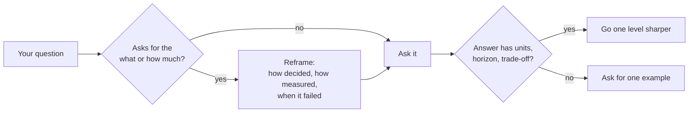

# How to talk to a quant

> **TL;DR**
>
> - Ask about **approach, not alpha**: how they decide, measure and fail, never what the signal is. Method questions get long answers; questions that fish for the secret end conversations.
> - Shareable: methods, infrastructure, lessons from failures, published research, industry economics. Off-limits: signals, parameters, positions, P&L or capacity by strategy, latency rank, risk limits, counterparty terms.
> - Signal competence with precise vocabulary, numbers that carry units and horizons, gross versus net, and knowing where the textbook and practice part ways.
> - In corporate development, quant firms show up as counterparties, as acquirers or targets, and as buyers of hardware. Each role calls for different questions.
> - Listen for red flags: a Sharpe ratio with no costs, period or capacity attached; "AI" with no method; returns with no losing stretches.

**Level:** Core · **Read time:** ~6 min · **Last verified:** 2026-11

## Ask about approach, not alpha

A signal is to a quant firm what source code is to a software company: the asset itself. Edges also decay when copied. Across 97 published predictors, returns fell about 26% out of sample and 58% after publication `[Verified]` ([McLean and Pontiff 2016](https://doi.org/10.1111/jofi.12365)). An idea that spreads loses much of its value. Contracts and courts back this up: Jane Street's 2024 suit against Millennium and two former traders over an India options strategy settled in December 2024 `[Reported]`. Even a friendly quant is protecting colleagues' bonuses.

So convert every "what" into "how do you decide", every "how much" into "how do you measure", and every "does it work" into "when did it stop working". "What's your signal?" becomes "Which data families carry most of your IC, and how fast does it decay?" "What's your Sharpe?" becomes "How big is the gap between your backtests and live results?" The second version of each is answerable, and it shows you know which part matters.

## What is shareable and what is not

| Topic | Usually open | Grey zone | Off-limits |
|---|---|---|---|
| Methods | Cross-validation scheme, risk-model type, how they set hurdles | Holding period, turnover, number of signals | Signal definitions, features, parameters |
| Infrastructure | Languages, FPGA versus CPU, open-source tools | Cluster size (XTX publicly cites over 25,000 GPUs `[Reported]`) | Latency figures, race rank, network routes |
| Lessons | What broke in August 2007 or March 2020 and why | Size of their own drawdowns | Live positions, limits, stop levels |
| Research | Published papers, talks, firm podcasts and blogs | Which public ideas they still trade | Live Sharpe and capacity by strategy |
| Economics | How market making or stat arb earns money | Firm revenue (press reports; Virtu files a 10-K) | P&L by strategy, PFOF rates, broker terms |

Firms publish a lot of the "open" column themselves, from Jane Street's *Signals and Threads* podcast to research libraries at AQR and Two Sigma. Having read one piece is the cheapest credibility you can buy.

## Signaling competence

- **Vocabulary, used precisely.** [Markout](../09-reference/glossary.md#markout), [adverse selection](../09-reference/glossary.md#adverse-selection), [IC](../09-reference/glossary.md#information-coefficient-ic), [half-life](../09-reference/glossary.md#half-life), [turnover](../09-reference/glossary.md#turnover), [implementation shortfall](../09-reference/glossary.md#implementation-shortfall), [crowding](../09-reference/glossary.md#crowding). One term used correctly beats five dropped. The [glossary](../09-reference/glossary.md) and [elevator explanations](elevator-explanations.md) are the drill.
- **Numbers with units and horizons.** Basis points of notional, mils per share (1 mil = \$0.0001), microseconds, percent of ADV, half-life in days, daily versus annualized Sharpe, gross versus net. "Costs eat half the gross alpha at 30× annual turnover" (illustrative) sounds like an insider. "Costs are significant" does not.
- **The textbook-to-practice gap.** Ask how far practice departs from the model they started with: [Almgren-Chriss](../03-algorithms/e-execution-algorithms/implementation-shortfall-and-almgren-chriss.md) calibrated on their own fills, [MVO](../03-algorithms/d-portfolio-construction/mean-variance-optimization.md) with shrunk alphas and binding constraints, [Avellaneda-Stoikov](../03-algorithms/f-market-making-and-hft-algorithms/quoting-and-inventory-control.md) as a skeleton. Every card's "textbook versus practice" section prepares this question, and it is the strongest competence signal there is.
- **Your own lens.** An income-statement view of a market maker (spread revenue, rebates, adverse-selection cost, inventory P&L) or an M&A diligence instinct is a fresh angle that quants rarely hear.
- **Follow the answer, not your script**, and say plainly when something is new to you.

## The corp-dev and M&A angle

**As counterparties.** Quant firms quote the stock, ETF and options markets your company's buybacks, issuance and hedges trade in. Retail brokers sell them order flow; ETF issuers rely on their market makers and [authorized participants](../09-reference/glossary.md#authorized-participant). Ask how they price your flow, what they hedge it with, and what happens to their spreads in stress ([ETF market making](../02-strategies/a-liquidity-provision/etf-market-making.md), [retail internalization](../02-strategies/a-liquidity-provision/retail-flow-internalization.md)).

**As acquirers or targets.** Most leading firms are private partnerships with little disclosure `[Reported]`; Virtu, which files a 10-K, is the main US-listed exception `[Verified]`. Deals do happen: Virtu bought KCG in 2017 and ITG for about \$1.0B in 2019 `[Verified]`. The diligence lens is unusual:

- Revenue tracks volatility and volume, so ask for revenue by regime and business line, not by strategy.
- The assets are people and code, and both can walk. Look at deferred compensation, non-competes and trade-secret history.
- Operational risk is existential: Knight Capital lost more than \$460M in about 45 minutes in 2012 `[Verified]`. Diligence covers [risk controls](../03-algorithms/f-market-making-and-hft-algorithms/algorithmic-risk-controls.md) and deployment process, not just P&L.

**As customers.** They buy GPUs, FPGAs, network cards, colocation, microwave links, data and cloud. Hudson River Trading announced a multi-year research platform on CoreWeave in 2026 `[Verified]`. They buy on tail latency, determinism, power density and total cost, and they will not describe their workloads. Ask about the research versus production split, build versus buy, and refresh cycles ([semiconductor lens](../05-infrastructure/semiconductor-lens.md)).

## Listening for red flags in claims

- **A Sharpe ratio missing gross or net, period or capacity.** At high turnover, gross can be mostly costs ([how quants evaluate a strategy](../02-strategies/how-quants-evaluate-a-strategy.md)).
- **A backtest presented as a track record.** The SEC marketing rule (compliance from November 2022) restricts hypothetical performance in adviser advertising `[Reported]`. Count the trials behind it ([overfitting](../03-algorithms/c-validation-and-backtesting/overfitting-and-multiple-testing.md)).
- **"AI-driven" with no method.** In March 2024 the SEC settled its first "AI washing" cases against two advisers, for \$400K in combined penalties `[Verified]`.
- **Smooth returns with no losing stretch.** That usually means short volatility, stale marks or a short sample.
- **High Sharpe at large capacity and slow horizons.** A Sharpe above 2 on billions at a monthly horizon contradicts the [comparison matrix](../02-strategies/h-cross-cutting/strategy-comparison-matrix.md).
- **"Uncorrelated to everything"**, never tested in 2007, 2020 or August 2024.
- **"Proprietary" used to dodge method questions**, not just parameters.

The [sanity-checking checklist](../08-calibration/sanity-checking-claims.md) turns these into a procedure.

## Related pages

- [Questions to ask](questions-to-ask.md)
- [Faux pas and naive questions](faux-pas-and-naive-questions.md)
- [Mock conversations](mock-conversations.md)
- [How quants evaluate a strategy](../02-strategies/how-quants-evaluate-a-strategy.md)
- [Competitive dynamics and M&A](../04-industry-and-firms/competitive-dynamics-and-ma.md)
- [Backtest pitfalls](../03-algorithms/c-validation-and-backtesting/backtest-pitfalls.md)
- [Myths vs reality](../08-calibration/myths-vs-reality.md)

## Sources

- [Verified] McLean, R. D. & Pontiff, J. (2016). "Does Academic Research Destroy Stock Return Predictability?" *Journal of Finance* 71(1), 5–32. <https://doi.org/10.1111/jofi.12365> (accessed 2026-11)
- [Reported] Bloomberg Law (2024-12-05). "Jane Street-Millennium Trade Secrets Fight Ends in Settlement." <https://news.bloomberglaw.com/ip-law/jane-street-millennium-settle-india-options-trade-secrets-case> (accessed 2026-11)
- [Verified] Virtu Financial, Inc. (2020). Form 10-K for fiscal year 2019 (KCG acquisition closed 2017-07-20; ITG acquisition closed 2019-03-01 for about \$1.0B). *SEC EDGAR*. <https://www.sec.gov/Archives/edgar/data/0001592386/000159238620000003/virtufinancial12-31x19.htm> (accessed 2026-11)
- [Verified] U.S. SEC (2013-10-16). *In the Matter of Knight Capital Americas LLC*, Release No. 34-70694. <https://www.sec.gov/litigation/admin/2013/34-70694.pdf> (accessed 2026-11)
- [Verified] CoreWeave (2026). "Hudson River Trading to Build Next-Gen Research Platform Powered by NVIDIA Vera Rubin NVL72 on CoreWeave Cloud." <https://coreweave.com/news/hudson-river-trading-to-build-next-gen-research-platform-powered-by-nvidia-vera-rubin-nvl72-on-coreweave-cloud> (accessed 2026-11)
- [Reported] XTX Markets (n.d.). Company website (research cluster of over 25,000 GPUs; firm statement). <https://www.xtxmarkets.com/> (accessed 2026-11)
- [Verified] U.S. SEC (2024-03-18). "SEC Charges Two Investment Advisers with Making False and Misleading Statements About Their Use of Artificial Intelligence." Press release 2024-36. <https://www.sec.gov/newsroom/press-releases/2024-36> (accessed 2026-11)
- [Reported] Troutman Pepper (2022-10-31). "The SEC's New Marketing Rule – Practically Speaking: Hypothetical Performance." <https://www.troutman.com/insights/the-secs-new-marketing-rule-practically-speaking-hypothetical-performance/> (accessed 2026-11)
- [Reported] Jane Street (n.d.). *Signals and Threads* podcast, hosted by Ron Minsky. <https://signalsandthreads.com/> (accessed 2026-11)
