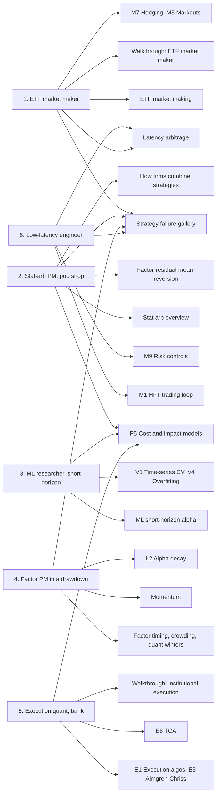
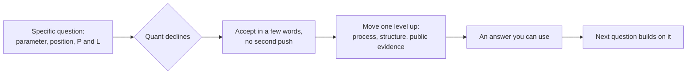

# Mock conversations

> **TL;DR**
>
> - Six annotated dialogues between "You" (a finance professional with a corp-dev and M&A background) and six composite, fictional quants: an ETF market maker, a stat-arb PM at a pod shop, a short-horizon ML researcher, a factor PM in a drawdown, a bank execution quant and a low-latency engineer.
> - The pattern that works: ask about approach and economics, not alpha; anchor on public numbers; when the quant declines (🔒), accept it at once and move one level up, to process, structure or published evidence.
> - Each dialogue also contains a faux pas and its recovery: "risk-free", "why not lever it up", "just use a transformer", hindsight factor timing, "we beat VWAP", "front-running".
> - Margin notes explain the jargon and why each question landed. Every number the quants use matches a tagged figure or an illustrative example elsewhere in the KB.

**Level:** Core · **Read time:** ~30 min · **Last verified:** 2026-11

These are rehearsal scripts for a first real conversation with a quant. The six quants are **composite, fictional characters**: no real person, firm or trading secret is depicted, and the numbers they quote about their own desks are illustrative, calibrated to the KB's dossiers, cards and walkthroughs. Public figures in the margin notes carry the KB's confidence tags. Read a dialogue, then the pages listed under it; the map below shows which pages each one exercises. A margin note (indented) follows the exchange it explains; 🔒 marks proprietary territory, as in every dossier's question list. The general rules are in [How to talk to a quant](how-to-talk-to-a-quant.md), and the question bank is in [Questions to ask](questions-to-ask.md).

Every 🔒 moment below uses the same move:

## 1. The ETF market maker

*Setting (fictional): Dana runs a US ETF desk at an electronic market maker that is a lead market maker and an authorized participant. You meet over coffee after an industry panel.*

**You:** When a pension fund asks you for a price on \$20M of a small-cap ETF, what are you actually pricing?

**Dana:** Not NAV. I'm pricing what it costs me to get rid of the risk. Fair value comes from the stocks, the Russell futures and a couple of peer ETFs. The quote is hedge cost, plus what I expect to lose to informed flow, plus a margin.

> **Margin note:** [Fair value](../09-reference/glossary.md#fair-value) is the desk's own real-time estimate, not the published NAV or iNAV; Rule 6c-11 does not even require an iNAV `[Verified]`. "What are you pricing?" invites her to explain her model of the business, which practitioners enjoy; "how wide do you quote?" invites a number she may not want to give.

**You:** On \$20M, roughly what does that add up to?

**Dana:** For a small-cap fund, high single digits in basis points over fair. Futures in and out are half a bp each way. Buying the basket into the close is the big line, maybe 4 bps. Then the creation fee. If I keep two or three bps after all that, it was a good trade.

> **Margin note:** This is the [ETF market making](../02-strategies/a-liquidity-provision/etf-market-making.md) dossier's illustrative block: sell at fair value + 8 bps, pay 5.75 bps of hedge and creation costs, keep 2.25 bps (\$4,500). Read it as an income statement: revenue is the spread over fair value, cost of goods sold is the hedge, basket and fee. Flow Traders' 2025 net trading income was about 2.5 bps of ETP value traded `[Reported]`, so "two or three bps" is the right order of magnitude for the whole business.

**You:** So once you're hedged it's basically risk-free arbitrage?

**Dana:** (laughs) Hedged isn't flat. The futures don't track a 2,000-stock basket perfectly, the closing print can move against me, and on a bad day I can't price the basket at all. Arbitrage is the band that creations and redemptions put around the price. We live well inside it.

**You:** Fair, "risk-free" was the wrong word. What risk is left after the hedge?

**Dana:** [Basis](../09-reference/glossary.md#basis) between the future and the basket until the close, execution risk on the basket, and the tails. On 24 August 2015 lots of stocks opened late and nobody could compute a fair value. Desks widened or walked away.

> **Margin note (faux pas, recovered):** "Arbitrage" and "risk-free" say you think the hedge is perfect. The recovery concedes in a few words and turns her correction into the next question. [ETF arbitrage](../09-reference/glossary.md#etf-arbitrage) is the no-arbitrage band set by the cost of [creation and redemption](../09-reference/glossary.md#creation-and-redemption); quoting happens inside it. On 24 August 2015 there were 1,278 [LULD](../09-reference/glossary.md#limit-up-limit-down-luld) halts, 1,058 of them in 327 ETPs `[Verified]`.

**You:** How do you choose the hedge?

**Dana:** Futures first: cheap and instant, with some basis risk. A peer ETF tracks better but costs more to trade. The basket is the hedge of last resort; I buy it when I'm going to create, usually in the closing auction.

> **Margin note:** In the [ETF walkthrough](../03-algorithms/h-end-to-end-walkthroughs/walkthrough-etf-market-maker.md), hedging an \$11M short for five hours cost 0.48 bp in futures, 1.60 bps in a peer ETF and 6.09 bps in the basket (synthetic lab result); futures won once basis risk was charged at the desk's risk aversion. The general rule is in [M7 Hedging algorithms](../03-algorithms/f-market-making-and-hft-algorithms/hedging-algorithms.md).

**You:** And at the end of the day, do you create or carry?

**Dana:** Whatever didn't net against other clients goes to the primary market at the cutoff, in whole creation units. A fraction of a unit I'll carry overnight, hedged. Market-on-close orders for the basket have to be in by 3:50 on NYSE and 3:55 on Nasdaq.

> **Margin note:** An [authorized participant](../09-reference/glossary.md#authorized-participant) delivers the basket and receives new ETF shares (creation), or the reverse. The [MOC](../09-reference/glossary.md#market-on-close-moc) cutoffs are 3:50 p.m. NYSE and 3:55 p.m. Nasdaq `[Verified]`. In the walkthrough the desk creates 4 units at 6.1 bps each rather than buy back from rivals at about 7.6 bps.

**You:** How do you tell whether a client's flow is informed?

**Dana:** Markouts, marked against the hedge. If I sell a block and the market rallies, the raw markout looks terrible and tells me nothing. Net of the futures, it shows whether the client knew something about that fund.

> **Margin note:** A [markout](../09-reference/glossary.md#markout) marks each fill forward against fair value; markouts that fall after the trade mean [adverse selection](../09-reference/glossary.md#adverse-selection). In the walkthrough the block's raw markout swung from +20 bps at 60 s to −34 bps at the close, while the hedge-adjusted markout stayed at +8 to +11 bps. The sharpest question of the dialogue: it shows you know a hedged trade is judged net of its hedge ([M5](../03-algorithms/f-market-making-and-hft-algorithms/adverse-selection-and-markouts.md)).

**You:** How do you build fair value for a Japan ETF while Tokyo is shut? What weights go on futures, ADRs and FX?

**Dana:** I'm not giving you the weights. That's the model. It's futures plus FX plus whatever related instrument is trading, and the hard part is that half of those are stale too.

**You:** Understood. Without numbers: which error costs you more there, the level of fair value or how fast it updates?

**Dana:** Speed, most days. A slightly wrong level costs a bit of spread. A stale quote when the futures jump gets picked off by someone faster.

> **Margin note (🔒 declined):** The dossier flags the fair-value blend as proprietary. You accepted the no and moved from parameters to the structure of the error, which she can discuss without giving anything away. Her answer points to [latency arbitrage](../09-reference/glossary.md#latency-arbitrage): a stale quote is a free option for faster traders.

**You:** Where is the margin going for the industry?

**Dana:** The biggest funds trade at one tick, so the money is in bond, international, active and new funds, and in blocks. And it's concentrated: a handful of firms do most of the creations.

> **Margin note:** US ETF assets hit a record \$16.36T at the end of August 2026 `[Reported]`; Jane Street reportedly did 24% of US ETF primary-market activity in 2024 `[Reported]`. An industry-structure question plays to your M&A background and is safe for her to answer.

**You:** Last one: what do outsiders never ask you about?

**Dana:** The bad weeks. In March 2020 LQD traded 5% under NAV and people said the ETF broke. I'd say the ETF was the price and the NAV was an opinion.

> **Margin note:** LQD closed at about a 5.0% discount in the week to 20 March 2020 `[Reported]`. Whether that was stale bond NAV or a real dislocation is contested: issuers read stale NAV, while Haddad, Moreira & Muir (2021) find a real dislocation that the Fed erased `[Verified]`. "What do people never ask you?" is a good closer because it hands the quant the floor.

**Pages to review:** [ETF market making](../02-strategies/a-liquidity-provision/etf-market-making.md) · [Walkthrough: a day at an ETF market maker](../03-algorithms/h-end-to-end-walkthroughs/walkthrough-etf-market-maker.md) · [ETF and index arbitrage](../02-strategies/b-speed-and-structural/etf-and-index-arbitrage.md) · [M2 Fair value and microprice](../03-algorithms/f-market-making-and-hft-algorithms/fair-value-and-microprice.md) · [M5 Adverse selection and markouts](../03-algorithms/f-market-making-and-hft-algorithms/adverse-selection-and-markouts.md) · [M7 Hedging algorithms](../03-algorithms/f-market-making-and-hft-algorithms/hedging-algorithms.md)

## 2. The stat-arb PM at a pod shop

*Setting (fictional): Marcus runs a market-neutral US equity stat-arb book on a multi-manager platform. A mutual contact set up a 30-minute call.*

**You:** In one sentence, what are you paid for?

**Marcus:** Warehousing other people's urgency. Someone has to sell a big position today, the price dips more than the news justifies, I buy it hedged and hand it back over the next few days.

> **Margin note:** [Statistical arbitrage](../09-reference/glossary.md#statistical-arbitrage) is mostly paid liquidity provision: price-insensitive sellers (redemptions, index flows, liquidations) accept a few bps of slippage to finish. "What are you paid for?" asks who the counterparty is, the KB's first question for any strategy ([how quants evaluate a strategy](../02-strategies/how-quants-evaluate-a-strategy.md)).

**You:** What does the book look like?

**Marcus:** About 2,000 stocks, neutral to the market, sectors and the usual style factors. Average hold a couple of days. We trade roughly 30% of the book every day.

> **Margin note:** [Neutralization](../09-reference/glossary.md#neutralization) leaves mostly [residual returns](../09-reference/glossary.md#residual-return), the stock-specific part, measured with a [risk model](../03-algorithms/d-portfolio-construction/risk-models.md). Thirty percent of gross market value a day is inside the [stat-arb overview](../02-strategies/c-statistical-arbitrage/stat-arb-overview-and-history.md)'s 20–60% range `[Lore]`: the book turns over about 75 times a year.

**You:** At that turnover, how much of gross alpha do costs eat?

**Marcus:** Half in a good year. Two-thirds is normal. This is an execution business with a forecasting department attached.

> **Margin note:** The overview's illustrative \$1B book makes 7.5% gross and keeps 2.6% after spread, impact, borrow and financing: costs take about two-thirds. The classic residual signal breaks even near 10 bps per dollar traded ([factor-residual mean reversion](../02-strategies/c-statistical-arbitrage/factor-residual-mean-reversion.md)). An informed question: it shows you know where stat-arb P&L leaks.

**You:** If it's market-neutral across 2,000 names, why not lever it much harder?

**Marcus:** August 2007.

**You:** Right, naive question. What actually happened that week, mechanically?

**Marcus:** Lots of books held the same residual trades, because they used similar risk models and signals. Somebody big had to liquidate. Their selling pushed every crowded position the wrong way, the next fund's limits fired, and so on. Three awful days, then it snapped back on the Friday. If you were levered and got stopped out, you sold the bottom.

> **Margin note (faux pas, recovered):** Market-neutral is not low-risk; [crowding](../09-reference/glossary.md#crowding) risk is fat-tailed. In Khandani & Lo's simulation a simple contrarian strategy lost 1.16%, 2.83% and 2.86% on 7–9 August 2007 and gained 5.92% on Friday 10 August; at 8:1 leverage the three days cost over 25% `[Verified]`. This was the [quant quake](../09-reference/glossary.md#quant-quake). Admitting the naive question fast and asking for the mechanism turned a wince into the best story of the call.

**You:** How does the platform's risk team see your book?

**Marcus:** As a P&L stream that should be idiosyncratic. Tight limits on market, sector and style exposure, a volatility target, gross and net limits. And a drawdown rule.

**You:** I've read that some platforms halve capital at a 5% loss and cut the PM near 7.5%. Is that how yours works?

**Marcus:** I won't give you our thresholds. The press numbers for the big platforms are in the right neighbourhood. The shape is: lose some, capital gets cut; lose more, you're out.

**You:** Fair enough. Without numbers, does the stop change how you run the book?

**Marcus:** Completely. I run lower volatility than I would with my own money and keep a cushion above the line; the platform adds leverage on top. And I'm quicker to cut a misbehaving signal, which isn't always right.

> **Margin note (🔒 declined):** Drawdown thresholds are firm-specific; Millennium reportedly halves a PM's capital at a 5% loss and is likely to part ways near 7.5% `[Reported]`. You cited the public report, let him decline, and asked about behavior instead. The KB's simulation shows why he keeps a cushion: at 4% annual volatility a zero-skill [pod](../09-reference/glossary.md#pod) hits a 5% peak-to-trough drawdown within a year about 37% of the time, a Sharpe-1 pod 13% `[Estimate]` ([how firms combine strategies](../02-strategies/h-cross-cutting/how-firms-combine-strategies.md)).

**You:** If your capital doubled tomorrow, what happens to P&L?

**Marcus:** It doesn't double. Impact grows with the square root of size. Doubling might add a fifth to the dollars; quadruple it and I'm working for the brokers.

> **Margin note:** With [square-root](../09-reference/glossary.md#square-root-law) impact, the overview's illustrative book nets \$150k a day at \$1B, \$176k at \$2B (+17%) and zero at \$4B `[Estimate]`. Asking about the shape of the [capacity](../09-reference/glossary.md#capacity) curve rather than its level gets a real answer; "where does your capacity curve cross zero?" is 🔒.

**You:** Other pods must trade some of the same names. Does anyone net the trades?

**Marcus:** Sometimes the platform crosses opposite orders internally at the mid, which saves us both the spread. But each pod is still neutral on its own and pays its own borrow. That's the price of independence.

> **Margin note:** This is the pods-versus-one-book debate. In the KB's illustrative example, netting a \$10M buy against a \$7.5M sell cuts cost from \$13,400 to \$1,250, a 91% saving. A centralized fund nets before trading; a pod shop buys less correlated returns and fast failure detection instead.

**You:** How do you know when your book is crowded?

**Marcus:** When my residuals start moving together, with each other and with other books. If the first principal component suddenly explains much more of the variance, my residuals carry market risk, and I cut gross before the risk model says so.

> **Margin note:** Avellaneda & Lee saw exactly this in summer 2007, when the top 15 eigenvectors explained more variance `[Verified]`. Their PCA residual strategy earned a Sharpe of 1.44 net of costs over 1997–2007 but 0.9 in 2003–07 `[Verified]`: published stat arb decays.

**Pages to review:** [Stat arb: overview and history](../02-strategies/c-statistical-arbitrage/stat-arb-overview-and-history.md) · [Factor-residual mean reversion](../02-strategies/c-statistical-arbitrage/factor-residual-mean-reversion.md) · [How firms combine strategies](../02-strategies/h-cross-cutting/how-firms-combine-strategies.md) · [P5 Transaction cost and impact models](../03-algorithms/d-portfolio-construction/transaction-cost-and-impact-models.md) · [Strategy failure gallery](../02-strategies/h-cross-cutting/strategy-failure-gallery.md)

## 3. The ML researcher on a short-horizon team

*Setting (fictional): Lin, a machine-learning PhD, builds intraday forecasting models for US equities at a quant fund. You meet at a data-science meetup.*

**You:** What exactly are you predicting?

**Lin:** Residual returns, stock by stock, at several horizons: 5 minutes, 30 minutes, an hour, to the close, next day. Ranked across a few thousand names. Features are things like residual returns at many lags, volume and volatility against their usual time-of-day level, order-book imbalance, futures and sector moves.

> **Margin note:** Forecasting the ranked residual keeps the model on the part of the return the book will actually hold. Volume is U-shaped through the day, so features are compared with their time-of-day norm ([ML-driven short-horizon alpha](../02-strategies/c-statistical-arbitrage/ml-driven-short-horizon-alpha.md)).

**You:** What does a good model look like, in numbers?

**Lin:** A rank IC of 0.02 or 0.03 is good. Directional accuracy is maybe 51%. Sounds like nothing, but across thousands of stocks and many trades a day it adds up.

> **Margin note:** The [information coefficient](../09-reference/glossary.md#information-coefficient-ic) is the correlation between forecast and outcome; [rank IC](../09-reference/glossary.md#rank-ic) uses ranks. The [Fundamental Law](../09-reference/glossary.md#fundamental-law-of-active-management) says information ratio ≈ IC × √breadth, so tiny ICs pay at large breadth. The dossier's range is 0.01–0.05.

**You:** With transformers everywhere, isn't prediction getting easy? Couldn't you throw a big model at it?

**Lin:** People ask that a lot. The problem isn't model capacity. Prices are mostly noise, and anything that works gets traded away. A bigger model just fits the noise faster.

**You:** Fair, probably a tired question. So where does model choice matter, and where doesn't it?

**Lin:** Gradient-boosted trees are the default for tabular features; nets help on sequences and raw book data. We ensemble them and average over random seeds. But labels, validation and costs move results more than architecture does.

> **Margin note (faux pas, recovered):** "ML makes prediction easy" is one of the KB's [myths](../08-calibration/myths-vs-reality.md). Whether bigger models help is contested: Kelly, Malamud & Zhou (2024) find gains in market timing `[Reported]`. In Gu, Kelly & Xiu (2020), trees and nets reached monthly out-of-sample R² of 0.33–0.40% against 0.16% for a three-characteristic linear model `[Verified]`: better, but still under half a percent ([F2 Tree ensembles](../03-algorithms/b-forecasting-models/tree-ensembles.md)). The recovery asks for her judgment, which is what she is paid for.

**You:** How do you validate without fooling yourself?

**Lin:** Walk-forward by date, never shuffled. Labels overlap: a 30-minute return at 10:00 shares most of its path with the one at 10:05. We purge training samples whose labels overlap the test period and add an embargo after it. Shuffled cross-validation makes boosted trees look about twice as good as they are.

> **Margin note:** [Purged cross-validation](../09-reference/glossary.md#purged-cross-validation) and the [embargo](../09-reference/glossary.md#embargo) come from López de Prado (2018). In the KB's Lab 12, boosted trees scored an out-of-sample IC of 0.127 under shuffled K-fold, 0.066 walk-forward and 0.076 purged (synthetic lab result with planted alphas; real ICs are far lower). "Twice as good" matches ([V1 Time-series cross-validation](../03-algorithms/c-validation-and-backtesting/time-series-cross-validation.md)).

**You:** How do you account for everything the team has tried?

**Lin:** We log every experiment, dead ones included, and haircut the winner for the number of real trials. The best of a few hundred backtests always looks great.

> **Margin note:** This is [multiple testing](../09-reference/glossary.md#multiple-testing). With five years of daily data and 100 independent trials, the best zero-skill Sharpe is about 1.13 by luck alone `[Estimate]`; the [deflated Sharpe ratio](../09-reference/glossary.md#deflated-sharpe-ratio) asks whether the winner clears that bar. In Lab 13 the best of 500 noise strategies fell from Sharpe 2.18 in sample to −0.90 out of sample (synthetic). Practitioners say "show me the graveyard" ([V4](../03-algorithms/c-validation-and-backtesting/overfitting-and-multiple-testing.md)).

**You:** Do costs enter training, or only the optimizer?

**Lin:** Both. Each horizon has to pay its own way. The 5-minute model can't cross the spread on its own, so we use it to time trades the slower models already want.

> **Margin note:** The dossier's illustrative numbers: at 30 minutes, IC 0.03 earns about 1.7 bps per leg against 5.4 bps for an aggressive round trip; at one day, IC 0.02 earns 4.2 bps, which pays only with passive fills and crossing (2.5 bps). In its illustrative \$1B book, costs take about two-thirds of gross alpha ([P5](../03-algorithms/d-portfolio-construction/transaction-cost-and-impact-models.md)).

**You:** Which features carry the most weight?

**Lin:** I can't talk about features. That's the work.

**You:** Of course. Then how do you decide a new feature is real and not a leak?

**Lin:** Three checks. Shuffle the labels within each date: the IC should drop to zero, and if it doesn't, something leaks. Audit every timestamp against when the data was actually available, not when it was stamped. Then run it in shadow mode on live data before it touches money.

> **Margin note (🔒 declined):** Feature lists are a firm's crown jewels; never ask for them. Asking how a feature is *tested* is safe and tells you more about rigor. [Look-ahead bias](../09-reference/glossary.md#look-ahead-bias) from late-arriving data is the classic leak ([point-in-time data](../03-algorithms/a-data-and-signals/point-in-time-data-and-cleaning.md)). The dossier's model lifecycle runs research, shadow, small live, scaled, watch, retired.

**You:** How fast do models decay?

**Lin:** Faster than people expect. Without retraining, ICs fade within months. We refit on a rolling window and down-weight a model before we kill it. One bad month proves nothing.

> **Margin note:** ICs fading within months is practitioner lore `[Lore]`. Across 97 published predictors, returns fell about 58% after publication (McLean & Pontiff 2016) `[Verified]`. Telling decay from bad luck takes years: separating a Sharpe of 1.0 from zero at two standard errors needs about four years of data ([L2 Alpha decay detection](../03-algorithms/g-live-trading/alpha-decay-detection-and-model-retirement.md)).

**You:** Coming from the chip side, I'm curious: what's your bottleneck? GPUs, memory, interconnect?

**Lin:** Less than you'd think. Each model is small, but we train thousands, so it's throughput, and above all moving years of tick data through clean pipelines.

> **Margin note:** A question that uses your own expertise builds rapport. Lin's view is one practitioner's `[Lore]`; at firm level, compute is large: XTX Markets says it has more than 25,000 GPUs `[Reported]`. See [a semiconductor lens](../05-infrastructure/semiconductor-lens.md).

**Pages to review:** [ML-driven short-horizon alpha](../02-strategies/c-statistical-arbitrage/ml-driven-short-horizon-alpha.md) · [V1 Time-series cross-validation](../03-algorithms/c-validation-and-backtesting/time-series-cross-validation.md) · [V4 Overfitting and multiple testing](../03-algorithms/c-validation-and-backtesting/overfitting-and-multiple-testing.md) · [F2 Tree ensembles](../03-algorithms/b-forecasting-models/tree-ensembles.md) · [L2 Alpha decay detection and model retirement](../03-algorithms/g-live-trading/alpha-decay-detection-and-model-retirement.md)

## 4. The factor PM during a drawdown

*Setting (fictional): early September 2026. Ruth runs a systematic multi-factor long-short US equity book at an asset manager. Momentum has just had a bad summer. She booked the call weeks ago and kept it.*

**You:** Thanks for keeping this; I know the summer was rough for momentum. Happy to keep it short. How does it look from your seat?

**Ruth:** Painful, not existential. Momentum had loaded up on the AI winners, and when they reversed the sleeve gave back a lot. The book also holds value, quality and other signals, so the total damage is a fraction of that.

> **Margin note:** Acknowledging the drawdown without asking "how much did you lose?" keeps the call open. The public numbers: the Fama-French [momentum](../09-reference/glossary.md#momentum) factor (UMD) lost 17.9% from 22 June to 3 September 2026 `[Verified]` (KB computation), and systematic equity funds' year-to-date return fell from 14.4% to 10.8% in the June–July AI-stock reversal (Goldman prime-brokerage data via press) `[Reported]`. Value and momentum are negatively correlated, which is why a blended book hurts less.

**You:** Is this a premium drought or a crowding event?

**Ruth:** That's the right question. Speed says crowding: it was fast and correlated, and momentum names moved together far beyond what their factor exposure explains. A drought looks different. Nothing breaks; the premium just doesn't pay for years.

> **Margin note:** The [factor timing and quant winters](../02-strategies/e-risk-premia-and-factors/factor-timing-crowding-and-quant-winters.md) dossier separates fast crowded unwinds (August 2007: days) from slow droughts (2018–2020: years). Comomentum measures momentum stocks moving together beyond their factor exposure. AQR's Style Premia Alternative Fund returned −12.4%, −8.2% and −22.0% in 2018–2020, then +24.8% and +30.6% in 2021–2022 `[Verified]`: a drought, not a run.

**You:** Value spreads were at a record in June. Shouldn't the models have seen this coming and turned momentum down?

**Ruth:** Everyone times factors perfectly in hindsight. The value spread was at the 86th percentile in 2017, and the factor then lost about half over the next three-plus years. Cheap can get cheaper.

**You:** Fair, that was hindsight. What do you let yourself change ahead of time, and within what bounds?

**Ruth:** Small, slow tilts: half to one and a half times the strategic weight, reviewed monthly. And volatility targeting: when a sleeve's volatility jumps, its weight comes down. Don't time it, size it.

> **Margin note (faux pas, recovered):** "Shouldn't you have seen it coming?" sounds like blame. The value-over-growth spread ranked at the 86th percentile of 1951–2026 in 2017; value then lost 51% from January 2017 to September 2020 `[Verified]` (KB computation from French data). Evidence on [factor timing](../09-reference/glossary.md#factor-timing) is mixed: Haddad, Kozak & Santosh (2020) find factors strongly predictable; Asness et al. (2017) find value-spread timing adds little to a book that already holds value `[Verified]`. Asking about ex-ante bounds respects her process.

**You:** Does volatility scaling actually help in a momentum crash?

**Ruth:** Over the long run, yes: it roughly doubles momentum's Sharpe. It doesn't save you on the first day of a reversal, because volatility rises after the losses start. The worst crashes come after bear markets, when the losers are high-beta and rebound hardest.

> **Margin note:** On the KB's replication, [volatility targeting](../09-reference/glossary.md#volatility-targeting) lifts UMD's gross Sharpe from 0.45 to 0.87 over 1927–2026 `[Verified]`. [Momentum crashes](../09-reference/glossary.md#momentum-crash): −74% in July–August 1932, −49% in March–May 2009, −14.4% in one day on 9 November 2020 `[Verified]` ([Momentum](../02-strategies/e-risk-premia-and-factors/momentum.md)).

**You:** What triggers de-grossing, and how do you avoid de-grossing into the low?

**Ruth:** Rules agreed with the risk committee in calm markets. The danger is the spiral: a levered fund loses, its prime broker caps gross, it sells, prices fall further, and it locks in a loss that would have reversed. So we run moderate leverage and leave room before the rules force a sale.

> **Margin note:** In the dossier's illustrative spiral, a fund at 8× gross loses 3% and 2% on the spread over two days, is forced to sell, and misses the 5% rebound: a holder ends flat, the de-levered fund down 3.3%. Khandani & Lo estimate an 8:1 levered value portfolio lost 24% from 1 to 7 August 2007 before prices reverted `[Verified]`. Sizing rules are in [P7 Position sizing and risk budgeting](../03-algorithms/d-portfolio-construction/position-sizing-and-risk-budgeting.md).

**You:** Did the prime-broker crowding reports flag your shorts? How much do you overlap with peers?

**Ruth:** I'm not going to talk about our positioning or what the brokers send us. That's our book and their clients' data.

**You:** Understood. In general, which crowding gauges have actually led losses, and which are noise?

**Ruth:** Short interest comes out twice a month and holdings quarterly, so both are stale. Prime-broker reports are timely but only cover that broker's clients. The one I trust most is our own: excess residual correlation inside each leg of the factor.

> **Margin note (🔒 declined):** Positions and broker reports are off-limits, and the dossier marks peer overlap as 🔒. Asking which *class* of gauge works gets her real experience with no position data. The staleness facts are in the dossier `[Reported]`.

**You:** What would make you retire the momentum sleeve?

**Ruth:** Years, not a summer. A Sharpe of one and a Sharpe of zero look alike for a long time. We'd watch it, cut its weight, and retire it only if the decay persisted and we understood why.

> **Margin note:** An annual Sharpe's standard error is roughly 1/√years, so separating 1.0 from zero at two standard errors takes about four years ([L2](../03-algorithms/g-live-trading/alpha-decay-detection-and-model-retirement.md)). UMD's gross Sharpe has been 0.14 since 2000 `[Verified]` (KB computation): weak alone, but it earns its place next to value through negative correlation.

**You:** That's very helpful. I'll let you get back to it. Mind if I check in after quarter-end?

**Ruth:** Do. It'll be a better conversation.

> **Margin note:** Short, prepared, and you leave first. A PM in a drawdown remembers who was considerate.

**Pages to review:** [Factor timing, crowding and quant winters](../02-strategies/e-risk-premia-and-factors/factor-timing-crowding-and-quant-winters.md) · [Momentum](../02-strategies/e-risk-premia-and-factors/momentum.md) · [Value, quality and low volatility](../02-strategies/e-risk-premia-and-factors/value-quality-low-vol.md) · [P7 Position sizing and risk budgeting](../03-algorithms/d-portfolio-construction/position-sizing-and-risk-budgeting.md) · [L2 Alpha decay detection and model retirement](../03-algorithms/g-live-trading/alpha-decay-detection-and-model-retirement.md)

## 5. The execution quant at a bank

*Setting (fictional): Tomás designs agency execution algorithms and runs transaction cost analysis for institutional clients on a bank's electronic trading desk.*

**You:** Suppose a client hands you \$500M to buy in a large cap that trades about \$1B a day. What's your first question?

**Tomás:** What's the benchmark, and how fast does their idea decay? Half a day's volume can't be bought in a day without moving the price a lot, so it's a schedule over days. Over five even days I'd expect something like 45 to 50 bps of cost. But the price risk is about five times bigger.

> **Margin note:** The [execution walkthrough](../03-algorithms/h-end-to-end-walkthroughs/walkthrough-institutional-execution.md) sizes this exact [parent order](../09-reference/glossary.md#parent-order), 50% of ADV: about 46–47 bps (\$2.3M) of expected cost over five even days, with a 254 bps (\$12.7M) standard deviation (synthetic lab calibration). "What's the benchmark?" is every execution quant's first question; asking it back shows you know the vocabulary ([E1 Execution algorithms](../03-algorithms/e-execution-algorithms/execution-algorithms-overview.md)).

**You:** If risk dwarfs cost, why not go faster?

**Tomás:** Because faster costs more. That's Almgren-Chriss: decide how much expected cost you'll pay to cut risk. A front-loaded schedule might double the expected cost and halve the standard deviation. The textbook linear model says the fastest schedule costs 240 bps; nobody pays that. With square-root impact it's more like 80.

> **Margin note:** The [Almgren-Chriss model](../09-reference/glossary.md#almgren-chriss-model) trades expected [implementation shortfall](../09-reference/glossary.md#implementation-shortfall) against its variance. In Lab 16 (synthetic), TWAP expects 46 bps with a 254 bps standard deviation; λ = 10⁻⁷ expects 96 bps with 110; λ = 10⁻⁶ costs 242 bps under linear impact but 84 bps under square-root impact ([E3](../03-algorithms/e-execution-algorithms/implementation-shortfall-and-almgren-chriss.md)).

**You:** A company I worked with ran a buyback, and the bank's report said they beat VWAP every day. So the execution was good?

**Tomás:** Maybe. Beating VWAP is easy if you trade along with the market. What was the shortfall against the price when the decision was made? And did they finish the program?

**You:** I don't know. What should they have asked for?

**Tomás:** Implementation shortfall against the decision price, split into pieces: the delay before the algo started, spread, the market's move, impact and timing, the cost of unfilled shares, and fees. Each piece has an owner.

> **Margin note (faux pas, recovered):** [VWAP](../09-reference/glossary.md#vwap) is a benchmark the algorithm partly sets itself. In the KB's illustrative [TCA](../09-reference/glossary.md#transaction-cost-analysis-tca) example, an order "beat VWAP by 6 bps" while losing 65.6 bps against the decision price, mostly by not finishing. Perold (1988) defined implementation shortfall as the paper portfolio versus the real one `[Verified]`. "What should they have asked for?" turns an anecdote into a lesson ([E6](../03-algorithms/e-execution-algorithms/transaction-cost-analysis.md)).

**You:** How does a client know your algo beats another bank's?

**Tomás:** From a few orders, they can't. A single order's shortfall has a standard deviation of 50 to 150 bps; the gap between brokers is a few bps. You need hundreds to thousands of comparable orders, allocated at random and market-adjusted.

> **Margin note:** Hence algo wheels, which randomize orders across brokers within a bucket so the league table compares like with like. 36% of North American desks use them, and algos plus smart order routers carried 43% of buy-side activity in FY2025 `[Reported]`.

**You:** What does information leakage look like from your seat?

**Tomás:** Footprints. The same slice size every 30 seconds, the same venues, the same time of day. Fast traders first trade against a big order, then, if it looks informed, with it. So we randomize sizes and timing and use dark pools with minimum fill sizes.

> **Margin note:** van Kervel & Menkveld (2019) find high-frequency traders lean against large institutional orders at first, then trade with the most informed ones `[Verified]`. [Information leakage](../09-reference/glossary.md#information-leakage) has a legal side too: Credit Suisse paid \$84.3M and Barclays \$70M in 2016 to settle dark-pool charges `[Verified]` ([E5](../03-algorithms/e-execution-algorithms/auction-close-and-dark-liquidity-algos.md)).

**You:** What's the Y in your square-root impact model for large caps?

**Tomás:** That's calibrated on our clients' fills; I can't share it. Published work puts it around one.

**You:** Makes sense. Then how often do you recalibrate, and what moves it?

**Tomás:** Monthly. It moves with volatility, spreads and how much of the day prints in the close. And our measured costs come in below the academic estimates, because we trade patiently.

> **Margin note (🔒 declined):** Impact coefficients fitted on client fills are proprietary. The public anchor: [market impact](../09-reference/glossary.md#market-impact) ≈ Y·σ·√(Q/V) with Y of order one, so trading 5% of daily volume in a 2%-volatility stock costs roughly 15–30 bps ([P5](../03-algorithms/d-portfolio-construction/transaction-cost-and-impact-models.md)). On \$1.7 trillion of AQR's live trades, costs were an order of magnitude below earlier academic estimates `[Verified]`. Asking about the process (cadence, drivers) gets a real answer.

**You:** The close keeps getting bigger. How does that change your schedules?

**Tomás:** For index and benchmark-to-close orders the close is the main event. MOC orders go in before 3:50 on NYSE and 3:55 on Nasdaq; after that you can only add on the side that offsets the imbalance. We cap our share of the expected print, often around 15%, so we don't become the imbalance.

> **Margin note:** The [closing auction](../09-reference/glossary.md#closing-auction) set a record 9.4% of notional in Q2 2024 `[Reported]`. The walkthrough caps the order at 15% of the expected print.

**You:** What do clients most often misunderstand?

**Tomás:** That one order tells them anything. They call about the order that cost 200 bps, never about the one that made 150.

> **Margin note:** In Lab 16, TWAP beat a far less risky schedule on 61% of single orders (synthetic): judging an algorithm one order at a time is mostly noise.

**Pages to review:** [E1 Execution algorithms](../03-algorithms/e-execution-algorithms/execution-algorithms-overview.md) · [E3 Implementation shortfall and Almgren-Chriss](../03-algorithms/e-execution-algorithms/implementation-shortfall-and-almgren-chriss.md) · [E5 Auction, close and dark-liquidity algos](../03-algorithms/e-execution-algorithms/auction-close-and-dark-liquidity-algos.md) · [E6 Transaction cost analysis](../03-algorithms/e-execution-algorithms/transaction-cost-analysis.md) · [Walkthrough: executing a \$500M buy order](../03-algorithms/h-end-to-end-walkthroughs/walkthrough-institutional-execution.md)

## 6. The low-latency engineer

*Setting (fictional): Sam writes C++ and FPGA code for an electronic market maker's US equities trading system. You hit it off over a shared background in hardware.*

**You:** Walk me through what happens between a packet arriving and an order leaving.

**Sam:** The network card hands us the exchange packet. The feed handler decodes it, we update the order book, recompute fair value, decide whether to move our quotes, run the risk checks, encode the order and put it on the wire. Acks and fills come back later and update inventory and hedges. Models are fitted offline; the hot path only does arithmetic and table lookups.

> **Margin note:** This is the [HFT trading loop](../03-algorithms/f-market-making-and-hft-algorithms/anatomy-of-an-hft-trading-loop.md) (M1). [Tick-to-trade](../09-reference/glossary.md#tick-to-trade), wire to wire, is about 2.5 µs at best in very good software (Cook 2017) `[Verified]`, and a 13.9 ns minimum on an [FPGA](../09-reference/glossary.md#fpga) in a 2024 vendor-commissioned STAC-T0 benchmark `[Verified]`.

**You:** Is the game about being the absolute fastest?

**Sam:** It's about rank. When the futures tick and our quote is stale, our cancel races someone else's order to hit it. Second place pays.

> **Margin note:** In London Stock Exchange data the race winner beat the first loser by a modal 5–10 µs, races were about 20% of FTSE 100 volume, and the top six firms took part in over 80% of race wins and losses (Aquilina, Budish & O'Neill 2022) `[Verified]`.

**You:** So HFT is basically front-running other people's orders?

**Sam:** No. Front-running is trading ahead of a customer order you're holding, and that's illegal. We react to public data, a futures price or a trade on another exchange, faster than others do.

**You:** Sorry, sloppy word. What's the honest version of what speed buys you?

**Sam:** Mostly not getting picked off: pulling stale quotes before someone hits them. Sometimes we're the one hitting a stale quote. Most of the firms racing are market makers doing both.

> **Margin note (faux pas, recovered):** "HFT = front-running" is a KB [myth](../08-calibration/myths-vs-reality.md). The defensible critique is [latency arbitrage](../02-strategies/b-speed-and-structural/latency-arbitrage.md): sniping stale quotes taxes liquidity by roughly 0.5 bp of trading volume, about \$5B a year globally `[Verified]`. Whether speed helps or hurts investors overall is contested; Menkveld (2013) and Baron et al. (2019) show speed also serving market making `[Verified]`. The apology plus a precise question saved the call.

**You:** Coming from semiconductors, I'm curious where you draw the line between FPGA and CPU.

**Sam:** FPGAs do the simple, fixed, fast things: parsing the feed and a few precomputed triggers, like "if the future ticks up, pull these quotes." The CPU does anything that needs branching or much state. Slow models arm the fast triggers. People talk about ASICs, but then you can't change the logic every week.

> **Margin note:** An FPGA is reprogrammable logic; an ASIC is fixed silicon. A 2026 Optiver deep dive describes slow models arming fast triggers, with some loops living on one FPGA or ASIC `[Reported]`. Physics bites at this scale: a 100-byte frame takes 80 ns just to serialize at 10 Gb/s. See [how infrastructure constrains algorithms](../05-infrastructure/how-infrastructure-constrains-algorithms.md) and [a semiconductor lens](../05-infrastructure/semiconductor-lens.md).

**You:** And between Chicago and New Jersey?

**Sam:** Microwave towers. About 4 milliseconds one way, against six and a half on the best fiber. We're within a couple of percent of the speed of light, so the fight is over the last microseconds. When it rains hard, microwave fades.

> **Margin note:** A [microwave network](../09-reference/glossary.md#microwave-network) carries futures prices from CME's Aurora data center to New Jersey: 3.982 ms rack to rack in a 2016 report versus 6.65 ms for the fastest fiber in 2013 `[Reported]`; the vacuum bound is about 3.92 ms `[Estimate]`. When rain disables the links, adverse selection falls and liquidity improves (Shkilko & Sokolov 2020) `[Verified]`. More in [colocation, networks and the speed of light](../05-infrastructure/colocation-networks-and-the-speed-of-light.md).

**You:** What's your p99 tick-to-trade at the open?

**Sam:** Not saying. Nobody in the industry will tell you that.

**You:** Fair. Then what do you measure, and where does tail latency come from?

**Sam:** The tail, not the average, and especially in bursts: the open, or a futures jump that moves hundreds of symbols at once. Tails come from page faults, interrupts, cache misses, a noisy neighbour on the core. If one core has to requote 500 symbols at a microsecond each, the last quote goes out half a millisecond late. So we shard symbols across cores and requote the biggest exposures first.

> **Margin note (🔒 declined):** Exact latency is competitive information, and the M1 card marks it 🔒. The burst arithmetic is the card's: 500 symbols at 1 µs on one core leave the last update 500 µs late; across 16 cores, about 31 µs. Asking what is *measured* shows you know averages hide the problem.

**You:** What scares you more than being slow?

**Sam:** Being wrong fast. Every order passes risk checks: price collars, size, position and loss limits, message throttles. Cancels always get through. There's a kill switch someone actually tests. And we can replay any recorded day and get identical orders, so we know what the code will do.

> **Margin note:** On 1 August 2012 Knight Capital's faulty router lost over \$460M in about 45 minutes `[Verified]`. SEC Rule 15c3-5, the [Market Access Rule](../09-reference/glossary.md#market-access-rule), requires broker-dealers with market access to reject orders that breach preset credit, capital, price or size limits `[Verified]`. A [kill switch](../09-reference/glossary.md#kill-switch) cancels everything at once; "strict on the way in, generous on the way out" is the design rule in [M9](../03-algorithms/f-market-making-and-hft-algorithms/algorithmic-risk-controls.md).

**You:** If I want to go one level deeper, what should I watch?

**Sam:** Carl Cook's CppCon talk from 2017. Still the best public explanation of why a microsecond matters.

> **Margin note:** Cook (2017), "When a Microsecond Is an Eternity" (CppCon, Optiver) `[Verified]`; more in [talks, podcasts and blogs](../09-reference/talks-podcasts-blogs.md).

**Pages to review:** [M1 Anatomy of an HFT trading loop](../03-algorithms/f-market-making-and-hft-algorithms/anatomy-of-an-hft-trading-loop.md) · [Latency arbitrage](../02-strategies/b-speed-and-structural/latency-arbitrage.md) · [M9 Algorithmic risk controls](../03-algorithms/f-market-making-and-hft-algorithms/algorithmic-risk-controls.md) · [Equity market making](../02-strategies/a-liquidity-provision/equity-market-making.md) · [Colocation, networks and the speed of light](../05-infrastructure/colocation-networks-and-the-speed-of-light.md)

## Related pages

- Playbook: [How to talk to a quant](how-to-talk-to-a-quant.md) · [Questions to ask](questions-to-ask.md) · [Faux pas and naive questions](faux-pas-and-naive-questions.md) · [Elevator explanations](elevator-explanations.md)
- Strategies and algorithms: [How quants evaluate a strategy](../02-strategies/how-quants-evaluate-a-strategy.md) · [Strategy failure gallery](../02-strategies/h-cross-cutting/strategy-failure-gallery.md) · [Algorithm map](../03-algorithms/algorithm-map.md)
- Context: [Myths vs reality](../08-calibration/myths-vs-reality.md) · [Sanity-checking claims](../08-calibration/sanity-checking-claims.md) · [Roles, teams and careers](../04-industry-and-firms/roles-teams-and-careers.md) · [Risk management at quant firms](../06-risk-and-regulation/risk-management-at-quant-firms.md)

## Sources

Every desk-level figure in the dialogues is drawn from these KB pages, which carry the primary sources:

- KB: [ETF market making](../02-strategies/a-liquidity-provision/etf-market-making.md) · [Walkthrough: a day at an ETF market maker](../03-algorithms/h-end-to-end-walkthroughs/walkthrough-etf-market-maker.md) · [M5 Adverse selection and markouts](../03-algorithms/f-market-making-and-hft-algorithms/adverse-selection-and-markouts.md) · [M7 Hedging algorithms](../03-algorithms/f-market-making-and-hft-algorithms/hedging-algorithms.md)
- KB: [Stat arb: overview and history](../02-strategies/c-statistical-arbitrage/stat-arb-overview-and-history.md) · [Factor-residual mean reversion](../02-strategies/c-statistical-arbitrage/factor-residual-mean-reversion.md) · [How firms combine strategies](../02-strategies/h-cross-cutting/how-firms-combine-strategies.md) · [P5 Transaction cost and impact models](../03-algorithms/d-portfolio-construction/transaction-cost-and-impact-models.md)
- KB: [ML-driven short-horizon alpha](../02-strategies/c-statistical-arbitrage/ml-driven-short-horizon-alpha.md) · [V1 Time-series cross-validation](../03-algorithms/c-validation-and-backtesting/time-series-cross-validation.md) · [V4 Overfitting and multiple testing](../03-algorithms/c-validation-and-backtesting/overfitting-and-multiple-testing.md) · [L2 Alpha decay detection](../03-algorithms/g-live-trading/alpha-decay-detection-and-model-retirement.md)
- KB: [Factor timing, crowding and quant winters](../02-strategies/e-risk-premia-and-factors/factor-timing-crowding-and-quant-winters.md) · [Momentum](../02-strategies/e-risk-premia-and-factors/momentum.md)
- KB: [E1 Execution algorithms](../03-algorithms/e-execution-algorithms/execution-algorithms-overview.md) · [E3 Implementation shortfall and Almgren-Chriss](../03-algorithms/e-execution-algorithms/implementation-shortfall-and-almgren-chriss.md) · [E5 Auction, close and dark-liquidity algos](../03-algorithms/e-execution-algorithms/auction-close-and-dark-liquidity-algos.md) · [E6 Transaction cost analysis](../03-algorithms/e-execution-algorithms/transaction-cost-analysis.md) · [Walkthrough: executing a \$500M buy order](../03-algorithms/h-end-to-end-walkthroughs/walkthrough-institutional-execution.md)
- KB: [M1 Anatomy of an HFT trading loop](../03-algorithms/f-market-making-and-hft-algorithms/anatomy-of-an-hft-trading-loop.md) · [Latency arbitrage](../02-strategies/b-speed-and-structural/latency-arbitrage.md) · [M9 Algorithmic risk controls](../03-algorithms/f-market-making-and-hft-algorithms/algorithmic-risk-controls.md)

External references:

- [Verified] Khandani, A. E. & Lo, A. W. (2011). "What happened to the quants in August 2007? Evidence from factors and transactions data." *Journal of Financial Markets* 14(1), 1–46. <https://doi.org/10.1016/j.finmar.2010.07.005> (accessed 2026-11)
- [Verified] Bailey, D. H. & López de Prado, M. (2014). "The Deflated Sharpe Ratio: Correcting for Selection Bias, Backtest Overfitting, and Non-Normality." *Journal of Portfolio Management* 40(5), 94–107. <https://doi.org/10.3905/jpm.2014.40.5.094> (accessed 2026-11)
- [Verified] Perold, A. F. (1988). "The implementation shortfall: Paper versus reality." *Journal of Portfolio Management* 14(3), 4–9. <https://doi.org/10.3905/jpm.1988.409150> (accessed 2026-11)
- [Verified] Aquilina, M., Budish, E. & O'Neill, P. (2022). "Quantifying the High-Frequency Trading 'Arms Race'." *Quarterly Journal of Economics* 137(1), 493–564. <https://doi.org/10.1093/qje/qjab032> (accessed 2026-11)
- [Verified] Cook, C. (2017). "When a Microsecond Is an Eternity: High Performance Trading Systems in C++." CppCon 2017 (Optiver). <https://isocpp.org/blog/2018/09/cppcon-2017-when-a-microsecond-is-an-eternity-high-performance-trading-syst> (accessed 2026-11)
