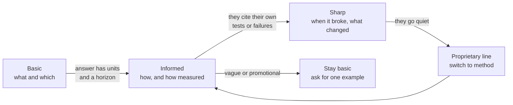
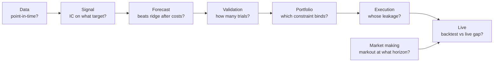

# Questions to ask

> **TL;DR**
>
> - About 140 questions, sorted by **strategy family** (A–G, as in the [strategy map](../02-strategies/index.md)), by **pipeline stage** (data → live), and by **role**.
> - Each is marked **Basic** (safe opener), **Informed** (shows you know the mechanics) or **Sharp** (probes a failure they lived through). Climb only as the answers earn it.
> - 🔒 marks proprietary territory (signals, parameters, capacity, latency rank, P&L by strategy). Nobody will answer; listen to *how* they decline, or ask the open version.
> - The best questions ask how they know and what broke, not what the secret is.

**Level:** Core · **Read time:** ~18 min · **Last verified:** 2026-11

## How to use this page

*Good answer* notes describe what a competent reply contains: a horizon, a unit, a split, an admitted trade-off. Their numbers are illustrative magnitudes from the linked pages, not firm data. If an informed question gets a vague answer, drop back and ask for one example. Sharp questions earn candor because they show you know where the strategy breaks, yet stay on method and history, which anyone can discuss. Tone: [how to talk to a quant](how-to-talk-to-a-quant.md). What not to ask: [faux pas](faux-pas-and-naive-questions.md).

## By strategy family

### A. Liquidity provision

Pages: [equity MM](../02-strategies/a-liquidity-provision/equity-market-making.md) · [ETF MM](../02-strategies/a-liquidity-provision/etf-market-making.md) · [options MM](../02-strategies/a-liquidity-provision/options-market-making.md) · [retail internalization](../02-strategies/a-liquidity-provision/retail-flow-internalization.md) · [auctions and the close](../02-strategies/a-liquidity-provision/auctions-and-closing-liquidity.md)

- **Basic.** What share of your volume is passive, and do you carry inventory overnight? *Good answer:* a rough share, and a reason for any overnight risk.
- **Basic.** After a small-cap ETF fill, what do you hedge with first: futures, a peer ETF or the basket? *Good answer:* the cheapest instrument that tracks it right now; the basket last.
- **Informed.** At which horizons do you measure [markouts](../09-reference/glossary.md#markout), against the mid or your own fair value? *Good answer:* a ladder (milliseconds to a minute or more), cut by venue, counterparty type and order size.
- **Informed.** How do you split options P&L into edge, theta-gamma and vega?
- **Informed.** How do you tell mechanical closing imbalances (index events) from informed ones?
- **Informed.** What will the half-penny tick and 10-mil fee cap (due November 2027 `[Verified]`) do to your queue strategy? *Good answer:* narrower spreads in [tick-constrained](../09-reference/glossary.md#tick-constrained-stock) names; less capture per share, smaller rebates.
- **Sharp.** What share of spread capture goes to [adverse selection](../09-reference/glossary.md#adverse-selection), and in which segment is it worst? 🔒 for the number. *Good answer:* "worst where we lose races; we widened there."
- **Sharp.** At what markout or one-sided imbalance would you stop internalizing a broker's flow?
- **Sharp.** In a March 2020-style week, which limit binds first on an ETF book: balance sheet, borrow or risk?
- **Sharp.** 🔒 What [PFOF](../09-reference/glossary.md#payment-for-order-flow-pfof) do you pay per contract, and what are your vega limits by expiry? Locked: these are commercial terms and live risk limits.

### B. Speed and structural

Pages: [latency arbitrage](../02-strategies/b-speed-and-structural/latency-arbitrage.md) · [lead-lag](../02-strategies/b-speed-and-structural/lead-lag-and-cross-asset-arbitrage.md) · [ETF and index arbitrage](../02-strategies/b-speed-and-structural/etf-and-index-arbitrage.md) · [fee-driven strategies](../02-strategies/b-speed-and-structural/fee-and-microstructure-driven-strategies.md)

- **Basic.** What triggers most of your races: futures, other venues or the SIP?
- **Basic.** Which instruments lead your names; do you trade on them or only quote on them? *Good answer:* mostly to move quotes, so it shows up as lower adverse selection.
- **Informed.** When you lose a race, is it a missed fill or a cancel that arrived too late?
- **Informed.** Do you estimate [lead-lag](../09-reference/glossary.md#lead-lag) in event time or clock time?
- **Informed.** What does one creation unit cost all in? *Good answer:* fee, basket spread, borrow and financing, each in bps.
- **Sharp.** If the SEC repeals the [trade-through rule](../09-reference/glossary.md#trade-through-rule) (proposed June 2026 `[Verified]`), which P&L lines change? *Good answer:* names routing, [ISO](../09-reference/glossary.md#intermarket-sweep-order-iso) usage and venues that lose forced flow.
- **Sharp.** Under one-second batch auctions, which of your P&L lines vanish?
- **Sharp.** 🔒 What is your [tick-to-trade](../09-reference/glossary.md#tick-to-trade), and where do you rank on each route? Locked: speed rank is the edge.

### C. Statistical arbitrage

Pages: [overview](../02-strategies/c-statistical-arbitrage/stat-arb-overview-and-history.md) · [pairs](../02-strategies/c-statistical-arbitrage/pairs-trading-and-cointegration.md) · [factor residuals](../02-strategies/c-statistical-arbitrage/factor-residual-mean-reversion.md) · [reversal](../02-strategies/c-statistical-arbitrage/short-term-cross-sectional-reversal.md) · [intraday patterns](../02-strategies/c-statistical-arbitrage/intraday-patterns-and-seasonality.md) · [ML short-horizon](../02-strategies/c-statistical-arbitrage/ml-driven-short-horizon-alpha.md)

- **Basic.** What is your holding period and daily turnover, and which factors do you neutralize?
- **Basic.** Residuals from statistical factors, ETFs or a fundamental risk model? *Good answer:* a trade-off, e.g. PCA adapts faster but its factors are unnamed.
- **Informed.** What is your break-even cost per dollar traded, and what do you actually pay? *Good answer:* two numbers in bps; a book within 2× of break-even is fragile.
- **Informed.** How do you treat residuals on earnings and news days? *Good answer:* excluded or down-weighted, because news moves tend not to revert.
- **Informed.** How many candidate pairs do you test, and how many survive out of sample after a multiple-testing correction?
- **Sharp.** How did the book behave on 7–9 August 2007 or in March 2020, and how fast did you de-gross? *Good answer:* names the mechanism (crowded deleveraging, the [quant quake](../09-reference/glossary.md#quant-quake)) and one process change.
- **Sharp.** How correlated is your pairs or residual P&L with a plain reversal factor? *Good answer:* they have checked; high correlation means a cheap factor in disguise.
- **Sharp.** 🔒 Where does your capacity curve cross zero, and how much residual alpha is crossed internally? Locked: [capacity](../09-reference/glossary.md#capacity) tells rivals how much room is left.

### D. Mid-frequency alpha

Pages: [cross-sectional alpha](../02-strategies/d-mid-frequency-alpha/cross-sectional-alpha-and-neutralization.md) · [fundamental signals](../02-strategies/d-mid-frequency-alpha/fundamental-quant-signals.md) · [earnings and events](../02-strategies/d-mid-frequency-alpha/earnings-and-event-driven.md) · [revisions and sentiment](../02-strategies/d-mid-frequency-alpha/analyst-revisions-and-sentiment.md) · [flow-driven](../02-strategies/d-mid-frequency-alpha/flow-driven-strategies.md) · [alt data](../02-strategies/d-mid-frequency-alpha/alternative-data.md) · [NLP and LLMs](../02-strategies/d-mid-frequency-alpha/nlp-and-llm-signals.md)

- **Basic.** Do you [neutralize](../09-reference/glossary.md#neutralization) in the signal, in the optimizer, or both?
- **Basic.** Do you use as-first-reported fundamentals, stamped by filing date, acceptance time or vendor receipt?
- **Basic.** Which index families do you trade around? Russell moves to semiannual reconstitution from December 2026 `[Reported]`; does that change your calendar?
- **Informed.** How far is your effective [breadth](../09-reference/glossary.md#breadth) from the nominal count of names?
- **Informed.** How do you test a vendor's history for backfill, and what share of trialed datasets do you buy? *Good answer:* first-delivered versus restated history; they buy few.
- **Informed.** How do you handle LLM training-cutoff [look-ahead](../09-reference/glossary.md#look-ahead-bias) in text backtests? *Good answer:* post-cutoff tests or time-stamped models.
- **Sharp.** How much IC does text add *after* earnings surprise and revisions? *Good answer:* a small number, measured on residuals, not standalone.
- **Sharp.** Which legal red flags have made you walk away from a dataset? *Good answer:* scraping terms, personal data, possible MNPI; cites the 2021 App Annie case `[Verified]`.
- **Sharp.** 🔒 What is the IC half-life of a newly added alpha in production? Locked: it reveals research productivity and decay rates.

### E. Risk premia and factors

Pages: [factor fundamentals](../02-strategies/e-risk-premia-and-factors/factor-investing-fundamentals.md) · [momentum](../02-strategies/e-risk-premia-and-factors/momentum.md) · [value, quality, low vol](../02-strategies/e-risk-premia-and-factors/value-quality-low-vol.md) · [timing, crowding, quant winters](../02-strategies/e-risk-premia-and-factors/factor-timing-crowding-and-quant-winters.md)

- **Basic.** Long-short, or long-only with a tracking-error budget?
- **Basic.** Which momentum lookback and skip month, and is the book industry-neutral?
- **Informed.** How do your definitions differ from Fama-French: breakpoints, price lag, neutralization?
- **Informed.** What haircut do you apply to published Sharpe ratios? *Good answer:* cites post-publication decay (McLean and Pontiff: −58% `[Verified]`) and haircuts about half.
- **Informed.** Do you combine value and momentum in the signal or in the portfolio, and did that change after 2020?
- **Informed.** How do you size momentum after a bear market? *Good answer:* knows [momentum crashes](../09-reference/glossary.md#momentum-crash) come in sharp rebounds; scales by volatility or market state.
- **Sharp.** How do you tell a premium drought from [crowding](../09-reference/glossary.md#crowding) in your attribution? *Good answer:* crowding shows as rising peer correlation and short interest; a drought as a broad factor loss.
- **Sharp.** Which crowding measure has actually *led* your losses, rather than moved with them?
- **Sharp.** 🔒 Live Sharpe per factor versus backtest since launch? Locked: it is the product's track record by sleeve.

### F. Volatility and derivatives

Pages: [VRP and vol arb](../02-strategies/f-volatility-and-derivatives/volatility-risk-premium-and-vol-arb.md) · [dispersion and correlation](../02-strategies/f-volatility-and-derivatives/dispersion-and-correlation-trading.md)

- **Basic.** Variance swaps, straddles or puts, and why?
- **Basic.** Do you trade dispersion with options or with variance swaps?
- **Informed.** What stress do you size to, and how much carry goes to tail hedges? *Good answer:* a named scenario (5 February 2018: VIX +116% in a day `[Verified]`) and a hedge budget.
- **Informed.** Vega-neutral or correlation-weighted dispersion, and how do you forecast realized correlation?
- **Sharp.** How do you separate the [variance risk premium](../09-reference/glossary.md#variance-risk-premium) from plain equity beta?
- **Sharp.** What did the week of 5 August 2024 cost, and what changed afterwards?
- **Sharp.** 🔒 What are your correlation-vega limit and timing filters?

### G. Futures and macro context

Pages: [trend following](../02-strategies/g-futures-and-macro-context/trend-following-and-ctas.md) · [carry](../02-strategies/g-futures-and-macro-context/carry-and-cross-asset-risk-premia.md)

- **Basic.** Which trend speeds do you blend, and why?
- **Basic.** How do you define [carry](../09-reference/glossary.md#carry) in each asset class; do you rank within or across classes?
- **Informed.** Do you size by standalone volatility or by risk contribution?
- **Informed.** How correlated is carry with short-vol and equity beta in a crisis? *Good answer:* an honest "close to one", with an example such as August 2024.
- **Sharp.** How did your bond book handle 10–13 March 2023?
- **Sharp.** 🔒 How much of your Sharpe is trend versus carry?

## By pipeline stage

Every strategy runs the same pipeline at a different clock speed ([there is no single algorithm](../03-algorithms/there-is-no-single-algorithm.md)). One sharp question per stage:

### Data

Cards: [D1 point-in-time data](../03-algorithms/a-data-and-signals/point-in-time-data-and-cleaning.md) · [D2 feature engineering](../03-algorithms/a-data-and-signals/feature-engineering.md)

- **Basic.** Which security identifier do you key on, and how do you handle ticker changes?
- **Informed.** What delisting return do you assume when it is missing? *Good answer:* a negative imputation (Shumway: −30% NYSE/Amex, −55% Nasdaq `[Verified]`), never zero.
- **Informed.** How do you lag features relative to when you could actually trade on them?
- **Sharp.** Can you reproduce a two-year-old backtest bit for bit? *Good answer:* yes, from versioned snapshots; otherwise research gains and data changes blur.
- **Sharp.** How do you catch a vendor backfill before it enters a feature?
- **Sharp.** 🔒 How much did Sharpe fall when you moved to [point-in-time data](../09-reference/glossary.md#point-in-time-data)? Ask instead whether it changed the *ranking* of signals.

### Signal

Cards: [D3 signal transforms](../03-algorithms/a-data-and-signals/signal-transforms.md) · [D4 evaluating signals](../03-algorithms/a-data-and-signals/evaluating-signals.md)

- **Basic.** Ranks, z-scores or Gaussianized ranks, and why?
- **Basic.** Rank or Pearson [IC](../09-reference/glossary.md#information-coefficient-ic), on raw or residual returns, at what horizon? *Good answer:* rank IC on residual returns at the trading horizon, plus a decay curve.
- **Informed.** How fast does IC decay, and how do overlapping horizons enter its t-stat?
- **Informed.** How do you measure a signal's marginal contribution to the book, not its standalone IC?
- **Sharp.** How many variants did you try, and what hurdle applies? *Good answer:* they count trials and raise the bar: t > 3 (Harvey, Liu and Zhu `[Verified]`) or a [deflated Sharpe](../09-reference/glossary.md#deflated-sharpe-ratio).
- **Sharp.** 🔒 How much backtest IC survives live?

### Forecast

Cards: [F1 linear models](../03-algorithms/b-forecasting-models/linear-models-and-regularization.md) · [F2 trees](../03-algorithms/b-forecasting-models/tree-ensembles.md) · [F3 neural nets](../03-algorithms/b-forecasting-models/neural-nets-and-sequence-models.md) · [F4 LLMs](../03-algorithms/b-forecasting-models/llms-and-foundation-models-in-quant.md) · [F5 alpha combination](../03-algorithms/b-forecasting-models/alpha-combination-and-ensembling.md) · [F6 regimes](../03-algorithms/b-forecasting-models/regime-detection.md)

- **Basic.** Pooled or per-date regression, and on what target: raw, residual or ranked?
- **Basic.** Trees or linear for the main forecast, and why?
- **Informed.** How do you choose the penalty, and on what metric? *Good answer:* IC or net P&L on purged folds, not in-sample fit.
- **Informed.** When regimes shift, do you change risk or change the model? *Good answer:* usually risk; model-switching on a lagging signal often costs more.
- **Sharp.** When did a nonlinear model last beat your linear one *after costs*?
- **Sharp.** 🔒 What marginal IC must a new signal show to enter the combination?

### Validation

Cards: [V1 time-series CV](../03-algorithms/c-validation-and-backtesting/time-series-cross-validation.md) · [V2 backtesting engines](../03-algorithms/c-validation-and-backtesting/backtesting-engines.md) · [V3 pitfalls](../03-algorithms/c-validation-and-backtesting/backtest-pitfalls.md) · [V4 overfitting](../03-algorithms/c-validation-and-backtesting/overfitting-and-multiple-testing.md)

- **Basic.** Walk-forward, purged K-fold or [CPCV](../09-reference/glossary.md#combinatorial-purged-cross-validation-cpcv), and why?
- **Informed.** How do you set purge and [embargo](../09-reference/glossary.md#embargo) for your label horizon? *Good answer:* purge at least the label horizon; embargo until feature autocorrelation dies.
- **Informed.** What fill price does your daily backtest assume, and how do you model queue position for passive orders?
- **Informed.** Do you compute a deflated Sharpe or [PBO](../09-reference/glossary.md#probability-of-backtest-overfitting-pbo) before allocating?
- **Sharp.** How many times has the final hold-out been looked at? *Good answer:* an honest number above one, and a rule for retiring a contaminated hold-out.
- **Sharp.** 🔒 What is your typical backtest-to-live Sharpe ratio? Ask what haircut they consider normal instead.

### Portfolio

Cards: [P1 risk models](../03-algorithms/d-portfolio-construction/risk-models.md) · [P3 MVO](../03-algorithms/d-portfolio-construction/mean-variance-optimization.md) · [P5 cost models](../03-algorithms/d-portfolio-construction/transaction-cost-and-impact-models.md) · [P6 trading toward the aim](../03-algorithms/d-portfolio-construction/multi-period-and-trading-toward-aim.md) · [P7 sizing](../03-algorithms/d-portfolio-construction/position-sizing-and-risk-budgeting.md)

- **Basic.** Vendor [risk model](../09-reference/glossary.md#risk-model), your own, or both? What share of risk is factor versus specific?
- **Basic.** What volatility target do you run, and do you budget by standalone volatility or risk contribution?
- **Informed.** Which constraint binds most often, and what does it cost in transfer coefficient? *Good answer:* names it (sector, borrow, liquidity caps) and estimates the cost.
- **Informed.** How does your trade rate relate to signal half-lives? *Good answer:* the book [trades toward the aim](../09-reference/glossary.md#trading-toward-the-aim) at a rate tied to decay and cost.
- **Informed.** Is your impact model fitted on your own fills, and how do you strip your own alpha out of the calibration?
- **Sharp.** How often does the optimizer go infeasible, and what gives way?
- **Sharp.** When do you re-risk after a drawdown cut?
- **Sharp.** 🔒 How much do you shrink alphas before the optimizer sees them, and what cost multiplier do you run?

### Execution

Cards: [E1 overview](../03-algorithms/e-execution-algorithms/execution-algorithms-overview.md) · [E3 Almgren-Chriss](../03-algorithms/e-execution-algorithms/implementation-shortfall-and-almgren-chriss.md) · [E4 smart order routing](../03-algorithms/e-execution-algorithms/smart-order-routing.md) · [E5 close and dark](../03-algorithms/e-execution-algorithms/auction-close-and-dark-liquidity-algos.md) · [E6 TCA](../03-algorithms/e-execution-algorithms/transaction-cost-analysis.md)

- **Basic.** Which benchmark judges each order, and who chose it? *Good answer:* [arrival price](../09-reference/glossary.md#arrival-price) for alpha-driven orders; VWAP only when urgency is low.
- **Basic.** Broker algos or your own?
- **Informed.** How do you map signal half-life to urgency?
- **Informed.** Do you rank venues on fees, fill rate or markouts? How do you detect dark-pool pinging?
- **Informed.** How many orders before you trust a broker comparison? *Good answer:* hundreds to thousands; [TCA](../09-reference/glossary.md#transaction-cost-analysis-tca) noise swamps small differences.
- **Sharp.** How much of realized [shortfall](../09-reference/glossary.md#implementation-shortfall) is your own [information leakage](../09-reference/glossary.md#information-leakage)?
- **Sharp.** What changes in your router if Rule 611 goes?
- **Sharp.** 🔒 Which venues have you cut on markouts?

### Market making

Cards: [M1 HFT loop](../03-algorithms/f-market-making-and-hft-algorithms/anatomy-of-an-hft-trading-loop.md) · [M2 fair value](../03-algorithms/f-market-making-and-hft-algorithms/fair-value-and-microprice.md) · [M4 quoting](../03-algorithms/f-market-making-and-hft-algorithms/quoting-and-inventory-control.md) · [M5 markouts](../03-algorithms/f-market-making-and-hft-algorithms/adverse-selection-and-markouts.md) · [M6 queue position](../03-algorithms/f-market-making-and-hft-algorithms/queue-position-and-order-placement.md) · [M8 vol surfaces](../03-algorithms/f-market-making-and-hft-algorithms/options-pricing-and-vol-surfaces-for-mm.md) · [M9 risk controls](../03-algorithms/f-market-making-and-hft-algorithms/algorithmic-risk-controls.md)

- **Basic.** Do you quote around the mid or your own [fair value](../09-reference/glossary.md#fair-value), and which input moves it most?
- **Informed.** Do you skew on price, on size, or by dropping a side, and when do you hedge instead of skewing?
- **Informed.** How do you fit fill intensity when your own quotes decide which fills you see?
- **Informed.** How much worse do back-of-queue fills mark out than front-of-queue ones?
- **Sharp.** Do inventory-increasing fills mark out worse than inventory-reducing ones? *Good answer:* yes, and they size the skew from that difference.
- **Sharp.** How does a [kill switch](../09-reference/glossary.md#kill-switch) avoid leaving you half-hedged?
- **Sharp.** 🔒 What is your skew per 100 shares, and your wing model?

### Live

Cards: [L1 monitoring and attribution](../03-algorithms/g-live-trading/live-monitoring-and-pnl-attribution.md) · [L2 alpha decay](../03-algorithms/g-live-trading/alpha-decay-detection-and-model-retirement.md) · [L3 RL](../03-algorithms/g-live-trading/reinforcement-learning-in-trading.md)

- **Basic.** Is the [attribution](../09-reference/glossary.md#pl-attribution) model the same risk model the optimizer uses?
- **Informed.** How many years of live data before you trust a signal's Sharpe? *Good answer:* knows t ≈ Sharpe × √years, so a 0.75 Sharpe needs about seven years to reach t = 2.
- **Informed.** How do you separate capacity decay from [alpha decay](../09-reference/glossary.md#alpha-decay)? *Good answer:* decay that tracks assets is capacity; decay in a paper-traded copy is alpha.
- **Sharp.** Which alert last fired, and what changed afterwards?
- **Sharp.** Which baseline does your learned (RL) policy beat out of sample, and did it ever game the reward?
- **Sharp.** 🔒 Which crowding indicators actually led your drawdowns?

## By role

Titles vary by firm; see [roles, teams and careers](../04-industry-and-firms/roles-teams-and-careers.md).

**Quantitative researcher (QR)**

- **Basic.** How does a research week split between data work, modeling and debugging?
- **Informed.** What share of ideas die, and at which stage? *Good answer:* most at validation or costs, with kill criteria set in advance.
- **Informed.** How is credit assigned when signals are combined into one book?
- **Sharp.** What did you believe two years ago that live data proved wrong?

**Quantitative trader (QT)**

- **Basic.** What do you watch during the day that the models do not?
- **Informed.** When do you override the system, and how is an override audited?
- **Informed.** What did the open on 5 August 2024 look like from your seat?
- **Sharp.** Which manual intervention cost money, and what rule replaced it?
- **Sharp.** In real time, how do you tell a bad day from a broken model?

**Portfolio manager (PM)**

- **Basic.** Do you combine signals into one book, or P&L streams across books? ([how firms combine strategies](../02-strategies/h-cross-cutting/how-firms-combine-strategies.md))
- **Informed.** What correlation to the rest of the platform do you run, and what volatility on allocated capital?
- **Informed.** How do drawdown limits shape the risk you take? *Good answer:* admits stop ladders (reportedly a 5% cut and 7.5% exit at one [pod](../09-reference/glossary.md#pod) platform `[Reported]`) push PMs below target volatility.
- **Sharp.** How much of this year's research replaced decayed alpha, and how much was net new?
- **Sharp.** Where did the capital and people from your last retired strategy go?

**Execution quant**

- **Basic.** Who are your internal clients, and at what horizons do their signals decay?
- **Informed.** How do you forecast closing volume on index rebalance days?
- **Informed.** Is VWAP slippage measured against the whole day or only your trading interval?
- **Sharp.** How do realized costs feed back into the cost model and the alpha haircuts?
- **Sharp.** 🔒 What does in-house execution save versus broker algos?

**Low-latency engineer**

- **Basic.** What runs on [FPGA](../09-reference/glossary.md#fpga), what on CPU, what on GPU? ([colocation and networks](../05-infrastructure/colocation-networks-and-the-speed-of-light.md))
- **Informed.** What happens when you miss a packet?
- **Informed.** Can you replay a day and get byte-identical orders?
- **Sharp.** What drives the gap between your median and p99 latency at the open? 🔒 for the absolute numbers.
- **Sharp.** OPRA projects peaks near 13.6M messages per 100 ms `[Verified]`; what does that do to your hardware plan?

**Risk manager**

- **Basic.** Which checks run before every order, and where in the stack?
- **Informed.** How do you stress a crowded-factor unwind like August 2007?
- **Informed.** Which blind spot in your risk model worries you most?
- **Sharp.** What did your last post-mortem change?
- **Sharp.** 🔒 What are your actual price collars and loss stops? ([risk management at quant firms](../06-risk-and-regulation/risk-management-at-quant-firms.md))

## What no one will answer, and why

| 🔒 Topic | Why it stays locked | Ask instead |
|---|---|---|
| Signal definitions and parameters | Copying them copies the strategy; published anomalies lose about 58% after publication `[Verified]` | Which data families and horizons matter; how sensitive results are |
| P&L, Sharpe, capacity by strategy | Shows rivals where the money is and how much room is left | Realistic ranges for the class ([comparison matrix](../02-strategies/h-cross-cutting/strategy-comparison-matrix.md)) |
| Latency and race rank | The rank is the edge, and it is temporary | Which strategies are latency-sensitive at all |
| Risk limits and stop levels | Tells others when the firm becomes a forced seller | How limits are set and reviewed |
| Counterparty terms (PFOF, broker splits) | Commercial contracts | How the economics work in general |

Contracts and courts enforce these lines. Jane Street sued Millennium and two former traders in 2024 over an India options strategy that reportedly made about \$1B in 2023; the case settled in December 2024 on undisclosed terms `[Reported]`.

## Related pages

- [How to talk to a quant](how-to-talk-to-a-quant.md)
- [Faux pas and naive questions](faux-pas-and-naive-questions.md)
- [Mock conversations](mock-conversations.md)
- [How quants evaluate a strategy](../02-strategies/how-quants-evaluate-a-strategy.md)
- [Strategy x algorithm matrix](../02-strategies/h-cross-cutting/strategy-x-algorithm-matrix.md)
- [Algorithm map](../03-algorithms/algorithm-map.md)
- [Sanity-checking claims](../08-calibration/sanity-checking-claims.md)

## Sources

- [Verified] McLean, R. D. & Pontiff, J. (2016). "Does Academic Research Destroy Stock Return Predictability?" *Journal of Finance* 71(1), 5–32. <https://doi.org/10.1111/jofi.12365> (accessed 2026-11)
- [Verified] Harvey, C. R., Liu, Y. & Zhu, H. (2016). "… and the Cross-Section of Expected Returns." *Review of Financial Studies* 29(1), 5–68. <https://doi.org/10.1093/rfs/hhv059> (accessed 2026-11)
- [Verified] Bailey, D. H. & López de Prado, M. (2014). "The Deflated Sharpe Ratio: Correcting for Selection Bias, Backtest Overfitting and Non-Normality." *Journal of Portfolio Management* 40(5), 94–107. <https://doi.org/10.3905/jpm.2014.40.5.094> (accessed 2026-11)
- [Verified] Khandani, A. E. & Lo, A. W. (2011). "What happened to the quants in August 2007? Evidence from factors and transactions data." *Journal of Financial Markets* 14(1), 1–46. <https://doi.org/10.1016/j.finmar.2010.07.005> (accessed 2026-11)
- [Verified] U.S. SEC (2026-06-11). Temporary exemptive order delaying Regulation NMS tick-size and access-fee compliance, Release No. 34-105656. <https://www.sec.gov/files/rules/exorders/2026/34-105656.pdf> (accessed 2026-11)
- [Reported] Morrison Foerster (2026-06-12). "SEC Proposes Landmark Rollback of Core Regulation NMS Requirements and Delays Implementation of 2024 Market Structure Reforms." <https://www.mofo.com/resources/insights/260612-sec-proposes-landmark-rollback-of-core-regulation> (accessed 2026-11)
- [Verified] SIAC for the OPRA Participants (2025-09-15). "Revised OPRA Capacity Projections." <https://cdn.opraplan.com/documents/notices/OPRA_Capacity_Projections_Update_0925.pdf> (accessed 2026-11)
- [Verified] FTSE Russell (2026-09-01). "FTSE Russell announces December 2026 Russell US Indexes Reconstitution schedule." <https://www.lseg.com/en/media-centre/press-releases/ftse-russell/2026/ftse-russell-announces-december-2026-russell-us-indexes-reconstitution-schedule> (accessed 2026-11)
- [Reported] SAFE Data Center (2025). "Data Description: CRSP monthly returns with Shumway delisting adjustment" (−30% NYSE/Amex, −55% Nasdaq imputation). <https://datacenter.safe-frankfurt.de/documents/Data_Description_CRSP_Shumway_20250317.pdf> (accessed 2026-11)
- [Reported] Simpson Thacher (2021-09-15). "App Annie and Its Founder to Pay \$10 Million to Settle First SEC Enforcement Action Against Alternative Data Provider." <https://www.stblaw.com/about-us/publications/view/2021/09/15/app-annie-and-its-founder-to-pay-$10-million-to-settle-first-sec-enforcement-action-against-alternative-data-provider> (accessed 2026-11)
- [Reported] eFinancialCareers (n.d.). Article on Millennium jobs and stop-loss practice, citing the Wall Street Journal. <https://www.efinancialcareers.com/news/millennium-hedge-fund-jobs> (accessed 2026-11)
- [Reported] Bloomberg Law (2024-12-05). "Jane Street-Millennium Trade Secrets Fight Ends in Settlement." <https://news.bloomberglaw.com/ip-law/jane-street-millennium-settle-india-options-trade-secrets-case> (accessed 2026-11)
