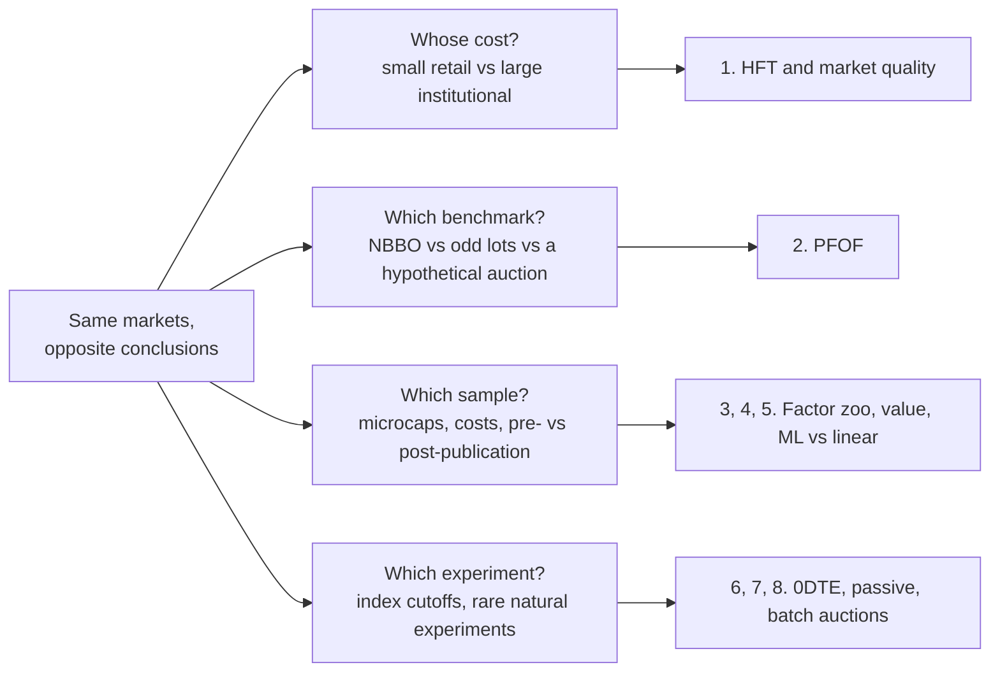

# Contested debates

> **TL;DR**
>
> - Eight live arguments a quant may raise, each with the strongest evidence on both sides and no verdict where the evidence is mixed.
> - The camps rarely disagree on the data; they disagree on whose cost, which benchmark, which sample and which experiment.
> - The useful question is "which measure are you using?", not "is HFT good?"

**Level:** Deep dive · **Read time:** ~9 min · **Last verified:** 2026-11

Each section gives the best case for each answer, with tagged evidence, and why the question stays open. Evidence from an interested party is flagged.

## 1. HFT and market quality

**Improves it.**

- When the NYSE automated quotes in 2003, algorithmic trading rose, and spreads and adverse selection fell, especially in large stocks (Hendershott, Jones and Menkveld 2011) `[Verified]`.
- [HFTs](../09-reference/glossary.md#high-frequency-trading-hft) trade in the direction of permanent price changes and against transitory pricing errors, which speeds price discovery (Brogaard, Hendershott and Riordan 2014) `[Verified]`.

**Harms it.**

- Latency races take about 20% of FTSE 100 volume and act as a tax of roughly 0.5 bp of volume; removing them would cut the cost of liquidity by about 17% (Aquilina, Budish and O'Neill 2022) `[Verified]`.
- HFTs first lean against large institutional orders, then trade alongside the most informed ones (van Kervel and Menkveld 2019) `[Verified]`. In Canada, HFT activity went with higher costs for large informed trades and lower costs for small uninformed ones (Korajczyk and Murphy 2019) `[Verified]`.
- In the 2010 Flash Crash, HFTs kept trading but did not absorb the selling (Kirilenko et al. 2017) `[Verified]`.

**Why it stays open.** HFT can cut small orders' costs on calm days and raise large orders' costs, or step back in stress, at the same time. Mechanisms: [equity market making](../02-strategies/a-liquidity-provision/equity-market-making.md), [adverse selection and markouts](../03-algorithms/f-market-making-and-hft-algorithms/adverse-selection-and-markouts.md).

## 2. Payment for order flow

**PFOF helps retail.**

- Using Rule 605 data for January 2019 to March 2022, Dyhrberg, Shkilko and Werner find wholesaler price improvement outweighs exchanges' lower realized spreads, saving retail close to \$1B a month `[Verified]` (working-paper version).
- Retail flow rarely predicts prices, so [wholesalers](../09-reference/glossary.md#wholesaler) can pay brokers and still beat the NBBO ([mechanism](../02-strategies/a-liquidity-provision/retail-flow-internalization.md)).

**PFOF hurts retail.**

- In 85,000 simultaneous orders across six accounts, round-trip costs ranged from 0.07% to 0.46%, and PFOF did not explain the gap (Schwarz et al. 2025) `[Verified]`.
- Across 150,000 trades, costs differed persistently between wholesalers within a broker, yet many brokers kept routing to the dearer ones (Huang, Jorion, Lee and Schwarz 2024) `[Verified]`.
- Better odd-lot quotes routinely sit inside the NBBO (Bartlett, McCrary and O'Hara) `[Verified]`, so "improvement" against the NBBO is a soft yardstick.
- The SEC estimated order-by-order auctions would save retail about \$1.5B a year `[Verified]`, then withdrew the proposal on 2025-06-12 `[Reported]`. The EU ended its PFOF exemptions on 2026-06-30 `[Reported]`.

**Why it stays open.** Every study needs a counterfactual: an NBBO that odd lots beat, an exchange that would receive different flow, or an auction that does not exist.

## 3. Factor premia: real or data-mined?

**Mostly data-mined or decayed.**

- Given how many factors have been tried, a new one needs t > 3.0 (Harvey, Liu and Zhu 2016) `[Verified]`.
- With NYSE breakpoints and value weights to limit microcaps, 65% of 452 anomalies fail |t| ≥ 1.96 and 82% fail 2.78 (Hou, Xue and Zhang 2020) `[Verified]`.
- Predictor returns fall 58% after publication (McLean and Pontiff 2016) `[Verified]`.

**Mostly real.**

- 98% of 161 clearly significant original predictors still show t > 1.96 in replication (Chen and Zimmermann 2022) `[Verified]`.
- 153 factors cluster into 13 themes, and most replicate across 93 countries (Jensen, Kelly and Pedersen 2023) `[Verified]`.

**Why it stays open.** The camps differ on definitions: value weights or equal, microcaps in or out, and whether a redundant factor counts as false. See [factor investing fundamentals](../02-strategies/e-risk-premia-and-factors/factor-investing-fundamentals.md) and [overfitting and multiple testing](../03-algorithms/c-validation-and-backtesting/overfitting-and-multiple-testing.md).

## 4. Value: dead or cyclical?

**Dead, or badly measured.**

- HML's gross Sharpe ratio was −0.06 over 2010–2026, against 0.52 in 1963–1991 `[Verified]` (our computation, French data library).
- Book value misses intangibles (Lev and Srivastava 2022) `[Reported]`.
- Fama and French (2021) find value premiums much lower in the second half of 1963–2019; book-to-market regressions point to a real decline if their coefficients are stable `[Verified]`.

**Cyclical.**

- Arnott, Harvey, Kalesnik and Linnainmaa (2021) attribute HML's roughly 55% drawdown to mid-2020 to value getting cheaper relative to growth, not to failing fundamentals `[Verified]`. HML then rose 68% from October 2020 to December 2022 `[Verified]`.
- Fama and French cannot reject equal expected premiums in the two halves, because monthly premiums are so volatile `[Verified]`.
- Israel, Laursen and Richardson (2021) argue that multi-measure systematic value is not dead `[Reported]`.

**Why it stays open.** At a true Sharpe of 0.3, reaching t = 2 takes about (2 ÷ 0.3)² ≈ 44 years of data `[Estimate]`. See [value, quality, low vol](../02-strategies/e-risk-premia-and-factors/value-quality-low-vol.md).

## 5. Machine learning versus linear models

**ML wins.**

- Gu, Kelly and Xiu (2020): trees and neural nets doubled monthly out-of-sample R² (0.33–0.40% against 0.16%); a neural-net long-short decile portfolio earned a value-weighted Sharpe of 1.35, gross, over 1987–2016 `[Verified]`.
- Kelly, Malamud and Zhou (2024) prove that models with more parameters than observations can beat simple ones, and show it in US market timing `[Verified]`.

**Linear is enough, or the ML edge is fragile.**

- Avramov, Cheng and Metzker (2023): deep-learning profits come from microcaps, distressed stocks and volatile periods; excluding them, or charging reasonable costs, removes much of the gain `[Verified]`.
- Nagel (2025, working paper): the "complex" market-timing forecasts reduce to volatility-timed momentum, and the method builds the same strategy even on simulated data with reversals `[Reported]`.
- Many production books keep regularized linear models as the backbone for stability and explainability `[Lore]`.

**Why it stays open.** The ML advantage is a few tenths of a percent of R², concentrated where costs are highest, and studies differ in universe, horizon and costs. See [tree ensembles](../03-algorithms/b-forecasting-models/tree-ensembles.md) and [linear models](../03-algorithms/b-forecasting-models/linear-models-and-regularization.md).

## 6. Do 0DTE options destabilize the market?

**Destabilizing.**

- 0DTE options reached a record 66.2% of SPX options volume in July 2026 `[Verified]`.
- Brogaard, Han and Won (working paper): a one-standard-deviation rise in 0DTE volume goes with about 14% higher daily S&P 500 volatility `[Reported]`.
- Mechanism: short-gamma dealers buy rallies and sell dips; a dealer short 2,000 at-the-money SPX contracts with three hours left must trade about \$750M of index after a 1% move (illustrative).

**Benign or stabilizing.**

- Dim, Eraker and Vilkov (2024): higher dealer gamma goes with *lower* intraday realized volatility, with no spillover to later periods `[Reported]`. Adams et al. argue dealer hedging mostly dampens moves `[Reported]`.
- Volume is not exposure: customers both buy and sell 0DTE, and dealer net gamma is the small difference `[Lore]`.

**Why it stays open.** Dealer positioning is not public; studies infer it, and its sign changes day to day. See [ETF, futures and options linkages](../01-market-structure/etf-futures-options-linkages.md) and [hedging algorithms](../03-algorithms/f-market-making-and-hft-algorithms/hedging-algorithms.md).

## 7. Does passive investing distort prices?

**It distorts them.**

- Other investors offset only two-thirds of a shift in behavior; the rise of passive investing over 20 years made demand for individual stocks 11% more inelastic (Haddad, Huebner and Loualiche 2025) `[Verified]`.
- Gabaix and Koijen (working paper): \$1 of flow into equities raises aggregate market value by about \$5 `[Reported]`.
- Rising passive ownership cut the information in prices ahead of earnings announcements by about a quarter of its sample mean (Sammon 2025) `[Verified]`.

**It does not, much.**

- Coles, Heath and Ringgenberg (2022): as index investing grows, the mix of active investors adjusts and price efficiency is not impaired `[Reported]`.
- The S&P 500 inclusion effect fell from 7.4% in the 1990s to under 1% in the 2010s even as passive ownership grew (Greenwood and Sammon 2025) `[Verified]`.

**Why it stays open.** Clean experiments are rare; the Russell 1000/2000 cutoff designs many studies use are disputed as selection bias (Wei and Young) `[Reported]`. See [flow-driven strategies](../02-strategies/d-mid-frequency-alpha/flow-driven-strategies.md).

## 8. The latency arms race and batch auctions

**Batch auctions would help.**

- Budish, Cramton and Shim (2015): continuous trading creates mechanical arbitrage at millisecond horizons; competition cut the median ES–SPY window from 97 ms (2005) to 7 ms (2011) without shrinking the profit per opportunity. [Frequent batch auctions](../09-reference/glossary.md#frequent-batch-auction) would end the race `[Verified]`.
- When rain disables microwave links, adverse selection falls and liquidity improves (Shkilko and Sokolov 2020) `[Verified]`.
- After Taiwan moved from periodic call auctions to continuous trading in March 2020, adverse selection and trading costs rose (Indriawan, Pascual and Shkilko, working paper) `[Reported]`.

**Continuous trading is fine.**

- Speed also serves price discovery (Brogaard, Hendershott and Riordan 2014) `[Verified]`.
- Citadel Securities, a market maker with a stake in the answer, found tighter spreads, more depth and more volume in Taiwan after the same switch `[Reported]`.
- The whole race is worth about \$5B a year globally (Aquilina, Budish and O'Neill) `[Verified]`, small against redesigning every venue. US policy chose single-venue speed bumps instead: the SEC approved IEX's in 2016 but rejected Cboe EDGA's asymmetric delay in 2020 `[Reported]`.

**Why it stays open.** No US exchange runs frequent batch auctions, and the one large foreign switch has been read both ways. See [latency arbitrage](../02-strategies/b-speed-and-structural/latency-arbitrage.md).

## Related pages

- [Myths vs reality](myths-vs-reality.md) and [sanity-checking claims](sanity-checking-claims.md)
- [Retail flow internalization](../02-strategies/a-liquidity-provision/retail-flow-internalization.md)
- [Factor timing, crowding and quant winters](../02-strategies/e-risk-premia-and-factors/factor-timing-crowding-and-quant-winters.md)
- [ML-driven short-horizon alpha](../02-strategies/c-statistical-arbitrage/ml-driven-short-horizon-alpha.md)
- [Rules that shape strategies](../06-risk-and-regulation/rules-that-shape-strategies.md)

## Sources

- [Verified] Hendershott, T., Jones, C. M. & Menkveld, A. J. (2011). "Does Algorithmic Trading Improve Liquidity?" *Journal of Finance* 66(1), 1–33. <https://doi.org/10.1111/j.1540-6261.2010.01624.x> (accessed 2026-11)
- [Verified] Brogaard, J., Hendershott, T. & Riordan, R. (2014). "High-Frequency Trading and Price Discovery." *Review of Financial Studies* 27(8), 2267–2306. <https://doi.org/10.1093/rfs/hhu032> (accessed 2026-11)
- [Verified] Aquilina, M., Budish, E. & O'Neill, P. (2022). "Quantifying the High-Frequency Trading 'Arms Race'." *Quarterly Journal of Economics* 137(1), 493–564. <https://doi.org/10.1093/qje/qjab032> (accessed 2026-11)
- [Verified] van Kervel, V. & Menkveld, A. J. (2019). "High-Frequency Trading around Large Institutional Orders." *Journal of Finance* 74(3), 1091–1137. <https://doi.org/10.1111/jofi.12759> (accessed 2026-11)
- [Verified] Korajczyk, R. A. & Murphy, D. (2019). "High-Frequency Market Making to Large Institutional Trades." *Review of Financial Studies* 32(3), 1034–1067. <https://doi.org/10.1093/rfs/hhy079> (accessed 2026-11)
- [Verified] Kirilenko, A., Kyle, A. S., Samadi, M. & Tuzun, T. (2017). "The Flash Crash: High-Frequency Trading in an Electronic Market." *Journal of Finance* 72(3), 967–998. <https://doi.org/10.1111/jofi.12498> (accessed 2026-11)
- [Verified] Dyhrberg, A. H., Shkilko, A. & Werner, I. M. (2025). "The retail execution quality landscape." *Journal of Financial Economics* 168, 104051 (findings from the 2023 working-paper abstract). <https://doi.org/10.1016/j.jfineco.2025.104051> (accessed 2026-11)
- [Verified] Schwarz, C., Barber, B. M., Huang, X., Jorion, P. & Odean, T. (2025). "The 'Actual Retail Price' of Equity Trades." *Journal of Finance* 80(5), 2507–2541. <https://doi.org/10.1111/jofi.13467> (accessed 2026-11)
- [Verified] Huang, X., Jorion, P., Lee, J. & Schwarz, C. (2024). "Who Is Minding the Store? Order Routing and Competition in Retail Trade Execution." Finance and Economics Discussion Series 2024-080, Federal Reserve Board. <https://doi.org/10.17016/FEDS.2024.080> (accessed 2026-11)
- [Verified] Bartlett, R. P., McCrary, J. & O'Hara, M. (2025). "The Market Inside the Market: Odd-Lot Quotes." *Review of Financial Studies* 38(3), 661–711. <https://doi.org/10.1093/rfs/hhad074> (accessed 2026-11)
- [Verified] SEC (2022-12-14). "SEC Proposes Rule to Enhance Competition for Individual Investor Order Execution" (press release, republished). <https://www.newsfilecorp.com/release/148085/SEC-Proposes-Rule-to-Enhance-Competition-for-Individual-Investor-Order-Execution> (accessed 2026-11)
- [Reported] PwC Legal (2024). "MiFIR/MiFID II review: making sense of the key amendments" (PFOF ban; exemptions end 30 June 2026). <https://legal.pwc.de/en/news/articles/mifir-mifid-ii-review-making-sense-of-the-key-amendments> (accessed 2026-11)
- [Verified] Harvey, C. R., Liu, Y. & Zhu, H. (2016). "… and the Cross-Section of Expected Returns." *Review of Financial Studies* 29(1), 5–68. <https://doi.org/10.1093/rfs/hhv059> (accessed 2026-11)
- [Verified] Hou, K., Xue, C. & Zhang, L. (2020). "Replicating Anomalies." *Review of Financial Studies* 33(5), 2019–2133. <https://doi.org/10.1093/rfs/hhy131> (accessed 2026-11)
- [Verified] McLean, R. D. & Pontiff, J. (2016). "Does Academic Research Destroy Stock Return Predictability?" *Journal of Finance* 71(1), 5–32. <https://doi.org/10.1111/jofi.12365> (accessed 2026-11)
- [Verified] Chen, A. Y. & Zimmermann, T. (2022). "Open Source Cross-Sectional Asset Pricing." *Critical Finance Review* 11(2), 207–264. <https://doi.org/10.1561/104.00000112> (accessed 2026-11)
- [Verified] Jensen, T. I., Kelly, B. & Pedersen, L. H. (2023). "Is There a Replication Crisis in Finance?" *Journal of Finance* 78(5), 2465–2518. <https://doi.org/10.1111/jofi.13249> (accessed 2026-11)
- [Reported] Lev, B. & Srivastava, A. (2022). "Explaining the Recent Failure of Value Investing." *Critical Finance Review* 11(2), 333–360. <https://doi.org/10.1561/104.00000115> (accessed 2026-11)
- [Verified] Fama, E. F. & French, K. R. (2021). "The Value Premium." *Review of Asset Pricing Studies* 11(1), 105–121. <https://doi.org/10.1093/rapstu/raaa021> (accessed 2026-11)
- [Verified] Arnott, R. D., Harvey, C. R., Kalesnik, V. & Linnainmaa, J. T. (2021). "Reports of Value's Death May Be Greatly Exaggerated." *Financial Analysts Journal* 77(1), 44–67. <https://doi.org/10.1080/0015198X.2020.1842704> (accessed 2026-11)
- [Reported] Israel, R., Laursen, K. & Richardson, S. (2021). "Is (Systematic) Value Investing Dead?" *Journal of Portfolio Management* 47(2), 38–62. <https://doi.org/10.3905/jpm.2020.1.194> (accessed 2026-11)
- [Verified] Gu, S., Kelly, B. & Xiu, D. (2020). "Empirical Asset Pricing via Machine Learning." *Review of Financial Studies* 33(5), 2223–2273. <https://doi.org/10.1093/rfs/hhaa009> (accessed 2026-11)
- [Verified] Kelly, B., Malamud, S. & Zhou, K. (2024). "The Virtue of Complexity in Return Prediction." *Journal of Finance* 79(1), 459–503. <https://doi.org/10.1111/jofi.13298> (accessed 2026-11)
- [Verified] Avramov, D., Cheng, S. & Metzker, L. (2023). "Machine Learning vs. Economic Restrictions: Evidence from Stock Return Predictability." *Management Science* 69(5), 2587–2619. <https://doi.org/10.1287/mnsc.2022.4449> (accessed 2026-11)
- [Reported] Nagel, S. (2025). "Seemingly Virtuous Complexity in Return Prediction." NBER Working Paper 34104. <https://doi.org/10.3386/w34104> (accessed 2026-11)
- [Verified] Cboe (2026-08). "Market Metrics That Matter: Derivatives July 2026 Volume Highlights." <https://www.cboe.com/insights/posts/market-metrics-that-matter-derivatives-july-2026-volume-highlights> (accessed 2026-11)
- [Reported] Brogaard, J., Han, J. & Won, P. Y. (2023). "Does 0DTE Options Trading Increase Volatility?" SSRN working paper. <https://doi.org/10.2139/ssrn.4426358> (accessed 2026-11)
- [Reported] Dim, C., Eraker, B. & Vilkov, G. (2024). "0DTEs: Trading, Gamma Risk and Volatility Propagation." SSRN Working Paper 4692190. <https://papers.ssrn.com/sol3/papers.cfm?abstract_id=4692190> (accessed 2026-11)
- [Reported] Quantpedia. "Do S&P500 0DTEs Options Increase Market Volatility?" (summary of Adams et al.). <https://quantpedia.com/do-sp500-0dtes-options-increase-market-volatility/> (accessed 2026-11)
- [Verified] Haddad, V., Huebner, P. & Loualiche, E. (2025). "How Competitive Is the Stock Market? Theory, Evidence from Portfolios, and Implications for the Rise of Passive Investing." *American Economic Review* 115(3), 975–1018. <https://doi.org/10.1257/aer.20230505> (accessed 2026-11)
- [Reported] Gabaix, X. & Koijen, R. S. J. (2021). "In Search of the Origins of Financial Fluctuations: The Inelastic Markets Hypothesis." NBER Working Paper 28967. <https://doi.org/10.3386/w28967> (accessed 2026-11)
- [Verified] Sammon, M. (2025). "Passive Ownership and Price Informativeness." *Management Science* 71(6), 4582–4598. <https://doi.org/10.1287/mnsc.2023.00836> (accessed 2026-11)
- [Reported] Coles, J. L., Heath, D. & Ringgenberg, M. C. (2022). "On index investing." *Journal of Financial Economics* 145(3), 665–683. <https://doi.org/10.1016/j.jfineco.2022.05.007> (accessed 2026-11)
- [Verified] Greenwood, R. & Sammon, M. (2025). "The Disappearing Index Effect." *Journal of Finance* 80(2), 657–698. <https://doi.org/10.1111/jofi.13410> (accessed 2026-11)
- [Reported] Wei, W. & Young, A. (2017). "Selection Bias or Treatment Effect? A Re-Examination of Russell 1000/2000 Index Reconstitution." SSRN working paper. <https://doi.org/10.2139/ssrn.2780660> (accessed 2026-11)
- [Verified] Budish, E., Cramton, P. & Shim, J. (2015). "The High-Frequency Trading Arms Race: Frequent Batch Auctions as a Market Design Response." *Quarterly Journal of Economics* 130(4), 1547–1621. <https://doi.org/10.1093/qje/qjv027> (accessed 2026-11)
- [Verified] Shkilko, A. & Sokolov, K. (2020). "Every Cloud Has a Silver Lining: Fast Trading, Microwave Connectivity, and Trading Costs." *Journal of Finance* 75(6), 2899–2927. <https://doi.org/10.1111/jofi.12969> (accessed 2026-11)
- [Reported] Indriawan, I., Pascual Gascó, R. & Shkilko, A. (2020). "On the Effects of Continuous Trading." SSRN working paper. <https://doi.org/10.2139/ssrn.3707154> (accessed 2026-11)
- [Reported] Citadel Securities (2022-03). "Market Lens: Continuous Trading vs. Frequent Batch Auction" (interested-party analysis of Taiwan's 2020 switch). <https://www.citadelsecurities.com/wp-content/uploads/sites/2/2022/03/Market-Lens_Continuous-Trading-vs-Frequent-Batch-Auction.pdf> (accessed 2026-11)
- [Reported] National Law Review (2016). "SEC approves IEX national securities exchange and issues interpretation to allow IEX." <https://natlawreview.com/article/sec-approves-iex-national-securities-exchange-and-issues-interpretation-to-allow-iex> (accessed 2026-11)
- [Reported] The TRADE (2020-02). "SEC denies Cboe stock exchange speed bump proposal." <https://www.thetradenews.com/sec-denies-cboe-stock-exchange-speed-bump-proposal> (accessed 2026-11)
