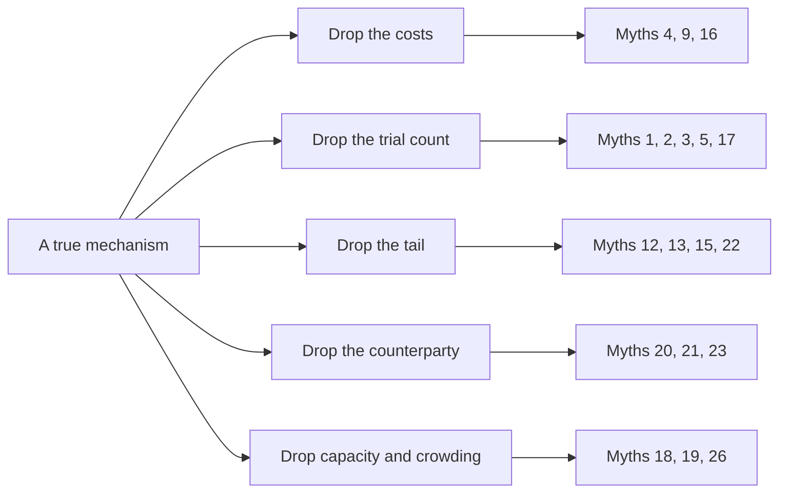

# Myths vs reality

> **TL;DR**
>
> - 28 beliefs about quant trading that turn up in pitch decks and press coverage, each checked against evidence. More than 20 are about strategies or algorithms.
> - Most myths take a true mechanism and drop one ingredient: the costs, the number of trials, the tail, the counterparty or the capacity. Ask for the missing ingredient.
> - Backtests shrink live, published anomalies lose about half their return, and ML gains are measured in tenths of a percent of R². None of that makes quant fake; it means the edge is small, costly and crowded.
> - Some popular "myths" are open debates (PFOF, 0DTE, value). They get a short answer here and both sides in [Contested debates](contested-debates.md).

**Level:** Core · **Read time:** ~13 min · **Last verified:** 2026-11

Each entry gives the myth, the reality in two to four sentences with a confidence tag, and the page that explains the mechanism. Tags: `[Verified]` primary source, `[Reported]` credible secondary source, `[Estimate]` our arithmetic, `[Lore]` widely repeated but unverified.

## Research, backtests and signals

### 1. "A high backtest Sharpe means the strategy works"

A backtest shown after many tries is a maximum, and maxima of noise are large. Five years of daily data pin an annual [Sharpe ratio](../09-reference/glossary.md#sharpe-ratio) down only to about ±0.45, so the best of 100 zero-skill strategies shows about 1.1 by luck `[Estimate]`. Across 888 Quantopian algorithms, backtest Sharpe explained under 2.5% of the variation in out-of-sample Sharpe `[Reported]` (Wiecki et al. 2016). Ask for the trial count and the [deflated Sharpe ratio](../09-reference/glossary.md#deflated-sharpe-ratio). See [overfitting and multiple testing](../03-algorithms/c-validation-and-backtesting/overfitting-and-multiple-testing.md).

### 2. "A t-statistic above 2 proves the signal is real"

The 1.96 hurdle assumes one test. After hundreds of published factors, Harvey, Liu and Zhu (2016) argue a new one needs t > 3.0 `[Verified]`; Harvey and Liu's haircut turns a Sharpe of 1.0 over 120 months, picked from 100 tests, into 0.44 `[Verified]`. Overlapping return windows inflate t-statistics further unless corrected (Newey–West). See [evaluating signals](../03-algorithms/a-data-and-signals/evaluating-signals.md).

### 3. "Published anomalies keep paying"

Across 97 predictors, returns were 26% lower out of sample and 58% lower after publication (McLean and Pontiff 2016) `[Verified]`. Part is statistical bias in the original papers, part is readers trading the signal away. Haircut academic gross returns by a third to a half before costs `[Estimate]`. See [alpha decay detection](../03-algorithms/g-live-trading/alpha-decay-detection-and-model-retirement.md).

### 4. "Higher accuracy or higher IC means more profit"

Profit is hit rate times payoff minus costs, and turnover sets the costs. A signal with an [IC](../09-reference/glossary.md#information-coefficient-ic) of 0.05 at 80% daily turnover can lose to one with 0.02 at 5% (illustrative). Medallion is reported to be right on only about 50.75% of its trades `[Reported]` (Zuckerman 2019); breadth and sizing do the rest. See [cross-sectional alpha](../02-strategies/d-mid-frequency-alpha/cross-sectional-alpha-and-neutralization.md).

### 5. "More features and more data always help"

Every feature is another chance to fit noise and another path for [look-ahead](../09-reference/glossary.md#look-ahead-bias) leakage. In Gu, Kelly and Xiu's 94-characteristic study, a few families (momentum, liquidity, volatility) carried most of the signal for every model `[Verified]`. Practitioners report that most alternative datasets they trial add nothing after costs `[Lore]`. See [feature engineering](../03-algorithms/a-data-and-signals/feature-engineering.md) and [alternative data](../02-strategies/d-mid-frequency-alpha/alternative-data.md).

## Models: ML, LLMs, optimizers and sizing

### 6. "ML and LLMs make return prediction easy"

In the best-known study, trees and neural nets explained 0.33–0.40% of monthly stock-return variance out of sample, against 0.16% for a three-variable regression `[Verified]` (Gu, Kelly and Xiu 2020): twice as good, still tiny. LLM headline scores predict next-day returns, but those returns fall as LLM adoption rises `[Verified]` (Lopez-Lira and Tang 2026). A model pretrained on later text has also read the future in any earlier backtest. See [LLMs and foundation models](../03-algorithms/b-forecasting-models/llms-and-foundation-models-in-quant.md).

### 7. "Reinforcement learning learns to trade end to end"

Published RL results mostly beat simple baselines, not production algorithms; the best-documented production use is bank execution, such as J.P. Morgan's LOXM (2017) `[Reported]`. Simulators cannot show how the market reacts to you, and there is only one history to learn from. RL as a hedge fund's profit engine is `[Lore]`. See [RL in trading](../03-algorithms/g-live-trading/reinforcement-learning-in-trading.md).

### 8. "The optimizer finds the optimal portfolio"

[Mean-variance optimization](../09-reference/glossary.md#mean-variance-optimization-mvo) multiplies an inverted, noisy covariance matrix by noisy forecasts, so it bets hardest where estimates are most wrong; Michaud (1989) called it error maximization `[Verified]`. With 500 stocks and 252 days the sample covariance cannot even be inverted (Lab 14: rank 251). Shrinkage, factor risk models, constraints and cost penalties make it usable. See [MVO](../03-algorithms/d-portfolio-construction/mean-variance-optimization.md) and [covariance shrinkage](../03-algorithms/d-portfolio-construction/covariance-estimation-and-shrinkage.md).

### 9. "VWAP is best execution"

[VWAP](../09-reference/glossary.md#vwap) is a benchmark, and an easy one, because your own trades sit inside the average. In Lab 17 a VWAP order that cost 12.8 bps against the arrival price looked like 8.2 bps against interval VWAP (synthetic lab result); real orders of 10% of daily volume cost nearer 20 bps `[Estimate]`. [Implementation shortfall](../09-reference/glossary.md#implementation-shortfall) against arrival measures what the decision cost. See [VWAP, TWAP and POV](../03-algorithms/e-execution-algorithms/vwap-twap-pov.md) and [TCA](../03-algorithms/e-execution-algorithms/transaction-cost-analysis.md).

### 10. "Full Kelly is the optimal bet size"

The [Kelly criterion](../09-reference/glossary.md#kelly-criterion) maximizes long-run growth only if you know the true Sharpe; at twice true Kelly leverage, expected growth falls to zero. Sharpe estimates are noisy, so practitioners run a quarter to a half Kelly or less `[Lore]`. See [position sizing](../03-algorithms/d-portfolio-construction/position-sizing-and-risk-budgeting.md).

### 11. "Quant firms have one secret formula"

A firm runs a pipeline of dozens of algorithms, from point-in-time data to quoting and hedging, and the edge usually sits in the joints: forecast meets cost model, fair value meets inventory. Even Medallion, described as one unified model, is reported to combine many weak signals `[Reported]` (Zuckerman 2019). See [there is no single algorithm](../03-algorithms/there-is-no-single-algorithm.md).

## Strategies

### 12. "Stat arb and market-neutral books are riskless"

[Statistical arbitrage](../09-reference/glossary.md#statistical-arbitrage) has positive expectation and fat-tailed [crowding](../09-reference/glossary.md#crowding) risk. Khandani and Lo's simple contrarian strategy had decayed so far that matching its 1998 return took about 9:1 leverage, and it lost 6.85% unlevered in three days of August 2007 `[Verified]`. Market neutrality removes beta, not the risk that everyone holds the same positions. See [stat arb overview](../02-strategies/c-statistical-arbitrage/stat-arb-overview-and-history.md).

### 13. "Factor investing is free money"

Classic long-short factors earned gross Sharpe ratios of about 0.3–0.7 over their full histories `[Verified]` (our computation, French and AQR data), with long drawdowns: HML value lost 51% from January 2017 to September 2020, then gained 68% to December 2022 `[Verified]`. The premium is the pay for sitting through that. See [factor investing fundamentals](../02-strategies/e-risk-premia-and-factors/factor-investing-fundamentals.md) and [value, quality, low vol](../02-strategies/e-risk-premia-and-factors/value-quality-low-vol.md).

### 14. "Trend following is dead"

It was said after weak years such as 2016 and 2023 (−4.2%). In between, the SG Trend Index returned +27.4% in 2022, and it was up 15.8% in 2026 through September `[Reported]`. The payoff is lumpy by design, and live returns trail backtests: 5.75% a year since 2000, maximum drawdown 20.6% `[Reported]`. See [trend following and CTAs](../02-strategies/g-futures-and-macro-context/trend-following-and-ctas.md).

### 15. "Selling options is steady income"

It is selling insurance: small, frequent premiums and rare, large claims. The [variance risk premium](../09-reference/glossary.md#variance-risk-premium) is real; the VIX averaged 19.4 in 1990–2026 against 15.3 for the volatility subsequently realized `[Verified]` (our computation). But on 2018-02-05 the VIX went from 17.31 to 37.32 in one day `[Verified]`, and delta hedging removes direction, not gaps. See [volatility risk premium](../02-strategies/f-volatility-and-derivatives/volatility-risk-premium-and-vol-arb.md).

### 16. "Index inclusion is a free 5–8% pop"

The S&P 500 inclusion effect was 7.4% in the 1990s and under 1% in the 2010s (Greenwood and Sammon 2025) `[Verified]`. Announcements are public and widely traded; what remains is mostly pay for supplying liquidity to index funds at the close. See [flow-driven strategies](../02-strategies/d-mid-frequency-alpha/flow-driven-strategies.md).

### 17. "Highly correlated stocks make a good pair"

Correlated returns do not tie prices together; [cointegration](../09-reference/glossary.md#cointegration) does, and testing for it at scale manufactures false pairs. In Lab 08 about 49 of 1,719 same-sector pairs passed p < 0.05 each period, and only about 3 of those were real (synthetic lab result). See [pairs trading](../02-strategies/c-statistical-arbitrage/pairs-trading-and-cointegration.md).

### 18. "Renaissance proves markets are easy to beat with math"

Medallion reportedly averaged about 66% a year gross and 39% net of fees in 1988–2018 `[Reported]` (Zuckerman; not an audited series). It is capped in size and run for insiders. In 2020 Renaissance's funds for outside investors lost (RIEF −19%, RIDA −32%) while Medallion gained 76% `[Reported]`. One capacity-capped book says little about what large pools of capital can earn. See the [Renaissance profile](../04-industry-and-firms/firm-profiles/renaissance-technologies.md).

### 19. "AI will replace quants"

LLMs already write much research code and turn text into features, and firms are scaling compute: XTX Markets says it runs more than 25,000 GPUs `[Reported]`. But public models read public text, so their signals commoditize; Lopez-Lira and Tang find returns to ChatGPT headline signals fall as adoption rises `[Verified]`. The scarce inputs remain proprietary data, cost and risk models, and judgment about which result to distrust `[Lore]`. See [NLP and LLM signals](../02-strategies/d-mid-frequency-alpha/nlp-and-llm-signals.md).

## Market making, HFT and market structure

### 20. "HFT is front-running"

Front-running means trading ahead of a customer order you hold, which FINRA Rule 5320 bars `[Verified]`. [HFT](../09-reference/glossary.md#high-frequency-trading-hft) market makers trade against public orders and are themselves adversely selected: Menkveld's (2013) HFT earned €1.55 per trade on the spread and lost €0.68 on positions `[Verified]`. The sharper criticism is different: HFTs detect large institutional orders and end up trading alongside the informed ones (van Kervel and Menkveld 2019) `[Verified]`. See [equity market making](../02-strategies/a-liquidity-provision/equity-market-making.md).

### 21. "Market makers bet on direction"

They earn the spread and shed inventory within seconds to minutes. In Menkveld's data, positions held under five seconds made €0.45 and longer ones lost €1.13 `[Verified]`. An options market maker delta-hedges and is paid for flow and for realized versus implied volatility. See [quoting and inventory control](../03-algorithms/f-market-making-and-hft-algorithms/quoting-and-inventory-control.md) and [options market making](../02-strategies/a-liquidity-provision/options-market-making.md).

### 22. "Market makers must hold prices up in a crash"

Since December 2010, registered equity market makers must quote within 8%, 20% or 30% of the [NBBO](../09-reference/glossary.md#nbbo), depending on stock and time of day `[Verified]`. That bans penny stub quotes; it does not oblige anyone to absorb a one-sided wave of selling. See [algorithmic risk controls](../03-algorithms/f-market-making-and-hft-algorithms/algorithmic-risk-controls.md).

### 23. "PFOF means retail gets worse prices"

Contested. One Rule 605 study estimates wholesaler price improvement saves retail investors close to \$1B a month versus exchange execution `[Verified]` (Dyhrberg, Shkilko and Werner, working-paper version). Yet in 85,000 simultaneous orders, round-trip costs ranged from 0.07% to 0.46% across six accounts, and payment levels did not explain the gap `[Verified]` (Schwarz et al. 2025). See [retail flow internalization](../02-strategies/a-liquidity-provision/retail-flow-internalization.md) and the [PFOF debate](contested-debates.md#2-payment-for-order-flow).

### 24. "HFT caused the Flash Crash"

The CFTC-SEC report traced the trigger to a 75,000-contract E-mini sell program (about \$4.1B) executed at 9% of volume without regard to price or time `[Verified]`. HFTs kept trading as prices fell but did not absorb the imbalance; in 14 seconds they traded over 27,000 contracts, mostly among themselves, for about 200 net `[Verified]`. See the [failure gallery](../02-strategies/h-cross-cutting/strategy-failure-gallery.md).

### 25. "Speed matters for every quant strategy"

Speed is the edge only where the signal decays in microseconds to seconds: market making, [latency arbitrage](../09-reference/glossary.md#latency-arbitrage), lead-lag. A mid-frequency book's alpha decays over days, so trading cost binds, not latency; for earnings drift, waiting a day can beat trading into event-day spreads. See [how infrastructure constrains algorithms](../05-infrastructure/how-infrastructure-constrains-algorithms.md).

### 26. "Latency arbitrage is a huge hidden tax"

It is real but small per trade: about 0.5 bp of trading volume in FTSE 100 stocks, roughly \$5B a year across global equities (Aquilina, Budish and O'Neill 2022) `[Verified]`. The cost falls first on liquidity providers, who pass it on in spreads; removing races would cut the cost of liquidity by about 17% `[Verified]`. Whether that justifies redesigning markets is [debated](contested-debates.md#8-the-latency-arms-race-and-batch-auctions). See [latency arbitrage](../02-strategies/b-speed-and-structural/latency-arbitrage.md).

### 27. "Dark pools are unregulated"

Most are alternative trading systems: broker-dealer venues under Regulation ATS that must publish Form ATS-N disclosures on order types, segmentation and operator conflicts `[Verified]`. Off-exchange trading was 50.6% of US equity volume in 2025 `[Verified]`, but ATSs were only about 19% of it; wholesalers trading as principal were most of the rest `[Reported]`. See [venues and retail flow](../01-market-structure/venues-and-retail-flow.md).

### 28. "Cancelling most of your orders is spoofing"

Market makers cancel most orders because quotes must follow fair value. US commodities law defines [spoofing](../09-reference/glossary.md#spoofing) as bidding or offering with intent to cancel before execution `[Verified]`; the 2015 CFTC case against Navinder Sarao turned on layered orders he allegedly never meant to fill `[Reported]`. Intent, not the cancel rate, is the line. See [fee- and microstructure-driven strategies](../02-strategies/b-speed-and-structural/fee-and-microstructure-driven-strategies.md) and [rules that shape strategies](../06-risk-and-regulation/rules-that-shape-strategies.md).

## Related pages

- [Contested debates](contested-debates.md) and [sanity-checking claims](sanity-checking-claims.md)
- [How quants evaluate a strategy](../02-strategies/how-quants-evaluate-a-strategy.md)
- [Backtest pitfalls](../03-algorithms/c-validation-and-backtesting/backtest-pitfalls.md)
- [Strategy failure gallery](../02-strategies/h-cross-cutting/strategy-failure-gallery.md)
- [Faux pas and naive questions](../07-conversation-playbook/faux-pas-and-naive-questions.md)

## Sources

- [Reported] Wiecki, T., Campbell, A., Lent, J. & Stauth, J. (2016). "All That Glitters Is Not Gold: Comparing Backtest and Out-of-Sample Performance on a Large Cohort of Trading Algorithms." *Journal of Investing* 25(3), 69–80. <https://doi.org/10.3905/joi.2016.25.3.069> (accessed 2026-11)
- [Verified] Harvey, C. R., Liu, Y. & Zhu, H. (2016). "… and the Cross-Section of Expected Returns." *Review of Financial Studies* 29(1), 5–68. <https://doi.org/10.1093/rfs/hhv059> (accessed 2026-11)
- [Verified] Harvey, C. R. & Liu, Y. (2015). "Backtesting." *Journal of Portfolio Management* 42(1), 13–28. <https://doi.org/10.3905/jpm.2015.42.1.013> (accessed 2026-11)
- [Verified] McLean, R. D. & Pontiff, J. (2016). "Does Academic Research Destroy Stock Return Predictability?" *Journal of Finance* 71(1), 5–32. <https://doi.org/10.1111/jofi.12365> (accessed 2026-11)
- [Verified] Gu, S., Kelly, B. & Xiu, D. (2020). "Empirical Asset Pricing via Machine Learning." *Review of Financial Studies* 33(5), 2223–2273. <https://doi.org/10.1093/rfs/hhaa009> (accessed 2026-11)
- [Verified] Lopez-Lira, A. & Tang, Y. (2026). "Can ChatGPT Forecast Stock Price Movements? Return Predictability and Large Language Models." *Journal of Financial Economics* 184, 104335. <https://doi.org/10.1016/j.jfineco.2026.104335> (accessed 2026-11)
- [Verified] Michaud, R. O. (1989). "The Markowitz Optimization Enigma: Is 'Optimized' Optimal?" *Financial Analysts Journal* 45(1), 31–42. <https://doi.org/10.2469/faj.v45.n1.31> (accessed 2026-11)
- [Reported] Zuckerman, G. (2019). *The Man Who Solved the Market: How Jim Simons Launched the Quant Revolution*. Portfolio/Penguin. <https://www.randomhousebooks.com/books/557104> (accessed 2026-11)
- [Reported] Bloomberg via BNN Bloomberg (2021). "Renaissance Clients Pull Out After Firm's Rotten Run of Results." <https://www.bnnbloomberg.ca/renaissance-clients-pull-out-after-firm-s-rotten-run-of-results-1.1560482> (accessed 2026-11)
- [Verified] Khandani, A. E. & Lo, A. W. (2011). "What happened to the quants in August 2007? Evidence from factors and transactions data." *Journal of Financial Markets* 14(1), 1–46. <https://doi.org/10.1016/j.finmar.2010.07.005> (accessed 2026-11)
- [Verified] Greenwood, R. & Sammon, M. (2025). "The Disappearing Index Effect." *Journal of Finance* 80(2), 657–698. <https://doi.org/10.1111/jofi.13410> (accessed 2026-11)
- [Reported] Top Traders Unplugged (2026-01-23). "Trend Following Performance Report – December 2025" (SG Trend Index returns). <https://www.toptradersunplugged.com/?p=20381> (accessed 2026-11)
- [Verified] Menkveld, A. J. (2013). "High frequency trading and the new market makers." *Journal of Financial Markets* 16(4), 712–740. <https://doi.org/10.1016/j.finmar.2013.06.006> (accessed 2026-11)
- [Verified] van Kervel, V. & Menkveld, A. J. (2019). "High-Frequency Trading around Large Institutional Orders." *Journal of Finance* 74(3), 1091–1137. <https://doi.org/10.1111/jofi.12759> (accessed 2026-11)
- [Verified] FINRA. Rule 5320, "Prohibition Against Trading Ahead of Customer Orders." <https://www.finra.org/rules-guidance/rulebooks/finra-rules/5320> (accessed 2026-11)
- [Verified] SEC (2010-11-12). Order approving enhanced quotation standards for market makers (stub-quote ban), 75 FR 69484. <https://www.federalregister.gov/documents/2010/11/12/2010-28443/self-regulatory-organizations-bats-exchange-inc-nasdaq-omx-bx-inc-chicago-board-options-exchange> (accessed 2026-11)
- [Verified] Dyhrberg, A. H., Shkilko, A. & Werner, I. M. (2025). "The retail execution quality landscape." *Journal of Financial Economics* 168, 104051 (figure from the 2023 working-paper abstract). <https://doi.org/10.1016/j.jfineco.2025.104051> (accessed 2026-11)
- [Verified] Schwarz, C., Barber, B. M., Huang, X., Jorion, P. & Odean, T. (2025). "The 'Actual Retail Price' of Equity Trades." *Journal of Finance* 80(5), 2507–2541. <https://doi.org/10.1111/jofi.13467> (accessed 2026-11)
- [Verified] Staffs of the CFTC and SEC (2010-09-30). "Findings Regarding the Market Events of May 6, 2010." <https://www.sec.gov/news/studies/2010/marketevents-report.pdf> (accessed 2026-11)
- [Verified] Aquilina, M., Budish, E. & O'Neill, P. (2022). "Quantifying the High-Frequency Trading 'Arms Race'." *Quarterly Journal of Economics* 137(1), 493–564. <https://doi.org/10.1093/qje/qjab032> (accessed 2026-11)
- [Verified] SEC (2018-08-07). "Regulation of NMS Stock Alternative Trading Systems" (Form ATS-N), 83 FR 38768. <https://www.federalregister.gov/documents/2018/08/07/2018-15896/regulation-of-nms-stock-alternative-trading-systems> (accessed 2026-11)
- [Verified] 7 U.S.C. § 6c(a)(5)(C) (Commodity Exchange Act anti-spoofing provision, added by Dodd-Frank § 747). <https://www.law.cornell.edu/uscode/text/7/6c> (accessed 2026-11)
- [Reported] U.S. CFTC (2015-04-21). "CFTC Charges U.K. Resident Navinder Singh Sarao and His Company Nav Sarao Futures Limited PLC with Price Manipulation and Spoofing." Press release 7156-15. <https://www.cftc.gov/PressRoom/PressReleases/7156-15> (accessed 2026-11)
