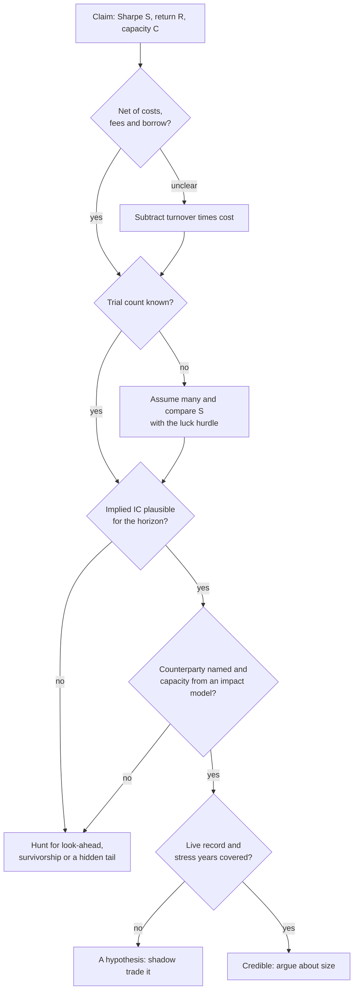

# Sanity-checking claims

> **TL;DR**
>
> - Eleven checks catch most inflated claims, whether in a pitch deck, a paper, the press or your own backtest. Nearly every bias pushes performance up.
> - Five formulas do most of the work: the standard error of Sharpe, the luck hurdle for N trials, the Fundamental Law, breakeven cost and square-root impact.
> - A claim is implausible when the IC it implies is far above what real signals deliver, when the breakeven cost sits near the modeled cost, or when the sample skips the stress years.
> - A failed check is not proof of fraud. It tells you which question to ask next.

**Level:** Core · **Read time:** ~7 min · **Last verified:** 2026-11

The full funding process is in [how quants evaluate a strategy](../02-strategies/how-quants-evaluate-a-strategy.md); the mechanics of each bias are in [backtest pitfalls](../03-algorithms/c-validation-and-backtesting/backtest-pitfalls.md). This page is the pocket version.

## The checklist

| # | Check | Ask | Red flag |
|---|---|---|---|
| 1 | Gross or net | Sharpe after spread, impact, fees, borrow and financing? | Only gross shown, or "costs of 1 bp" at any size |
| 2 | Sharpe vs horizon | What IC does this Sharpe imply? | Net Sharpe above 1.5 from a monthly book, or above 1 at \$10B+ in factors |
| 3 | Costs and [turnover](../09-reference/glossary.md#turnover) | Breakeven cost versus modeled cost? | Breakeven within 2× of modeled cost |
| 4 | [Look-ahead](../09-reference/glossary.md#look-ahead-bias) | Point-in-time data? Fill on the bar after the signal? | Restated fundamentals, today's index members, same-bar fills |
| 5 | [Survivorship](../09-reference/glossary.md#survivorship-bias) | Delisted stocks and their final returns included? | Universe built from today's constituents |
| 6 | Multiple testing | How many variants were tried? | No trial log; t below 3; [DSR](../09-reference/glossary.md#deflated-sharpe-ratio) below 0.95 |
| 7 | [Capacity](../09-reference/glossary.md#capacity) vs AUM | Net Sharpe at the target size, from an impact model? | Capacity quoted without one |
| 8 | Counterparty | Who pays, and why do they accept it? | "The model found it" |
| 9 | Regime coverage | 2007–2009, March 2020, the 2022 rate shock? | Sample starts after the last crisis |
| 10 | Live vs backtest | How long live, and does live track the backtest replayed on live dates? | No live record, or live Sharpe far below backtest without explanation |
| 11 | Leverage and tails | Worst day, week and month? Skew? Gross leverage? | Smooth returns from selling insurance; leverage quoted only on net |

The thresholds are our rules of thumb `[Estimate]`. Context: a new factor needs t > 3 given how many have been tried (Harvey, Liu and Zhu 2016) `[Verified]`; published predictors lost 26% out of sample and 58% after publication (McLean and Pontiff 2016) `[Verified]`, and across 888 Quantopian algorithms backtest Sharpe explained under 2.5% of out-of-sample Sharpe `[Reported]`. CRSP-based studies that omit delisting returns miss losses Shumway (1997) imputes at −30% (NYSE/Amex) and −55% (Nasdaq) `[Verified]`. Realistic net Sharpe ranges by strategy are in the [comparison matrix](../02-strategies/h-cross-cutting/strategy-comparison-matrix.md): risk-premia books 0.3–0.7, diversified stat arb 1–3 `[Lore]`.

## Back-of-envelope formulas

**1. Noise in a Sharpe ratio.** With $T$ years of data and annual Sharpe $S$ (Lo 2002, i.i.d. returns) `[Verified]`:

$$ SE(\hat S) \approx \sqrt{\frac{1 + S^2/2}{T}}, \qquad t \approx S\sqrt{T} $$

A Sharpe of 1.0 over five years has a standard error of about 0.55 and a t of 2.2. Serial correlation and fat tails widen it.

**2. Luck hurdle.** The best of $N$ zero-skill strategies shows a Sharpe of about $z_N/\sqrt{T}$, where $z_N$ is the expected maximum of $N$ standard normals: 2.5 for 100 trials, 2.9 for 300, 3.2 for 1,000 `[Estimate]`. The [deflated Sharpe ratio](../03-algorithms/c-validation-and-backtesting/overfitting-and-multiple-testing.md) formalizes this and adds skew and kurtosis.

**3. Fundamental Law.** $IR \approx TC \times IC \times \sqrt{BR}$ (Grinold 1989; Clarke, de Silva and Thorley 2002) `[Verified]`. Invert it to get the [IC](../09-reference/glossary.md#information-coefficient-ic) a claimed Sharpe requires: $IC = IR / (TC\sqrt{BR})$. [Breadth](../09-reference/glossary.md#breadth) counts independent bets, so correlated positions shrink it. See [evaluating signals](../03-algorithms/a-data-and-signals/evaluating-signals.md).

**4. Breakeven cost.** With gross alpha $\alpha$, annual turnover $\tau$ and cost $c$ per dollar traded, net alpha is $\alpha - \tau c$ and breakeven cost is $c^* = \alpha / \tau$. Most anomalies with under 50% monthly turnover survive costs; few faster ones do (Novy-Marx and Velikov 2016) `[Verified]`.

**5. Square-root impact.** Cost per share $\approx Y \sigma \sqrt{Q/V}$, with $Y$ of order 1. Trading 5% of daily volume in a 2%-volatility stock costs roughly 15–30 bps of impact. Double the size and cost per share rises 41%. See [transaction cost and impact models](../03-algorithms/d-portfolio-construction/transaction-cost-and-impact-models.md).

Two quick extras. The chance of a losing year at Sharpe $S$ is about $\Phi(-S)$: 31% at 0.5, 16% at 1.0, 2% at 2.0 `[Estimate]`, so "never a down year" claims a high Sharpe. Leverage multiplies losses: Khandani and Lo's contrarian strategy lost 6.85% unlevered in three days of August 2007 `[Verified]`; at the 9:1 leverage it then needed, that is about 62% of equity `[Estimate]`.

## Worked example (illustrative pitch)

"Net Sharpe 2.5, 25% a year, monthly rebalance on 500 US large caps, \$2B capacity, backtest 2010–2024, 300 variants tried."

1. **Noise.** $t \approx 2.5 \times \sqrt{15} \approx 9.7$. Taken alone, overwhelming.
2. **Luck.** The best of 300 zero-skill variants would show about $2.9 / \sqrt{15} \approx 0.74$. Luck does not explain 2.5.
3. **Plausibility.** Monthly bets on 500 names give at most $BR = 6{,}000$. With a transfer coefficient of 0.5, the required IC is $2.5 / (0.5 \times 77) \approx 0.065$; if correlation cuts effective breadth to 1,500, about 0.13. An IC near 0.05 on a broad monthly composite is usually called good `[Lore]`. The claim needs two to three times that, every month, after costs.
4. **Regimes.** 2010–2024 skips 2007–2009 and the 2007 quant unwind. Value's 2017–2020 drawdown is in sample; ask how the book survived it.
5. **Verdict.** Not luck, and probably not a real signal at that strength either. The likeliest culprits are look-ahead, survivorship or an unpriced tail. Ask for the point-in-time data lineage, a delisting-return check, the worst month and net Sharpe at \$2B from an impact model.

## Related pages

- [Backtest pitfalls](../03-algorithms/c-validation-and-backtesting/backtest-pitfalls.md)
- [Overfitting and multiple testing](../03-algorithms/c-validation-and-backtesting/overfitting-and-multiple-testing.md)
- [Evaluating signals](../03-algorithms/a-data-and-signals/evaluating-signals.md)
- [Transaction cost and impact models](../03-algorithms/d-portfolio-construction/transaction-cost-and-impact-models.md)
- [Point-in-time data and cleaning](../03-algorithms/a-data-and-signals/point-in-time-data-and-cleaning.md)
- [Live monitoring and P&L attribution](../03-algorithms/g-live-trading/live-monitoring-and-pnl-attribution.md)
- [Myths vs reality](myths-vs-reality.md) and [contested debates](contested-debates.md)

## Sources

- [Verified] Lo, A. W. (2002). "The Statistics of Sharpe Ratios." *Financial Analysts Journal* 58(4), 36–52. <https://doi.org/10.2469/faj.v58.n4.2453> (accessed 2026-11)
- [Verified] Bailey, D. H. & López de Prado, M. (2014). "The Deflated Sharpe Ratio: Correcting for Selection Bias, Backtest Overfitting, and Non-Normality." *Journal of Portfolio Management* 40(5), 94–107. <https://doi.org/10.3905/jpm.2014.40.5.094> (accessed 2026-11)
- [Verified] Grinold, R. C. (1989). "The Fundamental Law of Active Management." *Journal of Portfolio Management* 15(3), 30–37. <https://doi.org/10.3905/jpm.1989.409211> (accessed 2026-11)
- [Verified] Clarke, R., de Silva, H. & Thorley, S. (2002). "Portfolio Constraints and the Fundamental Law of Active Management." *Financial Analysts Journal* 58(5), 48–66. <https://doi.org/10.2469/faj.v58.n5.2468> (accessed 2026-11)
- [Verified] Novy-Marx, R. & Velikov, M. (2016). "A Taxonomy of Anomalies and Their Trading Costs." *Review of Financial Studies* 29(1), 104–147. <https://doi.org/10.1093/rfs/hhv063> (accessed 2026-11)
- [Verified] Tóth, B., Lempérière, Y., Deremble, C., de Lataillade, J., Kockelkoren, J. & Bouchaud, J.-P. (2011). "Anomalous Price Impact and the Critical Nature of Liquidity in Financial Markets." *Physical Review X* 1(2), 021006. <https://doi.org/10.1103/PhysRevX.1.021006> (accessed 2026-11)
- [Verified] McLean, R. D. & Pontiff, J. (2016). "Does Academic Research Destroy Stock Return Predictability?" *Journal of Finance* 71(1), 5–32. <https://doi.org/10.1111/jofi.12365> (accessed 2026-11)
- [Reported] Wiecki, T., Campbell, A., Lent, J. & Stauth, J. (2016). "All That Glitters Is Not Gold: Comparing Backtest and Out-of-Sample Performance on a Large Cohort of Trading Algorithms." *Journal of Investing* 25(3), 69–80. <https://doi.org/10.3905/joi.2016.25.3.069> (accessed 2026-11)
- [Verified] Shumway, T. (1997). "The Delisting Bias in CRSP Data." *Journal of Finance* 52(1), 327–340. <https://doi.org/10.1111/j.1540-6261.1997.tb03818.x> (accessed 2026-11)
- [Verified] Harvey, C. R., Liu, Y. & Zhu, H. (2016). "… and the Cross-Section of Expected Returns." *Review of Financial Studies* 29(1), 5–68. <https://doi.org/10.1093/rfs/hhv059> (accessed 2026-11)
- [Verified] Khandani, A. E. & Lo, A. W. (2011). "What happened to the quants in August 2007? Evidence from factors and transactions data." *Journal of Financial Markets* 14(1), 1–46. <https://doi.org/10.1016/j.finmar.2010.07.005> (accessed 2026-11)
