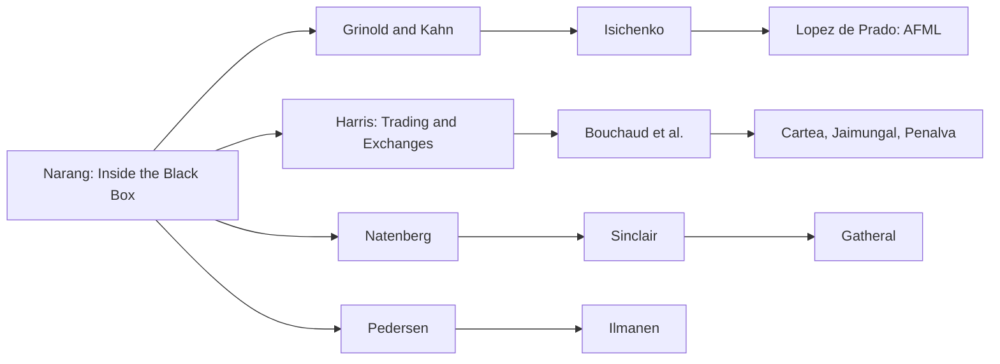

# Books

> **TL;DR**
>
> - 29 books: the 21 the build spec requires plus 8 more, grouped by topic. Each entry gives who it is for, which chapters matter, a difficulty rating and the KB pages it backs.
> - If you read three: Narang for the map, Grinold & Kahn for the logic of a cross-sectional book, Harris for who is on the other side of every trade.
> - For the priority topics, the working shelf is Isichenko (stat arb end to end), López de Prado (validation), Bouchaud et al. (impact and the order book) and Cartea, Jaimungal & Penalva (execution and market-making models).
> - Journalism (Zuckerman, Patterson, MacKenzie) is good context but `[Reported]` at best on firm specifics. Never quote it as disclosure.

**Level:** Core · **Read time:** ~12 min · **Last verified:** 2026-11

**How to read an entry.** Difficulty: ★ needs no math beyond algebra; ★★ needs CFA-level statistics plus some linear algebra; ★★★ needs stochastic calculus, optimal control or graduate econometrics. "Backs" lists the KB pages that lean on the book. `[Verified]` means the edition, year and publisher were checked in 2026-11 against the publisher, the DOI registry (Crossref) or an Open Library edition record. Where chapter titles are quoted, they come from the publisher's or Crossref's table of contents. Otherwise chapters are described by topic.

*Suggested reading paths: equity stat arb (top), microstructure and market making (middle), options (lower), risk premia (bottom). Each path runs from ★ to ★★★.*

## Strategies and portfolio management

- [Verified] Narang, R. K. (2024). *Inside the Black Box: A Simple Guide to Systematic Investing* (3rd ed.). Wiley. <https://openlibrary.org/isbn/9781119931898> (accessed 2026-11) — ★ · The first book to read, written without math. Start with the anatomy chapters (alpha, risk, transaction-cost, portfolio-construction and execution models; data; research), then the high-speed and HFT part. The 3rd edition adds ML, alt data and signal mixing. Backs [The big picture](../00-start-here/the-big-picture.md) · [There is no single algorithm](../03-algorithms/there-is-no-single-algorithm.md).
- [Verified] Grinold, R. C. & Kahn, R. N. (2000). *Active Portfolio Management: A Quantitative Approach for Producing Superior Returns and Controlling Risk* (2nd ed.; released October 1999). McGraw-Hill. <https://openlibrary.org/isbn/9780070248823> (accessed 2026-11) — ★★/★★★ · The source of the [information coefficient](glossary.md#information-coefficient-ic), [breadth](glossary.md#breadth) and the [Fundamental Law](glossary.md#fundamental-law-of-active-management). Read the information-ratio, Fundamental Law, forecasting and information-analysis chapters, then portfolio construction and transaction costs. Dated on ML and capacity. Backs [Evaluating signals](../03-algorithms/a-data-and-signals/evaluating-signals.md) · [Mean-variance optimization](../03-algorithms/d-portfolio-construction/mean-variance-optimization.md) · [Cross-sectional alpha](../02-strategies/d-mid-frequency-alpha/cross-sectional-alpha-and-neutralization.md).
- [Verified] Isichenko, M. (2021). *Quantitative Portfolio Management: The Art and Science of Statistical Arbitrage*. Wiley. <https://openlibrary.org/isbn/9781119821328> (accessed 2026-11) — ★★★ · The closest thing to a stat-arb operator's manual, written by a physicist and dense. Chapters run Market Data → Forecasting (point-in-time data, survival bias, ML) → Forecast Combining → Risk → Trading Costs → Portfolio Construction → Simulation, which is this KB's pipeline. Backs [Walkthrough: a mid-frequency stat-arb book](../03-algorithms/h-end-to-end-walkthroughs/walkthrough-mid-frequency-stat-arb.md) · [Alpha combination](../03-algorithms/b-forecasting-models/alpha-combination-and-ensembling.md) · [Transaction cost and impact models](../03-algorithms/d-portfolio-construction/transaction-cost-and-impact-models.md).
- [Verified] Pedersen, L. H. (2015). *Efficiently Inefficient: How Smart Money Invests and Market Prices Are Determined*. Princeton University Press (paperback 2019). <https://press.princeton.edu/books/paperback/9780691196091/efficiently-inefficient> (accessed 2026-11) — ★★ · Covers each hedge-fund style: why it earns money, who pays, and an interview with a practitioner. Read Part I (performance measures, backtesting, portfolio construction, market and funding liquidity), Quantitative Equity Investing and Managed Futures. Backs [Factor investing fundamentals](../02-strategies/e-risk-premia-and-factors/factor-investing-fundamentals.md) · [Trend following and CTAs](../02-strategies/g-futures-and-macro-context/trend-following-and-ctas.md) · [How quants evaluate a strategy](../02-strategies/how-quants-evaluate-a-strategy.md).
- [Verified] Ilmanen, A. (2011). *Expected Returns: An Investor's Guide to Harvesting Market Rewards*. Wiley. <https://doi.org/10.1002/9781118467190> (accessed 2026-11) — ★★ · The evidence base for risk premia across asset classes. Read Value-Oriented Equity Selection, Currency Carry, Commodity Momentum and Trend Following, Volatility Selling and Tail Risks. The data stop around 2010, so pair it with the dossiers' post-2010 numbers. Backs [Carry and cross-asset risk premia](../02-strategies/g-futures-and-macro-context/carry-and-cross-asset-risk-premia.md) · [Volatility risk premium](../02-strategies/f-volatility-and-derivatives/volatility-risk-premium-and-vol-arb.md).
- [Verified] Chan, E. P. (2021). *Quantitative Trading: How to Build Your Own Algorithmic Trading Business* (2nd ed.). Wiley. <https://openlibrary.org/isbn/9781119800064> (accessed 2026-11) — ★ · The solo-quant workflow: finding ideas, backtesting, execution systems, Kelly sizing. Written for retail traders, but the backtesting chapter is a good catalogue of pitfalls. Backs [Backtesting engines](../03-algorithms/c-validation-and-backtesting/backtesting-engines.md) · [Backtest pitfalls](../03-algorithms/c-validation-and-backtesting/backtest-pitfalls.md).
- [Verified] Chan, E. P. (2013). *Algorithmic Trading: Winning Strategies and Their Rationale*. Wiley. <https://doi.org/10.1002/9781118676998> (accessed 2026-11) — ★★ · Runnable mean-reversion and momentum recipes. Read The Basics of Mean Reversion, Implementing Mean Reversion Strategies (Kalman-filter hedge ratios), Mean Reversion of Stocks and ETFs, and Intraday Momentum Strategies. Backs [Pairs trading and cointegration](../02-strategies/c-statistical-arbitrage/pairs-trading-and-cointegration.md) · [Intraday patterns](../02-strategies/c-statistical-arbitrage/intraday-patterns-and-seasonality.md).
- [Verified] Tulchinsky, I. et al. (2019). *Finding Alphas: A Quantitative Approach to Building Trading Strategies* (2nd ed.). Wiley. <https://doi.org/10.1002/9781119571278> (accessed 2026-11) — ★ · Short essays by WorldQuant researchers on mining many weak signals at scale. Read Turnover, Alpha Correlation, Backtest – Signal or Overfitting?, Controlling Biases and Machine Learning in Alpha Research. Backs [Feature engineering](../03-algorithms/a-data-and-signals/feature-engineering.md) · [Signal transforms](../03-algorithms/a-data-and-signals/signal-transforms.md) · [Overfitting and multiple testing](../03-algorithms/c-validation-and-backtesting/overfitting-and-multiple-testing.md).
- [Verified] López de Prado, M. (2018). *Advances in Financial Machine Learning*. Wiley. <https://www.wiley-vch.de/en/areas-interest/finance-economics-law/advances-in-financial-machine-learning-978-1-119-48208-6> (accessed 2026-11) — ★★★ · The standard reference on validating ML strategies. Read ch. 3 (labeling), ch. 4 (sample weights), ch. 7 (cross-validation in finance: purging and embargo), ch. 10 (bet sizing), chs. 11–14 (backtesting, CPCV, backtest statistics) and ch. 16 (HRP). Its validation chapters are much more widely used than its feature recipes `[Lore]`. Backs [Time-series cross-validation](../03-algorithms/c-validation-and-backtesting/time-series-cross-validation.md) · [Overfitting and multiple testing](../03-algorithms/c-validation-and-backtesting/overfitting-and-multiple-testing.md) · [Alternatives to MVO](../03-algorithms/d-portfolio-construction/alternatives-to-mvo.md).

## Microstructure, market making and execution

- [Verified] Harris, L. (2003). *Trading and Exchanges: Market Microstructure for Practitioners*. Oxford University Press (©2003; first published late 2002). <https://doi.org/10.1093/oso/9780195144703.001.0001> (accessed 2026-11) — ★ · The best plain-English account of who trades and why. Read Orders and Order Properties, Order-Driven Markets, Informed Traders, Order Anticipators, Bluffers and Market Manipulation, Dealers, Bid/Ask Spreads and Arbitrageurs. It predates Reg NMS, so the venue details are out of date, but the economics still hold. Backs [The limit order book](../01-market-structure/the-limit-order-book.md) · [Equity market making](../02-strategies/a-liquidity-provision/equity-market-making.md) · [Adverse selection and markouts](../03-algorithms/f-market-making-and-hft-algorithms/adverse-selection-and-markouts.md).
- [Verified] Cartea, Á., Jaimungal, S. & Penalva, J. (2015). *Algorithmic and High-Frequency Trading*. Cambridge University Press. <https://www.cambridge.org/9781107091146> (accessed 2026-11) — ★★★ · The stochastic-control textbook for execution, market making and stat arb, with closed-form strategies you can code. Read the optimal-execution chapters, ch. 10 (market making) and the pairs-trading chapter. You need Itô calculus. Backs [Quoting and inventory control](../03-algorithms/f-market-making-and-hft-algorithms/quoting-and-inventory-control.md) · [Implementation shortfall and Almgren-Chriss](../03-algorithms/e-execution-algorithms/implementation-shortfall-and-almgren-chriss.md).
- [Verified] Bouchaud, J.-P., Bonart, J., Donier, J. & Gould, M. (2018). *Trades, Quotes and Prices: Financial Markets Under the Microscope*. Cambridge University Press. <https://doi.org/10.1017/9781316659335> (accessed 2026-11) — ★★★ · Empirical order-book and price-impact research from a physics-trained team led by Jean-Philippe Bouchaud of CFM. Read Empirical Properties of Limit Order Books, The Impact of Market Orders, The Propagator Model, The Kyle Model and The Profitability of Market-Making. Backs [Transaction cost and impact models](../03-algorithms/d-portfolio-construction/transaction-cost-and-impact-models.md) (the [square-root law](glossary.md#square-root-law)) · [Order-book and trade-flow signals](../03-algorithms/f-market-making-and-hft-algorithms/order-book-and-trade-flow-signals.md).
- [Verified] Lehalle, C.-A. & Laruelle, S. (eds.) (2018). *Market Microstructure in Practice* (2nd ed.). World Scientific. <https://doi.org/10.1142/10739> (accessed 2026-11) — ★★ · A practitioner and regulator view of fragmentation and optimal trading, centred on Europe and the US. Its three chapters are Monitoring the Fragmentation at Any Scale, Understanding the Stakes and the Roots of Fragmentation, and Optimal Organizations for Optimal Trading. Backs [Smart order routing](../03-algorithms/e-execution-algorithms/smart-order-routing.md) · [Execution algorithms overview](../03-algorithms/e-execution-algorithms/execution-algorithms-overview.md).
- [Verified] Johnson, B. (2010). *Algorithmic Trading & DMA: An Introduction to Direct Access Trading Strategies*. 4Myeloma Press. <https://openlibrary.org/isbn/9780956399205> (accessed 2026-11) — ★ · The sell-side execution desk's manual: order types, venue mechanics, the main algorithm families (VWAP, TWAP, POV, implementation shortfall) and how to measure them. The structure is pre-2010. Backs [VWAP, TWAP and POV](../03-algorithms/e-execution-algorithms/vwap-twap-pov.md) · [Transaction cost analysis](../03-algorithms/e-execution-algorithms/transaction-cost-analysis.md).
- [Verified] Kissell, R. (2014). *The Science of Algorithmic Trading and Portfolio Management*. Academic Press. <https://shop.elsevier.com/books/the-science-of-algorithmic-trading-and-portfolio-management/kissell/978-0-12-401689-7> (accessed 2026-11) — ★★ · The buy-side cost-modelling view. Read Algorithmic Transaction Cost Analysis, Market Impact Models, Estimating I-Star Model Parameters, Algorithmic Decision Making Framework and Portfolio Algorithms. *Algorithmic Trading Methods* (2nd ed., 2020) updates it. Backs [Transaction cost and impact models](../03-algorithms/d-portfolio-construction/transaction-cost-and-impact-models.md) · [Walkthrough: executing a \$500M buy order](../03-algorithms/h-end-to-end-walkthroughs/walkthrough-institutional-execution.md).

## Options and volatility

- [Verified] Natenberg, S. (2015). *Option Volatility and Pricing: Advanced Trading Strategies and Techniques* (2nd ed.). McGraw-Hill Education. <https://openlibrary.org/isbn/9780071818773> (accessed 2026-11) — ★ · How an options market maker thinks: volatility as the traded quantity, the Greeks as risk, spreads, dynamic hedging and skew. It is widely said to be the first book options trading firms hand new hires `[Lore]`. Backs [Options market making](../02-strategies/a-liquidity-provision/options-market-making.md) · [Hedging algorithms](../03-algorithms/f-market-making-and-hft-algorithms/hedging-algorithms.md).
- [Verified] Gatheral, J. (2006). *The Volatility Surface: A Practitioner's Guide*. Wiley. <https://doi.org/10.1002/9781119202073> (accessed 2026-11) — ★★★ · Compact and mathematical. Read Stochastic Volatility and Local Volatility, The Heston Model, The Implied Volatility Surface, Volatility Surface Asymptotics, Dynamics of the Volatility Surface and Volatility Derivatives. Backs [Options pricing and vol surfaces for MM](../03-algorithms/f-market-making-and-hft-algorithms/options-pricing-and-vol-surfaces-for-mm.md) · [Walkthrough: an options market maker](../03-algorithms/h-end-to-end-walkthroughs/walkthrough-options-market-maker.md).
- [Verified] Sinclair, E. (2013). *Volatility Trading* (2nd ed.). Wiley. <https://doi.org/10.1002/9781118662724> (accessed 2026-11) — ★★ · The trader's book on the [variance risk premium](glossary.md#variance-risk-premium). Read Volatility Measurement, Volatility Forecasting, Hedging, Distribution of Hedged Option Positions, Money Management and Trade Evaluation. Backs [Volatility risk premium and vol arb](../02-strategies/f-volatility-and-derivatives/volatility-risk-premium-and-vol-arb.md) · [Hedging algorithms](../03-algorithms/f-market-making-and-hft-algorithms/hedging-algorithms.md).

## History and industry context

- [Verified] MacKenzie, D. (2021). *Trading at the Speed of Light: How Ultrafast Algorithms Are Transforming Financial Markets*. Princeton University Press. <https://press.princeton.edu/books/hardcover/9780691211381/trading-at-the-speed-of-light> (accessed 2026-11) — ★ · A sociologist's interview-based study of HFT. Read To the Towers (microwave links), Dealers, Clients, and the Politics of Market Structure, and How HFT Algorithms Interact. Backs [Latency arbitrage](../02-strategies/b-speed-and-structural/latency-arbitrage.md) · [Colocation, networks and the speed of light](../05-infrastructure/colocation-networks-and-the-speed-of-light.md).
- [Verified] Zuckerman, G. (2019). *The Man Who Solved the Market: How Jim Simons Launched the Quant Revolution*. Portfolio/Penguin. <https://www.penguinrandomhouse.com/books/557104/the-man-who-solved-the-market-by-gregory-zuckerman/> (accessed 2026-11) — ★ · A history of Renaissance Technologies. Read it for culture and history. Every firm detail in it is journalism, not disclosure, so treat it as `[Reported]`. Backs [Stat arb: overview and history](../02-strategies/c-statistical-arbitrage/stat-arb-overview-and-history.md) · [Evolution of quant strategies](../02-strategies/h-cross-cutting/evolution-of-quant-strategies.md).
- [Verified] Patterson, S. (2010). *The Quants: How a New Breed of Math Whizzes Conquered Wall Street and Nearly Destroyed It*. Crown Business. <https://openlibrary.org/isbn/9780307453372> (accessed 2026-11) — ★ · A narrative of the August 2007 [quant quake](glossary.md#quant-quake) and the 2008 crisis through the people involved. Read it as context for the crowding mechanics, which Khandani & Lo document properly. Backs [Strategy failure gallery](../02-strategies/h-cross-cutting/strategy-failure-gallery.md) · [Factor timing, crowding and quant winters](../02-strategies/e-risk-premia-and-factors/factor-timing-crowding-and-quant-winters.md).

## More good books (beyond the required list)

- [Verified] Hasbrouck, J. (2007). *Empirical Market Microstructure: The Institutions, Economics, and Econometrics of Securities Trading*. Oxford University Press. <https://doi.org/10.1093/oso/9780195301649.001.0001> (accessed 2026-11) — ★★★ · How to measure spreads, price impact and price discovery: the Roll model, trade-and-quote VARs, information shares. Backs [Adverse selection and markouts](../03-algorithms/f-market-making-and-hft-algorithms/adverse-selection-and-markouts.md) · [Transaction cost analysis](../03-algorithms/e-execution-algorithms/transaction-cost-analysis.md).
- [Verified] O'Hara, M. (1995). *Market Microstructure Theory*. Blackwell. <https://openlibrary.org/isbn/9781557864437> (accessed 2026-11) — ★★★ · The theory survey: inventory models (Ho-Stoll and others), then information models (Glosten-Milgrom, Kyle). It is the background for every quoting model in module 03. Backs [Quoting and inventory control](../03-algorithms/f-market-making-and-hft-algorithms/quoting-and-inventory-control.md) · [Adverse selection and markouts](../03-algorithms/f-market-making-and-hft-algorithms/adverse-selection-and-markouts.md).
- [Verified] Guéant, O. (2016). *The Financial Mathematics of Market Liquidity: From Optimal Execution to Market Making*. Chapman & Hall/CRC. <https://doi.org/10.1201/b21350> (accessed 2026-11) — ★★★ · The [GLFT](glossary.md#glft-model) author's monograph. It is the cleanest derivation of the closed-form quoting and execution approximations used in the labs. Backs [Quoting and inventory control](../03-algorithms/f-market-making-and-hft-algorithms/quoting-and-inventory-control.md) · [Implementation shortfall and Almgren-Chriss](../03-algorithms/e-execution-algorithms/implementation-shortfall-and-almgren-chriss.md).
- [Verified] Paleologo, G. A. (2025). *The Elements of Quantitative Investing*. Wiley. <https://www.wiley-vch.de/en/areas-interest/finance-economics-law/the-elements-of-quantitative-investing-978-1-394-26545-9> (accessed 2026-11) — ★★ · Factor models done carefully: linear models of returns, evaluating risk, fundamental and statistical (PCA) factor models, then portfolio management and post-trade analysis. The publisher's bio describes the author as head of quantitative research at Balyasny. Backs [Risk models](../03-algorithms/d-portfolio-construction/risk-models.md) · [Factor-residual mean reversion](../02-strategies/c-statistical-arbitrage/factor-residual-mean-reversion.md).
- [Verified] Ang, A. (2014). *Asset Management: A Systematic Approach to Factor Investing*. Oxford University Press. <https://doi.org/10.1093/acprof:oso/9780199959327.001.0001> (accessed 2026-11) — ★★ · The textbook case for treating factors, not asset classes, as the unit of allocation. Strong on value, momentum, low-vol and the economics of each. Backs [Factor investing fundamentals](../02-strategies/e-risk-premia-and-factors/factor-investing-fundamentals.md) · [Value, quality and low volatility](../02-strategies/e-risk-premia-and-factors/value-quality-low-vol.md).
- [Verified] López de Prado, M. (2020). *Machine Learning for Asset Managers*. Cambridge University Press (Elements in Quantitative Finance). <https://doi.org/10.1017/9781108883658> (accessed 2026-11) — ★★ · A short follow-up to AFML on denoising covariance matrices, clustering, feature importance, nested-clustered portfolio optimization and test-set overfitting. Backs [Covariance estimation and shrinkage](../03-algorithms/d-portfolio-construction/covariance-estimation-and-shrinkage.md) · [Overfitting and multiple testing](../03-algorithms/c-validation-and-backtesting/overfitting-and-multiple-testing.md).
- [Verified] Kelly, B. & Xiu, D. (2023). *Financial Machine Learning*. *Foundations and Trends in Finance* 13(3–4), 205–363. <https://doi.org/10.1561/0500000064> (accessed 2026-11) — ★★★ · A 160-page survey by two of the Gu-Kelly-Xiu authors covering ML for return prediction, factor models and portfolio choice. It is the academic counterpart to AFML, and an NBER working-paper version (w31502) is free. Backs [ML-driven short-horizon alpha](../02-strategies/c-statistical-arbitrage/ml-driven-short-horizon-alpha.md) · [Neural nets and sequence models](../03-algorithms/b-forecasting-models/neural-nets-and-sequence-models.md).
- [Verified] Jansen, S. (2020). *Machine Learning for Algorithmic Trading* (2nd ed.). Packt. <https://openlibrary.org/isbn/9781839217715> (accessed 2026-11) — ★★ · End-to-end Python notebooks (alphalens, zipline-reloaded, LightGBM, NLP, deep learning), with a companion site at ml4trading.io. The free data it uses has survivorship and look-ahead problems; see [Datasets and tools](datasets-and-tools.md). Backs [Tree ensembles](../03-algorithms/b-forecasting-models/tree-ensembles.md) · [Backtesting engines](../03-algorithms/c-validation-and-backtesting/backtesting-engines.md).

## Related pages

- [Papers](papers.md): the primary research behind every family, grouped the same way.
- [Talks, podcasts and blogs](talks-podcasts-blogs.md) and [Datasets and tools](datasets-and-tools.md).
- [Learning paths](../00-start-here/learning-paths.md): where each book fits in a reading plan.
- [How quants evaluate a strategy](../02-strategies/how-quants-evaluate-a-strategy.md) and [Algorithm map](../03-algorithms/algorithm-map.md): the pages most of these books feed.
