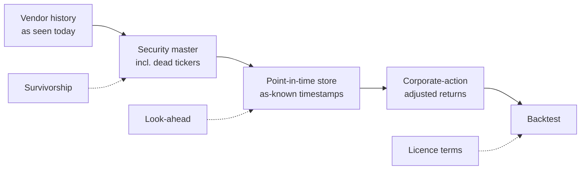

# Datasets and tools

> **TL;DR**
>
> - Free data is fine for learning and for checking published factor claims (French library, AQR, Open Source Asset Pricing, FRED). It is not fine for trading decisions: most free price data is survivor-only, back-adjusted and not [point-in-time](glossary.md#point-in-time-data).
> - Professional research runs on licensed data (CRSP, Compustat, TAQ, OptionMetrics, usually through WRDS) and on direct-feed captures for anything intraday. The licence often costs more than the compute and limits what you may do with results.
> - The Python stack covers almost everything below HFT: pandas or polars plus DuckDB for data, statsmodels and scikit-learn for models, cvxpy for optimization, and zipline-reloaded or NautilusTrader for backtests. Its blind spots are purging and embargo in CV, costs and impact, and corporate actions.
> - Every dataset below has a "what goes wrong" note. Read those before the description.

**Level:** Core · **Read time:** ~12 min · **Last verified:** 2026-11

## The four ways data lies

| Problem | What goes wrong | Typical symptom | Fix | KB page |
|---|---|---|---|---|
| [Survivorship bias](glossary.md#survivorship-bias) | Universe built from stocks alive today; delisted losers vanish | Small-cap and value backtests look too good | Security master with dead tickers; delisting returns | [Point-in-time data and cleaning](../03-algorithms/a-data-and-signals/point-in-time-data-and-cleaning.md) |
| [Look-ahead bias](glossary.md#look-ahead-bias) | Restated fundamentals, revised macro, today's index membership | Fundamental signals work "too well" around reporting dates | As-first-reported values stamped with filing or release dates | [Backtest pitfalls](../03-algorithms/c-validation-and-backtesting/backtest-pitfalls.md) |
| Corporate actions | Splits, dividends, spinoffs, ticker changes mishandled | Fake jumps, wrong returns, broken pairs | Permanent IDs (e.g., CRSP PERMNO) and total-return adjustment | [Point-in-time data and cleaning](../03-algorithms/a-data-and-signals/point-in-time-data-and-cleaning.md) |
| Licensing | Academic licence used commercially; vendor data redistributed | Legal exposure, unusable research | Read the licence before the data | [Alternative data](../02-strategies/d-mid-frequency-alpha/alternative-data.md) |

*Each stage removes one class of error. Skipping any one of them is enough to invalidate a backtest.*

**How to read an entry.** ★ means you can download and use it in an afternoon. ★★ needs cleaning or a licence. ★★★ needs serious engineering (raw feeds, terabytes). Versions and URLs were checked in 2026-11. Paid products are labelled; prices are not quoted because they are negotiated.

## Free factor and anomaly data

- [Verified] French, K. R. (n.d.). Data Library (Fama-French factors, momentum and reversal factors, industry and characteristic-sorted portfolios; US, developed and emerging). Tuck School of Business. <https://mba.tuck.dartmouth.edu/pages/faculty/ken.french/data_library.html> (accessed 2026-11) — ★ · The default factor-return source, and the source of most factor figures computed in this KB. **What goes wrong:** returns are gross of costs and paper portfolios. Value is rebalanced annually. Series are rebuilt from CRSP and Compustat each update, so history can change between downloads; save dated copies. Backs [Factor investing fundamentals](../02-strategies/e-risk-premia-and-factors/factor-investing-fundamentals.md) · [Momentum](../02-strategies/e-risk-premia-and-factors/momentum.md).
- [Verified] AQR Capital Management (n.d.). Datasets (Betting Against Beta, Quality Minus Junk, Value and Momentum Everywhere, Time Series Momentum, Century of Factor Premia and others). <https://www.aqr.com/Insights/Datasets> (accessed 2026-11) — ★ · Long monthly histories of AQR-defined factors across asset classes. **What goes wrong:** the definitions are AQR's own (for example, its HML variant uses current prices), and the publisher runs products on these ideas. Backs [Value, quality and low volatility](../02-strategies/e-risk-premia-and-factors/value-quality-low-vol.md) · [Carry and cross-asset risk premia](../02-strategies/g-futures-and-macro-context/carry-and-cross-asset-risk-premia.md).
- [Verified] Chen, A. Y. & Zimmermann, T. (2026-10). Open Source Asset Pricing: data (October 2026 release). <https://www.openassetpricing.com/data/> (accessed 2026-11) — ★★ · Portfolio returns and firm-level signals for 200+ published predictors, plus code that rebuilds them from CRSP and Compustat if you have WRDS access. **What goes wrong:** releases are revised, including an October 2024 look-ahead fix, so pin the release you used. Backs [Feature engineering](../03-algorithms/a-data-and-signals/feature-engineering.md) · [Overfitting and multiple testing](../03-algorithms/c-validation-and-backtesting/overfitting-and-multiple-testing.md).
- [Verified] Jensen, T. I., Kelly, B. & Pedersen, L. H. (n.d.). Global Factor Data. <https://jkpfactors.com/> (accessed 2026-11) — ★ · Factor returns for the 153 factors and 93 countries of Jensen, Kelly & Pedersen (2023), grouped into themes. **What goes wrong:** like all factor data it is gross of costs, and many country-level series are thin early on. Backs [Factor investing fundamentals](../02-strategies/e-risk-premia-and-factors/factor-investing-fundamentals.md).

## Licensed research databases (paid)

- [Verified] Wharton Research Data Services (n.d.). WRDS. <https://wrds-www.wharton.upenn.edu/> (accessed 2026-11) — ★★ · The gateway most academics and many funds use for CRSP, Compustat, TAQ, OptionMetrics, I/B/E/S and more. **What goes wrong:** access is by institutional subscription, and academic licences generally bar commercial use. Code written against WRDS tables does not run elsewhere. Backs [Point-in-time data and cleaning](../03-algorithms/a-data-and-signals/point-in-time-data-and-cleaning.md).
- [Verified] CRSP (n.d.). CRSP US Stock Databases. <https://www.crsp.org/research/crsp-us-stock-databases/> (accessed 2026-11) — ★★ · Survivorship-free US daily and monthly prices, returns and shares, with permanent IDs (PERMNO, PERMCO). The site now redirects to Morningstar Indexes. **What goes wrong:** missing delisting returns need imputation. The 2025 move from the legacy SIZ format to CIZ changed how dividends enter returns and rewrote a share of historical monthly returns, so old and new extracts disagree. Backs [Point-in-time data and cleaning](../03-algorithms/a-data-and-signals/point-in-time-data-and-cleaning.md).
- [Verified] S&P Global Market Intelligence (n.d.). Compustat Financials. <https://www.spglobal.com/market-intelligence/en/solutions/products/compustat-financials> (accessed 2026-11) — ★★ · Standardized fundamentals back to the 1950s for US firms. **What goes wrong:** the standard files show restated values, and report dates must be lagged or taken from a point-in-time product; otherwise you trade on numbers nobody had. Backs [Fundamental quant signals](../02-strategies/d-mid-frequency-alpha/fundamental-quant-signals.md).
- [Verified] OptionMetrics (n.d.). IvyDB (historical options data). <https://optionmetrics.com/> (accessed 2026-11) — ★★ · End-of-day US option prices, implied volatilities, Greeks and fitted surfaces, standard in academic options research. **What goes wrong:** end-of-day mids are not tradable prices, and closing quotes on illiquid strikes are stale. Intraday vol strategies need intraday data. Backs [Volatility risk premium and vol arb](../02-strategies/f-volatility-and-derivatives/volatility-risk-premium-and-vol-arb.md) · [Options pricing and vol surfaces for MM](../03-algorithms/f-market-making-and-hft-algorithms/options-pricing-and-vol-surfaces-for-mm.md).

## Trades, quotes and order books

- [Verified] NYSE (n.d.). Daily TAQ (trades and quotes). <https://www.nyse.com/data-products/catalog/daily-taq> (accessed 2026-11) — ★★★ · Every consolidated US trade and NBBO quote, the standard source for spreads, TCA studies and intraday research. **What goes wrong:** it is the [SIP](glossary.md#sip) view, which is slower than [direct feeds](glossary.md#direct-feed). Trade-condition codes, late prints and odd lots need filtering, and the files are terabyte-scale. Backs [NBBO and market data](../01-market-structure/nbbo-and-market-data.md) · [Transaction cost analysis](../03-algorithms/e-execution-algorithms/transaction-cost-analysis.md).
- [Verified] Nasdaq (n.d.). TotalView-ITCH sample files. <https://emi.nasdaq.com/ITCH/> (accessed 2026-11) — ★★★ · Free full-day binary samples of Nasdaq's order-by-order feed. Parsing one is the best way to understand a [limit order book](../01-market-structure/the-limit-order-book.md); the format is in the [ITCH 5.0 specification](https://www.nasdaqtrader.com/content/technicalsupport/specifications/dataproducts/NQTVITCHspecification.pdf). **What goes wrong:** it covers one venue only, while the stock trades on many, and a few sample days cannot support a backtest. Backs [Order-book and trade-flow signals](../03-algorithms/f-market-making-and-hft-algorithms/order-book-and-trade-flow-signals.md) · [Lab 01](https://github.com/FrankHuang94/quant_trading_claude/tree/main/labs/01-matching-engine-order-book).
- [Verified] LOBSTER (n.d.). Limit order book data reconstructed from Nasdaq ITCH, with free samples. <https://lobsterdata.com/info/DataSamples.php> (accessed 2026-11) — ★★ · Ready-made message and order-book files to N levels, priced for academics. It is the easiest route to real book data for OFI or microprice experiments. **What goes wrong:** it shows the Nasdaq visible book only, without queue position at other venues. Backs [Fair value and microprice](../03-algorithms/f-market-making-and-hft-algorithms/fair-value-and-microprice.md) · [Queue position and order placement](../03-algorithms/f-market-making-and-hft-algorithms/queue-position-and-order-placement.md).
- [Verified] Cboe Global Markets (n.d.). Cboe DataShop. <https://datashop.cboe.com/> (accessed 2026-11) — ★★ · Historical options, equities and volatility-index data, mostly paid. VIX and SPX daily history files are free on Cboe's site. **What goes wrong:** options datasets differ in quote snapshot times and in whether they include all exchanges. Check before comparing to OptionMetrics. Backs [Options market making](../02-strategies/a-liquidity-provision/options-market-making.md).
- [Verified] Databento (n.d.). Market data API. <https://databento.com/> (accessed 2026-11) — ★★ · A commercial vendor of normalized historical and live exchange data, including order-book-level schemas, with usage-based access. **What goes wrong:** exchange licence fees and redistribution terms still apply on top of the vendor's price. Backs [Backtesting engines](../03-algorithms/c-validation-and-backtesting/backtesting-engines.md).
- [Verified] FINRA (n.d.). Short Sale Volume Data (daily). <https://www.finra.org/finra-data/browse-catalog/short-sale-volume-data> (accessed 2026-11) — ★ · Daily volume of trades marked short on FINRA facilities. **What goes wrong:** it is routinely misread as short interest. Most of it is market makers' and arbitrageurs' hedging short sales, so a "50% short volume" figure says little about bearish bets. Backs [Shorting, financing and settlement](../01-market-structure/shorting-financing-and-settlement.md).
- [Verified] FINRA (n.d.). OTC Transparency Data (ATS and non-ATS volume by firm). <https://otctransparency.finra.org/> (accessed 2026-11) — ★ · Weekly off-exchange volume by ATS and by wholesaler, published with a lag of a few weeks. It is the best public view of who internalizes retail and institutional flow. Backs [Venues and retail flow](../01-market-structure/venues-and-retail-flow.md) · [Retail flow internalization](../02-strategies/a-liquidity-provision/retail-flow-internalization.md).

## Macro and filings

- [Verified] Federal Reserve Bank of St. Louis (n.d.). FRED. <https://fred.stlouisfed.org/> (accessed 2026-11) — ★ · Hundreds of thousands of macro and market series, including VIX, rates and FX, with an API. **What goes wrong:** FRED shows the latest revised values. For any macro signal, use ALFRED below. Backs [Regime detection](../03-algorithms/b-forecasting-models/regime-detection.md).
- [Verified] Federal Reserve Bank of St. Louis (n.d.). ALFRED (archival FRED vintages). <https://alfred.stlouisfed.org/> (accessed 2026-11) — ★★ · Every past vintage of a series, i.e., what GDP or payrolls looked like on the day. This is the only honest way to backtest a macro signal. Backs [Backtest pitfalls](../03-algorithms/c-validation-and-backtesting/backtest-pitfalls.md).
- [Verified] U.S. SEC (n.d.). EDGAR application programming interfaces (XBRL company facts and submissions on data.sec.gov). <https://www.sec.gov/search-filings/edgar-application-programming-interfaces> (accessed 2026-11) — ★★ · Free JSON of every XBRL financial fact, each stamped with its filing date and accession number, so you can rebuild what was reported and when. **What goes wrong:** XBRL tags vary across firms and years. The SEC throttles clients that do not declare a user agent, and full-text NLP still needs the filings themselves. Backs [Fundamental quant signals](../02-strategies/d-mid-frequency-alpha/fundamental-quant-signals.md) · [NLP and LLM signals](../02-strategies/d-mid-frequency-alpha/nlp-and-llm-signals.md).

## Competition datasets (Kaggle)

Good for practising validation discipline on real but anonymized data. Bad as evidence of what works: features are obfuscated, windows are short, public leaderboards reward overfitting, and competition rules restrict use of the data.

- [Reported] Optiver (2021). "Optiver Realized Volatility Prediction." Kaggle competition. <https://www.kaggle.com/competitions/optiver-realized-volatility-prediction> (accessed 2026-11) — ★★ · Short-horizon realized volatility from order-book and trade snapshots. A good first exercise in book features. Backs [Order-book and trade-flow signals](../03-algorithms/f-market-making-and-hft-algorithms/order-book-and-trade-flow-signals.md).
- [Reported] Optiver (2023). "Optiver – Trading at the Close." Kaggle competition. <https://www.kaggle.com/competitions/optiver-trading-at-the-close> (accessed 2026-11) — ★★ · Predicts Nasdaq closing-auction price moves from auction imbalance and book data. It is the closest public dataset to closing-auction trading. Backs [Auctions and closing liquidity](../02-strategies/a-liquidity-provision/auctions-and-closing-liquidity.md).
- [Reported] Jane Street (2020). "Jane Street Market Prediction." Kaggle competition. <https://www.kaggle.com/competitions/jane-street-market-prediction> (accessed 2026-11) — ★★ · Anonymized features and a trade/no-trade utility score. It is a lesson in how little a well-validated model can extract. Backs [Time-series cross-validation](../03-algorithms/c-validation-and-backtesting/time-series-cross-validation.md).
- [Reported] Jane Street (2024). "Jane Street Real-Time Market Data Forecasting." Kaggle competition. <https://www.kaggle.com/competitions/jane-street-real-time-market-data-forecasting> (accessed 2026-11) — ★★ · Forecasts anonymized "responders" with live-updated scoring, so non-stationarity is built into the evaluation. Backs [ML-driven short-horizon alpha](../02-strategies/c-statistical-arbitrage/ml-driven-short-horizon-alpha.md).
- [Reported] Two Sigma (2018). "Two Sigma: Using News to Predict Stock Movements." Kaggle competition. <https://www.kaggle.com/competitions/two-sigma-financial-news> (accessed 2026-11) — ★★ · Market data plus licensed news analytics, from the pre-LLM era. Useful for seeing how hard news signals are to monetize. Backs [NLP and LLM signals](../02-strategies/d-mid-frequency-alpha/nlp-and-llm-signals.md).

## Data handling and modelling tools

- [Verified] pandas development team (2026). pandas 3.1.1. <https://pandas.pydata.org/> (accessed 2026-11) — ★ · The default DataFrame library, BSD-licensed. **Watch:** the 3.x series changed defaults such as copy semantics, so pin versions. Index alignment silently creates look-ahead when you shift the wrong way. Backs [Feature engineering](../03-algorithms/a-data-and-signals/feature-engineering.md).
- [Verified] Polars (2026). polars 2.1.0. <https://pola.rs/> (accessed 2026-11) — ★★ · A multi-threaded, lazy DataFrame engine (MIT) that is much faster than pandas on wide panels and tick data. **Watch:** a different API, and fewer finance-specific helpers. Backs [Point-in-time data and cleaning](../03-algorithms/a-data-and-signals/point-in-time-data-and-cleaning.md).
- [Verified] DuckDB contributors (2026). DuckDB 2.0. <https://duckdb.org/> (accessed 2026-11) — ★★ · An in-process SQL engine that queries Parquet files directly. It is a good local substitute for a tick database at research scale. Backs [Trading and research tech stacks](../05-infrastructure/trading-and-research-tech-stacks.md).
- [Verified] statsmodels developers (2026). statsmodels 0.15.0. <https://www.statsmodels.org/> (accessed 2026-11) — ★★ · OLS with HAC (Newey-West) errors, ADF and Engle-Granger cointegration tests, state-space models (BSD). **Watch:** there is no built-in Fama-MacBeth, and the default OLS errors are wrong for overlapping returns. Backs [Pairs trading and cointegration](../02-strategies/c-statistical-arbitrage/pairs-trading-and-cointegration.md) · [Evaluating signals](../03-algorithms/a-data-and-signals/evaluating-signals.md).
- [Verified] scikit-learn developers (2026). scikit-learn 1.9.1. <https://scikit-learn.org/> (accessed 2026-11) — ★★ · Regularized linear models, trees, pipelines and CV utilities (BSD). **Watch:** `TimeSeriesSplit` offers only a fixed `gap`, not label-aware purging or embargo, so overlapping labels leak; see the CV card. Backs [Time-series cross-validation](../03-algorithms/c-validation-and-backtesting/time-series-cross-validation.md) · [Linear models and regularization](../03-algorithms/b-forecasting-models/linear-models-and-regularization.md).
- [Verified] LightGBM developers (2026). LightGBM 4.7.0. <https://lightgbm.readthedocs.io/> (accessed 2026-11) — ★★ · Gradient-boosted trees, the workhorse for tabular return prediction, alongside [XGBoost](https://xgboost.readthedocs.io/). **Watch:** early stopping on a randomly drawn validation set leaks across time, so validate on a later period. Backs [Tree ensembles](../03-algorithms/b-forecasting-models/tree-ensembles.md).
- [Verified] Sheppard, K. (2026). arch 9.0.0. <https://bashtage.github.io/arch/> (accessed 2026-11) — ★★ · GARCH-family volatility models, unit-root tests and block and stationary bootstraps. It is the right tool for resampling serially dependent returns. Backs [Volatility risk premium and vol arb](../02-strategies/f-volatility-and-derivatives/volatility-risk-premium-and-vol-arb.md) · [Overfitting and multiple testing](../03-algorithms/c-validation-and-backtesting/overfitting-and-multiple-testing.md).

## Optimization and portfolio tools

- [Verified] CVXPY developers (2026). CVXPY 1.9.3. <https://www.cvxpy.org/> (accessed 2026-11) — ★★ · A convex-optimization modelling language (Apache-2.0), the engine behind the KB's MVO lab. **Watch:** solver choice matters for speed and accuracy at 3,000 names, and commercial solvers such as MOSEK or Gurobi need licences. Backs [Mean-variance optimization](../03-algorithms/d-portfolio-construction/mean-variance-optimization.md) · [Lab 14](https://github.com/FrankHuang94/quant_trading_claude/tree/main/labs/14-risk-model-mvo).
- [Verified] Busseti, E., Boyd, S. and contributors (2026). Cvxportfolio 1.5.0. <https://www.cvxportfolio.com/> (accessed 2026-11) — ★★ · The reference implementation of Boyd et al.'s multi-period trading framework, with costs, holding costs and back-testing in one object model. Backs [Multi-period optimization and trading toward the aim](../03-algorithms/d-portfolio-construction/multi-period-and-trading-toward-aim.md).
- [Verified] Riskfolio-Lib developers (2026). Riskfolio-Lib 7.4.1. <https://riskfolio-lib.readthedocs.io/> (accessed 2026-11) — ★★ · Many risk measures (CVaR, drawdown-based), risk parity, HRP and HERC on top of CVXPY (BSD). **Watch:** the many options make it easy to overfit the choice of risk measure. Backs [Alternatives to MVO](../03-algorithms/d-portfolio-construction/alternatives-to-mvo.md).
- [Verified] Martin, R. A. and contributors (2026). PyPortfolioOpt 1.6.0. <https://pyportfolioopt.readthedocs.io/> (accessed 2026-11) — ★ · Readable MVO, Black-Litterman, HRP and Ledoit-Wolf shrinkage (MIT). Good for learning, thin on costs and constraints. Backs [Covariance estimation and shrinkage](../03-algorithms/d-portfolio-construction/covariance-estimation-and-shrinkage.md).
- [Verified] skfolio developers (2026). skfolio 1.12.9. <https://skfolio.org/> (accessed 2026-11) — ★★ · Portfolio optimization, factor models and risk tools with a scikit-learn API (BSD), so allocation methods can be cross-validated like models. Backs [Alternatives to MVO](../03-algorithms/d-portfolio-construction/alternatives-to-mvo.md) · [Time-series cross-validation](../03-algorithms/c-validation-and-backtesting/time-series-cross-validation.md).
- [Verified] QuantLib developers (2026). QuantLib 1.44. <https://www.quantlib.org/> (accessed 2026-11) — ★★★ · A C++ pricing library with Python bindings covering curves, options, vol surfaces and calendars (BSD). It is accurate and verbose. Backs [Options pricing and vol surfaces for MM](../03-algorithms/f-market-making-and-hft-algorithms/options-pricing-and-vol-surfaces-for-mm.md).

## Backtesting and research platforms

- [Verified] Jansen, S. and contributors (2026). zipline-reloaded 3.2.1. <https://zipline.ml4trading.io/> (accessed 2026-11) — ★★ · The maintained fork of Quantopian's event-driven daily and minute backtester (Apache-2.0). **Watch:** results are only as survivorship-free as the data bundle you load, and its built-in slippage models are simple and uncalibrated. Backs [Backtesting engines](../03-algorithms/c-validation-and-backtesting/backtesting-engines.md).
- [Verified] Jansen, S. and contributors (2026). alphalens-reloaded 0.5.1. <https://alphalens.ml4trading.io/> (accessed 2026-11) — ★ · Factor tear sheets: IC by horizon, quantile returns, turnover. It is a fast first look at a signal. Its companion [pyfolio-reloaded](https://pyfolio.ml4trading.io/) does strategy tear sheets. Backs [Evaluating signals](../03-algorithms/a-data-and-signals/evaluating-signals.md).
- [Verified] Polakow, O. (2026). vectorbt 1.2.1. <https://vectorbt.dev/> (accessed 2026-11) — ★★ · Vectorized backtesting fast enough to sweep thousands of parameter sets. That is also its danger: it makes [multiple testing](glossary.md#multiple-testing) effortless. It ships under a "fair-code" licence; read it before commercial use. Backs [Overfitting and multiple testing](../03-algorithms/c-validation-and-backtesting/overfitting-and-multiple-testing.md).
- [Verified] Nautech Systems (2026). NautilusTrader 1.231.0. <https://nautilustrader.io/> (accessed 2026-11) — ★★★ · An event-driven engine with a Rust core and Python API (LGPL-3.0), designed to run the same strategy code in backtest and live trading, down to order-book data. Backs [Backtesting engines](../03-algorithms/c-validation-and-backtesting/backtesting-engines.md) · [Anatomy of an HFT trading loop](../03-algorithms/f-market-making-and-hft-algorithms/anatomy-of-an-hft-trading-loop.md).
- [Verified] QuantConnect (n.d.). LEAN engine. <https://www.quantconnect.com/docs/v2/lean-engine> (accessed 2026-11) — ★★ · An open-source C#/Python engine behind a hosted platform with bundled data. **Watch:** the convenient hosted data sets the limits of your research. Backs [Backtesting engines](../03-algorithms/c-validation-and-backtesting/backtesting-engines.md).
- [Verified] Manoim, G. and contributors (2026). exchange-calendars 4.13.2. <https://pypi.org/project/exchange-calendars/> (accessed 2026-11) — ★ · Trading sessions, holidays and early closes for many exchanges. Off-by-one-day bugs around half-days and holidays are a classic source of look-ahead. Backs [Backtest pitfalls](../03-algorithms/c-validation-and-backtesting/backtest-pitfalls.md).
- [Verified] KX (n.d.). kdb+ and the q language. <https://kx.com/products/kdb/> (accessed 2026-11) — ★★★ · A columnar time-series database with a vector language. Its Python interface (PyKX, now documented as [KDB-X Python](https://code.kx.com/pykx/)) is under a proprietary licence. It is widely described as the standard tick store at banks and trading firms `[Lore]`. **Watch:** commercial licensing and q's learning curve. DuckDB and Parquet cover much research-scale work. Backs [Trading and research tech stacks](../05-infrastructure/trading-and-research-tech-stacks.md).
- [Verified] Backtrader (2023). backtrader 1.9.78.123. <https://pypi.org/project/backtrader/> (accessed 2026-11) — ★ · Listed as a warning: still common in tutorials, but its last PyPI release was in April 2023. Prefer the maintained engines above for new work. Backs [Backtesting engines](../03-algorithms/c-validation-and-backtesting/backtesting-engines.md).

## Related pages

- [Point-in-time data and cleaning](../03-algorithms/a-data-and-signals/point-in-time-data-and-cleaning.md): the card these caveats come from.
- [Backtesting engines](../03-algorithms/c-validation-and-backtesting/backtesting-engines.md) and [Backtest pitfalls](../03-algorithms/c-validation-and-backtesting/backtest-pitfalls.md).
- [Trading and research tech stacks](../05-infrastructure/trading-and-research-tech-stacks.md): what firms run instead of this list.
- [Papers](papers.md) and [Books](books.md): where the datasets above were first used.
