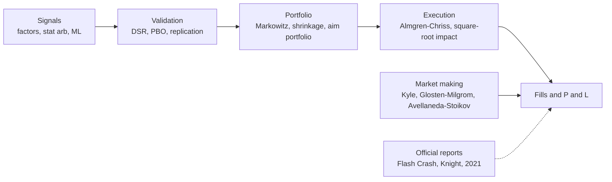

# Papers

> **TL;DR**
>
> - 120 papers and official reports, grouped by strategy family and pipeline stage. They include every paper the build spec requires and the papers the strategy dossiers and algorithm cards cite most.
> - Each entry gives what the paper shows, how hard it is (★ to ★★★) and which KB pages rest on it. Bibliographic details were checked against Crossref (DOI registry) metadata in 2026-11.
> - If you read ten, read Kyle; Glosten & Milgrom; Avellaneda & Stoikov; Avellaneda & Lee; Khandani & Lo; Jegadeesh & Titman; McLean & Pontiff; Gu, Kelly & Xiu; Almgren & Chriss; and Grinold's Fundamental Law.
> - Academic backtests are gross of most real costs and usually decayed after publication. Treat every Sharpe ratio below as an upper bound until a dossier says otherwise.

**Level:** Deep dive · **Read time:** ~25 min · **Last verified:** 2026-11

**How to read an entry.** ★ means the introduction and results tables are readable without the math. ★★ needs regression and CFA-level statistics. ★★★ needs stochastic control, optimization theory or heavy econometrics. Within each section, papers run roughly from foundational to recent. Where a dossier quotes a figure from a paper, the figure and its confidence tag live on that dossier; the notes here only orient you.

*How the sections below map onto the signal → portfolio → orders → fills pipeline.*

## Market making and microstructure models

- [Verified] Ho, T. & Stoll, H. R. (1981). "Optimal dealer pricing under transactions and return uncertainty." *Journal of Financial Economics* 9(1), 47–73. <https://doi.org/10.1016/0304-405X(81)90020-9> (accessed 2026-11) — ★★★ · The first inventory model of dealing: quotes shift away from the dealer's position, and the spread widens with risk and horizon. Every [reservation-price](glossary.md#reservation-price) model descends from it. Backs [Quoting and inventory control](../03-algorithms/f-market-making-and-hft-algorithms/quoting-and-inventory-control.md).
- [Verified] Glosten, L. R. & Milgrom, P. R. (1985). "Bid, ask and transaction prices in a specialist market with heterogeneously informed traders." *Journal of Financial Economics* 14(1), 71–100. <https://doi.org/10.1016/0304-405X(85)90044-3> (accessed 2026-11) — ★★ · Shows that a spread can exist from [adverse selection](glossary.md#adverse-selection) alone: the bid and ask are the expected value conditional on a sell or a buy. It is the theory behind every [markout](glossary.md#markout). Backs [Adverse selection and markouts](../03-algorithms/f-market-making-and-hft-algorithms/adverse-selection-and-markouts.md) · [Equity market making](../02-strategies/a-liquidity-provision/equity-market-making.md).
- [Verified] Kyle, A. S. (1985). "Continuous auctions and insider trading." *Econometrica* 53(6), 1315–1335. <https://doi.org/10.2307/1913210> (accessed 2026-11) — ★★★ · An informed trader hides in noise flow, and prices move linearly in net order flow with slope λ ("Kyle's lambda"). It is the root of linear impact and order-flow signals. Backs [Order-book and trade-flow signals](../03-algorithms/f-market-making-and-hft-algorithms/order-book-and-trade-flow-signals.md) · [The limit order book](../01-market-structure/the-limit-order-book.md).
- [Verified] Grossman, S. J. & Miller, M. H. (1988). "Liquidity and Market Structure." *Journal of Finance* 43(3), 617–633. <https://doi.org/10.1111/j.1540-6261.1988.tb04594.x> (accessed 2026-11) — ★★ · Liquidity is the price of immediacy: market makers absorb temporary imbalances and are paid through the later price reversal. This is the economic rationale for liquidity provision and reversal strategies. Backs [Auctions and closing liquidity](../02-strategies/a-liquidity-provision/auctions-and-closing-liquidity.md) · [Short-term reversal](../02-strategies/c-statistical-arbitrage/short-term-cross-sectional-reversal.md).
- [Verified] Avellaneda, M. & Stoikov, S. (2008). "High-frequency trading in a limit order book." *Quantitative Finance* 8(3), 217–224. <https://doi.org/10.1080/14697680701381228> (accessed 2026-11) — ★★★ · The canonical quoting model: a reservation price skewed by inventory, plus an optimal spread under exponential fill intensities. Short and readable for its class. Backs [Quoting and inventory control](../03-algorithms/f-market-making-and-hft-algorithms/quoting-and-inventory-control.md) · [Lab 05](https://github.com/FrankHuang94/quant_trading_claude/tree/main/labs/05-avellaneda-stoikov-glft-quoting).
- [Verified] Stoikov, S. & Sağlam, M. (2009). "Option market making under inventory risk." *Review of Derivatives Research* 12(1), 55–79. <https://doi.org/10.1007/s11147-009-9036-3> (accessed 2026-11) — ★★★ · Extends inventory-aware quoting to options, where risk is held in Greeks rather than shares. Backs [Options market making](../02-strategies/a-liquidity-provision/options-market-making.md).
- [Verified] Cont, R., Stoikov, S. & Talreja, R. (2010). "A stochastic model for order book dynamics." *Operations Research* 58(3), 549–563. <https://doi.org/10.1287/opre.1090.0780> (accessed 2026-11) — ★★★ · Models the book as queues with Poisson arrivals and computes the probabilities that matter for placement: the next mid move, and a fill before the price moves. Backs [Queue position and order placement](../03-algorithms/f-market-making-and-hft-algorithms/queue-position-and-order-placement.md).
- [Verified] Guéant, O., Lehalle, C.-A. & Fernandez-Tapia, J. (2013). "Dealing with the inventory risk: a solution to the market making problem." *Mathematics and Financial Economics* 7(4), 477–507. <https://doi.org/10.1007/s11579-012-0087-0> (accessed 2026-11) — ★★★ · The [GLFT](glossary.md#glft-model) closed-form approximation: stationary quotes with inventory limits and no terminal-time artefact, as used in practice-style quoting. Backs [Quoting and inventory control](../03-algorithms/f-market-making-and-hft-algorithms/quoting-and-inventory-control.md).
- [Verified] Cont, R., Kukanov, A. & Stoikov, S. (2014). "The Price Impact of Order Book Events." *Journal of Financial Econometrics* 12(1), 47–88. <https://doi.org/10.1093/jjfinec/nbt003> (accessed 2026-11) — ★★ · Defines [order-flow imbalance](glossary.md#order-flow-imbalance-ofi) and shows short-horizon price changes are roughly linear in it, with slope inversely related to depth. It is the most-used microstructure feature. Backs [Order-book and trade-flow signals](../03-algorithms/f-market-making-and-hft-algorithms/order-book-and-trade-flow-signals.md) · [Lab 03](https://github.com/FrankHuang94/quant_trading_claude/tree/main/labs/03-order-flow-imbalance).
- [Verified] Huang, W., Lehalle, C.-A. & Rosenbaum, M. (2015). "Simulating and analyzing order book data: The queue-reactive model." *Journal of the American Statistical Association* 110(509), 107–122. <https://doi.org/10.1080/01621459.2014.982278> (accessed 2026-11) — ★★★ · Order arrival and cancel rates depend on current queue sizes. This is a realistic simulator design for testing placement logic. Backs [The limit order book](../01-market-structure/the-limit-order-book.md).
- [Verified] Stoikov, S. (2018). "The micro-price: a high-frequency estimator of future prices." *Quantitative Finance* 18(12), 1959–1966. <https://doi.org/10.1080/14697688.2018.1489139> (accessed 2026-11) — ★★ · Builds a martingale fair-value estimate from imbalance and spread state, fixing the weighted mid's biases. Backs [Fair value and microprice](../03-algorithms/f-market-making-and-hft-algorithms/fair-value-and-microprice.md) · [Lab 02](https://github.com/FrankHuang94/quant_trading_claude/tree/main/labs/02-microprice-fair-value).
- [Verified] Easley, D., López de Prado, M. M. & O'Hara, M. (2012). "Flow toxicity and liquidity in a high-frequency world." *Review of Financial Studies* 25(5), 1457–1493. <https://doi.org/10.1093/rfs/hhs053> (accessed 2026-11) — ★★ · Introduces VPIN, a volume-clock measure of [flow toxicity](glossary.md#flow-toxicity), and argues it rose before the 2010 Flash Crash. Read it alongside the rebuttal below. Backs [Order-book and trade-flow signals](../03-algorithms/f-market-making-and-hft-algorithms/order-book-and-trade-flow-signals.md).
- [Verified] Andersen, T. G. & Bondarenko, O. (2014). "VPIN and the flash crash." *Journal of Financial Markets* 17, 1–46. <https://doi.org/10.1016/j.finmar.2013.05.005> (accessed 2026-11) — ★★ · The main critique: VPIN's apparent warning depends on trade-classification and volume choices and has little incremental predictive power. The debate is unresolved; the authors' rejoinder is in the same issue. Backs [Order-book and trade-flow signals](../03-algorithms/f-market-making-and-hft-algorithms/order-book-and-trade-flow-signals.md).
- [Verified] Kolm, P. N., Turiel, J. & Westray, N. (2023). "Deep order flow imbalance: Extracting alpha at multiple horizons from the limit order book." *Mathematical Finance* 33(4), 1044–1081. <https://doi.org/10.1111/mafi.12413> (accessed 2026-11) — ★★ · Deep nets fed multi-level OFI beat nets fed raw book states. Feature design still matters with deep learning. Backs [Fair value and microprice](../03-algorithms/f-market-making-and-hft-algorithms/fair-value-and-microprice.md) · [Neural nets and sequence models](../03-algorithms/b-forecasting-models/neural-nets-and-sequence-models.md).

## HFT, market design and retail flow (empirical)

- [Verified] Menkveld, A. J. (2013). "High frequency trading and the new market makers." *Journal of Financial Markets* 16(4), 712–740. <https://doi.org/10.1016/j.finmar.2013.06.006> (accessed 2026-11) — ★ · The cleanest real HFT market-maker P&L: one firm's spread revenue minus positioning losses, per trade. It is the template for this KB's market-maker income statement. Backs [Equity market making](../02-strategies/a-liquidity-provision/equity-market-making.md) · [Adverse selection and markouts](../03-algorithms/f-market-making-and-hft-algorithms/adverse-selection-and-markouts.md).
- [Verified] Brogaard, J., Hendershott, T. & Riordan, R. (2014). "High-Frequency Trading and Price Discovery." *Review of Financial Studies* 27(8), 2267–2306. <https://doi.org/10.1093/rfs/hhu032> (accessed 2026-11) — ★★ · On aggregate, HFTs trade in the direction of permanent price changes and against transitory errors. Their passive fills are adversely selected. Backs [Adverse selection and markouts](../03-algorithms/f-market-making-and-hft-algorithms/adverse-selection-and-markouts.md).
- [Verified] Budish, E., Cramton, P. & Shim, J. (2015). "The High-Frequency Trading Arms Race: Frequent Batch Auctions as a Market Design Response." *Quarterly Journal of Economics* 130(4), 1547–1621. <https://doi.org/10.1093/qje/qjv027> (accessed 2026-11) — ★★ · Shows that continuous limit order books create mechanical arbitrage races, for example ES vs SPY correlation breaking down at millisecond horizons, and proposes [frequent batch auctions](glossary.md#frequent-batch-auction). Backs [Latency arbitrage](../02-strategies/b-speed-and-structural/latency-arbitrage.md) · [ETF and index arbitrage](../02-strategies/b-speed-and-structural/etf-and-index-arbitrage.md).
- [Verified] Kirilenko, A., Kyle, A. S., Samadi, M. & Tuzun, T. (2017). "The Flash Crash: High-Frequency Trading in an Electronic Market." *Journal of Finance* 72(3), 967–998. <https://doi.org/10.1111/jofi.12498> (accessed 2026-11) — ★★ · Audit-trail evidence from E-mini futures: HFTs did not trigger the crash, but their usual inventory behavior amplified selling pressure. Backs [Strategy failure gallery](../02-strategies/h-cross-cutting/strategy-failure-gallery.md).
- [Verified] Baron, M., Brogaard, J., Hagströmer, B. & Kirilenko, A. (2019). "Risk and Return in High-Frequency Trading." *Journal of Financial and Quantitative Analysis* 54(3), 993–1024. <https://doi.org/10.1017/S0022109018001096> (accessed 2026-11) — ★★ · HFT profits concentrate in a few firms, aggressive styles earn the most, and relative speed predicts returns. This is evidence for winner-take-most economics. Backs [Equity market making](../02-strategies/a-liquidity-provision/equity-market-making.md) · [Evolution of quant strategies](../02-strategies/h-cross-cutting/evolution-of-quant-strategies.md).
- [Verified] van Kervel, V. & Menkveld, A. J. (2019). "High-frequency trading around large institutional orders." *Journal of Finance* 74(3), 1091–1137. <https://doi.org/10.1111/jofi.12759> (accessed 2026-11) — ★★ · HFTs first lean against large institutional orders, then trade with them as the orders persist, raising execution costs. This is why execution algos hide intent. Backs [Execution algorithms overview](../03-algorithms/e-execution-algorithms/execution-algorithms-overview.md).
- [Verified] Shkilko, A. & Sokolov, K. (2020). "Every Cloud Has a Silver Lining: Fast Trading, Microwave Connectivity, and Trading Costs." *Journal of Finance* 75(6), 2899–2927. <https://doi.org/10.1111/jofi.12969> (accessed 2026-11) — ★★ · A natural experiment: rain disrupts microwave links, latency arbitrage drops, and liquidity improves. It is causal evidence that speed races tax liquidity providers. Backs [Latency arbitrage](../02-strategies/b-speed-and-structural/latency-arbitrage.md).
- [Verified] Aquilina, M., Budish, E. & O'Neill, P. (2022). "Quantifying the High-Frequency Trading 'Arms Race'." *Quarterly Journal of Economics* 137(1), 493–564. <https://doi.org/10.1093/qje/qjab032> (accessed 2026-11) — ★★ · Uses LSE message data, including failed orders, to measure races directly: their share of volume, the implied latency tax, and how concentrated the winners are. Backs [Latency arbitrage](../02-strategies/b-speed-and-structural/latency-arbitrage.md) · [The big picture](../00-start-here/the-big-picture.md).
- [Verified] Battalio, R., Corwin, S. A. & Jennings, R. (2016). "Can Brokers Have It All? On the Relation between Make-Take Fees and Limit Order Execution Quality." *Journal of Finance* 71(5), 2193–2238. <https://doi.org/10.1111/jofi.12422> (accessed 2026-11) — ★★ · Brokers that route limit orders to high-rebate venues get worse fill rates and worse fill quality. This is a [maker-taker](glossary.md#maker-taker) conflict of interest. Backs [Fee- and microstructure-driven strategies](../02-strategies/b-speed-and-structural/fee-and-microstructure-driven-strategies.md) · [Smart order routing](../03-algorithms/e-execution-algorithms/smart-order-routing.md).
- [Verified] Boehmer, E., Jones, C. M., Zhang, X. & Zhang, X. (2021). "Tracking Retail Investor Activity." *Journal of Finance* 76(5), 2249–2305. <https://doi.org/10.1111/jofi.13033> (accessed 2026-11) — ★★ · Identifies retail trades in public TRF prints by their subpenny price improvement, and finds that retail order imbalance predicts returns. Later work questions the classifier's accuracy. Backs [Retail flow internalization](../02-strategies/a-liquidity-provision/retail-flow-internalization.md).
- [Verified] Bryzgalova, S., Pavlova, A. & Sikorskaya, T. (2023). "Retail Trading in Options and the Rise of the Big Three Wholesalers." *Journal of Finance* 78(6), 3465–3514. <https://doi.org/10.1111/jofi.13285> (accessed 2026-11) — ★★ · Documents the retail options boom, its concentration in cheap short-dated contracts, and the three wholesalers that buy most of the flow. Backs [Options market making](../02-strategies/a-liquidity-provision/options-market-making.md).
- [Verified] Schwarz, C., Barber, B. M., Huang, X., Jorion, P. & Odean, T. (2025). "The 'Actual Retail Price' of Equity Trades." *Journal of Finance* 80(5), 2507–2541. <https://doi.org/10.1111/jofi.13467> (accessed 2026-11) — ★ · The authors placed real trades across brokers and found that execution prices differ materially by broker, which matters more than the PFOF headline. Backs [Retail flow internalization](../02-strategies/a-liquidity-provision/retail-flow-internalization.md).
- [Verified] Bogousslavsky, V. & Muravyev, D. (2023). "Who trades at the close? Implications for price discovery and liquidity." *Journal of Financial Markets* 66, 100852. <https://doi.org/10.1016/j.finmar.2023.100852> (accessed 2026-11) — ★★ · As closing-auction volume has grown, closing prices carry temporary distortions that partly reverse overnight. Backs [Auctions and closing liquidity](../02-strategies/a-liquidity-provision/auctions-and-closing-liquidity.md) · [Intraday patterns](../02-strategies/c-statistical-arbitrage/intraday-patterns-and-seasonality.md).

## ETFs, index events and flows

- [Verified] Harris, L. & Gurel, E. (1986). "Price and Volume Effects Associated with Changes in the S&P 500 List: New Evidence for the Existence of Price Pressures." *Journal of Finance* 41(4), 815–829. <https://doi.org/10.1111/j.1540-6261.1986.tb04550.x> (accessed 2026-11) — ★ · The classic index-inclusion result: an announcement pop that partly reverses, i.e., price pressure from index demand. Backs [Flow-driven strategies](../02-strategies/d-mid-frequency-alpha/flow-driven-strategies.md).
- [Verified] Petajisto, A. (2017). "Inefficiencies in the pricing of exchange-traded funds." *Financial Analysts Journal* 73(1), 24–54. <https://doi.org/10.2469/faj.v73.n1.7> (accessed 2026-11) — ★ · ETF premiums and discounts to NAV are larger where the underlying is hard to price or trade, and arbitrage closes them only partly. Backs [ETF market making](../02-strategies/a-liquidity-provision/etf-market-making.md) · [ETF and index arbitrage](../02-strategies/b-speed-and-structural/etf-and-index-arbitrage.md).
- [Verified] Ben-David, I., Franzoni, F. & Moussawi, R. (2018). "Do ETFs increase volatility?" *Journal of Finance* 73(6), 2471–2535. <https://doi.org/10.1111/jofi.12727> (accessed 2026-11) — ★★ · Creation and redemption arbitrage passes ETF-level liquidity shocks into the underlying stocks and raises their volatility. Backs [ETF and index arbitrage](../02-strategies/b-speed-and-structural/etf-and-index-arbitrage.md).
- [Verified] Greenwood, R. & Sammon, M. (2025). "The Disappearing Index Effect." *Journal of Finance* 80(2), 657–698. <https://doi.org/10.1111/jofi.13410> (accessed 2026-11) — ★ · The S&P 500 inclusion premium shrank from the 1990s to almost nothing as the trade became crowded and anticipated. It is a model case of [alpha decay](glossary.md#alpha-decay). Backs [Flow-driven strategies](../02-strategies/d-mid-frequency-alpha/flow-driven-strategies.md).

## Statistical arbitrage and short-horizon reversal

- [Verified] Lehmann, B. N. (1990). "Fads, Martingales, and Market Efficiency." *Quarterly Journal of Economics* 105(1), 1–28. <https://doi.org/10.2307/2937816> (accessed 2026-11) — ★★ · Weekly contrarian portfolios earn large gross profits, but bid-ask bounce and costs eat much of them. This is the origin of the [short-term reversal](glossary.md#short-term-reversal) literature. Backs [Short-term reversal](../02-strategies/c-statistical-arbitrage/short-term-cross-sectional-reversal.md).
- [Verified] Jegadeesh, N. (1990). "Evidence of Predictable Behavior of Security Returns." *Journal of Finance* 45(3), 881–898. <https://doi.org/10.1111/j.1540-6261.1990.tb05110.x> (accessed 2026-11) — ★★ · Documents one-month reversal alongside longer-horizon continuation, the twin patterns behind reversal and momentum books. Backs [Short-term reversal](../02-strategies/c-statistical-arbitrage/short-term-cross-sectional-reversal.md) · [Stat arb overview](../02-strategies/c-statistical-arbitrage/stat-arb-overview-and-history.md).
- [Verified] Lo, A. W. & MacKinlay, A. C. (1990). "When Are Contrarian Profits Due to Stock Market Overreaction?" *Review of Financial Studies* 3(2), 175–205. <https://doi.org/10.1093/rfs/3.2.175> (accessed 2026-11) — ★★ · Decomposes contrarian profits and finds that a large share comes from [lead-lag](glossary.md#lead-lag) cross-autocorrelation (large stocks lead small), not only from overreaction. Backs [Stat arb overview](../02-strategies/c-statistical-arbitrage/stat-arb-overview-and-history.md).
- [Verified] Campbell, J. Y., Grossman, S. J. & Wang, J. (1993). "Trading Volume and Serial Correlation in Stock Returns." *Quarterly Journal of Economics* 108(4), 905–939. <https://doi.org/10.2307/2118454> (accessed 2026-11) — ★★ · Price moves on high volume tend to reverse, consistent with pay for liquidity provision. Volume-conditioned reversal signals come from here. Backs [Factor-residual mean reversion](../02-strategies/c-statistical-arbitrage/factor-residual-mean-reversion.md).
- [Verified] Gatev, E., Goetzmann, W. N. & Rouwenhorst, K. G. (2006). "Pairs Trading: Performance of a Relative-Value Arbitrage Rule." *Review of Financial Studies* 19(3), 797–827. <https://doi.org/10.1093/rfs/hhj020> (accessed 2026-11) — ★ · The distance-method pairs benchmark on 1962–2002 data. Read it for the method and the committed-capital accounting. Backs [Pairs trading and cointegration](../02-strategies/c-statistical-arbitrage/pairs-trading-and-cointegration.md) · [Lab 08](https://github.com/FrankHuang94/quant_trading_claude/tree/main/labs/08-pairs-cointegration).
- [Verified] Khandani, A. E. & Lo, A. W. (2007). "What Happened to the Quants in August 2007?" *Journal of Investment Management* 5(4). <https://web.mit.edu/Alo/www/Papers/august07.pdf> (accessed 2026-11) — ★ · Written weeks after the event. A simple contrarian strategy reproduces the losses of the week of August 6, which fits a forced deleveraging of crowded books. Backs [Strategy failure gallery](../02-strategies/h-cross-cutting/strategy-failure-gallery.md).
- [Verified] Avellaneda, M. & Lee, J.-H. (2010). "Statistical arbitrage in the US equities market." *Quantitative Finance* 10(7), 761–782. <https://doi.org/10.1080/14697680903124632> (accessed 2026-11) — ★★ · The reference design for [PCA](glossary.md#principal-component-analysis-pca)/ETF-residual stat arb: fit residuals as an [Ornstein-Uhlenbeck process](glossary.md#ornstein-uhlenbeck-process) and trade the [s-score](glossary.md#s-score). Its Sharpe ratios decay over the sample. Backs [Factor-residual mean reversion](../02-strategies/c-statistical-arbitrage/factor-residual-mean-reversion.md) · [Lab 09](https://github.com/FrankHuang94/quant_trading_claude/tree/main/labs/09-pca-residual-stat-arb).
- [Verified] Heston, S. L., Korajczyk, R. A. & Sadka, R. (2010). "Intraday Patterns in the Cross-section of Stock Returns." *Journal of Finance* 65(4), 1369–1407. <https://doi.org/10.1111/j.1540-6261.2010.01573.x> (accessed 2026-11) — ★★ · A stock's return in a given half-hour predicts its return in the same half-hour on later days. Periodic flows leave footprints. Backs [Intraday patterns and seasonality](../02-strategies/c-statistical-arbitrage/intraday-patterns-and-seasonality.md).
- [Verified] Khandani, A. E. & Lo, A. W. (2011). "What happened to the quants in August 2007? Evidence from factors and transactions data." *Journal of Financial Markets* 14(1), 1–46. <https://doi.org/10.1016/j.finmar.2010.07.005> (accessed 2026-11) — ★★ · The journal version adds factor and transaction data: liquidity provision evaporated and losses spread through common positions. This is the KB's most-cited crowding paper. Backs [Factor-residual mean reversion](../02-strategies/c-statistical-arbitrage/factor-residual-mean-reversion.md) · [Factor timing, crowding and quant winters](../02-strategies/e-risk-premia-and-factors/factor-timing-crowding-and-quant-winters.md).
- [Verified] Nagel, S. (2012). "Evaporating Liquidity." *Review of Financial Studies* 25(7), 2005–2039. <https://doi.org/10.1093/rfs/hhs066> (accessed 2026-11) — ★★ · Treats reversal-strategy returns as the return to liquidity provision. They spike when VIX is high, which is when liquidity providers retreat. Backs [Short-term reversal](../02-strategies/c-statistical-arbitrage/short-term-cross-sectional-reversal.md).
- [Verified] Da, Z., Liu, Q. & Schaumburg, E. (2014). "A Closer Look at the Short-Term Return Reversal." *Management Science* 60(3), 658–674. <https://doi.org/10.1287/mnsc.2013.1766> (accessed 2026-11) — ★★ · Strip out industry moves and cash-flow news, and the residual reversal is much stronger. This is the case for residualizing before trading reversal. Backs [Short-term reversal](../02-strategies/c-statistical-arbitrage/short-term-cross-sectional-reversal.md) · [Lab 10](https://github.com/FrankHuang94/quant_trading_claude/tree/main/labs/10-reversal-momentum-costs).
- [Verified] Krauss, C., Do, X. A. & Huck, N. (2017). "Deep neural networks, gradient-boosted trees, random forests: Statistical arbitrage on the S&P 500." *European Journal of Operational Research* 259(2), 689–702. <https://doi.org/10.1016/j.ejor.2016.10.031> (accessed 2026-11) — ★★ · Daily ML stat arb with high pre-cost returns that shrink sharply in later years. A cautionary benchmark. Backs [ML-driven short-horizon alpha](../02-strategies/c-statistical-arbitrage/ml-driven-short-horizon-alpha.md).
- [Verified] Gao, L., Han, Y., Li, S. Z. & Zhou, G. (2018). "Market intraday momentum." *Journal of Financial Economics* 129(2), 394–414. <https://doi.org/10.1016/j.jfineco.2018.05.009> (accessed 2026-11) — ★ · The first half-hour's market return predicts the last half-hour's. Backs [Intraday patterns and seasonality](../02-strategies/c-statistical-arbitrage/intraday-patterns-and-seasonality.md).
- [Verified] Guijarro-Ordonez, J., Pelger, M. & Zanotti, G. (2026). "Deep Learning Statistical Arbitrage." *Management Science* 72(9), 7502–7549. <https://doi.org/10.1287/mnsc.2022.03132> (accessed 2026-11) — ★★★ · Learns both the residual portfolios and the trading policy end to end with a CNN-transformer. It is the frontier version of A&L, with academic, pre-capacity Sharpe ratios. Backs [Factor-residual mean reversion](../02-strategies/c-statistical-arbitrage/factor-residual-mean-reversion.md) · [Stat arb overview](../02-strategies/c-statistical-arbitrage/stat-arb-overview-and-history.md).

## Factors and anomalies

- [Verified] Fama, E. F. & MacBeth, J. D. (1973). "Risk, Return, and Equilibrium: Empirical Tests." *Journal of Political Economy* 81(3), 607–636. <https://doi.org/10.1086/260061> (accessed 2026-11) — ★★ · The [cross-sectional regression](glossary.md#fama-macbeth-regression) method that factor research still uses for signal premia and their t-stats. Backs [Evaluating signals](../03-algorithms/a-data-and-signals/evaluating-signals.md).
- [Verified] Bernard, V. L. & Thomas, J. K. (1989). "Post-Earnings-Announcement Drift: Delayed Price Response or Risk Premium?" *Journal of Accounting Research* 27 (Supplement), 1–36. <https://doi.org/10.2307/2491062> (accessed 2026-11) — ★ · [PEAD](glossary.md#post-earnings-announcement-drift-pead): prices keep drifting toward earnings surprises for weeks, and the drift is not explained by risk. Backs [Earnings and event-driven](../02-strategies/d-mid-frequency-alpha/earnings-and-event-driven.md).
- [Verified] Fama, E. F. & French, K. R. (1992). "The Cross-Section of Expected Stock Returns." *Journal of Finance* 47(2), 427–465. <https://doi.org/10.1111/j.1540-6261.1992.tb04398.x> (accessed 2026-11) — ★★ · Size and book-to-market subsume CAPM beta in the cross-section. This is the starting gun for factor investing. Backs [Value, quality and low volatility](../02-strategies/e-risk-premia-and-factors/value-quality-low-vol.md).
- [Verified] Fama, E. F. & French, K. R. (1993). "Common Risk Factors in the Returns on Stocks and Bonds." *Journal of Financial Economics* 33(1), 3–56. <https://doi.org/10.1016/0304-405X(93)90023-5> (accessed 2026-11) — ★★ · Builds the SMB and HML factor portfolios and the three-factor model. Read the portfolio-construction section to understand every factor dataset. Backs [Factor investing fundamentals](../02-strategies/e-risk-premia-and-factors/factor-investing-fundamentals.md).
- [Verified] Jegadeesh, N. & Titman, S. (1993). "Returns to Buying Winners and Selling Losers: Implications for Stock Market Efficiency." *Journal of Finance* 48(1), 65–91. <https://doi.org/10.1111/j.1540-6261.1993.tb04702.x> (accessed 2026-11) — ★ · The 3–12-month cross-sectional [momentum](glossary.md#momentum) result and its partial long-run reversal. Backs [Momentum](../02-strategies/e-risk-premia-and-factors/momentum.md).
- [Verified] Carhart, M. M. (1997). "On Persistence in Mutual Fund Performance." *Journal of Finance* 52(1), 57–82. <https://doi.org/10.1111/j.1540-6261.1997.tb03808.x> (accessed 2026-11) — ★★ · Adds a momentum factor to Fama-French, the "four-factor" model, and shows apparent fund skill is mostly factor exposure. Backs [Factor investing fundamentals](../02-strategies/e-risk-premia-and-factors/factor-investing-fundamentals.md).
- [Verified] Ang, A., Hodrick, R. J., Xing, Y. & Zhang, X. (2006). "The Cross-Section of Volatility and Expected Returns." *Journal of Finance* 61(1), 259–299. <https://doi.org/10.1111/j.1540-6261.2006.00836.x> (accessed 2026-11) — ★★ · High idiosyncratic-volatility stocks earn low returns, one root of the [low-volatility anomaly](glossary.md#low-volatility-anomaly). Backs [Value, quality and low volatility](../02-strategies/e-risk-premia-and-factors/value-quality-low-vol.md).
- [Verified] Moskowitz, T. J., Ooi, Y. H. & Pedersen, L. H. (2012). "Time series momentum." *Journal of Financial Economics* 104(2), 228–250. <https://doi.org/10.1016/j.jfineco.2011.11.003> (accessed 2026-11) — ★★ · An asset's own past 12-month return predicts its future return across liquid futures. This is the academic basis of [trend following](glossary.md#trend-following). Backs [Trend following and CTAs](../02-strategies/g-futures-and-macro-context/trend-following-and-ctas.md) · [Lab 19](https://github.com/FrankHuang94/quant_trading_claude/tree/main/labs/19-trend-following-vol-targeting).
- [Verified] Asness, C. S., Moskowitz, T. J. & Pedersen, L. H. (2013). "Value and Momentum Everywhere." *Journal of Finance* 68(3), 929–985. <https://doi.org/10.1111/jofi.12021> (accessed 2026-11) — ★★ · Value and momentum work across eight asset classes and are negatively correlated, so combining them is the free lunch. Backs [Momentum](../02-strategies/e-risk-premia-and-factors/momentum.md) · [Value, quality and low volatility](../02-strategies/e-risk-premia-and-factors/value-quality-low-vol.md).
- [Verified] Novy-Marx, R. (2013). "The Other Side of Value: The Gross Profitability Premium." *Journal of Financial Economics* 108(1), 1–28. <https://doi.org/10.1016/j.jfineco.2013.01.003> (accessed 2026-11) — ★ · Gross profits over assets predicts returns about as well as book-to-market, and hedges it. This is the accountant's quality factor. Backs [Fundamental quant signals](../02-strategies/d-mid-frequency-alpha/fundamental-quant-signals.md).
- [Verified] Frazzini, A. & Pedersen, L. H. (2014). "Betting Against Beta." *Journal of Financial Economics* 111(1), 1–25. <https://doi.org/10.1016/j.jfineco.2013.10.005> (accessed 2026-11) — ★★ · Leverage-constrained investors bid up high-beta assets, so a levered low-beta portfolio earns a premium across markets. Backs [Value, quality and low volatility](../02-strategies/e-risk-premia-and-factors/value-quality-low-vol.md).
- [Verified] Fama, E. F. & French, K. R. (2015). "A Five-Factor Asset Pricing Model." *Journal of Financial Economics* 116(1), 1–22. <https://doi.org/10.1016/j.jfineco.2014.10.010> (accessed 2026-11) — ★★ · Adds profitability (RMW) and investment (CMA). HML becomes redundant in their US sample, and momentum is still left out. Backs [Factor investing fundamentals](../02-strategies/e-risk-premia-and-factors/factor-investing-fundamentals.md).
- [Verified] Barroso, P. & Santa-Clara, P. (2015). "Momentum has its moments." *Journal of Financial Economics* 116(1), 111–120. <https://doi.org/10.1016/j.jfineco.2014.11.010> (accessed 2026-11) — ★ · Scaling momentum by its own recent volatility greatly reduces crash risk and raises Sharpe. It is the standard fix. Backs [Momentum](../02-strategies/e-risk-premia-and-factors/momentum.md) · [Position sizing and risk budgeting](../03-algorithms/d-portfolio-construction/position-sizing-and-risk-budgeting.md).
- [Verified] Daniel, K. & Moskowitz, T. J. (2016). "Momentum Crashes." *Journal of Financial Economics* 122(2), 221–247. <https://doi.org/10.1016/j.jfineco.2015.12.002> (accessed 2026-11) — ★★ · [Momentum crashes](glossary.md#momentum-crash) hit in sharp rebounds after bear markets, when the short side is full of high-beta losers. Proposes a dynamic hedge. Backs [Momentum](../02-strategies/e-risk-premia-and-factors/momentum.md) · [Regime detection](../03-algorithms/b-forecasting-models/regime-detection.md).
- [Verified] Kakushadze, Z. (2016). "101 Formulaic Alphas." *Wilmott* 2016(84), 72–81. <https://doi.org/10.1002/wilm.10525> (accessed 2026-11) — ★ · 101 explicit price-volume alpha formulas, presented as real-life trading alphas, with holding periods of days and low pairwise correlation. Read it to see what "a signal" looks like at an alpha factory. Backs [Feature engineering](../03-algorithms/a-data-and-signals/feature-engineering.md).
- [Verified] Kakushadze, Z. & Tulchinsky, I. (2016). "Performance v. Turnover: A Story by 4,000 Alphas." *Journal of Investment Strategies* 5(2), 75–89. <https://arxiv.org/abs/1509.08110> (accessed 2026-11) — ★★ · Empirical scaling of return and volatility with turnover across thousands of real alphas, useful for thinking about the cost-adjusted value of fast signals. Backs [Signal transforms](../03-algorithms/a-data-and-signals/signal-transforms.md).
- [Verified] Hurst, B., Ooi, Y. H. & Pedersen, L. H. (2017). "A Century of Evidence on Trend-Following Investing." *Journal of Portfolio Management* 44(1), 15–29. <https://doi.org/10.3905/jpm.2017.44.1.015> (accessed 2026-11) — ★ · Trend following has been positive across more than a century, including crisis periods. The backtest assumes costs and fees. Backs [Trend following and CTAs](../02-strategies/g-futures-and-macro-context/trend-following-and-ctas.md).
- [Verified] Moreira, A. & Muir, T. (2017). "Volatility-Managed Portfolios." *Journal of Finance* 72(4), 1611–1644. <https://doi.org/10.1111/jofi.12513> (accessed 2026-11) — ★★ · Scaling factor exposure inversely to recent variance raises alphas. Out-of-sample robustness is contested (Cederburg et al. 2020). Backs [Position sizing and risk budgeting](../03-algorithms/d-portfolio-construction/position-sizing-and-risk-budgeting.md).
- [Verified] Koijen, R. S. J., Moskowitz, T. J., Pedersen, L. H. & Vrugt, E. B. (2018). "Carry." *Journal of Financial Economics* 127(2), 197–225. <https://doi.org/10.1016/j.jfineco.2017.11.002> (accessed 2026-11) — ★★ · A unified definition of [carry](glossary.md#carry) (return if prices do not move) that predicts returns in every major asset class. Backs [Carry and cross-asset risk premia](../02-strategies/g-futures-and-macro-context/carry-and-cross-asset-risk-premia.md).
- [Verified] Asness, C. S., Frazzini, A. & Pedersen, L. H. (2019). "Quality Minus Junk." *Review of Accounting Studies* 24(1), 34–112. <https://doi.org/10.1007/s11142-018-9470-2> (accessed 2026-11) — ★★ · Defines quality as profitability, growth, safety and payout. Quality stocks earn more, but are not priced as much higher as theory implies. Backs [Value, quality and low volatility](../02-strategies/e-risk-premia-and-factors/value-quality-low-vol.md).
- [Verified] Loughran, T. & McDonald, B. (2011). "When Is a Liability Not a Liability? Textual Analysis, Dictionaries, and 10-Ks." *Journal of Finance* 66(1), 35–65. <https://doi.org/10.1111/j.1540-6261.2010.01625.x> (accessed 2026-11) — ★ · General sentiment word lists misclassify finance text (e.g., "liability"), so they build finance-specific dictionaries, still the baseline before LLMs. Backs [NLP and LLM signals](../02-strategies/d-mid-frequency-alpha/nlp-and-llm-signals.md).
- [Verified] Cohen, L., Malloy, C. & Nguyen, Q. (2020). "Lazy Prices." *Journal of Finance* 75(3), 1371–1415. <https://doi.org/10.1111/jofi.12885> (accessed 2026-11) — ★ · Firms that change their 10-K language underperform, and the market is slow to notice. It is a clean text signal. Backs [NLP and LLM signals](../02-strategies/d-mid-frequency-alpha/nlp-and-llm-signals.md).
- [Verified] Arnott, R. D., Harvey, C. R., Kalesnik, V. & Linnainmaa, J. T. (2021). "Reports of Value's Death May Be Greatly Exaggerated." *Financial Analysts Journal* 77(1), 44–67. <https://doi.org/10.1080/0015198X.2020.1842704> (accessed 2026-11) — ★ · Attributes value's 2007–2020 drawdown mostly to widening valuation spreads, plus intangibles missing from book value, rather than a dead premium. Backs [Value, quality and low volatility](../02-strategies/e-risk-premia-and-factors/value-quality-low-vol.md).
- [Verified] Lou, D. & Polk, C. (2022). "Comomentum: Inferring Arbitrage Activity from Return Correlations." *Review of Financial Studies* 35(7), 3272–3302. <https://doi.org/10.1093/rfs/hhab117> (accessed 2026-11) — ★★ · Excess return correlation among momentum stocks measures arbitrage crowding. High "comomentum" predicts momentum's later reversal. Backs [Factor timing, crowding and quant winters](../02-strategies/e-risk-premia-and-factors/factor-timing-crowding-and-quant-winters.md).

## Anomaly replication, decay and crowding

- [Verified] McLean, R. D. & Pontiff, J. (2016). "Does Academic Research Destroy Stock Return Predictability?" *Journal of Finance* 71(1), 5–32. <https://doi.org/10.1111/jofi.12365> (accessed 2026-11) — ★ · Tests 97 predictors: returns fall out of sample and fall further after publication. This is the KB's most-cited decay estimate. Backs [Cross-sectional alpha](../02-strategies/d-mid-frequency-alpha/cross-sectional-alpha-and-neutralization.md) · [Alpha decay detection](../03-algorithms/g-live-trading/alpha-decay-detection-and-model-retirement.md).
- [Verified] Harvey, C. R., Liu, Y. & Zhu, H. (2016). "… and the Cross-Section of Expected Returns." *Review of Financial Studies* 29(1), 5–68. <https://doi.org/10.1093/rfs/hhv059> (accessed 2026-11) — ★★ · With hundreds of factors tried, a new one should clear t ≈ 3, not 2. This is the [multiple-testing](glossary.md#multiple-testing) reckoning for factor research. Backs [Overfitting and multiple testing](../03-algorithms/c-validation-and-backtesting/overfitting-and-multiple-testing.md) · [How quants evaluate a strategy](../02-strategies/how-quants-evaluate-a-strategy.md).
- [Verified] Novy-Marx, R. & Velikov, M. (2016). "A Taxonomy of Anomalies and Their Trading Costs." *Review of Financial Studies* 29(1), 104–147. <https://doi.org/10.1093/rfs/hhv063> (accessed 2026-11) — ★★ · Sorts anomalies by turnover. Most low-turnover ones survive costs, few high-turnover ones do, and cost-mitigation rules help. Backs [Factor investing fundamentals](../02-strategies/e-risk-premia-and-factors/factor-investing-fundamentals.md) · [Transaction cost and impact models](../03-algorithms/d-portfolio-construction/transaction-cost-and-impact-models.md).
- [Verified] Hou, K., Xue, C. & Zhang, L. (2020). "Replicating Anomalies." *Review of Financial Studies* 33(5), 2019–2133. <https://doi.org/10.1093/rfs/hhy131> (accessed 2026-11) — ★★ · With NYSE breakpoints and value weights (i.e., no microcap dominance), most of 452 anomalies lose significance. This is the skeptic's side of the replication debate. Backs [Fundamental quant signals](../02-strategies/d-mid-frequency-alpha/fundamental-quant-signals.md) · [Point-in-time data and cleaning](../03-algorithms/a-data-and-signals/point-in-time-data-and-cleaning.md).
- [Verified] Chen, A. Y. & Zimmermann, T. (2022). "Open Source Cross-Sectional Asset Pricing." *Critical Finance Review* 11(2), 207–264. <https://doi.org/10.1561/104.00000112> (accessed 2026-11) — ★★ · Open-code replication of over 300 predictors, most of which reproduce. The defender's side, with data you can download (see [Datasets and tools](datasets-and-tools.md)). Backs [Factor investing fundamentals](../02-strategies/e-risk-premia-and-factors/factor-investing-fundamentals.md) · [Feature engineering](../03-algorithms/a-data-and-signals/feature-engineering.md).
- [Verified] Falck, A., Rej, A. & Thesmar, D. (2022). "When do systematic strategies decay?" *Quantitative Finance* 22(11), 1955–1969. <https://doi.org/10.1080/14697688.2022.2098810> (accessed 2026-11) — ★★ · Out-of-sample performance runs at about half of in-sample, and publication date is the main predictor of decay. Backs [Alpha decay detection](../03-algorithms/g-live-trading/alpha-decay-detection-and-model-retirement.md) · [How quants evaluate a strategy](../02-strategies/how-quants-evaluate-a-strategy.md).
- [Verified] Jensen, T. I., Kelly, B. & Pedersen, L. H. (2023). "Is There a Replication Crisis in Finance?" *Journal of Finance* 78(5), 2465–2518. <https://doi.org/10.1111/jofi.13249> (accessed 2026-11) — ★★ · A Bayesian view across 153 factors and 93 countries: most factors replicate and cluster into 13 themes. The global-factor data are public. Backs [Factor investing fundamentals](../02-strategies/e-risk-premia-and-factors/factor-investing-fundamentals.md) · [Overfitting and multiple testing](../03-algorithms/c-validation-and-backtesting/overfitting-and-multiple-testing.md).

## Machine learning, validation and backtest statistics

- [Verified] Newey, W. K. & West, K. D. (1987). "A Simple, Positive Semi-Definite, Heteroskedasticity and Autocorrelation Consistent Covariance Matrix." *Econometrica* 55(3), 703–708. <https://doi.org/10.2307/1913610> (accessed 2026-11) — ★★★ · HAC standard errors. These are mandatory whenever you regress overlapping multi-day returns, or t-stats are inflated. Backs [Evaluating signals](../03-algorithms/a-data-and-signals/evaluating-signals.md) · [Backtest pitfalls](../03-algorithms/c-validation-and-backtesting/backtest-pitfalls.md).
- [Verified] Lo, A. W. (2002). "The Statistics of Sharpe Ratios." *Financial Analysts Journal* 58(4), 36–52. <https://doi.org/10.2469/faj.v58.n4.2453> (accessed 2026-11) — ★★ · Sharpe ratios carry standard errors, and with serially correlated returns the √12 annualization can badly misstate them. Backs [How quants evaluate a strategy](../02-strategies/how-quants-evaluate-a-strategy.md).
- [Verified] Bailey, D. H. & López de Prado, M. (2014). "The Deflated Sharpe Ratio: Correcting for Selection Bias, Backtest Overfitting, and Non-Normality." *Journal of Portfolio Management* 40(5), 94–107. <https://doi.org/10.3905/jpm.2014.40.5.094> (accessed 2026-11) — ★★ · The [deflated Sharpe ratio](glossary.md#deflated-sharpe-ratio): the probability that the true Sharpe is positive after accounting for how many variants were tried, plus skew and kurtosis. Backs [Overfitting and multiple testing](../03-algorithms/c-validation-and-backtesting/overfitting-and-multiple-testing.md) · [Lab 13](https://github.com/FrankHuang94/quant_trading_claude/tree/main/labs/13-backtest-overfitting-dsr-pbo).
- [Verified] Harvey, C. R. & Liu, Y. (2015). "Backtesting." *Journal of Portfolio Management* 42(1), 13–28. <https://doi.org/10.3905/jpm.2015.42.1.013> (accessed 2026-11) — ★★ · How to "haircut" a backtested Sharpe for multiple testing (Bonferroni, Holm, BHY). It shows how much of a 1.0 Sharpe survives 100 trials. Backs [Backtest pitfalls](../03-algorithms/c-validation-and-backtesting/backtest-pitfalls.md).
- [Verified] Bailey, D. H., Borwein, J. M., López de Prado, M. & Zhu, Q. J. (2017). "The Probability of Backtest Overfitting." *Journal of Computational Finance* 20(4). <https://doi.org/10.21314/JCF.2016.322> (accessed 2026-11) — ★★ · [PBO](glossary.md#probability-of-backtest-overfitting-pbo) via combinatorially symmetric cross-validation: how often the in-sample winner lands below the out-of-sample median. Backs [Overfitting and multiple testing](../03-algorithms/c-validation-and-backtesting/overfitting-and-multiple-testing.md).
- [Verified] Gu, S., Kelly, B. & Xiu, D. (2020). "Empirical Asset Pricing via Machine Learning." *Review of Financial Studies* 33(5), 2223–2273. <https://doi.org/10.1093/rfs/hhaa009> (accessed 2026-11) — ★★ · Compares linear, tree and neural models on 94 characteristics. Nonlinear interactions roughly double out-of-sample R², which is still well under 1% monthly. Backs [Tree ensembles](../03-algorithms/b-forecasting-models/tree-ensembles.md) · [ML-driven short-horizon alpha](../02-strategies/c-statistical-arbitrage/ml-driven-short-horizon-alpha.md).
- [Verified] Glasserman, P. & Lin, C. (2023). "Assessing Look-Ahead Bias in Stock Return Predictions Generated by GPT Sentiment Analysis." arXiv:2309.17322. <https://arxiv.org/abs/2309.17322> (accessed 2026-11) — ★★ · LLMs have seen the future of their training window. Anonymizing company names exposes how much backtested "skill" is memory. Backs [LLMs and foundation models in quant](../03-algorithms/b-forecasting-models/llms-and-foundation-models-in-quant.md) · [Backtest pitfalls](../03-algorithms/c-validation-and-backtesting/backtest-pitfalls.md).
- [Verified] Kelly, B., Malamud, S. & Zhou, K. (2024). "The Virtue of Complexity in Return Prediction." *Journal of Finance* 79(1), 459–503. <https://doi.org/10.1111/jofi.13298> (accessed 2026-11) — ★★★ · Argues that heavily over-parameterized ridge models improve market timing out of sample. The claim is actively debated. Backs [Linear models and regularization](../03-algorithms/b-forecasting-models/linear-models-and-regularization.md) · [Contested debates](../08-calibration/contested-debates.md).
- [Verified] Lopez-Lira, A. & Tang, Y. (2026). "Can ChatGPT Forecast Stock Price Movements? Return Predictability and Large Language Models." *Journal of Financial Economics* 184, 104335. <https://doi.org/10.1016/j.jfineco.2026.104335> (accessed 2026-11) — ★ · LLM-scored headline sentiment predicts next-day returns, mostly in small, hard-to-arbitrage stocks, with signs of decay as adoption spreads. Backs [NLP and LLM signals](../02-strategies/d-mid-frequency-alpha/nlp-and-llm-signals.md).

## Portfolio construction, risk and costs

- [Verified] Markowitz, H. (1952). "Portfolio Selection." *Journal of Finance* 7(1), 77–91. <https://doi.org/10.1111/j.1540-6261.1952.tb01525.x> (accessed 2026-11) — ★★ · Mean-variance efficiency. Short and still worth reading in the original. Backs [Mean-variance optimization](../03-algorithms/d-portfolio-construction/mean-variance-optimization.md).
- [Verified] Perold, A. F. (1988). "The implementation shortfall: Paper versus reality." *Journal of Portfolio Management* 14(3), 4–9. <https://doi.org/10.3905/jpm.1988.409150> (accessed 2026-11) — ★ · Defines [implementation shortfall](glossary.md#implementation-shortfall) as the gap between the paper portfolio and the real one. It is the benchmark behind modern TCA. Backs [Transaction cost analysis](../03-algorithms/e-execution-algorithms/transaction-cost-analysis.md).
- [Verified] Grinold, R. C. (1989). "The Fundamental Law of Active Management." *Journal of Portfolio Management* 15(3), 30–37. <https://doi.org/10.3905/jpm.1989.409211> (accessed 2026-11) — ★★ · IR ≈ IC × √breadth: many small, independent bets beat a few big ones. The single most-used equation in quant equity. Backs [Cross-sectional alpha](../02-strategies/d-mid-frequency-alpha/cross-sectional-alpha-and-neutralization.md) · [Evaluating signals](../03-algorithms/a-data-and-signals/evaluating-signals.md).
- [Verified] Michaud, R. O. (1989). "The Markowitz optimization enigma: Is 'optimized' optimal?" *Financial Analysts Journal* 45(1), 31–42. <https://doi.org/10.2469/faj.v45.n1.31> (accessed 2026-11) — ★ · Unconstrained optimizers maximize estimation error. This is the reason practitioners shrink, constrain and regularize. Backs [Alternatives to MVO](../03-algorithms/d-portfolio-construction/alternatives-to-mvo.md).
- [Verified] Grinold, R. C. (1994). "Alpha Is Volatility Times IC Times Score." *Journal of Portfolio Management* 20(4), 9–16. <https://doi.org/10.3905/jpm.1994.409482> (accessed 2026-11) — ★ · The recipe for turning a z-scored signal into an expected return the optimizer can use. Backs [Signal transforms](../03-algorithms/a-data-and-signals/signal-transforms.md) · [Lab 11](https://github.com/FrankHuang94/quant_trading_claude/tree/main/labs/11-signal-transforms-ic).
- [Verified] Laloux, L., Cizeau, P., Bouchaud, J.-P. & Potters, M. (1999). "Noise Dressing of Financial Correlation Matrices." *Physical Review Letters* 83(7), 1467–1470. <https://doi.org/10.1103/PhysRevLett.83.1467> (accessed 2026-11) — ★★★ · Random-matrix theory shows most eigenvalues of a sample correlation matrix are noise. This motivates eigenvalue cleaning. Backs [Covariance estimation and shrinkage](../03-algorithms/d-portfolio-construction/covariance-estimation-and-shrinkage.md).
- [Verified] Almgren, R. & Chriss, N. (2000). "Optimal execution of portfolio transactions." *Journal of Risk* 3(2), 5–39 (Winter 2000/01 issue). <https://doi.org/10.21314/JOR.2001.041> (accessed 2026-11) — ★★★ · The cost-vs-risk efficient frontier for liquidating a position under linear impact. Every IS algorithm starts here. Backs [Implementation shortfall and Almgren-Chriss](../03-algorithms/e-execution-algorithms/implementation-shortfall-and-almgren-chriss.md) · [Lab 16](https://github.com/FrankHuang94/quant_trading_claude/tree/main/labs/16-almgren-chriss-frontier).
- [Verified] Clarke, R., de Silva, H. & Thorley, S. (2002). "Portfolio Constraints and the Fundamental Law of Active Management." *Financial Analysts Journal* 58(5), 48–66. <https://doi.org/10.2469/faj.v58.n5.2468> (accessed 2026-11) — ★★ · Adds the transfer coefficient: constraints such as long-only cut how much of the IC reaches the portfolio. Backs [Cross-sectional alpha](../02-strategies/d-mid-frequency-alpha/cross-sectional-alpha-and-neutralization.md) · [How firms combine strategies](../02-strategies/h-cross-cutting/how-firms-combine-strategies.md).
- [Verified] Jagannathan, R. & Ma, T. (2003). "Risk reduction in large portfolios: Why imposing the wrong constraints helps." *Journal of Finance* 58(4), 1651–1683. <https://doi.org/10.1111/1540-6261.00580> (accessed 2026-11) — ★★ · No-short and weight constraints act like covariance shrinkage, which is why they often help out of sample. Backs [Covariance estimation and shrinkage](../03-algorithms/d-portfolio-construction/covariance-estimation-and-shrinkage.md).
- [Verified] Ledoit, O. & Wolf, M. (2004). "A well-conditioned estimator for large-dimensional covariance matrices." *Journal of Multivariate Analysis* 88(2), 365–411. <https://doi.org/10.1016/S0047-259X(03)00096-4> (accessed 2026-11) — ★★★ · [Ledoit-Wolf shrinkage](glossary.md#ledoit-wolf-shrinkage) toward a scaled identity with an analytic optimal intensity, the default covariance fix. Backs [Covariance estimation and shrinkage](../03-algorithms/d-portfolio-construction/covariance-estimation-and-shrinkage.md) · [Lab 14](https://github.com/FrankHuang94/quant_trading_claude/tree/main/labs/14-risk-model-mvo).
- [Verified] DeMiguel, V., Garlappi, L. & Uppal, R. (2009). "Optimal Versus Naive Diversification: How Inefficient is the 1/N Portfolio Strategy?" *Review of Financial Studies* 22(5), 1915–1953. <https://doi.org/10.1093/rfs/hhm075> (accessed 2026-11) — ★★ · Equal weighting beats most estimated mean-variance rules out of sample, because estimation error swamps the optimization gain. Backs [Alternatives to MVO](../03-algorithms/d-portfolio-construction/alternatives-to-mvo.md).
- [Verified] Tóth, B., Lempérière, Y., Deremble, C., de Lataillade, J., Kockelkoren, J. & Bouchaud, J.-P. (2011). "Anomalous Price Impact and the Critical Nature of Liquidity in Financial Markets." *Physical Review X* 1(2), 021006. <https://doi.org/10.1103/PhysRevX.1.021006> (accessed 2026-11) — ★★★ · Meta-order impact grows with the square root of size, robustly across markets, and comes with a latent-liquidity explanation. Backs [Transaction cost and impact models](../03-algorithms/d-portfolio-construction/transaction-cost-and-impact-models.md).
- [Verified] Ceria, S., Saxena, A. & Stubbs, R. A. (2012). "Factor Alignment Problems and Quantitative Portfolio Management." *Journal of Portfolio Management* 38(2), 29–43. <https://doi.org/10.3905/jpm.2012.38.2.029> (accessed 2026-11) — ★★ · When alpha factors are missing from the risk model, the optimizer takes unpriced bets. Fix it with an alpha-alignment factor. Backs [Risk models](../03-algorithms/d-portfolio-construction/risk-models.md).
- [Verified] Obizhaeva, A. A. & Wang, J. (2013). "Optimal trading strategy and supply/demand dynamics." *Journal of Financial Markets* 16(1), 1–32. <https://doi.org/10.1016/j.finmar.2012.09.001> (accessed 2026-11) — ★★★ · Models transient impact with book resilience. The optimal schedule trades in discrete blocks at the start and end and continuously in between. Backs [Implementation shortfall and Almgren-Chriss](../03-algorithms/e-execution-algorithms/implementation-shortfall-and-almgren-chriss.md).
- [Verified] Gârleanu, N. & Pedersen, L. H. (2013). "Dynamic Trading with Predictable Returns and Transaction Costs." *Journal of Finance* 68(6), 2309–2340. <https://doi.org/10.1111/jofi.12080> (accessed 2026-11) — ★★★ · Trade partially toward an aim portfolio that weights fast signals less than slow ones. This is the theory behind [trading toward the aim](glossary.md#trading-toward-the-aim). Backs [Multi-period optimization and trading toward the aim](../03-algorithms/d-portfolio-construction/multi-period-and-trading-toward-aim.md) · [Lab 15](https://github.com/FrankHuang94/quant_trading_claude/tree/main/labs/15-trading-toward-aim).
- [Verified] López de Prado, M. (2016). "Building diversified portfolios that outperform out of sample." *Journal of Portfolio Management* 42(4), 59–69. <https://doi.org/10.3905/jpm.2016.42.4.059> (accessed 2026-11) — ★★ · Hierarchical risk parity: cluster assets, then allocate by recursive bisection without inverting the covariance matrix. Backs [Alternatives to MVO](../03-algorithms/d-portfolio-construction/alternatives-to-mvo.md).
- [Verified] Boyd, S., Busseti, E., Diamond, S., Kahn, R. N., Koh, K., Nystrup, P. & Speth, J. (2017). "Multi-Period Trading via Convex Optimization." *Foundations and Trends in Optimization* 3(1), 1–76. <https://doi.org/10.1561/2400000023> (accessed 2026-11) — ★★ · A practical, convex framework for single- and multi-period trading with costs, holding costs and constraints, with an open-source reference implementation. Backs [Multi-period optimization and trading toward the aim](../03-algorithms/d-portfolio-construction/multi-period-and-trading-toward-aim.md).
- [Verified] Frazzini, A., Israel, R. & Moskowitz, T. J. (2018). "Trading Costs." AQR working paper (SSRN 3229719). <https://www.aqr.com/Insights/Research/Working-Paper/Trading-Costs> (accessed 2026-11) — ★★ · Uses a large institutional manager's own executions to estimate real costs and break-even capacities for factor strategies. The authors are AQR-affiliated. Backs [Transaction cost and impact models](../03-algorithms/d-portfolio-construction/transaction-cost-and-impact-models.md) · [Momentum](../02-strategies/e-risk-premia-and-factors/momentum.md).
- [Verified] Harvey, C. R., Hoyle, E., Korgaonkar, R., Rattray, S., Sargaison, M. & Van Hemert, O. (2018). "The Impact of Volatility Targeting." *Journal of Portfolio Management* 45(1), 14–33. <https://doi.org/10.3905/jpm.2018.45.1.014> (accessed 2026-11) — ★ · [Volatility targeting](glossary.md#volatility-targeting) improves Sharpe ratios and left tails for risk assets such as equities and credit, and does less for bonds and commodities. Most of the authors are from Man Group. Backs [Position sizing and risk budgeting](../03-algorithms/d-portfolio-construction/position-sizing-and-risk-budgeting.md).
- [Verified] Bucci, F., Benzaquen, M., Lillo, F. & Bouchaud, J.-P. (2019). "Crossover from linear to square-root market impact." *Physical Review Letters* 122, 108302. <https://doi.org/10.1103/PhysRevLett.122.108302> (accessed 2026-11) — ★★★ · Impact is linear for very small participation and square-root beyond it, which reconciles Kyle with the [square-root law](glossary.md#square-root-law). Backs [Transaction cost and impact models](../03-algorithms/d-portfolio-construction/transaction-cost-and-impact-models.md).

## Volatility and options

- [Verified] Leland, H. E. (1985). "Option pricing and replication with transactions costs." *Journal of Finance* 40(5), 1283–1301. <https://doi.org/10.1111/j.1540-6261.1985.tb02383.x> (accessed 2026-11) — ★★★ · Discrete hedging with costs is equivalent to pricing at an adjusted volatility, the first rigorous hedging-cost result. Backs [Hedging algorithms](../03-algorithms/f-market-making-and-hft-algorithms/hedging-algorithms.md).
- [Verified] Whalley, A. E. & Wilmott, P. (1997). "An asymptotic analysis of an optimal hedging model for option pricing with transaction costs." *Mathematical Finance* 7(3), 307–324. <https://doi.org/10.1111/1467-9965.00034> (accessed 2026-11) — ★★★ · The optimal no-trade band around the delta, with width scaling as the cube root of costs. It is the basis of band-hedging rules. Backs [Hedging algorithms](../03-algorithms/f-market-making-and-hft-algorithms/hedging-algorithms.md) · [Lab 06](https://github.com/FrankHuang94/quant_trading_claude/tree/main/labs/06-options-mm-delta-hedging).
- [Verified] Demeterfi, K., Derman, E., Kamal, M. & Zou, J. (1999). "A Guide to Volatility and Variance Swaps." *Journal of Derivatives* 6(4), 9–32. <https://doi.org/10.3905/jod.1999.319129> (accessed 2026-11) — ★★ · Variance is replicated by a strip of out-of-the-money options. That is the math behind VIX and variance swaps. Backs [Volatility risk premium and vol arb](../02-strategies/f-volatility-and-derivatives/volatility-risk-premium-and-vol-arb.md).
- [Verified] Bakshi, G. & Kapadia, N. (2003). "Delta-Hedged Gains and the Negative Market Volatility Risk Premium." *Review of Financial Studies* 16(2), 527–566. <https://doi.org/10.1093/rfs/hhg002> (accessed 2026-11) — ★★ · Delta-hedged long index options lose money on average, which is evidence of a negative volatility risk premium. Backs [Volatility risk premium and vol arb](../02-strategies/f-volatility-and-derivatives/volatility-risk-premium-and-vol-arb.md).
- [Verified] Carr, P. & Wu, L. (2009). "Variance Risk Premiums." *Review of Financial Studies* 22(3), 1311–1341. <https://doi.org/10.1093/rfs/hhn038> (accessed 2026-11) — ★★ · Uses synthetic variance swaps to measure the [variance risk premium](glossary.md#variance-risk-premium). It is large and negative for indices, and the market factor does not explain it. Backs [Volatility risk premium and vol arb](../02-strategies/f-volatility-and-derivatives/volatility-risk-premium-and-vol-arb.md).
- [Verified] Driessen, J., Maenhout, P. J. & Vilkov, G. (2009). "The Price of Correlation Risk: Evidence from Equity Options." *Journal of Finance* 64(3), 1377–1406. <https://doi.org/10.1111/j.1540-6261.2009.01467.x> (accessed 2026-11) — ★★ · Index options are expensive relative to single-stock options because investors pay to hedge correlation spikes. This is the premium [dispersion trading](glossary.md#dispersion-trading) harvests. Backs [Dispersion and correlation trading](../02-strategies/f-volatility-and-derivatives/dispersion-and-correlation-trading.md).
- [Verified] Gârleanu, N., Pedersen, L. H. & Poteshman, A. M. (2009). "Demand-Based Option Pricing." *Review of Financial Studies* 22(10), 4259–4299. <https://doi.org/10.1093/rfs/hhp005> (accessed 2026-11) — ★★★ · Market makers cannot hedge perfectly, so end-user demand moves option prices. This explains index-put expensiveness and skew. Backs [Options market making](../02-strategies/a-liquidity-provision/options-market-making.md).
- [Verified] Gatheral, J. & Jacquier, A. (2014). "Arbitrage-free SVI volatility surfaces." *Quantitative Finance* 14(1), 59–71. <https://doi.org/10.1080/14697688.2013.819986> (accessed 2026-11) — ★★★ · Gives conditions and a fitting recipe for SVI surfaces without static arbitrage, the workhorse parameterization at options desks. Backs [Options pricing and vol surfaces for MM](../03-algorithms/f-market-making-and-hft-algorithms/options-pricing-and-vol-surfaces-for-mm.md).
- [Verified] Buehler, H., Gonon, L., Teichmann, J. & Wood, B. (2019). "Deep hedging." *Quantitative Finance* 19(8), 1271–1291. <https://doi.org/10.1080/14697688.2019.1571683> (accessed 2026-11) — ★★★ · Learns hedging policies under costs and constraints with neural nets and a convex risk measure, without a pricing model. Backs [Hedging algorithms](../03-algorithms/f-market-making-and-hft-algorithms/hedging-algorithms.md) · [Reinforcement learning in trading](../03-algorithms/g-live-trading/reinforcement-learning-in-trading.md).
- [Verified] Dew-Becker, I. & Giglio, S. (2025). "The Decline of the Variance Risk Premium: Evidence from Traded and Synthetic Options." Federal Reserve Bank of Chicago WP 2025-17. <https://doi.org/10.21033/wp-2025-17> (accessed 2026-11) — ★★ · Finds option-selling alphas near zero since about 2010. This is the main counterweight to "selling vol always pays". Backs [Volatility risk premium and vol arb](../02-strategies/f-volatility-and-derivatives/volatility-risk-premium-and-vol-arb.md).

## Official reports

- [Verified] Staffs of the CFTC and SEC (2010-09-30). "Findings Regarding the Market Events of May 6, 2010." Report to the Joint Advisory Committee on Emerging Regulatory Issues. <https://www.sec.gov/news/studies/2010/marketevents-report.pdf> (accessed 2026-11) — ★ · The Flash Crash: a large automated E-mini sell program, HFT "hot potato" volume, liquidity withdrawal and stub-quote executions. It led to LULD and the stub-quote ban. Backs [Strategy failure gallery](../02-strategies/h-cross-cutting/strategy-failure-gallery.md) · [Algorithmic risk controls](../03-algorithms/f-market-making-and-hft-algorithms/algorithmic-risk-controls.md).
- [Verified] U.S. SEC (2013-10-16). *In the Matter of Knight Capital Americas LLC*, Release No. 34-70694. <https://www.sec.gov/litigation/admin/2013/34-70694.pdf> (accessed 2026-11) — ★ · The 2012-08-01 software deployment failure and the [Market Access Rule](glossary.md#market-access-rule) violations behind it. Required reading for anyone designing [kill switches](glossary.md#kill-switch). Backs [Algorithmic risk controls](../03-algorithms/f-market-making-and-hft-algorithms/algorithmic-risk-controls.md) · [Strategy failure gallery](../02-strategies/h-cross-cutting/strategy-failure-gallery.md).
- [Verified] SEC Staff (2015-12). "Research Note: Equity Market Volatility on August 24, 2015." <https://www.sec.gov/marketstructure/research/equity_market_volatility.pdf> (accessed 2026-11) — ★ · How LULD halts clustered in ETFs during a gap-down open, breaking ETF-NAV arbitrage. Backs [ETF market making](../02-strategies/a-liquidity-provision/etf-market-making.md).
- [Verified] U.S. SEC Staff (2021-10-14). "Staff Report on Equity and Options Market Structure Conditions in Early 2021." <https://www.sec.gov/files/staff-report-equity-options-market-struction-conditions-early-2021.pdf> (accessed 2026-11) — ★ · The GameStop episode: retail and call-option buying, short covering (a small share of buy volume, per staff), off-exchange routing and PFOF, and the clearing-margin calls that led brokers to restrict buying. Backs [Retail flow internalization](../02-strategies/a-liquidity-provision/retail-flow-internalization.md) · [Rules that shape strategies](../06-risk-and-regulation/rules-that-shape-strategies.md).
- [Verified] Aquilina, M., Lombardi, M. J., Schrimpf, A. & Sushko, V. (2024-08-27). "The market turbulence and carry trade unwind of August 2024." *BIS Bulletin* 90. <https://www.bis.org/publ/bisbull90.htm> (accessed 2026-11) — ★ · A central-bank post-mortem of the August 2024 yen-carry and volatility unwind, a recent case of crowded positioning meeting thin liquidity. Backs [Carry and cross-asset risk premia](../02-strategies/g-futures-and-macro-context/carry-and-cross-asset-risk-premia.md) · [Strategy failure gallery](../02-strategies/h-cross-cutting/strategy-failure-gallery.md).

## Related pages

- [Books](books.md): the longer treatments, grouped the same way.
- [Datasets and tools](datasets-and-tools.md): where to get the data these papers use, and what is wrong with it.
- [How quants evaluate a strategy](../02-strategies/how-quants-evaluate-a-strategy.md): how to read a paper's Sharpe ratio skeptically.
- [Overfitting and multiple testing](../03-algorithms/c-validation-and-backtesting/overfitting-and-multiple-testing.md) and [Sanity-checking claims](../08-calibration/sanity-checking-claims.md).
- [Strategy × algorithm matrix](../02-strategies/h-cross-cutting/strategy-x-algorithm-matrix.md): which algorithms each strategy family relies on.
