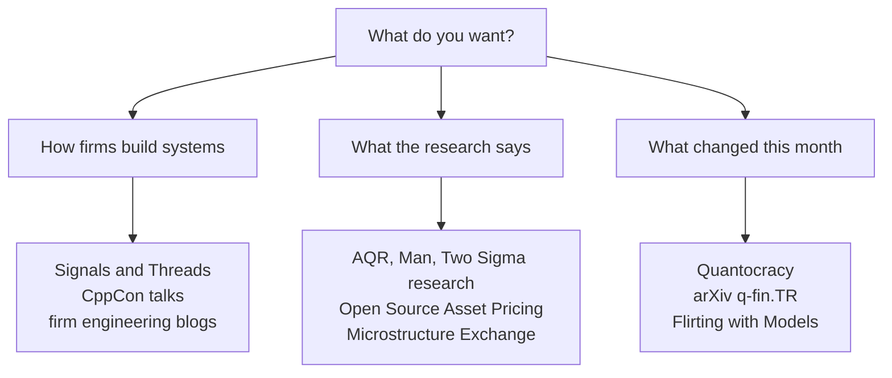

# Talks, podcasts and blogs

> **TL;DR**
>
> - Firms say more in podcasts, engineering blogs and conference talks than in any filing. Jane Street's *Signals and Threads* and Optiver engineers' CppCon talks are the best primary sources on how a trading firm is actually built.
> - Firm research blogs (AQR, Man Group, Two Sigma) are high quality but written by asset managers with products to sell. Read them as well-argued advocacy, and look for the paper behind each chart.
> - For staying current: Quantocracy aggregates, *Flirting with Models* interviews, the Open Source Asset Pricing project lets you check factor claims yourself, and arXiv q-fin.TR is where microstructure research appears first.
> - Every URL below was checked in 2026-11. Some sites block automated checkers but load in a browser.

**Level:** Core · **Read time:** ~8 min · **Last verified:** 2026-11

**How to read an entry.** ★ means general audience; ★★ assumes you know the KB's vocabulary; ★★★ assumes engineering or graduate-level math. Firm-produced content is primary evidence about *that firm's* views and technology. It is not evidence that a technique works, and never evidence about other firms.

## Podcasts

- [Verified] Jane Street (2020–). *Signals and Threads*, hosted by Ron Minsky. <https://signalsandthreads.com/> (accessed 2026-11) — ★★ · Long-form conversations with Jane Street engineers and researchers. The tone is engineering-first and the content is unusually concrete for a trading firm. Start with the four episodes below. Backs [Anatomy of an HFT trading loop](../03-algorithms/f-market-making-and-hft-algorithms/anatomy-of-an-hft-trading-loop.md) · [Trading and research tech stacks](../05-infrastructure/trading-and-research-tech-stacks.md).
- [Verified] Jane Street (2020-09-09). "Programmable Hardware with Andy Ray." *Signals and Threads*, episode 1. <https://signalsandthreads.com/programmable-hardware/> (accessed 2026-11) — ★★ · Why and where a trading firm puts logic on [FPGAs](glossary.md#fpga), and what hardware design culture looks like there. Backs [How infrastructure constrains algorithms](../05-infrastructure/how-infrastructure-constrains-algorithms.md) · [Semiconductor lens](../05-infrastructure/semiconductor-lens.md).
- [Verified] Jane Street (2020-09-23). "Multicast and the Markets with Brian Nigito." *Signals and Threads*, episode 3. <https://signalsandthreads.com/multicast-and-the-markets/> (accessed 2026-11) — ★★ · How exchanges handle huge message rates with single-threaded matching engines and multicast market data. It is the best audio primer on the [direct feed](glossary.md#direct-feed) world. Backs [NBBO and market data](../01-market-structure/nbbo-and-market-data.md) · [The limit order book](../01-market-structure/the-limit-order-book.md).
- [Verified] Jane Street (2020-10-14). "Clock Synchronization with Chris Perl." *Signals and Threads*, episode 6. <https://signalsandthreads.com/clock-synchronization/> (accessed 2026-11) — ★★ · Why every host's clock must agree to within about 100 microseconds, and be proven to, before latency, markouts or regulatory timestamps mean anything. Backs [Adverse selection and markouts](../03-algorithms/f-market-making-and-hft-algorithms/adverse-selection-and-markouts.md) · [Colocation, networks and the speed of light](../05-infrastructure/colocation-networks-and-the-speed-of-light.md).
- [Verified] Jane Street (2025-03-10). "Finding Signal in the Noise: Machine Learning and the Markets with In Young Cho." *Signals and Threads*, episode 22. <https://signalsandthreads.com/finding-signal-in-the-noise/> (accessed 2026-11) — ★★ · ML in a low-data, high-noise, regime-shifting setting, the move from linear models to deep nets, and the tension between research tools and production systems. Backs [ML-driven short-horizon alpha](../02-strategies/c-statistical-arbitrage/ml-driven-short-horizon-alpha.md) · [Neural nets and sequence models](../03-algorithms/b-forecasting-models/neural-nets-and-sequence-models.md).
- [Verified] Hoffstein, C. (host) (n.d.). *Flirting with Models*. <https://www.flirtingwithmodels.com/> (accessed 2026-11) — ★★ · Interviews with people who design systematic strategies (trend, factors, volatility, portfolio construction), still running in its seventh season in 2026. The research library at <https://blog.thinknewfound.com/> is a useful companion. Backs [Trend following and CTAs](../02-strategies/g-futures-and-macro-context/trend-following-and-ctas.md) · [Factor timing, crowding and quant winters](../02-strategies/e-risk-premia-and-factors/factor-timing-crowding-and-quant-winters.md).
- [Verified] Kaastrup-Larsen, N. (host). *Top Traders Unplugged*. <https://www.toptradersunplugged.com/> (accessed 2026-11) — ★ · A long-running podcast centred on CTAs and trend followers, with recurring "systematic investor" panels. It is useful for how managed-futures managers explain drawdowns to clients. Backs [Trend following and CTAs](../02-strategies/g-futures-and-macro-context/trend-following-and-ctas.md).

## Conference talks and seminar series

- [Verified] Cook, C. (2017). "When a Microsecond Is an Eternity: High Performance Trading Systems in C++." CppCon 2017 (Optiver). <https://www.youtube.com/watch?v=NH1Tta7purM> (accessed 2026-11) — ★★★ · The classic low-latency talk. It covers the hot path, cache warming, avoiding allocation and branching, measuring tick-to-trade, and the risk rule "if in doubt, pull your orders". Slides are on the CppCon GitHub. Backs [Anatomy of an HFT trading loop](../03-algorithms/f-market-making-and-hft-algorithms/anatomy-of-an-hft-trading-loop.md) · [Algorithmic risk controls](../03-algorithms/f-market-making-and-hft-algorithms/algorithmic-risk-controls.md).
- [Verified] Gross, D. (2024). "When Nanoseconds Matter: Ultrafast Trading Systems in C++." CppCon 2024. <https://www.youtube.com/watch?v=sX2nF1fW7kI> (accessed 2026-11) — ★★★ · A modern companion to Cook's talk, on data-structure and concurrency design for a trading system's hot path. Backs [Trading and research tech stacks](../05-infrastructure/trading-and-research-tech-stacks.md) · [Order types and auctions](../01-market-structure/order-types-and-auctions.md).
- [Verified] CppCon (n.d.). CppCon YouTube channel. <https://www.youtube.com/@CppCon> (accessed 2026-11) — ★★★ · Search it for "trading" and "low latency": several firms present every year. Treat each talk as one firm's practice, not the industry's. Backs [How infrastructure constrains algorithms](../05-infrastructure/how-infrastructure-constrains-algorithms.md).
- [Verified] Jane Street (n.d.). Tech Talks. <https://www.janestreet.com/tech-talks/> (accessed 2026-11) — ★★★ · Recorded engineering talks by Jane Street staff and guests. With the tech blog, it is the primary source on the firm's OCaml-centred stack. Backs [Trading and research tech stacks](../05-infrastructure/trading-and-research-tech-stacks.md).
- [Verified] The Microstructure Exchange (n.d.). Online seminar series. <https://microstructure.exchange/> (accessed 2026-11) — ★★★ · Recorded academic seminars on market microstructure, often working papers a year or two before publication. Backs [Equity market making](../02-strategies/a-liquidity-provision/equity-market-making.md) · [Latency arbitrage](../02-strategies/b-speed-and-structural/latency-arbitrage.md).

## Firm research and engineering blogs

- [Verified] Jane Street (n.d.). Jane Street Tech Blog. <https://blog.janestreet.com/> (accessed 2026-11) — ★★★ · Engineering posts, mostly about OCaml, build systems and tooling. Useful for culture and stack and silent on strategies, as you would expect. Backs [Trading and research tech stacks](../05-infrastructure/trading-and-research-tech-stacks.md).
- [Verified] Hudson River Trading (n.d.). HRT Beat. <https://www.hudsonrivertrading.com/hrtbeat/> (accessed 2026-11) — ★★ · HRT's engineering and research blog. The site may block automated checkers. Backs [Trading and research tech stacks](../05-infrastructure/trading-and-research-tech-stacks.md).
- [Verified] Two Sigma (n.d.). Insights and articles. <https://www.twosigma.com/insights/> (accessed 2026-11) — ★★ · Data-science and factor-risk articles, including material on its factor-lens framework. Backs [Risk models](../03-algorithms/d-portfolio-construction/risk-models.md) · [Factor investing fundamentals](../02-strategies/e-risk-premia-and-factors/factor-investing-fundamentals.md).
- [Verified] Man Group (n.d.). Man Insights (including the Man Institute). <https://www.man.com/insights> (accessed 2026-11) — ★★ · Research notes from a large systematic manager on trend following, volatility targeting, trading costs and ML. Backs [Trend following and CTAs](../02-strategies/g-futures-and-macro-context/trend-following-and-ctas.md) · [Position sizing and risk budgeting](../03-algorithms/d-portfolio-construction/position-sizing-and-risk-budgeting.md).
- [Verified] AQR Capital Management (n.d.). Research library. <https://www.aqr.com/Insights/Research> (accessed 2026-11) — ★★ · Working papers and journal articles on value, momentum, carry, defensive and trading costs. Many factor papers in the [Papers](papers.md) list originate here. Backs [Factor investing fundamentals](../02-strategies/e-risk-premia-and-factors/factor-investing-fundamentals.md) · [Momentum](../02-strategies/e-risk-premia-and-factors/momentum.md).
- [Verified] Asness, C. (n.d.). *Cliff's Perspectives*. AQR Capital Management. <https://www.aqr.com/Insights/Perspectives> (accessed 2026-11) — ★ · A founder's essays, often on value's drawdown, factor timing and critics of quant. Read them as the strongest statement of one side of [contested debates](../08-calibration/contested-debates.md). Backs [Factor timing, crowding and quant winters](../02-strategies/e-risk-premia-and-factors/factor-timing-crowding-and-quant-winters.md).
- [Verified] Optiver (n.d.). Insights and explainers. <https://www.optiver.com/insights/> (accessed 2026-11) — ★ · Plain-English explainers from a market maker on market making, options pricing, the Greeks and ETFs, plus market-structure opinion pieces. Backs [Options market making](../02-strategies/a-liquidity-provision/options-market-making.md) · [ETF market making](../02-strategies/a-liquidity-provision/etf-market-making.md).
- [Verified] IMC Trading (n.d.). Blogs. <https://www.imc.com/us/blogs> (accessed 2026-11) — ★ · Mostly careers and culture, with occasional research-team write-ups from ML conferences. It is good for understanding [roles and teams](../04-industry-and-firms/roles-teams-and-careers.md), thin on markets.
- [Reported] Orosz, G., Klaric, I. & Spevack, J. (2026-08-11). "Software engineering at a proprietary trading company: Optiver." *The Pragmatic Engineer*. <https://newsletter.pragmaticengineer.com/p/optiver> (accessed 2026-11) — ★★ · A reported profile of how a market maker's engineering organization works. Backs [Trading and research tech stacks](../05-infrastructure/trading-and-research-tech-stacks.md) · [Roles, teams and careers](../04-industry-and-firms/roles-teams-and-careers.md).

## Independent blogs, aggregators and communities

- [Verified] Quantocracy (n.d.). Quant Mashup. <https://quantocracy.com/> (accessed 2026-11) — ★ · A daily aggregator of quant blog posts and papers. Quality varies from excellent to retail backtest spam, so filter by author. Backs [Sanity-checking claims](../08-calibration/sanity-checking-claims.md).
- [Verified] Alpha Architect (n.d.). Blog. <https://alphaarchitect.com/blog/> (accessed 2026-11) — ★★ · Accessible reviews of academic factor and anomaly papers. The firm also issues factor ETFs, so weigh the framing. Backs [Factor investing fundamentals](../02-strategies/e-risk-premia-and-factors/factor-investing-fundamentals.md).
- [Verified] Chen, A. Y. & Zimmermann, T. (n.d.). Open Source Asset Pricing. <https://www.openassetpricing.com/> (accessed 2026-11) — ★★ · Code and data reproducing more than 300 published cross-sectional predictors, with release notes that document fixes, including an October 2024 look-ahead fix. It is the fastest way to check a factor claim yourself. Backs [Factor investing fundamentals](../02-strategies/e-risk-premia-and-factors/factor-investing-fundamentals.md) · [Feature engineering](../03-algorithms/a-data-and-signals/feature-engineering.md).
- [Verified] Carver, R. (n.d.). *This Blog is Systematic*. <https://qoppac.blogspot.com/> (accessed 2026-11) — ★★ · A practitioner's long-running blog on systematic futures trading: position sizing, costs, forecast combination and backtest hygiene, with open-source code. Backs [Position sizing and risk budgeting](../03-algorithms/d-portfolio-construction/position-sizing-and-risk-budgeting.md) · [Alpha combination](../03-algorithms/b-forecasting-models/alpha-combination-and-ensembling.md).
- [Verified] Chan, E. P. (n.d.). *Quantitative Trading* blog. <https://epchan.blogspot.com/> (accessed 2026-11) — ★ · The author of two books on the [Books](books.md) list writes here on mean reversion, ML and regime ideas, with a retail-to-small-fund perspective. Backs [Pairs trading and cointegration](../02-strategies/c-statistical-arbitrage/pairs-trading-and-cointegration.md).
- [Verified] Abdelmessih, K. (n.d.). *Moontower*. <https://moontower.substack.com/> (accessed 2026-11) — ★ · Options and volatility intuition from a former options trader: why vol is the traded asset, how market makers think about edge and risk. Backs [Volatility risk premium and vol arb](../02-strategies/f-volatility-and-derivatives/volatility-risk-premium-and-vol-arb.md) · [Options market making](../02-strategies/a-liquidity-provision/options-market-making.md).
- [Verified] Mechanical Markets (n.d.). Blog. <https://mechanicalmarkets.wordpress.com/> (accessed 2026-11) — ★★ · An infrequent but sharp blog on HFT economics and market-structure proposals such as retail order auctions. Backs [Retail flow internalization](../02-strategies/a-liquidity-provision/retail-flow-internalization.md) · [Latency arbitrage](../02-strategies/b-speed-and-structural/latency-arbitrage.md).
- [Verified] López de Prado, M. (n.d.). Quantitative Research (papers and slides). <https://www.quantresearch.org/> (accessed 2026-11) — ★★★ · Free versions of the author's papers and lecture slides on backtest overfitting, HRP and financial ML. Backs [Overfitting and multiple testing](../03-algorithms/c-validation-and-backtesting/overfitting-and-multiple-testing.md).
- [Verified] Quantpedia (n.d.). Encyclopedia of quantitative trading strategies. <https://quantpedia.com/> (accessed 2026-11) — ★ · A catalogue of published strategies with summaries and paper links (partly paywalled). It is useful as an index, but its backtests are not evidence. Backs [How quants evaluate a strategy](../02-strategies/how-quants-evaluate-a-strategy.md).
- [Verified] Cboe Global Markets (n.d.). Insights. <https://www.cboe.com/insights/> (accessed 2026-11) — ★ · Exchange commentary and monthly volume statistics for options and VIX products, including 0DTE share. It is a primary source for options-market numbers. Backs [Options market making](../02-strategies/a-liquidity-provision/options-market-making.md).
- [Verified] Quantitative Finance Stack Exchange (n.d.). <https://quant.stackexchange.com/> (accessed 2026-11) — ★★ · Q&A where practitioners answer pricing, risk and microstructure questions. Good answers are excellent, but check the votes and the author. Backs [Questions to ask](../07-conversation-playbook/questions-to-ask.md).
- [Verified] arXiv (n.d.). Quantitative Finance: Trading and Market Microstructure (q-fin.TR), recent submissions. <https://arxiv.org/list/q-fin.TR/recent> (accessed 2026-11) — ★★★ · Where microstructure, execution and market-making preprints appear first. Preprints are unrefereed. Backs [Order-book and trade-flow signals](../03-algorithms/f-market-making-and-hft-algorithms/order-book-and-trade-flow-signals.md).

## Related pages

- [Books](books.md) and [Papers](papers.md): the longer and more rigorous sources behind these.
- [How to talk to a quant](../07-conversation-playbook/how-to-talk-to-a-quant.md): citing a firm's own podcast or talk is the cheapest credibility you can buy.
- [Trading and research tech stacks](../05-infrastructure/trading-and-research-tech-stacks.md): where the engineering talks are used.
- [Sanity-checking claims](../08-calibration/sanity-checking-claims.md): how to read firm marketing and blog backtests.
