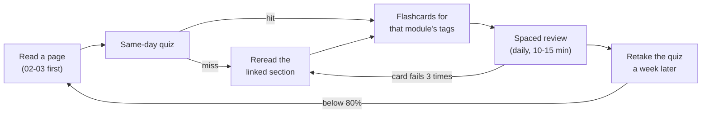

# Self-test

> **TL;DR**
>
> - Ten quizzes, one per module. The two priority modules (strategies and algorithms) get about twice as many questions as the others.
> - [`flashcards.csv`](flashcards.csv) holds 425 cards, 69% of them on strategies and algorithms. Every answer ends with the path of the page that explains it.
> - Use both in a loop: read a page, quiz yourself the same day, put misses into spaced repetition, and reread the linked page when a card keeps failing.

**Level:** Core · **Read time:** ~3 min · **Last verified:** 2026-11

## The quizzes

Each question is marked basic, informed or sharp, and its answer sits in a collapsed block that links to the page that explains it. Answer out loud or on paper before you open it; recall you had to work for is what sticks. A miss means reread the linked page, not just the answer. Take a module's quiz right after you finish the module, then again a week later.

| Quiz | Module | Questions |
|---|---|---|
| [Quiz 00](quiz-00-start-here.md) | Start here | 12 |
| [Quiz 01](quiz-01-market-structure.md) | Market structure | 15 |
| [Quiz 02 ★](quiz-02-strategies.md) | Strategies | 30 |
| [Quiz 03 ★](quiz-03-algorithms.md) | Algorithms | 30 |
| [Quiz 04](quiz-04-industry-and-firms.md) | Industry and firms | 15 |
| [Quiz 05](quiz-05-infrastructure.md) | Infrastructure | 14 |
| [Quiz 06](quiz-06-risk-and-regulation.md) | Risk and regulation | 14 |
| [Quiz 07](quiz-07-conversation-playbook.md) | Conversation playbook | 15 |
| [Quiz 08](quiz-08-calibration.md) | Calibration | 14 |
| [Quiz 09](quiz-09-reference.md) | Reference | 12 |

## The flashcards

[`flashcards.csv`](flashcards.csv) is UTF-8 with three columns, `front,back,tags`, and RFC 4180 quoting. Card types mix definitions, "why" questions, numbers, formulas and "spot the error" statements. Each back ends with a page path relative to `docs/`, such as `(02-strategies/a-liquidity-provision/equity-market-making.md)`.

| First tag | Cards | Source |
|---|---|---|
| `strategies` | 134 | module 02 |
| `algorithms` | 159 | module 03, including walkthroughs |
| `market-structure`, `start-here` | 41 | modules 01 and 00 |
| `industry`, `infrastructure`, `risk-regulation`, `conversation`, `calibration` | 69 | modules 04–08, including firm profiles |
| `reference` | 22 | the [glossary](../09-reference/glossary.md) |

Later tags name the topic (`market-making`, `stat-arb`, `portfolio`, `execution`) and the card type (`definition`, `why`, `number`, `formula`, `spot-the-error`, `failure`), so you can drill one slice, for example every `formula` card in `algorithms`.

**Importing into Anki** ([Anki manual](https://docs.ankiweb.net/manual/importing/text-files)):

1. Download the file and choose **File → Import**.
2. Set the field separator to **Comma** and pick a Basic note type and a deck.
3. Map column 1 to **Front**, column 2 to **Back** and column 3 to **Tags**.
4. The first line (`front,back,tags`) is a header. If your Anki version imports it as a card, delete that one note in the browser.

Any CSV-aware flashcard app or spreadsheet works the same way: first row is the header, three columns.

## A study loop

On the [Core Path](../00-start-here/learning-paths.md), quiz 02 and quiz 03 are the ones to retake until they feel easy. The flashcards' `number` cards double as a pre-meeting refresher alongside the [one-page cheat sheet](../00-start-here/one-page-cheat-sheet.md).

## Related pages

- [Learning paths](../00-start-here/learning-paths.md)
- [One-page cheat sheet](../00-start-here/one-page-cheat-sheet.md)
- [Strategies: the map](../02-strategies/index.md)
- [Algorithms: overview](../03-algorithms/index.md)
- [Glossary](../09-reference/glossary.md)

## Sources

- [Verified] Anki Docs. "Text Files" (Importing). <https://docs.ankiweb.net/manual/importing/text-files> (accessed 2026-11)
