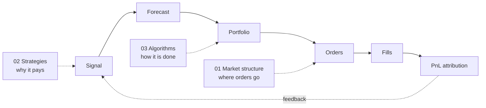

# Quant Trading Knowledge Base

**How quantitative trading firms trade US equities, with strategies and algorithms first.**

**Last updated:** 2026-11

## What this is

This knowledge base covers what quant firms actually trade, why each strategy makes money, and who is on the other side. It then covers the concrete algorithms inside the research-and-trading pipeline: signal construction, forecasting, validation, risk models and optimization, execution, and market-making logic. The goal is a medium-deep, accurate mental model: enough to discuss any strategy family with a quant, follow an idea from signal to P&L, read short Python for the core algorithms, and tell real insight from marketing.

## Who it is for

A finance professional who is comfortable with valuation, accounting, capital markets and filings, has CFA-level statistics, and reads Python without being a production engineer. Finance basics are skipped. Microstructure, stat-arb math, finance-specific machine-learning pitfalls, optimization, execution theory and market-making models are taught from first principles. Intuition comes first, numbers second, and math sits in collapsible blocks.

## Start with strategies and algorithms

Two modules carry this knowledge base and get most of its words, labs and fact-checking. [Strategies](02-strategies/index.md) holds 30 dossiers. [Algorithms](03-algorithms/index.md) holds 39 cards and 4 end-to-end walkthroughs. A good first hour:

1. [The big picture](00-start-here/the-big-picture.md): the whole industry on one page.
2. [Strategies: the map](02-strategies/index.md): who makes money doing what.
3. [There is no single algorithm](03-algorithms/there-is-no-single-algorithm.md): five canonical pipelines, with pseudocode.
4. One walkthrough, such as [a mid-frequency stat-arb book](03-algorithms/h-end-to-end-walkthroughs/walkthrough-mid-frequency-stat-arb.md).

[Learning paths](00-start-here/learning-paths.md) suggests other routes, including a short Core Path.

## Module map

| # | Module | Start here | What you get |
|---|---|---|---|
| 00 | Start here | [The big picture](00-start-here/the-big-picture.md) | Orientation, learning paths, a one-page cheat sheet |
| 01 | Market structure | [Life of a stock order](01-market-structure/life-of-a-stock-order.md) | Only what strategies and algorithms depend on |
| **02** | **Strategies ★** | [Strategies: the map](02-strategies/index.md) | 30 dossiers: edge, counterparty, capacity, how it fails |
| **03** | **Algorithms ★** | [Algorithms: overview](03-algorithms/index.md) | 39 cards, five pipelines, 4 walkthroughs |
| 04 | Industry and firms | [Taxonomy of quant firms](04-industry-and-firms/taxonomy-of-quant-firms.md) | Firm types, economics, short firm profiles |
| 05 | Infrastructure | [How infrastructure constrains algorithms](05-infrastructure/how-infrastructure-constrains-algorithms.md) | Colocation, networks, tech stacks, a semiconductor lens |
| 06 | Risk and regulation | [Risk management at quant firms](06-risk-and-regulation/risk-management-at-quant-firms.md) | Risk practice and the rules that shape strategies |
| 07 | Conversation playbook | [How to talk to a quant](07-conversation-playbook/how-to-talk-to-a-quant.md) | Elevator explanations, questions to ask, mock conversations |
| 08 | Calibration | [Myths vs reality](08-calibration/myths-vs-reality.md) | Myths, contested debates, sanity checks |
| 09 | Reference | [Glossary](09-reference/glossary.md) | Glossary, acronyms, books, papers, datasets |
| 10 | Self-test | [Self-test](10-self-test/index.md) | Quizzes and flashcards |

## The labs

Twenty small Python labs on synthetic data make the core algorithms concrete. They range from a matching engine and Avellaneda-Stoikov quoting to purged cross-validation, mean-variance optimization and the Almgren-Chriss frontier. Each is a single deterministic script, small enough to run on a laptop, and its plots are embedded in the relevant pages. See [Labs](labs.md) for the list, or browse the [code on GitHub](https://github.com/FrankHuang94/quant_trading_claude/tree/main/labs).

## How to read confidence tags

Every number and every firm-specific claim carries a tag:

| Tag | Meaning | Example of use |
|---|---|---|
| `[Verified]` | Primary source: a regulator's rule or order, an exchange document, a filing, a paper | What SEC Rule 15c3-5 requires of broker-dealers with market access |
| `[Reported]` | Credible secondary source: reputable press, a practitioner book | Press coverage of a firm's IPO filing |
| `[Estimate]` | Derived in this KB; the reasoning is shown next to it | How long an optimizer takes to solve for 3,000 stocks |
| `[Lore]` | Widely repeated but unverified | Industry rules of thumb |

Sharpe ratios, capacity and return figures also state gross or net, the period, and the source type (academic backtest, fund disclosure or practitioner estimate). Numbers in worked examples are labeled *illustrative*.

## How this was built and its limitations

- **AI-assisted.** The KB was researched and written with AI assistance from public sources: papers, regulators' documents, filings, firm talks and blogs, reputable press and practitioner books. The [master bibliography](https://github.com/FrankHuang94/quant_trading_claude/blob/main/references/sources.md) lists them.
- **Public sources only.** Firm details come from public sources. Nothing here is inside information, and no firm's proprietary strategy is described as fact unless it is publicly documented.
- **Synthetic labs.** The labs run on simulated markets. They show mechanisms, not achievable returns.
- **Dated.** Market structure and regulation change. Time-sensitive facts are dated "as of 2026-11" and will go stale.
- **Not investment advice.** This is educational material. Errors are possible; corrections are welcome as GitHub issues.
