# Labs

> **TL;DR**
>
> - 20 runnable Python labs on **synthetic data**, each backing specific strategy dossiers and algorithm cards.
> - The simulator (`labs/common/simulate.py`) plants effects of *known* strength, so every lab can show whether a method recovers the truth, and how often noise fools it.
> - Lab Sharpe ratios and P&Ls are **stylized**: they illustrate mechanisms and comparisons, not real-world levels. Each lab README lists what the toy misses.

**Level:** Core · **Last verified:** 2026-11

Run everything with `make labs` (about 4 minutes) or one lab with `python labs/NN-name/lab.py`; `--smoke` runs a tiny version (what CI runs). Plots below are from the committed full runs (seed 7).

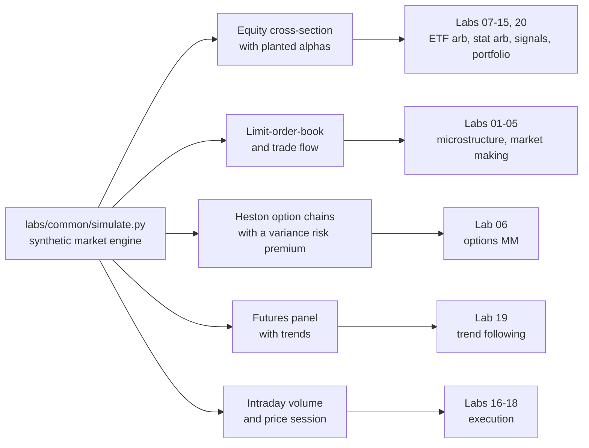

## Market microstructure and market making

### Lab 01: Matching engine, price-time priority and the value of queue position

**Price-time priority on a hand-built book.** Six limit orders, then a market sell, a cancel and a marketable limit order.

**Supports:** [The limit order book](01-market-structure/the-limit-order-book.md) · [Queue position and order placement](03-algorithms/f-market-making-and-hft-algorithms/queue-position-and-order-placement.md)

**Code:** [`labs/01-matching-engine-order-book/`](https://github.com/FrankHuang94/quant_trading_claude/tree/main/labs/01-matching-engine-order-book) · run `python labs/01-matching-engine-order-book/lab.py`

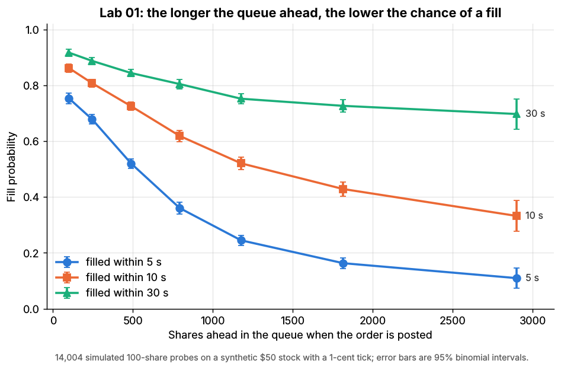

### Lab 02: Fair value from the order book: mid, weighted mid and the microprice

A market maker needs one number for "where the price really is" before it can quote around it. This lab builds three such fair-value estimators from the top of the book of a synthetic \$50 stock with a 1-cent tick, then tests them on simulated days they were not fitted on.

**Supports:** [Fair value and microprice](03-algorithms/f-market-making-and-hft-algorithms/fair-value-and-microprice.md) · [Order-book and trade-flow signals](03-algorithms/f-market-making-and-hft-algorithms/order-book-and-trade-flow-signals.md) · [Equity market making](02-strategies/a-liquidity-provision/equity-market-making.md)

**Code:** [`labs/02-microprice-fair-value/`](https://github.com/FrankHuang94/quant_trading_claude/tree/main/labs/02-microprice-fair-value) · run `python labs/02-microprice-fair-value/lab.py`

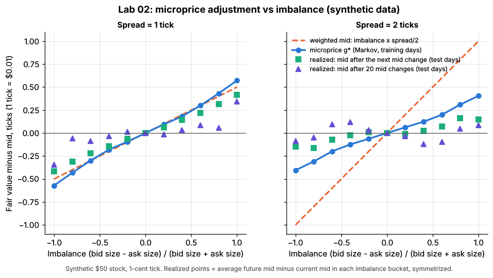

### Lab 03: Order-flow imbalance vs trade imbalance and queue imbalance

Short-horizon price moves are driven by the order flow at the best bid and ask. This lab reproduces the measurement of Cont, Kukanov & Stoikov (2014; "CKS") on a synthetic order book. It then asks the trader's question: how much of that flow *predicts* the next move, and can you trade on it?

**Supports:** [Order-book and trade-flow signals](03-algorithms/f-market-making-and-hft-algorithms/order-book-and-trade-flow-signals.md) · [Fair value and microprice](03-algorithms/f-market-making-and-hft-algorithms/fair-value-and-microprice.md) · [Adverse selection and markouts](03-algorithms/f-market-making-and-hft-algorithms/adverse-selection-and-markouts.md)

**Code:** [`labs/03-order-flow-imbalance/`](https://github.com/FrankHuang94/quant_trading_claude/tree/main/labs/03-order-flow-imbalance) · run `python labs/03-order-flow-imbalance/lab.py`

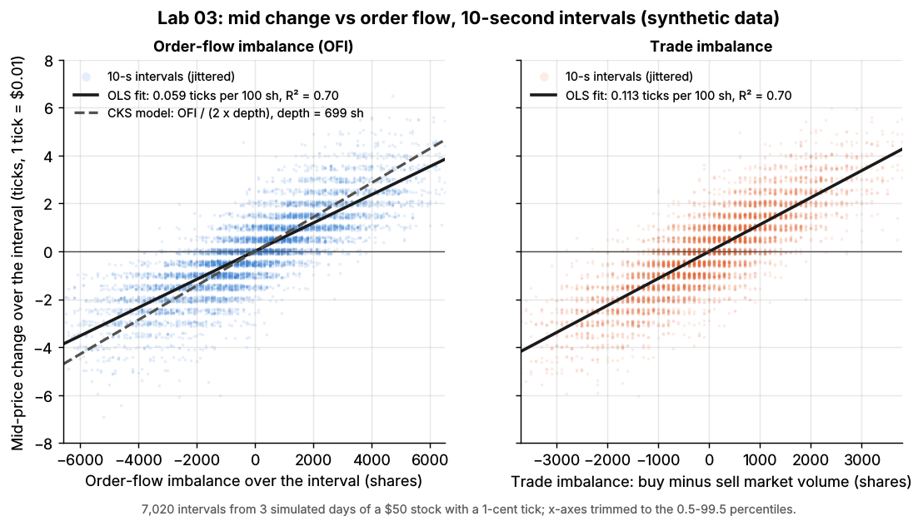

### Lab 04: Markout analysis: spread captured vs adverse selection, by segment

A **markout** asks: after I was filled, did the price move for me or against me? It is the standard tool market makers use to measure adverse selection, the cost of trading with someone who knows more. For a passive (liquidity-providing) fill at time $t$ and price $p$:

**Supports:** [Adverse selection and markouts](03-algorithms/f-market-making-and-hft-algorithms/adverse-selection-and-markouts.md) · [Equity market making](02-strategies/a-liquidity-provision/equity-market-making.md) · [Quoting and inventory control](03-algorithms/f-market-making-and-hft-algorithms/quoting-and-inventory-control.md) · [Transaction cost analysis](03-algorithms/e-execution-algorithms/transaction-cost-analysis.md)

**Code:** [`labs/04-markout-analysis/`](https://github.com/FrankHuang94/quant_trading_claude/tree/main/labs/04-markout-analysis) · run `python labs/04-markout-analysis/lab.py`

### Lab 05: Optimal market-making quotes: naive vs Avellaneda-Stoikov vs GLFT

A dealer in one stock posts a bid and an ask around the mid-price and earns the distance to the mid on every fill. The risk is **inventory**: every fill leaves the dealer long or short, and the mid keeps moving. This lab is a self-contained Monte Carlo of that problem, in the setting of the two papers that made it standard:

**Supports:** [Quoting and inventory control](03-algorithms/f-market-making-and-hft-algorithms/quoting-and-inventory-control.md) · [Equity market making](02-strategies/a-liquidity-provision/equity-market-making.md) · [Adverse selection and markouts](03-algorithms/f-market-making-and-hft-algorithms/adverse-selection-and-markouts.md) · [Fair value and microprice](03-algorithms/f-market-making-and-hft-algorithms/fair-value-and-microprice.md)

**Code:** [`labs/05-avellaneda-stoikov-glft-quoting/`](https://github.com/FrankHuang94/quant_trading_claude/tree/main/labs/05-avellaneda-stoikov-glft-quoting) · run `python labs/05-avellaneda-stoikov-glft-quoting/lab.py`

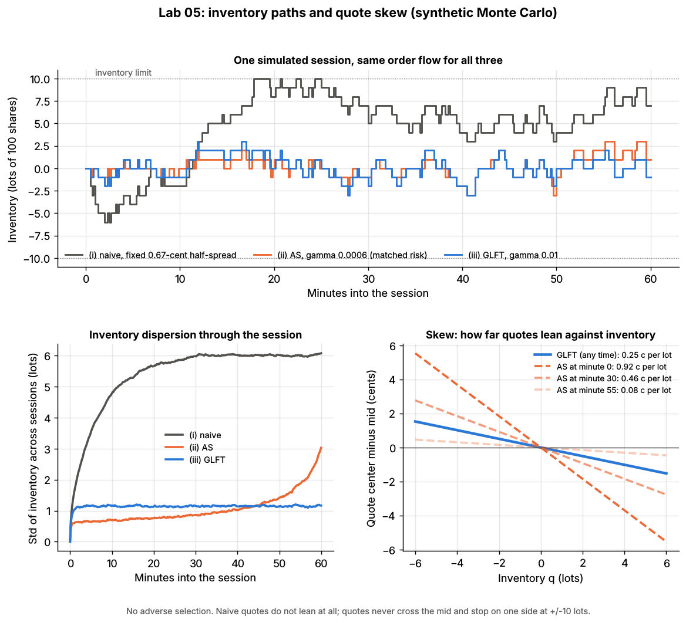

## Options, ETFs and arbitrage

### Lab 06: Options market making, delta hedging and Greeks P&L attribution

The lab uses a synthetic option market (`simulate_option_market`): eight years of a Heston stochastic-volatility underlying, with options priced under a risk-neutral Heston whose variance is 1.25 times the physical variance. That gap is the planted **variance risk premium (VRP)**. On this market the lab shows five things.

**Supports:** [Options market making](02-strategies/a-liquidity-provision/options-market-making.md) · [Options pricing and vol surfaces for market makers](03-algorithms/f-market-making-and-hft-algorithms/options-pricing-and-vol-surfaces-for-mm.md) · [Hedging algorithms](03-algorithms/f-market-making-and-hft-algorithms/hedging-algorithms.md)

**Code:** [`labs/06-options-mm-delta-hedging/`](https://github.com/FrankHuang94/quant_trading_claude/tree/main/labs/06-options-mm-delta-hedging) · run `python labs/06-options-mm-delta-hedging/lab.py`

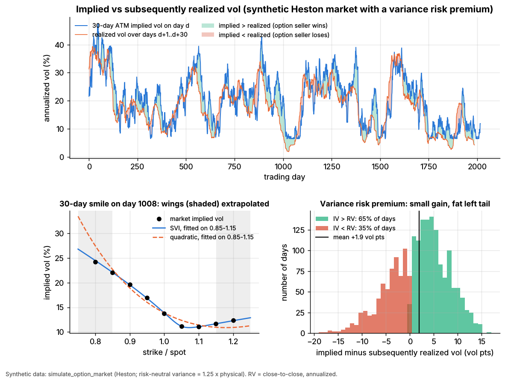

### Lab 07: ETF NAV arbitrage and the no-arbitrage band

An exchange-traded fund (ETF) trades at a price that can drift away from the value of what it holds (its NAV). **Authorized participants (APs)** pull the two back together by creating and redeeming ETF shares, but only when the gap is big enough to pay their costs. This lab builds the whole loop on synthetic data.

**Supports:** [ETF market making](02-strategies/a-liquidity-provision/etf-market-making.md) · [ETF and index arbitrage](02-strategies/b-speed-and-structural/etf-and-index-arbitrage.md)

**Code:** [`labs/07-etf-nav-arbitrage/`](https://github.com/FrankHuang94/quant_trading_claude/tree/main/labs/07-etf-nav-arbitrage) · run `python labs/07-etf-nav-arbitrage/lab.py`

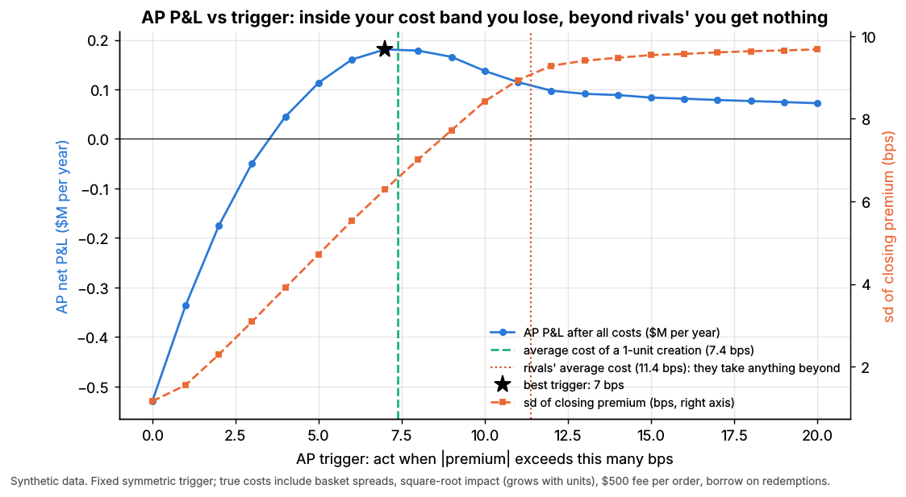

## Statistical arbitrage and factors

### Lab 08: Pairs trading, distance vs cointegration, with false discoveries and regime breaks

The market has 200 synthetic stocks and 5 years of daily total-return prices (`simulate_equity_market`). Stocks in the same sector share factor exposures, but their specific returns are independent, so **no natural pair is cointegrated**. On top of that, the lab **plants 8 cointegrated pairs**, clearly marked in `plant_pairs()`.

**Supports:** [Pairs trading and cointegration](02-strategies/c-statistical-arbitrage/pairs-trading-and-cointegration.md) · [Overfitting and multiple testing](03-algorithms/c-validation-and-backtesting/overfitting-and-multiple-testing.md) · [Transaction cost and impact models](03-algorithms/d-portfolio-construction/transaction-cost-and-impact-models.md)

**Code:** [`labs/08-pairs-cointegration/`](https://github.com/FrankHuang94/quant_trading_claude/tree/main/labs/08-pairs-cointegration) · run `python labs/08-pairs-cointegration/lab.py`

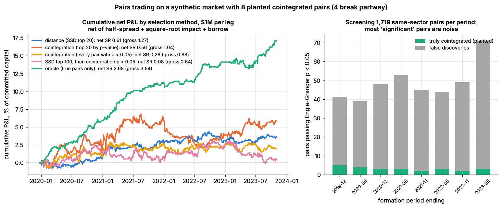

### Lab 09: PCA-residual statistical arbitrage (Avellaneda-Lee s-scores)

The market has 500 synthetic stocks and 5 years of daily data (`simulate_equity_market` with `reversal_strength = 0.04`). It contains a **real, known short-term reversal in specific returns**: minus the past 5-day specific return predicts the next day's specific return with a daily IC of 0.04. That is a strong, stylized effect. The lab runs the Avellaneda & Lee (2010) recipe on it:

**Supports:** [Factor-residual mean reversion](02-strategies/c-statistical-arbitrage/factor-residual-mean-reversion.md) · [Short-term cross-sectional reversal](02-strategies/c-statistical-arbitrage/short-term-cross-sectional-reversal.md) · [Risk models](03-algorithms/d-portfolio-construction/risk-models.md) · [Transaction cost and impact models](03-algorithms/d-portfolio-construction/transaction-cost-and-impact-models.md)

**Code:** [`labs/09-pca-residual-stat-arb/`](https://github.com/FrankHuang94/quant_trading_claude/tree/main/labs/09-pca-residual-stat-arb) · run `python labs/09-pca-residual-stat-arb/lab.py`

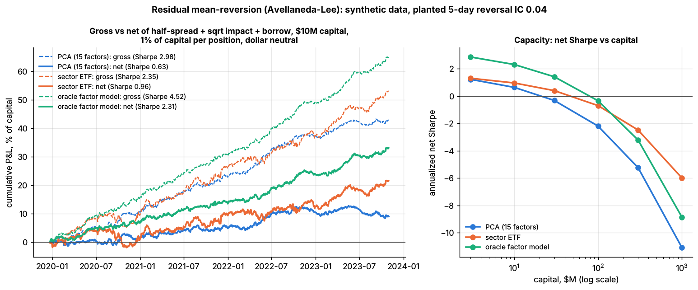

### Lab 10: Short-term reversal vs momentum, gross and net of trading costs

A synthetic 500-stock market (10 years of daily data from `simulate_equity_market`) has two planted effects of known size in the specific (residual) returns: a **1-week reversal** (daily IC 0.03 of minus the past 5-day specific return) and a **12-1 month momentum** (daily IC 0.01). Both magnitudes are stylized. The lab builds the two textbook books from **total** returns, as a trader would, and charges realistic costs:

**Supports:** [Short-term cross-sectional reversal](02-strategies/c-statistical-arbitrage/short-term-cross-sectional-reversal.md) · [Momentum](02-strategies/e-risk-premia-and-factors/momentum.md) · [Transaction cost and impact models](03-algorithms/d-portfolio-construction/transaction-cost-and-impact-models.md)

**Code:** [`labs/10-reversal-momentum-costs/`](https://github.com/FrankHuang94/quant_trading_claude/tree/main/labs/10-reversal-momentum-costs) · run `python labs/10-reversal-momentum-costs/lab.py`

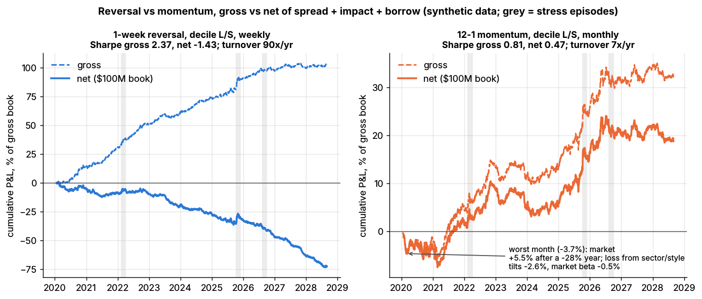

### Lab 19: Trend following with volatility targeting and risk budgeting

- **Time-series momentum (TSMOM)**, as in Moskowitz, Ooi & Pedersen (2012): each market is long if its own past return is positive and short if it is negative. The test bed is a synthetic panel of **24 futures** (6 equity index, 6 government bond, 6 FX, 6 commodity) over 20 years of daily excess returns (`simulate.simulate_futures`).

**Supports:** [Trend following and CTAs](02-strategies/g-futures-and-macro-context/trend-following-and-ctas.md) · [Position sizing and risk budgeting](03-algorithms/d-portfolio-construction/position-sizing-and-risk-budgeting.md)

**Code:** [`labs/19-trend-following-vol-targeting/`](https://github.com/FrankHuang94/quant_trading_claude/tree/main/labs/19-trend-following-vol-targeting) · run `python labs/19-trend-following-vol-targeting/lab.py`

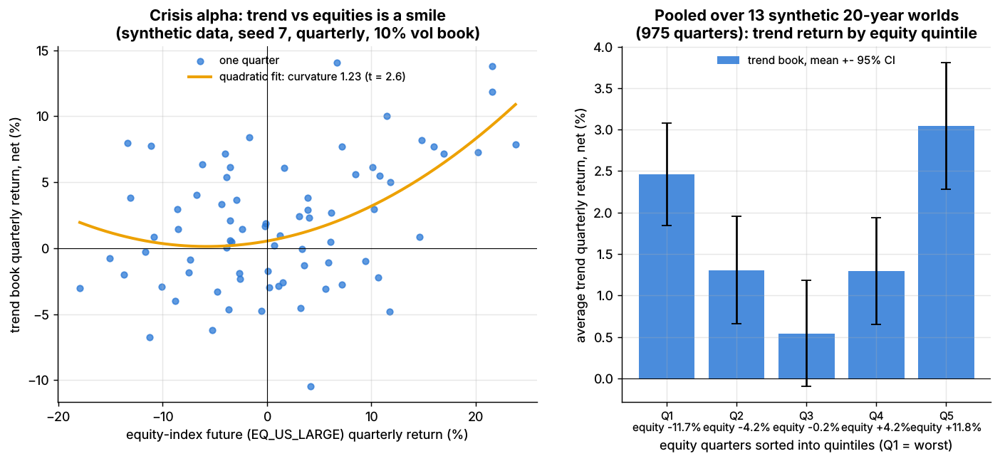

### Lab 20: Index reconstitution event study and the cost of crowding

- **A synthetic, Russell-style annual reconstitution.** The universe is 800 simulated stocks over 10 years (`simulate.simulate_equity_market`, with no planted stock alphas). On each rank day **R**, stocks are ranked by market cap. The index holds the top 400, with a ±10-rank band to limit turnover: a non-member joins if it ranks in the top 390, and a member leaves if it falls below 410.

**Supports:** [Flow-driven strategies](02-strategies/d-mid-frequency-alpha/flow-driven-strategies.md)

**Code:** [`labs/20-index-reconstitution-event-study/`](https://github.com/FrankHuang94/quant_trading_claude/tree/main/labs/20-index-reconstitution-event-study) · run `python labs/20-index-reconstitution-event-study/lab.py`

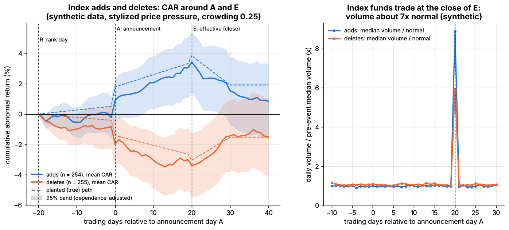

## Signals, combination and validation

### Lab 11: Signal transforms and information-coefficient diagnostics

The synthetic equity market (`labs/common/simulate.py`, 500 stocks x 1,260 days) plants three alphas whose strength and persistence are known exactly: `alpha_fast` (daily IC 0.04, half-life 2 days), `alpha_med` (0.03, 10 days) and `alpha_slow` (0.02, 60 days). The **information coefficient (IC)** is the cross-sectional correlation, on one date, between a signal and the return that follows; a signal is judged by the average and the stability of its daily IC.

**Supports:** [Signal transforms](03-algorithms/a-data-and-signals/signal-transforms.md) · [Evaluating signals](03-algorithms/a-data-and-signals/evaluating-signals.md) · [Cross-sectional alpha and neutralization](02-strategies/d-mid-frequency-alpha/cross-sectional-alpha-and-neutralization.md)

**Code:** [`labs/11-signal-transforms-ic/`](https://github.com/FrankHuang94/quant_trading_claude/tree/main/labs/11-signal-transforms-ic) · run `python labs/11-signal-transforms-ic/lab.py`

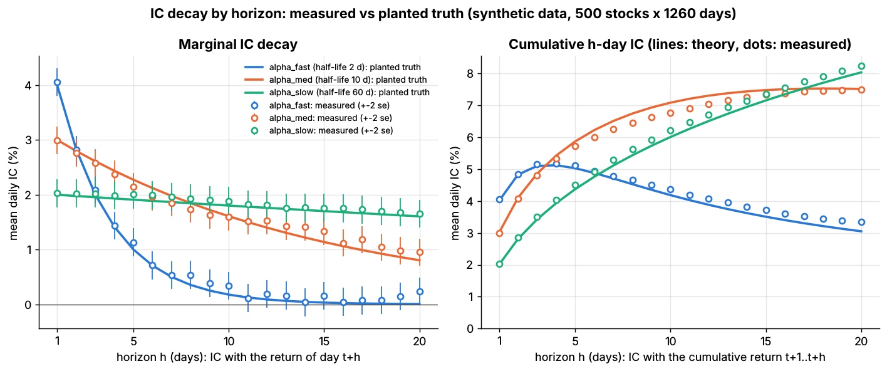

### Lab 12: Alpha combination and purged cross-validation

Fourteen signals on a synthetic 150-stock market (1,260 days) are combined into one forecast of each stock's **5-day forward residual return**, ranked per date. The signals are the three planted alphas (`alpha_fast`, `alpha_med`, `alpha_slow`: daily ICs 0.04 / 0.03 / 0.02, uncorrelated with each other), `alpha_fast_v2` (a noisier second measurement of `alpha_fast`, correlation ~0.85, as when two researchers build similar reversal signals) and 10 pure-noise signals.

**Supports:** [Alpha combination and ensembling](03-algorithms/b-forecasting-models/alpha-combination-and-ensembling.md) · [Time-series cross-validation](03-algorithms/c-validation-and-backtesting/time-series-cross-validation.md) · [Linear models and regularization](03-algorithms/b-forecasting-models/linear-models-and-regularization.md) · [tree ensembles](03-algorithms/b-forecasting-models/tree-ensembles.md)

**Code:** [`labs/12-alpha-combination-purged-cv/`](https://github.com/FrankHuang94/quant_trading_claude/tree/main/labs/12-alpha-combination-purged-cv) · run `python labs/12-alpha-combination-purged-cv/lab.py`

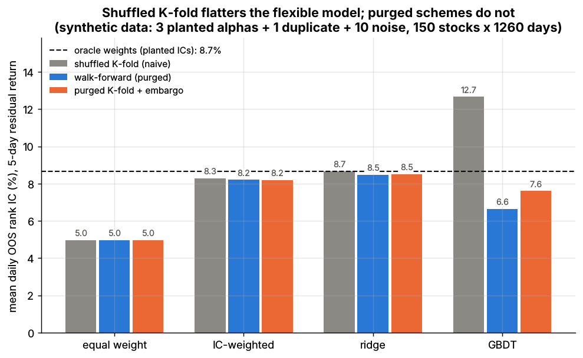

### Lab 13: Backtest overfitting, the Deflated Sharpe Ratio and PBO

A researcher tries many strategies and reports the best backtest. This lab shows how much of that "best" is luck, and how two published corrections measure it.

**Supports:** [Overfitting and multiple testing](03-algorithms/c-validation-and-backtesting/overfitting-and-multiple-testing.md)

**Code:** [`labs/13-backtest-overfitting-dsr-pbo/`](https://github.com/FrankHuang94/quant_trading_claude/tree/main/labs/13-backtest-overfitting-dsr-pbo) · run `python labs/13-backtest-overfitting-dsr-pbo/lab.py`

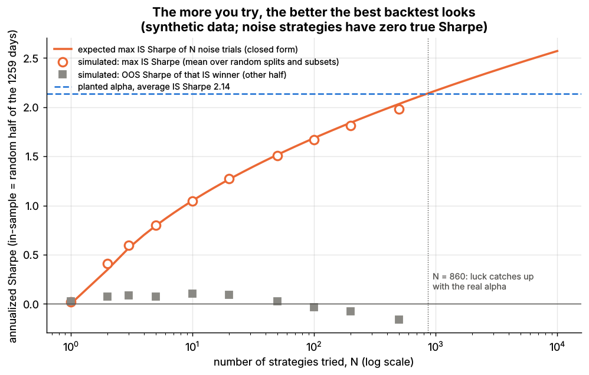

## Portfolio construction

### Lab 14: Risk models, covariance shrinkage and constrained mean-variance optimization

- **Four covariance estimators** for 500 simulated stocks, each fitted on a trailing 252-day window of daily returns. Because N = 500 > T = 252, the sample covariance is singular (rank 251). 1. the **sample covariance**; 2. **Ledoit-Wolf (2004) shrinkage** toward a scaled identity, via scikit-learn's `LedoitWolf`; 3. a **statistical PCA factor model**: the top k = 16 principal components plus a diagonal of specific variances; 4.

**Supports:** [Risk models](03-algorithms/d-portfolio-construction/risk-models.md) · [Covariance estimation and shrinkage](03-algorithms/d-portfolio-construction/covariance-estimation-and-shrinkage.md) · [Mean-variance optimization](03-algorithms/d-portfolio-construction/mean-variance-optimization.md)

**Code:** [`labs/14-risk-model-mvo/`](https://github.com/FrankHuang94/quant_trading_claude/tree/main/labs/14-risk-model-mvo) · run `python labs/14-risk-model-mvo/lab.py`

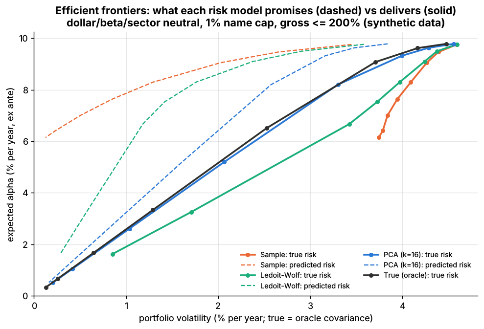

### Lab 15: Trading toward the aim (Gârleanu-Pedersen)

- **The Gârleanu & Pedersen (2013) result.** Suppose returns are predictable from signals that decay at known rates, and trading costs are quadratic (`cost = 1/2 * lam * dx' Sigma dx`, so impact grows with trade size). Then the optimal policy is to trade a **fixed fraction of the way toward an "aim" portfolio** every day:

**Supports:** [Multi-period optimization and trading toward the aim](03-algorithms/d-portfolio-construction/multi-period-and-trading-toward-aim.md)

**Code:** [`labs/15-trading-toward-aim/`](https://github.com/FrankHuang94/quant_trading_claude/tree/main/labs/15-trading-toward-aim) · run `python labs/15-trading-toward-aim/lab.py`

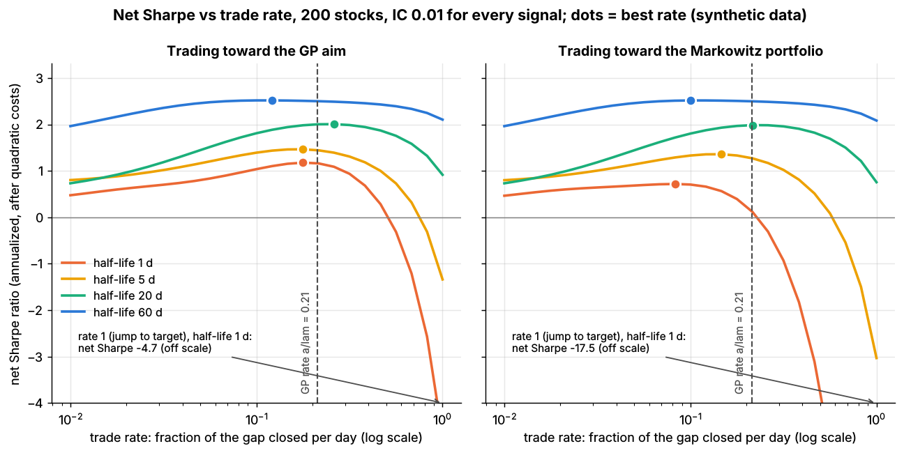

## Execution

### Lab 16: Almgren-Chriss optimal execution frontier

- The closed-form **Almgren & Chriss (2000)** optimal liquidation trajectory: holdings decay like `sinh(kappa (T - t)) / sinh(kappa T)`, where the urgency `kappa = sqrt(lambda sigma^2 / eta)` grows with risk aversion `lambda`. `lambda = 0` gives TWAP (a straight line).

**Supports:** [Implementation shortfall and Almgren-Chriss](03-algorithms/e-execution-algorithms/implementation-shortfall-and-almgren-chriss.md)

**Code:** [`labs/16-almgren-chriss-frontier/`](https://github.com/FrankHuang94/quant_trading_claude/tree/main/labs/16-almgren-chriss-frontier) · run `python labs/16-almgren-chriss-frontier/lab.py`

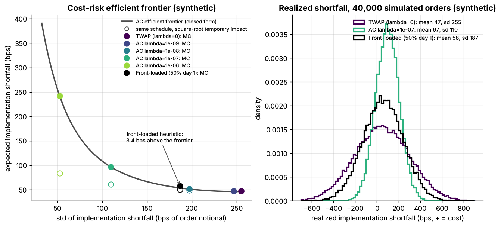

### Lab 17: VWAP, TWAP, POV and the closing auction

- **A one-day buy order for 10% of ADV** (500,000 shares of a \$50 stock, \$25M), executed on 500 simulated trading days (`simulate_intraday_session`: 390 one-minute bars plus a closing auction that carries 10% of the day's volume). Four schedules: 1. **TWAP:** equal slices every minute of the continuous session; 2.

**Supports:** [VWAP, TWAP and POV](03-algorithms/e-execution-algorithms/vwap-twap-pov.md) · [Execution algorithms: overview](03-algorithms/e-execution-algorithms/execution-algorithms-overview.md)

**Code:** [`labs/17-vwap-twap-pov/`](https://github.com/FrankHuang94/quant_trading_claude/tree/main/labs/17-vwap-twap-pov) · run `python labs/17-vwap-twap-pov/lab.py`

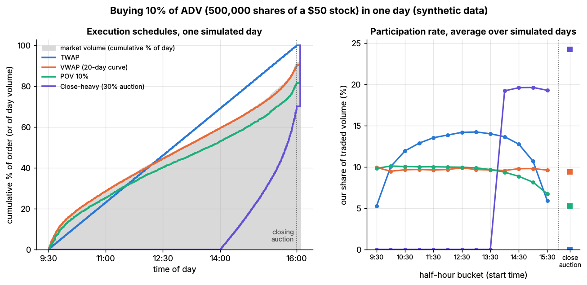

### Lab 18: Smart order router toy

- A toy **smart order router (SOR)** choosing among six stylized US-equity venues: two maker-taker lit exchanges (high and standard rebate), an inverted lit exchange, a low-fee lit exchange, and two **midpoint dark pools**, one with natural contra flow and one full of fast, toxic flow.

**Supports:** [Smart order routing](03-algorithms/e-execution-algorithms/smart-order-routing.md)

**Code:** [`labs/18-smart-order-router/`](https://github.com/FrankHuang94/quant_trading_claude/tree/main/labs/18-smart-order-router) · run `python labs/18-smart-order-router/lab.py`

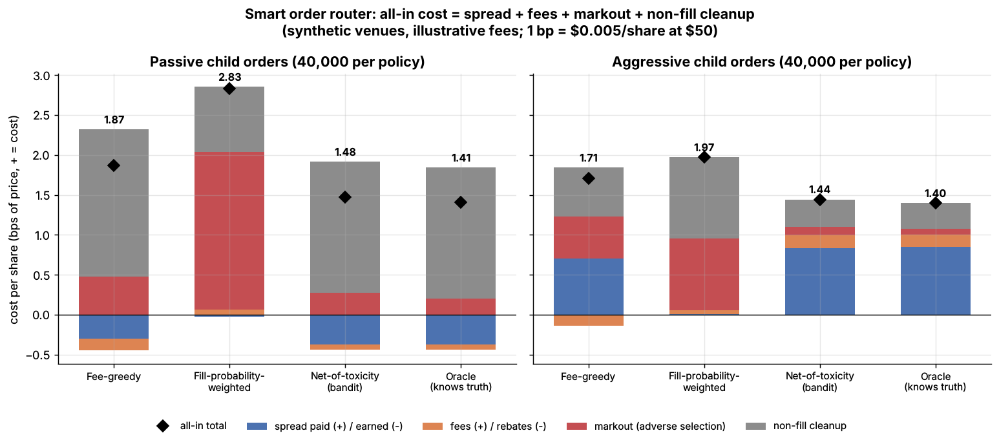

## Related pages

- [Algorithms: overview](03-algorithms/index.md)
- [Strategies: the map](02-strategies/index.md)
- [There is no single algorithm](03-algorithms/there-is-no-single-algorithm.md)
