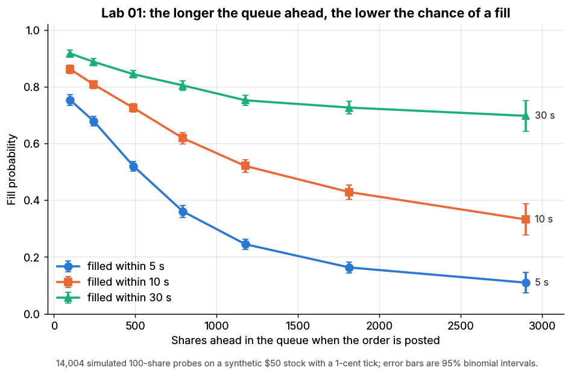
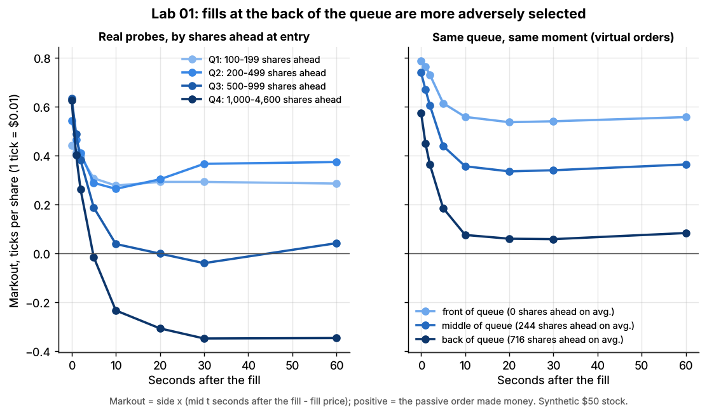

# Lab 01: Matching engine, price-time priority and the value of queue position

## What it demonstrates

1. **Price-time priority on a hand-built book.** Six limit orders, then a market sell, a cancel
   and a marketable limit order. The lab prints the book (each price level shows its queue,
   front to back) before and after, so you can see that at one price the oldest order is filled
   first, that a partial fill keeps its place, that a cancellation moves everyone behind it
   forward, and that a marketable limit order trades and then rests its remainder.
2. **Why queue position has value.** The synthetic order-book simulator
   (`labs/common/simulate.py`, which runs the same matching engine) generates a day of order flow
   for a \$50 stock with a 1-cent tick: liquidity providers, noise traders and informed traders
   who know the latent fair value. A probe agent posts a real 100-share order at the back of the
   best bid or ask every 5 seconds (14,000 probes over three simulated days) and cancels it
   after 60 seconds if it is still unfilled. Because queue lengths vary, probes start with
   anywhere from 100 to 4,600 shares ahead of them. The lab measures:
    - **fill probability within 5, 10 and 30 seconds vs shares ahead**: a long queue ahead
      means a lower and slower fill rate;
    - **markouts of the fills**: the mid-price move after a fill, in ticks per share from the
      passive order's point of view. Fills that needed a long queue ahead to be cleared first
      are adversely selected: by the time the queue is gone, the flow that cleared it is often
      informed and the price keeps moving through the level.

   A robustness check compares **virtual** orders at the front, middle and back of the *same*
   queue at the *same* moment. This is the queue-position model that backtesters use: shares
   ahead shrink as orders ahead trade or cancel, and the virtual order fills once trades reach
   it. It separates the effect of priority from the effect of how long the queue happened to be.

The core of the queue model, as used for the virtual orders in `lab.py`:

```python
def on_fill(fill):                       # called by the matching engine for every execution
    for v in pending_virtual_orders:
        hits_my_side = fill.taker_side == -v.side          # sells hit bids, buys lift asks
        at_or_through = fill.price <= v.price if v.side == BUY else fill.price >= v.price
        if hits_my_side and at_or_through and fill.maker_id not in v.ahead_ids:
            v.traded += fill.size        # everything ahead is gone: this volume would reach us
            if v.traded >= v.size:
                v.filled, v.fill_time = True, fill.time
```

## Supports

- [The limit order book](../../docs/01-market-structure/the-limit-order-book.md) (module 01)
- [Queue position and order placement](../../docs/03-algorithms/f-market-making-and-hft-algorithms/queue-position-and-order-placement.md) (algorithm card M6)

## How to run

```bash
python labs/01-matching-engine-order-book/lab.py            # full run: 3 simulated days, ~12 s
python labs/01-matching-engine-order-book/lab.py --smoke    # 30 simulated minutes, ~2 s
python labs/01-matching-engine-order-book/lab.py --seed 3   # another random world
```

The full run writes the two plots to `docs/assets/labs/` and the key numbers to `results.json`;
`--smoke` writes only to `labs/_smoke/`.

## Expected output

Part A prints the hand-built book and the fills: the market sell of 400 fills A (300 @ 10.00,
first in line) and then 100 of B; the marketable buy of 500 @ 10.01 fills D (100) and E (300)
and rests 100 shares as the new best bid. Part B (full run, seed 7):

| Shares ahead at entry | Probes | Filled within 5 s | within 10 s | within 30 s |
|---|---|---|---|---|
| 100-199 | 1,936 | 75% | 86% | 92% |
| 400-699 | 3,175 | 52% | 73% | 84% |
| 1,000-1,499 | 2,075 | 25% | 52% | 75% |
| 2,500+ | 274 | 11% | 33% | 70% |



*Fill probability of 100-share probes vs shares ahead when posted (synthetic \$50 stock, 1-cent tick).*

| Markout of fills, ticks per share | at 0 s | at 10 s | at 30 s |
|---|---|---|---|
| Real probes, shortest-queue quartile (100-199 ahead) | +0.44 | +0.28 | +0.29 |
| Real probes, longest-queue quartile (1,000+ ahead) | +0.63 | -0.23 | -0.35 |
| Virtual, front of queue (0 ahead) | +0.79 | +0.56 | +0.54 |
| Virtual, back of the same queue (~716 ahead) | +0.58 | +0.08 | +0.06 |



*Markout curves after the fill. Left: real probes by shares ahead at entry. Right: virtual orders
at the front, middle and back of the same queue at the same moment.*

Every fill starts near +0.5 ticks (the passive order earned half a 1-tick spread), but fills
from the back of a long queue give most of that back, and more, within 10 seconds. Combining
both effects, the expected value of a posted order at 30 seconds (fill probability x markout) is
about **+0.28 ticks per share in the shortest-queue quartile vs -0.29 in the longest**: queue
priority is worth roughly half a tick, or \$0.56 per 100 shares, in this toy. Exact numbers vary
with `--seed` by a few hundredths of a tick; the ordering does not.

## What this toy misses vs the real world

- **One venue, one stock, no hidden liquidity.** US equities trade on more than a dozen
  exchanges plus dark pools; queue position is per venue, and hidden or reserve (iceberg) orders sit behind displayed
  orders at the same price. Real queue models must also guess where hidden size is.
- **Stylized participants.** Order arrival, cancellation and informed trading follow simple
  rules (Poisson arrivals, uniform cancellation hazard, informed traders who see the true fair
  value). Real flow is bursty, self-exciting and clustered around news and the open/close, and
  cancellations are concentrated among the newest orders and among quotes about to be picked off.
- **No latency.** Every participant sees the book instantly; in reality being first in the queue
  after a price change is a latency race measured in microseconds, which is most of what
  "queue position" costs to obtain.
- **No fees or rebates.** Maker rebates and taker fees of a fraction of a cent per share are a
  large share of a 1-cent spread and change the value of resting orders; inverted venues
  (which pay takers) trade queue length for price. See the fees-and-ticks page in module 01.
- **Simplified virtual-order model.** The virtual orders do not absorb volume, so they ignore
  their own (small) effect on the queue behind them, and they assume orders ahead never
  re-enter. Production queue models also estimate unseen cancellations from market-by-price
  data, since most feeds do not identify individual orders.
- **One tick size and price level.** A \$50 stock with a 1-cent tick is a "large-tick" name
  where queues matter a lot; for high-priced or volatile stocks the spread is many ticks wide
  and price improvement, not queue position, dominates.
