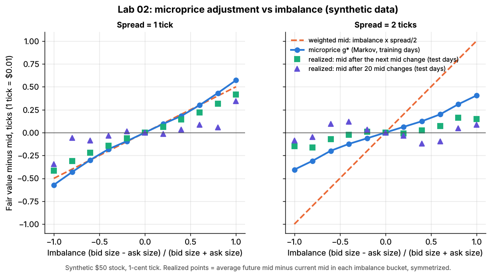
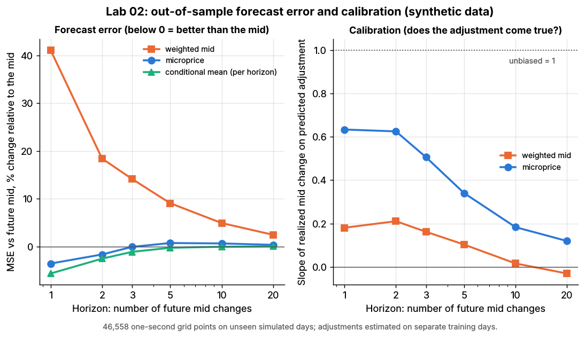

# Lab 02: Fair value from the order book: mid, weighted mid and the microprice

## What it demonstrates

A market maker needs one number for "where the price really is" before it can quote around it.
This lab builds three such fair-value estimators from the top of the book of a synthetic \$50
stock with a 1-cent tick, then tests them on simulated days they were not fitted on.

1. **Mid-price**: (bid + ask) / 2. It ignores the queue sizes.
2. **Weighted mid** (size-weighted mid): `(bid * ask_size + ask * bid_size) / (bid_size + ask_size)`,
   which equals `mid + imbalance * spread / 2` with imbalance $I = (Q_b - Q_a)/(Q_b + Q_a)$. A large bid
   queue pulls the estimate toward the ask.
3. **Microprice** (Stoikov 2018): `mid + g*(imbalance, spread)`. The adjustment `g*` is the expected
   change of the mid over all its future moves, given today's imbalance and spread. It is estimated
   from data with Stoikov's Markov-chain method: discretize the book into states (11 imbalance
   buckets x spreads of 1, 2 and 3 ticks), count transitions between consecutive book updates, and
   sum the expected mid move over the next move, the one after it, and so on.

   $$
   G^1 = (I - Q)^{-1} r, \qquad B = (I - Q)^{-1} R, \qquad g^* = \sum_{i \ge 0} B^i G^1
   $$

   Here $Q$ holds transition probabilities between book states while the mid stays put, $R$ the
   probability that the mid moves and lands the book in each state, and $r$ the mean mid move per
   update. The training data are symmetrized (each book is also added mirrored, with the move
   flipped) so the sum converges.

The core of the estimator, as in `lab.py` (`estimate_microprice_adjustment`):

```python
Q[s, s_next] += 1   for each update where the mid did NOT move      # book changes only
R[s, s_next] += 1   for each update where the mid moved             # s_next = state after the move
r[s]         += mid move (ticks) of each update from s
Q, R, r = Q / count[s], R / count[s], r / count[s]                  # per-state frequencies
G1 = inv(I - Q) @ r        # expected change up to and including the next mid move
B  = inv(I - Q) @ R        # where the book stands right after that move
g  = G1 + B @ G1 + B @ B @ G1 + ...   # until the terms vanish: the microprice adjustment
```

It then measures, out of sample:

- **forecast error**: mean squared error (MSE) of each estimator against the mid after the next
  1-20 mid changes and 1-120 seconds ahead, relative to the plain mid;
- **calibration**: regress the realized mid change on each estimator's predicted adjustment. A slope
  of 1 means the predicted move comes true on average; below 1 means the estimator over-reacts;
- **the planted truth**: the simulator has a latent "efficient" price that informed traders see.
  The lab checks whether any book-based estimator recovers it;
- a **labeled baseline**: the conditional-expectation adjustment `E[mid(t+h) - mid(t) | state]`,
  fitted separately for each horizon `h`. This is the best any function of the book state can do at
  that horizon, so it measures how much of the available signal the microprice captures.

Pitfalls shown: the weighted mid over-reacts when the spread is wide, and the microprice's
predicted move partly reverts when the Markov assumption is wrong. Both estimators are
short-horizon tools that know nothing about the information informed traders hold.

## Supports

- [Fair value and microprice](../../docs/03-algorithms/f-market-making-and-hft-algorithms/fair-value-and-microprice.md) (algorithm card)
- Related: [Order-book and trade-flow signals](../../docs/03-algorithms/f-market-making-and-hft-algorithms/order-book-and-trade-flow-signals.md), [Equity market making](../../docs/02-strategies/a-liquidity-provision/equity-market-making.md)

## How to run

```bash
cd /home/user/quant_trading_claude && export PATH=/home/user/venv-qt/bin:$PATH
python labs/02-microprice-fair-value/lab.py              # full run: 2 training + 2 test days, ~12 s
python labs/02-microprice-fair-value/lab.py --smoke      # 30-minute days, ~3 s, writes to labs/_smoke/
python labs/02-microprice-fair-value/lab.py --seed 3     # another random world
```

## Expected output

Full run, seed 7: the microprice is estimated from 132,939 book updates on two training days and
tested on 46,558 one-second snapshots of two other days. The spread is 1, 2 or 3 ticks 47%, 37% and
11% of the time. The sum over future moves converges after about 4 mid moves (each further term is
below 0.005 ticks).

**The adjustment.** With a 1-tick spread the microprice and the weighted mid agree: about +0.43
ticks at imbalance +0.8 (weighted mid +0.40) and +0.57 at +1.0. With a 2-tick spread the
microprice moves only +0.31 ticks at imbalance +0.8, while the weighted mid moves +0.80. With a
3-tick spread the figures are +0.25 and +1.20. A wide spread is likely to be filled from either
side, so imbalance says less about where the mid goes.



*Microprice adjustment `g*` (blue) vs the weighted-mid adjustment (dashed) and the realized average
mid move after 1 and 20 mid changes on unseen days. Synthetic data.*

**Forecast error.** MSE against the future mid, % change relative to the plain mid. Negative is
better:

| Horizon | Weighted mid | Microprice | Conditional mean (per horizon) | Latent fair value (oracle) |
|---|---|---|---|---|
| next mid change | +41.2% | **-3.5%** | -5.6% | +764% |
| next 3 mid changes | +14.1% | -0.0% | -1.1% | +121% |
| next 10 mid changes | +4.9% | +0.7% | -0.0% | -36% |
| 2 s | +25.9% | -2.5% | -3.7% | +465% |
| 10 s | +6.6% | +0.7% | -0.1% | -36% |
| 60 s | +0.9% | +0.1% | +0.1% | -15% |

- **The microprice captures most of the signal at its natural horizon.** At the next mid change it
  cuts the MSE by 3.5%, against 5.6% for the best possible function of the book state. Restricted
  to 1-tick spreads, both the microprice and the weighted mid cut it by about 10%.
- **The weighted mid's problem is the wide spread.** At the next mid change it is 61% worse than the
  plain mid when the spread is 2 ticks and 106% worse at 3 ticks. The microprice is within 2% of the
  mid there, because it has learned to shrink.
- **Calibration** (slope of the realized move on the predicted adjustment, 1 = unbiased): microprice
  0.63 at the next mid change, 0.51 after 3, 0.18 after 10 and 0.12 after 20. The weighted mid's
  slope is 0.18, then about 0. The weighted mid over-reacts by a factor of about 5. The
  microprice is roughly right for the next move or two, but much of that move later reverts.
- **Pitfall: the Markov assumption.** The microprice assumes (imbalance, spread) is all you need to
  know. In this simulator, liquidity providers anchor their quotes to a slowly updated belief about
  value that is not visible in the book. A move caused by one queue running out is therefore
  partly undone when they refill it. The Markov estimate says the move is permanent; the data say
  it is mostly transient. At a 1-tick spread and imbalance +0.8, the Markov chain predicts +0.39
  ticks by the next mid change (realized on test days: +0.31) and +0.43 ticks after 20 changes
  (realized: +0.06).
- **Pitfall: the book is not the information.** The latent fair value differs from the mid by 1.96
  ticks (standard deviation), and it is the best long-horizon forecast (36% lower MSE at 10 s). But
  the correlation between the microprice adjustment and that gap is +0.001: nothing in the top of
  the book reveals it here. Informed traders' knowledge reaches the price through their trades. A
  fair-value model that uses only the book cannot anticipate it (see Lab 03 and Lab 04).
- **Horizon matters.** All gains vanish beyond about 5 s or 3 mid changes, because the future
  price variance (24 ticks² at 60 s) dwarfs a sub-tick adjustment. Applied 1 s ahead the microprice
  is slightly worse than the mid (+0.5%): the mid rarely moves within 1 s, so the full adjustment
  overshoots. The horizon-specific conditional mean (-4.1%) shrinks it correctly.



*Left: MSE change vs the mid by horizon in mid changes. Right: calibration slope. Synthetic data.*

The numbers move by a few tenths of a percent with `--seed`. The ordering does not move: the
weighted mid is worst, the microprice is slightly better than the mid at short horizons, and the
calibration slope decays.

## What this toy misses vs the real world

- **Weak, transient imbalance signal by construction.** In this simulator, top-of-book imbalance
  removes only about 10% of the next mid move's squared error when the spread is 1 tick. In real
  large-tick stocks (very long queues, spread almost always 1 tick) queue imbalance is a much
  stronger predictor of the next move (Gould & Bonart 2016), and the microprice's advantage is
  larger.
- **One stock, one tick-to-price ratio.** Stoikov's method is most useful for large-tick names.
  For small-tick, high-priced stocks the spread is many ticks wide and the state space (spread
  states) explodes.
- **Only the top of the book.** Practitioners add deeper levels, recent trades, order-flow
  imbalance (Lab 03), queue ages, cross-venue quotes and related instruments (futures, ETFs,
  sector peers). The Markov state here has 33 cells.
- **No latency or data issues.** The estimator sees every book update instantly and in order. Real
  feeds arrive with venue-dependent delays, and the "current book" differs by the observer's
  location.
- **Stationary parameters.** The adjustment is fitted on two days and applied to two days of the
  same regime. Real books change with time of day, volatility and events, so desks refit often and
  condition on regime.
- **Equal-width imbalance buckets and symmetrization.** Quantile buckets are a common alternative.
  Symmetrizing is what makes the series converge, but it hides any genuine buy/sell asymmetry
  (for example on a down day).
- **No costs or decisions.** A better fair value only matters through the quotes and trades it
  changes. This lab measures forecast quality, not P&L (see Lab 05 for quoting).

## Key parameters

| Parameter | Value | Meaning |
|---|---|---|
| `N_IMB` | 11 | imbalance buckets, centers -1.0, -0.8, ..., +1.0 (odd, so a balanced book has its own bucket) |
| `MAX_SPREAD_TICKS` | 3 | spread states 1, 2, 3 ticks (96% of the time); wider books fall back to the mid |
| training / test data | 2 + 2 simulated days, seeds 7, 8 / 17, 18 | 6.5 h each, ~270,000 events per day |
| evaluation grid | every 1 s | avoids over-weighting busy periods, as event sampling would |
| horizons | 1, 2, 3, 5, 10, 20 mid changes; 1-120 s | event time is the microprice's natural clock |
| `max_iter`, `tol` | 200, 1e-6 ticks | stopping rule for the series `G1 + B G1 + ...` (converges in ~4 moves to 0.005 ticks) |
| simulator | `simulate_lob` defaults | \$50 stock, 1-cent tick, 2% daily vol, 25% informed market orders, LP belief lag 20 s |

Sources. Bibliographic details checked against Crossref (2026-11).

- [Verified] Stoikov, S. (2018). "The micro-price: a high-frequency estimator of future prices." *Quantitative Finance* 18(12), 1959–1966. <https://doi.org/10.1080/14697688.2018.1489139> (accessed 2026-11)
- [Verified] Gould, M. D. & Bonart, J. (2016). "Queue imbalance as a one-tick-ahead price predictor in a limit order book." *Market Microstructure and Liquidity* 2(2), 1650006. <https://doi.org/10.1142/S2382626616500064> (accessed 2026-11)
