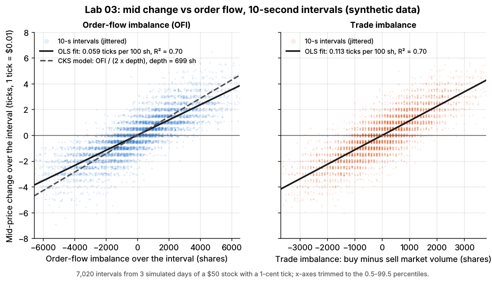
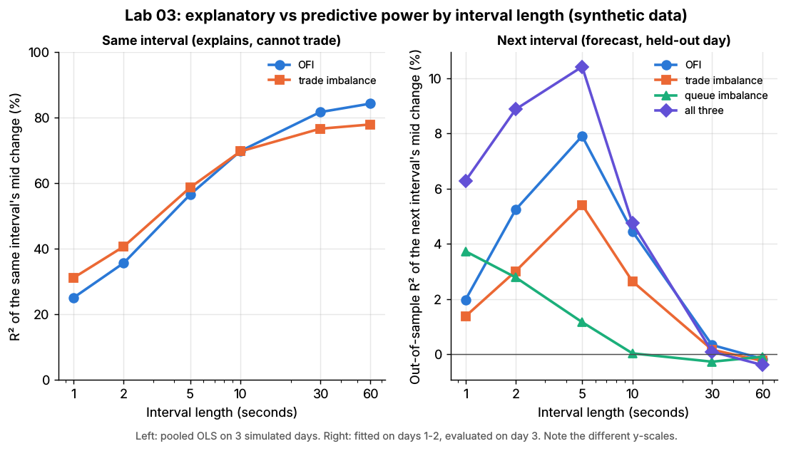

# Lab 03: Order-flow imbalance vs trade imbalance and queue imbalance

## What it demonstrates

Short-horizon price moves are driven by the order flow at the best bid and ask. This lab
reproduces the measurement of Cont, Kukanov & Stoikov (2014; "CKS") on a synthetic order book.
It then asks the trader's question: how much of that flow *predicts* the next move, and can you
trade on it?

1. **Order-flow imbalance (OFI).** Every top-of-book update adds or removes buying or selling
   interest at the touch. A new bid at the best price adds to demand, and a cancel or a market sell
   against the bid removes it. The ask side works the same way with the sign flipped. CKS's
   contribution of update $n$ (bid $P^B$, bid size $q^B$, ask $P^A$, ask size $q^A$):

   $$
   e_n = \mathbb{1}\{P^B_n \ge P^B_{n-1}\}\,q^B_n - \mathbb{1}\{P^B_n \le P^B_{n-1}\}\,q^B_{n-1}
       - \mathbb{1}\{P^A_n \le P^A_{n-1}\}\,q^A_n + \mathbb{1}\{P^A_n \ge P^A_{n-1}\}\,q^A_{n-1}
   $$

   $\mathrm{OFI}_k$ is the sum of $e_n$ over interval $k$. If the bid price is unchanged, $e_n$ is
   the change in bid size. If the bid moves up, it is the whole new queue; if it moves down, minus
   the whole old queue.
2. **Explaining price changes.** For intervals of 1 to 60 seconds, the lab regresses the mid change
   on OFI, on trade imbalance (buyer-initiated minus seller-initiated market-order volume) and on
   both. CKS's stylized model predicts a linear relation whose slope is inversely proportional to
   the depth $D$ at the touch:

   $$
   \Delta \text{mid}_k \approx \frac{\mathrm{OFI}_k}{2D}\ \text{ticks}
   $$

   The lab tests this as CKS did. It estimates the slope $\beta$ in each half-hour, regresses
   $\log\beta$ on $\log(\text{average depth})$ (the model says slope $-1$), and compares books
   that are thin, normal and thick.
3. **Predicting price changes.** The next interval's mid change is regressed on this interval's
   OFI, trade imbalance and the queue imbalance at its end, (bid size - ask size) / (bid size +
   ask size). The model is fitted on two simulated days and scored on a third (out-of-sample R²).
4. **Pitfalls.** Contemporaneous R² is not a forecast. And a taker who trades the forecast pays the
   half-spread to enter, which is larger than the move the forecast predicts.

The core of `compute_ofi` in `lab.py`:

```python
e = (bid >= prev_bid) * bid_size - (bid <= prev_bid) * prev_bid_size \
    - (ask <= prev_ask) * ask_size + (ask >= prev_ask) * prev_ask_size   # per book update, shares
k = floor(time / interval)                       # interval of each update
ofi[k] += e                                      # OFI per interval
mid_change[k] = mid(end of k) - mid(end of k-1)  # in ticks
beta = OLS(mid_change ~ ofi)                     # CKS: beta ~ 1 / (2 x average depth)
```

## Supports

- [Order-book and trade-flow signals](../../docs/03-algorithms/f-market-making-and-hft-algorithms/order-book-and-trade-flow-signals.md) (algorithm card)
- Related: [Fair value and microprice](../../docs/03-algorithms/f-market-making-and-hft-algorithms/fair-value-and-microprice.md), [Adverse selection and markouts](../../docs/03-algorithms/f-market-making-and-hft-algorithms/adverse-selection-and-markouts.md)

## How to run

```bash
cd /home/user/quant_trading_claude && export PATH=/home/user/venv-qt/bin:$PATH
python labs/03-order-flow-imbalance/lab.py              # full run: 3 days + 2 book variants, ~18 s
python labs/03-order-flow-imbalance/lab.py --smoke      # 1-hour days, ~5 s, writes to labs/_smoke/
python labs/03-order-flow-imbalance/lab.py --seed 3     # another random world
```

## Expected output

Full run, seed 7: 3 simulated days of a \$50 stock with a 1-cent tick (7,020 ten-second intervals).
The average touch depth is 699 shares per side.

**Explaining the same interval's mid change** (pooled OLS):

| Interval | R² OFI | R² trade imbalance | R² both | OFI beta (ticks per 100 sh) | Trade-imbalance beta |
|---|---|---|---|---|---|
| 1 s | 0.25 | 0.31 | 0.36 | 0.051 | 0.074 |
| 5 s | 0.57 | 0.59 | 0.68 | 0.057 | 0.098 |
| **10 s** | **0.70** | **0.70** | **0.80** | **0.059** | **0.113** |
| 30 s | 0.82 | 0.77 | 0.89 | 0.060 | 0.135 |
| 60 s | 0.84 | 0.78 | 0.91 | 0.061 | 0.143 |

- **OFI explains 70% of 10-second mid changes**, close to the 65% average CKS report for 50 NYSE
  stocks with 10-second intervals. As in CKS, the fit improves with the interval length.
- **The CKS depth law is recovered.** Across 39 half-hours the slope of $\log\beta$ on
  $\log(\text{depth})$ is **-1.01** (standard error 0.18; the model says -1). The constant
  $c = \beta \times \text{depth}$ is **0.41**, below the stylized 0.5. CKS also found $c$ below 0.5:
  mid-prices are more resilient than the toy model assumes. Across book thickness, a thin book
  (357 shares deep) has beta 0.137 ticks per 100 shares vs 0.140 predicted. The default book (697
  shares) has 0.059 vs 0.072, and a thick book (1,253 shares) 0.030 vs 0.040.
- **Unlike CKS, trade imbalance does as well as OFI here** (R² 0.70 at 10 s, against 32% in CKS's
  data), and both stay highly significant together (t = 58 and 55). In this simulator, liquidity
  providers move their quotes after every market order, so trades drive quotes by construction. In
  real books most quote changes come from limit orders and cancels that never trade. That is why
  OFI wins there.



*10-second mid changes vs OFI (left, with the OLS fit and the CKS line OFI / (2 x depth)) and vs trade
imbalance (right). Synthetic data.*

**Predicting the next interval's mid change** (fitted on days 1-2, R² on held-out day 3):

| Interval | OFI | Trade imbalance | Queue imbalance | All three |
|---|---|---|---|---|
| 1 s | 2.0% | 1.4% | 3.7% | 6.3% |
| 2 s | 5.2% | 3.0% | 2.8% | 8.9% |
| 5 s | 7.9% | 5.4% | 1.2% | **10.4%** |
| 10 s | 4.5% | 2.6% | 0.0% | 4.7% |
| 30 s | 0.3% | 0.2% | -0.3% | 0.1% |
| 60 s | -0.2% | -0.2% | -0.1% | -0.4% |

- **Explaining is not predicting.** The same OFI that explains 70% of the current 10-second move
  explains 4.5% of the next one.
- **Predictive power decays fast.** Queue imbalance is a 1-2 second signal (3.7% at 1 s, gone by
  10 s). Flow peaks at about 5 s and is gone by 30 s. It persists that long here only because the
  simulated liquidity providers update their view of value with a 20-second lag.
- **Pitfall, costs.** A taker buys at the ask (or sells at the bid) whenever the 10-second forecast
  points up (down) and holds for one interval. That makes **+0.32 ticks per trade mid to mid**, but
  pays a 0.88-tick half-spread to enter, so it loses **0.56 ticks** even if it exits at the mid. On
  a round trip it loses 1.44 ticks. Trading only when the forecast exceeds 0.5 ticks (15% of
  intervals) raises the gross to +0.76 ticks, still short of the cost. A market maker uses the
  same signal differently: to lean its quotes and avoid being picked off, which costs nothing
  extra.



*Left: R² of the same interval's mid change. Right: out-of-sample R² of the next interval's mid
change. Note the different scales. Synthetic data.*

With `--seed 3` the headline numbers barely move: R² 0.70 at 10 s, depth slope -0.93 (s.e. 0.26),
best forecast R² 10.1% at 5 s, round trip -1.39 ticks.

## What this toy misses vs the real world

- **Trades drive quotes too strongly.** The simulated liquidity providers shift their belief after
  every market order, which makes trade imbalance as informative as OFI. In CKS's NYSE data OFI is
  twice as good (65% vs 32% R²) and trade imbalance adds little once OFI is known.
- **A partly mechanical R².** OFI counts the very events that change the best prices, so some of
  the contemporaneous fit is accounting, not economics. CKS checked this by dropping
  price-changing events; R² fell to the 35-60% range but stayed high.
- **One venue, full visibility.** Real US stocks trade on many venues. OFI is usually computed from
  the consolidated best bid and offer (NBBO) or per venue. Hidden and odd-lot orders are invisible
  in top-of-book data, and quote updates arrive with latency.
- **Only the top of the book.** Multi-level OFI (deeper levels, weighted) and normalizing by depth
  improve fit and comparability across stocks. Neither is shown here.
- **Stationary flow.** Depth here varies little across half-hours (618-754 shares), so the depth law
  is tested on a narrow range plus three synthetic "stocks". Real depth has a strong intraday
  pattern and so, as CKS show, does the price-impact coefficient.
- **Simplified cost model.** The taker pays the quoted half-spread and nothing else. Real takers also
  pay exchange fees, have latency (the quote may be gone), and move the price when they trade
  size. The forecast is worth less, not more, after those costs.
- **Forecast persistence is a simulator parameter.** The 5-second peak in predictability comes from
  the 20-second belief lag of the simulated liquidity providers (`lp_fv_lag`). Real predictability
  of mid changes from order flow is typically shorter-lived and weaker after costs.

## Key parameters

| Parameter | Value | Meaning |
|---|---|---|
| intervals | 1, 2, 5, 10, 30, 60 s | grid of fixed time intervals (CKS used 10 s) |
| `MAIN_INTERVAL` | 10 s | used for the scatter, betas and the taker test |
| days | 3 x 6.5 h, seeds 7, 8, 9 | days 1-2 fit the forecasts, day 3 tests them |
| half-hour subsamples | 39 (13 per day) | CKS's unit for estimating beta vs depth |
| book thickness test | `limit_rate` 3, 6, 12 orders/s | thin / default / thick synthetic books |
| taker thresholds | 0, 0.25, 0.5, 1.0 ticks | trade only when the absolute forecast exceeds this |
| regression | OLS with intercept; heteroskedasticity-robust (HC1) t-stats | CKS used White standard errors |
| simulator | `simulate_lob` defaults | \$50 stock, 1-cent tick, 25% informed market orders, LP belief lag 20 s |

Sources. Bibliographic details checked against Crossref and the arXiv version of the paper (2026-11).

- [Verified] Cont, R., Kukanov, A. & Stoikov, S. (2014). "The price impact of order book events." *Journal of Financial Econometrics* 12(1), 47–88. <https://doi.org/10.1093/jjfinec/nbt003> (accessed 2026-11). Numbers quoted here (10-second intervals, average R² 65% for OFI vs 32% for trade imbalance, depth exponent close to 1, c below 1/2, 35-60% R² without price-changing events) are from the arXiv version <https://arxiv.org/abs/1011.6402>.
