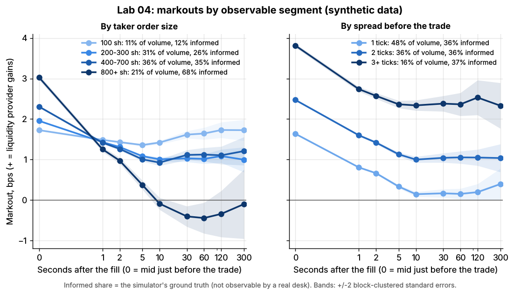

# Lab 04: Markout analysis: spread captured vs adverse selection, by segment

## What it demonstrates

A **markout** asks: after I was filled, did the price move for me or against me? It is the
standard tool market makers use to measure adverse selection, the cost of trading with
someone who knows more. For a passive (liquidity-providing) fill at time $t$ and price $p$:

$$
\text{markout}_h = \text{side} \times \frac{\text{mid}(t+h) - p}{p} \times 10^4 \ \text{bps}
$$

Here side = +1 if our bid was hit (we bought) and -1 if our offer was lifted. At $h = 0$ the lab
uses the mid just *before* the trade, so $\text{markout}_0$ is the spread captured: half the
spread, plus more if the order walked the book. As $h$ grows, the markout falls by the amount
the price moves against the liquidity provider. That drop is the adverse selection.

The lab computes markouts at 0, 1, 2, 5, 10, 30, 60, 120 and 300 seconds for every passive fill in
three simulated days (136,488 fills) of a \$50 stock with a 1-cent tick (1 tick = 2 bps). It then
splits them by:

1. **counterparty type**: informed vs uninformed. This is the simulator's ground truth, which no
   real desk observes;
2. **taker order size**: the size of the whole incoming market order (100 shares to 800+);
3. **spread before the trade**: 1, 2 or 3+ ticks.

For each segment it reports the informed share of volume, so you can see *why* a curve looks the
way it does. It also prints a daily income statement for the liquidity providers: spread
captured, minus adverse selection, equals what they keep.

Core functions in `lab.py`:

```python
def markouts(fills, mid_series, horizons):                 # bps, one row per fill
    for h in horizons:
        j = last book update strictly before t_fill   if h == 0     # spread captured
            last book update at or before t_fill + h  otherwise
        out[h] = side * (mid[j] - price) / price * 1e4

def markout_curve(mo, weights, blocks):                    # share-weighted mean, clustered s.e.
    mean = sum(w * mo) / sum(w)
    se   = sqrt(sum over 10-minute blocks of (sum of w * (mo - mean))^2) / sum(w)
```

Pitfalls shown: (1) a horizon that is too short hides the adverse selection; (2) naive standard
errors understate uncertainty because fills overlap in time; (3) averaging per fill instead of per
share understates toxicity, because big orders are the informed ones.

## Supports

- [Adverse selection and markouts](../../docs/03-algorithms/f-market-making-and-hft-algorithms/adverse-selection-and-markouts.md) (algorithm card)
- [Equity market making](../../docs/02-strategies/a-liquidity-provision/equity-market-making.md) (strategy dossier)
- Related: [Quoting and inventory control](../../docs/03-algorithms/f-market-making-and-hft-algorithms/quoting-and-inventory-control.md), [Transaction cost analysis](../../docs/03-algorithms/e-execution-algorithms/transaction-cost-analysis.md)

## How to run

```bash
cd /home/user/quant_trading_claude && export PATH=/home/user/venv-qt/bin:$PATH
python labs/04-markout-analysis/lab.py              # full run: 3 simulated days, ~9 s
python labs/04-markout-analysis/lab.py --smoke      # one simulated hour, ~2 s, writes to labs/_smoke/
python labs/04-markout-analysis/lab.py --seed 3     # another random world
```

## Expected output

Full run, seed 7: 136,488 passive fills, 20.4M shares. Informed traders account for 36% of the
volume. Share-weighted markouts in bps (positive = the liquidity provider made money):

| Segment | Share of volume | Informed share (truth) | 0 s | 1 s | 10 s | 60 s | 300 s |
|---|---|---|---|---|---|---|---|
| **All passive fills** | 100% | 36% | +2.28 | +1.39 | +0.80 | **+0.82** | +0.93 |
| Informed takers | 36% | 100% | +2.53 | +1.13 | -0.74 | **-1.46** | -1.21 |
| Uninformed takers | 64% | 0% | +2.14 | +1.54 | +1.67 | **+2.13** | +2.15 |
| Taker order 100 sh | 11% | 12% | +1.72 | +1.49 | +1.42 | +1.64 | +1.72 |
| Taker order 200-300 sh | 31% | 26% | +1.95 | +1.43 | +1.01 | +1.01 | +1.00 |
| Taker order 400-700 sh | 36% | 35% | +2.31 | +1.42 | +0.92 | +1.12 | +1.21 |
| Taker order 800+ sh | 21% | 68% | +3.03 | +1.25 | -0.09 | **-0.45** | -0.10 |
| Spread 1 tick | 48% | 36% | +1.64 | +0.80 | +0.14 | +0.15 | +0.39 |
| Spread 2 ticks | 36% | 36% | +2.47 | +1.60 | +1.00 | +1.05 | +1.04 |
| Spread 3+ ticks | 16% | 37% | +3.82 | +2.74 | +2.34 | +2.36 | +2.33 |

Standard errors at 60 s (block-clustered): 0.05 bps for all fills, 0.15 for informed, 0.19 for 800+
share orders.

- **The classic picture.** Every segment starts with positive spread capture (+1.6 to +3.8 bps). The
  informed curve crosses zero at about 5 seconds and settles near -1.4 bps. The uninformed curve
  dips and then recovers above +2 bps: uninformed trades push the price around only temporarily.
- **Observable segments recover the truth only partly.** Order size is a good proxy. Orders of
  800+ shares are 68% informed and lose 0.45 bps at 60 s. 100-share orders are 12% informed and
  keep +1.64 bps. Spread state is not a toxicity proxy here: the informed share is about 36% in
  every spread bucket. Wide-spread fills are more profitable only because they capture more spread
  (+3.82 vs +1.64 bps at t = 0). Fills at a 1-tick spread keep just +0.15 bps after 60 s.
- **Income statement for all liquidity providers, dollars per day:** spread captured **+\$77,818**,
  adverse selection (60 s) **-\$49,723**, net **+\$28,096**. They keep 36% of the spread they
  capture. By counterparty: informed takers cost them \$18,106 a day net, uninformed takers pay them
  \$46,202.
- **Pitfall, horizon.** At 1 second informed flow still shows +1.13 bps and looks profitable. A
  desk that marks out at 1 s would happily keep trading with the counterparties that are
  picking it off.
- **Pitfall, standard errors.** Fills close in time share the same future price path. Treating
  them as independent gives a standard error of 0.012 bps at 10 s and 0.071 bps at 300 s.
  Clustering by 10-minute blocks gives 0.026 and 0.118 bps: about 2x larger. Long-horizon
  markouts on a small sample of fills (one client, one day) are mostly noise.
- **Pitfall, weighting.** The average markout at 60 s is +0.99 bps per fill but +0.82 bps per
  share. Large orders are more often informed, so counting each fill once makes the flow look
  less toxic than it is.


*Markouts of passive fills by counterparty type, with +/-2 standard-error bands. Synthetic data.*



*Left: by the size of the incoming market order. Right: by the spread just before the trade.
Synthetic data.*

With `--seed 3` the numbers change by a few hundredths of a bp at short horizons and by up to
0.5 bps at 300 s (where the noise is largest). The ordering of segments does not change.

## What this toy misses vs the real world

- **Counterparty type is not observable.** Here the informed flag is ground truth. Real desks only
  see proxies: order size, venue, time of day, whether the order swept several levels, and (for
  wholesalers) the routing broker or client segment. Markouts by segment are how they infer it.
- **Informed traders are stylized.** They see the true value and trade on the gap with market
  orders. Real informed flow is split into small child orders (so size is a weaker proxy), uses
  limit orders too, and its information decays at many different speeds.
- **All passive fills, not one market maker.** The fills belong to the whole crowd of simulated
  liquidity providers. A real firm's markouts also depend on its queue position (Lab 01), its
  latency, and which quotes it chooses to show.
- **No fees, rebates or latency.** Real markout reports usually add the exchange rebate or fee per
  share (often a large share of a 1-cent spread) and are measured from the firm's own timestamps.
  Microsecond differences matter at the 0-1 s end of the curve.
- **One stock, one regime.** Real markouts vary with volatility, news, the open and close, and across
  stocks. They are monitored daily and per venue rather than once.
- **Mid-based markouts only.** Some desks mark out against their own fair value (microprice, Lab 02)
  or against the next trade price. Different benchmarks give different short-horizon numbers.
- **Clustered standard errors are still approximate.** With a 300-second horizon, fills in
  adjacent 10-minute blocks still overlap, so even the block standard error is somewhat too small.

## Key parameters

| Parameter | Value | Meaning |
|---|---|---|
| `HORIZONS_S` | 0, 1, 2, 5, 10, 30, 60, 120, 300 | markout horizons; 0 = mid just before the trade |
| units | bps of the fill price | 1 tick = \$0.01 = 2.0 bps at \$50 |
| weighting | per share (fill size) | per-fill averages are shown as a pitfall |
| `BLOCK_S` | 600 s | time blocks for clustered standard errors |
| size buckets | 100; 200-300; 400-700; 800+ shares | size of the whole incoming market order |
| spread buckets | 1, 2, 3+ ticks | spread just before the market order arrived |
| data | 3 days x 6.5 h, seeds 7, 8, 9 | fills in the last 300 s of each day are dropped (no full horizon) |
| simulator | `simulate_lob` defaults | 25% of market orders informed (36% of volume: their orders are larger) |

Sources. Bibliographic details checked against Crossref (2026-11).

- [Verified] Glosten, L. R. & Milgrom, P. R. (1985). "Bid, ask and transaction prices in a specialist market with heterogeneously informed traders." *Journal of Financial Economics* 14(1), 71–100. <https://doi.org/10.1016/0304-405X(85)90044-3> (accessed 2026-11). The classic model of the bid-ask spread as compensation for adverse selection.
