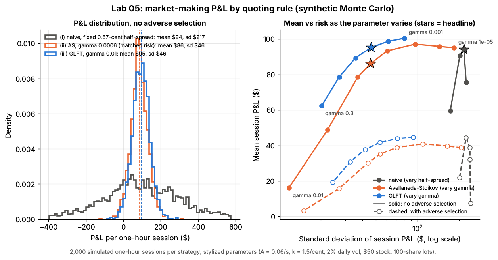
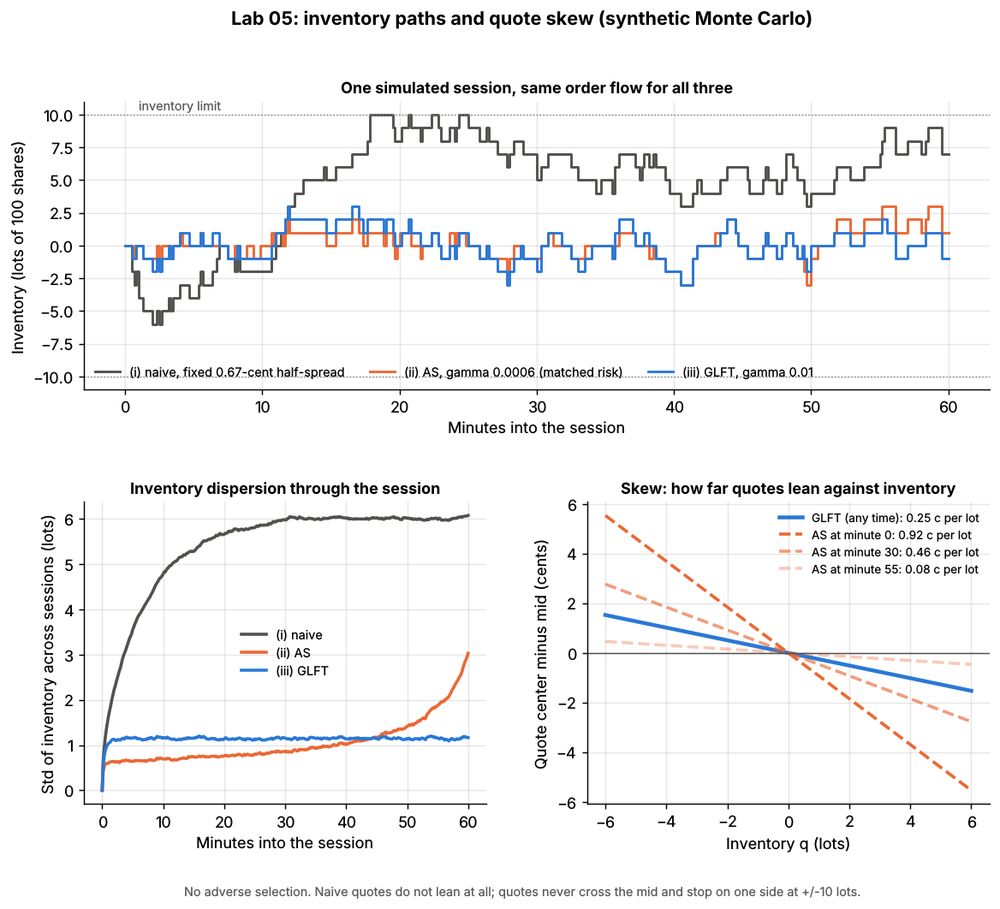

# Lab 05: Optimal market-making quotes: naive vs Avellaneda-Stoikov vs GLFT

## What it demonstrates

A dealer in one stock posts a bid and an ask around the mid-price and earns the distance to the
mid on every fill. The risk is **inventory**: every fill leaves the dealer long or short, and the
mid keeps moving. This lab is a self-contained Monte Carlo of that problem, in the setting of the
two papers that made it standard:

- the mid follows Brownian motion with volatility $\sigma$ (2% a day for a \$50 stock);
- a quote at distance $\delta$ from the mid is filled at Poisson rate

  $$
  \lambda(\delta) = A\, e^{-k\delta}
  $$

  Quoting tighter gets more fills, each worth less;
- the dealer has risk aversion $\gamma$, holds at most $\pm 10$ lots (1,000 shares), starts each
  one-hour session flat and flattens at the end, paying a stylized liquidation cost.

Three quoting rules are compared over 2,000 simulated sessions each:

**(i) Naive.** Symmetric quotes at a fixed distance from the mid, ignoring inventory (here
$\delta = 1/k = 0.67$ cents, the distance that maximizes expected spread income per second).

**(ii) Avellaneda & Stoikov (2008).** Quote around a *reservation price* that leans against
inventory, with a spread that widens with risk aversion and with the time left $T - t$:

$$
r_t = S_t - q\,\gamma\,\sigma^2\,(T - t)
$$

$$
\delta^a + \delta^b = \gamma\,\sigma^2\,(T - t) + \frac{2}{\gamma}\ln\!\left(1 + \frac{\gamma}{k}\right),
\qquad \text{bid} = r_t - \frac{\delta^a + \delta^b}{2},\quad \text{ask} = r_t + \frac{\delta^a + \delta^b}{2}
$$

Long inventory ($q > 0$) pushes both quotes down: the dealer sells more readily and buys less
readily.

**(iii) Guéant, Lehalle & Fernandez-Tapia (2013), "GLFT".** Their closed-form asymptotic
approximation (valid far from the end of the session) gives the distance of each quote from the
mid, with no bid at the upper inventory limit and no ask at the lower one:

$$
\delta^b(q) \approx \frac{1}{\gamma}\ln\!\left(1 + \frac{\gamma}{k}\right) + \frac{2q + 1}{2}\,c,
\qquad
\delta^a(q) \approx \frac{1}{\gamma}\ln\!\left(1 + \frac{\gamma}{k}\right) - \frac{2q - 1}{2}\,c
$$

$$
c = \sqrt{\frac{\sigma^2\,\gamma}{2\,k\,A}\left(1 + \frac{\gamma}{k}\right)^{1 + k/\gamma}}
$$

The quotes lean by $c$ per lot of inventory, and the lean does not depend on the clock. It does
depend on $A$: the more fills you expect, the faster inventory can be worked off and the less
you need to lean. Comparing the formulas, **GLFT quotes are exactly AS quotes with $T - t$
replaced by a constant horizon** $\tau^* = c / (\gamma\sigma^2)$. At $\gamma = 0.01$ that horizon is
60 seconds.

The core functions in `lab.py`, which the simulation calls every second:

```python
def as_quotes(mid, q, t, gamma, sigma, k, T):
    reservation = mid - q * gamma * sigma**2 * (T - t)
    spread = gamma * sigma**2 * (T - t) + (2 / gamma) * log(1 + gamma / k)
    return reservation - spread / 2, reservation + spread / 2          # bid, ask

def glft_quotes(q, gamma, sigma, A, k, q_max):
    base = log(1 + gamma / k) / gamma
    c = sqrt(sigma**2 * gamma / (2 * k * A) * (1 + gamma / k) ** (1 + k / gamma))
    d_bid = base + (2 * q + 1) / 2 * c        # distance below the mid; inf (no bid) if q >= q_max
    d_ask = base - (2 * q - 1) / 2 * c        # distance above the mid; inf (no ask) if q <= -q_max
    return d_bid, d_ask

def step_pnl(q_before, bought, sold, d_bid, d_ask, jump, diffusion):   # income-statement lines
    spread    = bought * d_bid + sold * d_ask                 # distance from the mid earned on fills
    adverse   = (bought - sold) * jump                        # jump right after the fills, on those lots
    inventory = q_before * jump + (q_before + bought - sold) * diffusion   # holding inventory
    return spread, adverse, inventory
```

**The income statement.** Every session's P&L is split into four lines that add up exactly. The
lab checks the identity against cash plus inventory at the final mid.

| Line | What it is | Sign |
|---|---|---|
| Spread capture | Sum over fills of the fill's distance from the mid at the time of the fill | always ≥ 0 |
| Inventory (mark-to-market) P&L | Inventory held x subsequent mid moves | ± (zero on average if the mid is a martingale) |
| Adverse selection | Price jump right after a fill, on the lots just traded (an informed trader picked off the quote) | ≤ 0 |
| Liquidation cost | Flattening the position at the end of the session | ≤ 0 |
| **Total P&L** | Sum of the above | |

Two worlds are simulated with the same random numbers. **World A** matches the models'
assumptions: no informed traders. **World B** adds adverse selection: news arrives about once a
minute and moves the mid by a random jump $J$ (exponential, mean 1.5 cents, random sign). Just
before each jump, an informed trader hits the dealer's quote on the losing side if the jump is
bigger than the quote's distance from the mid ($J > \delta$). This is the "stale quote gets
sniped" mechanism.

## Supports

- [Quoting and inventory control](../../docs/03-algorithms/f-market-making-and-hft-algorithms/quoting-and-inventory-control.md) (algorithm card)
- [Equity market making](../../docs/02-strategies/a-liquidity-provision/equity-market-making.md) (strategy dossier: P&L decomposition)
- Related: [Adverse selection and markouts](../../docs/03-algorithms/f-market-making-and-hft-algorithms/adverse-selection-and-markouts.md), [Fair value and microprice](../../docs/03-algorithms/f-market-making-and-hft-algorithms/fair-value-and-microprice.md)

## How to run

```bash
cd /home/user/quant_trading_claude && export PATH=/home/user/venv-qt/bin:$PATH
python labs/05-avellaneda-stoikov-glft-quoting/lab.py              # full run: 2,000 sessions x 23 strategies x 2 worlds, ~25 s
python labs/05-avellaneda-stoikov-glft-quoting/lab.py --smoke      # 150 sessions, ~4 s, writes to labs/_smoke/
python labs/05-avellaneda-stoikov-glft-quoting/lab.py --seed 3     # another Monte Carlo seed
```

## Expected output

Full run, seed 7. Units: dollars per one-hour session for one stock, 1 lot = 100 shares. "Sharpe-like"
= mean / standard deviation of session P&L (per hour, not annualized). AS uses $\gamma = 0.0006$,
chosen so that its P&L standard deviation matches GLFT's ("matched risk").

**World A: no adverse selection**

| Strategy | Spread capture | Inventory P&L | Adverse selection | Liquidation | **Total** | Std | Sharpe-like | Fills | Mean \|q\| (lots) | \|q\| at close |
|---|---|---|---|---|---|---|---|---|---|---|
| (i) Naive, 0.67-cent half-spread | 101.0 | -0.5 | 0 | -6.3 | **94.2** | 217.3 | 0.43 | 151 | 4.62 | 5.23 |
| (ii) AS, $\gamma$ = 0.0006 | 89.6 | -1.3 | 0 | -2.1 | **86.2** | 45.8 | 1.88 | 131 | 0.75 | 2.42 |
| (iii) GLFT, $\gamma$ = 0.01 | 95.6 | +0.2 | 0 | -0.6 | **95.2** | 46.2 | **2.06** | 143 | 0.85 | 0.86 |
| Pitfall: AS with GLFT's $\gamma$ = 0.01 | 16.6 | +0.3 | 0 | -0.8 | 16.1 | 11.8 | 1.37 | 19 | 0.06 | 1.13 |

- **Inventory control is almost free.** GLFT earns about as much as naive quoting (\$95 vs \$94 an
  hour; naive's mean has a standard error of about \$5) with one fifth of the risk (standard
  deviation \$46 vs \$217). Its 5th-percentile session is
  +\$21; naive's is -\$266. Naive quotes let inventory random-walk to the limit: the standard
  deviation of inventory is 5.5 lots and naive sits at the limit 7% of the time. GLFT's is 1.1 lots
  and it never reaches the limit.
- **GLFT dominates AS.** At the same risk, AS earns \$9 less (\$86). The right-hand frontier plot
  shows GLFT above AS at every risk level. The reason is the $T - t$ term. Early in the session AS
  leans hard (0.92 cents per lot at minute 0) and quotes wider than it needs to. Near the end it
  hardly leans (0.08 cents per lot at minute 55), so inventory drifts. The standard deviation of AS
  inventory rises from 0.86 lots at minute 30 to 2.63 lots at minute 59. It ends sessions holding
  2.4 lots on average vs GLFT's 0.9, and pays more to liquidate.
- **Pitfall: the literal AS formula with a long horizon.** With GLFT's $\gamma = 0.01$, AS's
  $\gamma\sigma^2(T - t)$ term is 15 cents per lot at the open. The quotes start about 17 cents
  wide, fill almost never (19 fills an hour vs 143) and earn \$16. AS's formula comes from a
  finite-horizon problem. GLFT shows the optimal quotes become stationary far from the horizon,
  which is why practitioners use GLFT-style quotes or a short rolling horizon.
- **The planted structure is recovered.** Inventory P&L averages about zero for every strategy
  (the mid is a martingale), and spread capture per fill equals the quoted distance (0.67 cents for
  naive and GLFT).

**World B: with adverse selection** (news about once a minute; stale quotes picked off)

| Strategy | Spread capture | Inventory P&L | Adverse selection | Liquidation | **Total** | Std | Sharpe-like | Fills |
|---|---|---|---|---|---|---|---|---|
| (i) Naive | 124.9 | -1.0 | **-78.8** | -6.3 | **38.8** | 240.1 | 0.16 | 187 |
| (ii) AS, $\gamma$ = 0.0006 | 114.7 | -0.1 | -77.0 | -2.4 | **35.2** | 53.7 | 0.66 | 167 |
| (iii) GLFT, $\gamma$ = 0.01 | 120.3 | +1.2 | **-79.2** | -0.6 | **41.7** | 53.4 | 0.78 | 180 |
| GLFT + widen 0.25 cents | 119.5 | +0.6 | -75.1 | -0.6 | 44.5 | 53.3 | 0.83 | 130 |
| GLFT + widen 0.44 cents (= measured markout) | 113.2 | -0.5 | -71.5 | -0.6 | 40.5 | 53.7 | 0.75 | 102 |
| GLFT + widen 1.00 cent | 86.1 | -0.6 | -59.9 | -0.7 | 24.9 | 53.8 | 0.46 | 52 |
| GLFT + cancels 50% of stale quotes in time | 108.0 | +1.0 | -40.0 | -0.6 | **68.5** | 51.9 | 1.32 | 161 |

- **Adverse selection hides in the spread line.** With informed traders around, GLFT's spread
  capture *rises* (\$95 to \$120), because pick-offs are fills too. Adverse selection costs \$79,
  and total P&L falls from \$95 to \$42. A dealer that tracks only spread capture would think
  business improved.
- **Planted vs measured.** At GLFT's resting half-spread (0.79 cents) theory says 35.4 pick-offs per
  session costing \$81. The simulation gives 36.2 pick-offs and \$79.
- **Pitfall: widening is a blunt fix.** Widening by the measured markout (0.44 cents per fill) helps
  nothing here (\$40.5 vs \$41.7). The best widening tried, 0.25 cents, adds \$3. The reason:
  uninformed fills fall off with distance much faster ($k$ = 1.5 per cent) than pick-offs do
  (jumps average 1.5 cents). Widening by 1 cent loses 70% of the fills but avoids only 24% of
  the adverse-selection cost.
- **Speed is the real defense.** A dealer fast enough to cancel half of its stale quotes before
  they are hit halves the adverse-selection line and earns \$68.5. This is why market makers
  invest in latency (see [latency arbitrage](../../docs/02-strategies/b-speed-and-structural/latency-arbitrage.md)).



*Left: distribution of session P&L in world A. Right: mean vs standard deviation of session P&L
as $\gamma$ (or the naive half-spread) varies, without (solid) and with (dashed) adverse
selection; stars mark the headline strategies. Synthetic Monte Carlo.*



*Top: one session's inventory for each strategy (same order flow). Bottom left: standard deviation
of inventory across sessions through the hour (AS loses control near the end). Bottom right: how
far quotes lean against inventory (GLFT constant; AS shrinking with the time left). Synthetic Monte Carlo.*

With `--seed 3` the totals move by a few dollars (the standard error of a mean is about \$1 for
GLFT and \$5 for naive). Naive's mean then comes out above GLFT's (\$104 vs \$97): the two are equal
within noise. The ranking by risk and by Sharpe-like ratio does not change, and neither do GLFT's
lead over AS at matched risk or the effects of adverse selection, widening and speed. Do not annualize the Sharpe-like ratios: a toy
dealer with no competitors, fees or latency looks far better than any real one.

## What this toy misses vs the real world

- **No tick size or queue.** Quotes are continuous prices and fill rates depend only on distance
  from the mid. On a real 1-cent grid, "0.67 cents" is not quotable. The choice is between joining
  the touch (and waiting in the queue, Lab 01) or improving it by a full tick.
- **Fill intensity is a fixed exponential.** Real $A$ and $k$ vary with time of day, volatility and
  queue length, and must be estimated from the dealer's own fills, which depend on its quotes (a
  feedback loop). Errors in $A$ and $k$ feed directly into the GLFT lean $c$.
- **Adverse selection is one stylized mechanism.** Informed flow here is news-driven sniping of
  stale quotes. Real toxicity also comes from slow informed flow (large orders worked over hours)
  that markouts at 1-60 s capture only partly (Lab 04). Real desks lean on a fair-value signal
  (microprice, order flow: Labs 02-03), not just inventory.
- **No fees, rebates or competition.** Maker rebates (or fees) of a fraction of a cent per share
  are the same order as the 0.67-cent edge here. Competing dealers narrow the spread until the
  marginal dealer just breaks even. Absolute P&L numbers are therefore not meaningful; the
  comparisons between rules are.
- **One stock, no hedging.** Real equity market makers manage a book of thousands of names and
  hedge inventory across correlated stocks, ETFs and futures, so inventory risk is a portfolio
  problem (factor exposure), not one stock's variance.
- **Unit fill size, one-hour sessions, flat at both ends.** Real dealers carry inventory across
  hours (and sometimes overnight), trade varying sizes and face a closing auction. The one-hour
  session is a stylized choice that keeps AS's $T - t$ term in a reasonable range.
- **Constant volatility, no intraday pattern, Brownian mid.** Volatility clustering and jumps make
  inventory risk much fatter-tailed than here.

## Key parameters

All parameters are **illustrative and stylized**, chosen so the numbers are easy to read. They
are not a calibration to any real stock or firm.

| Parameter | Value | Meaning |
|---|---|---|
| price, units | \$50; prices in cents/share; inventory in 100-share lots | 1 cent x 1 lot = \$1 |
| $\sigma$ | 0.654 cents/$\sqrt{\text{s}}$ | 2% daily volatility over a 6.5-hour day |
| $A$ | 0.06 fills/s | fill rate of a quote at the mid (each side) |
| $k$ | 1.5 per cent | fill rate falls by $e^{-1.5}$ per cent of distance from the mid |
| session $T$, step | 3,600 s, 1 s | flat at the start; liquidated at the end |
| inventory limit | ±10 lots (1,000 shares) | applied to every strategy; quotes never cross the mid |
| liquidation cost | $\lvert q\rvert\,(0.5 + 0.1\lvert q\rvert)$ dollars | half a 1-cent spread plus linear impact per lot |
| naive half-spread | $1/k$ = 0.67 cents | maximizes expected spread income per second |
| $\gamma$ (GLFT) | 0.01 per \$ | lean $c$ = 0.25 cents per lot; equivalent AS horizon $\tau^*$ = 60 s |
| $\gamma$ (AS) | 0.0006 per \$ | chosen to match GLFT's P&L standard deviation |
| sweeps | naive half-spread 0.33-1.5 cents; AS $\gamma$ 1e-5 to 1e-2; GLFT $\gamma$ 1e-3 to 0.3 | frontier plot |
| news (world B) | 1 per minute, jump ~ exponential, mean 1.5 cents (3 bps), random sign | informed trader hits the stale quote if $J > \delta$ |
| sessions | 2,000 per strategy (smoke: 150) | common random numbers across strategies and worlds |

Sources. Bibliographic details checked against Crossref (2026-11).

- [Verified] Avellaneda, M. & Stoikov, S. (2008). "High-frequency trading in a limit order book." *Quantitative Finance* 8(3), 217–224. <https://doi.org/10.1080/14697680701381228> (accessed 2026-11)
- [Verified] Guéant, O., Lehalle, C.-A. & Fernandez-Tapia, J. (2013). "Dealing with the inventory risk: a solution to the market making problem." *Mathematics and Financial Economics* 7(4), 477–507. <https://doi.org/10.1007/s11579-012-0087-0> (accessed 2026-11)
- [Verified] Guéant, O. (2017). "Optimal market making." *Applied Mathematical Finance* 24(2), 112–154. <https://doi.org/10.1080/1350486X.2017.1342552> (accessed 2026-11). Generalizes the closed-form approximations.
