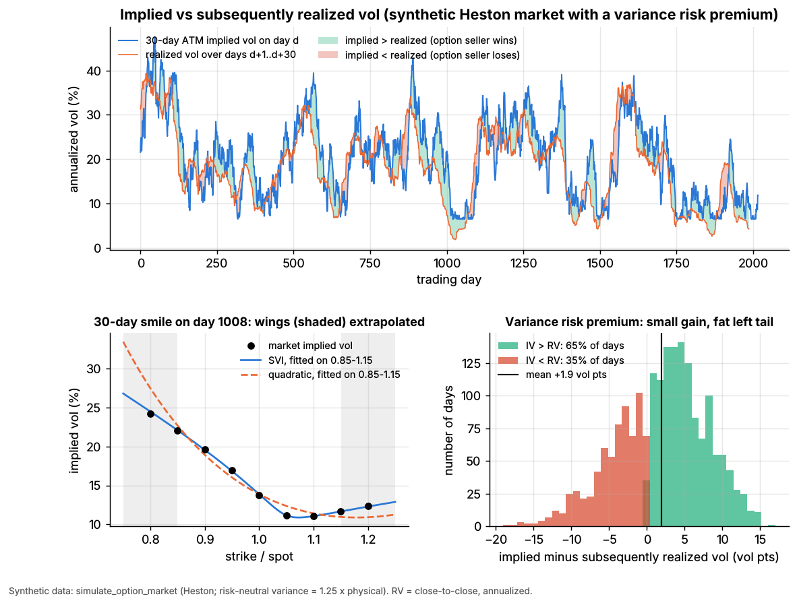
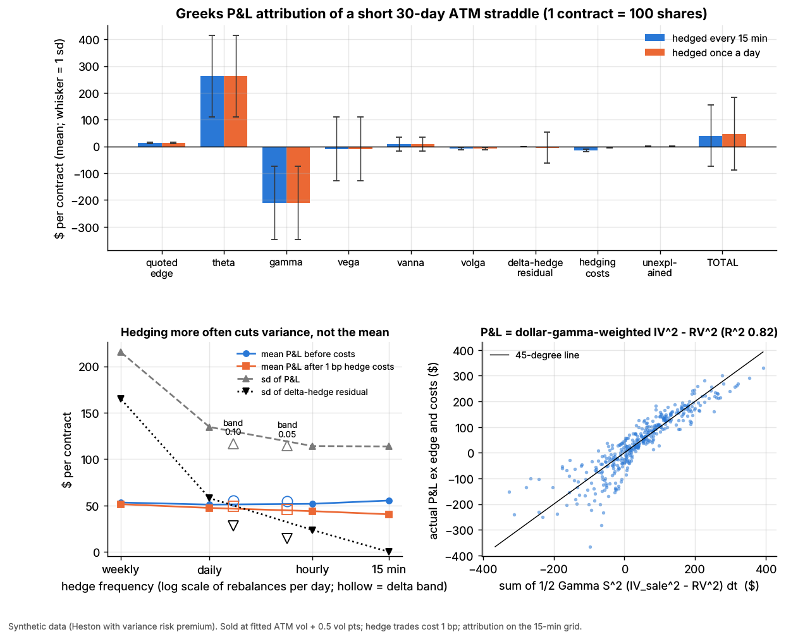

# Lab 06: Options market making, delta hedging and Greeks P&L attribution

## What it demonstrates

The lab uses a synthetic option market (`simulate_option_market`): eight years of a Heston
stochastic-volatility underlying, with options priced under a risk-neutral Heston whose variance
is 1.25 times the physical variance. That gap is the planted **variance risk premium (VRP)**. On
this market the lab shows five things.

1. **Smile fitting.** Each expiry's smile is fitted with a quadratic in log-moneyness and with raw
   **SVI** (Gatheral 2006; Gatheral & Jacquier 2014). Both fit the nine quoted strikes closely.
   The pitfall shows up when a fit is extended past the strikes it was fitted on: the parabola
   misses the wings by ten times more than SVI, because a parabola is a local approximation and
   SVI's wings are linear in log-moneyness, as Lee's (2004) moment formula requires.
2. **A short-straddle market maker.** Once a week the desk sells a 30-day at-the-money straddle at
   its fitted ATM vol plus **0.5 vol points of edge**. It delta-hedges with the stock until expiry,
   under one of six policies: every 15 minutes, hourly, daily or weekly, or only when net delta
   leaves a band of ±0.05 or ±0.10 per share. Every hedge trade pays 1 bp. The sample is 398
   overlapping trades.
3. **Greeks P&L attribution**, the desk's daily "P&L explain", computed on the 15-minute grid with
   the reusable function `greeks_attribution(...)`:

   `quoted edge + theta + gamma + vega + vanna + volga + delta-hedge residual + hedging costs + unexplained = total`

   The terms mean:
    - **quoted edge**: the premium received minus the fair (market) value at the trade.
    - **delta-hedge residual**: `sum (hedge shares + option delta) x dS`. It comes from a stale
      hedge between rebalances. It is zero by construction for 15-minute hedging, because 15
      minutes is also the attribution grid.
    - **unexplained**: the Taylor remainder (speed, charm and other higher-order terms), reported
      so you can see how well the Greeks explain the P&L.

   With r = 0, `theta + gamma` is exactly `sum 1/2 Gamma S^2 (IV^2 dt - (dS/S)^2)`. That is the
   textbook intuition: a delta-hedged short option earns the gap between implied and realized
   variance, weighted by dollar gamma. The lab checks the hold-to-expiry version
   `P&L ~ sum 1/2 Gamma(IV_sale) S^2 (IV_sale^2 - RV^2) dt` trade by trade. For background, see
   Boyle & Emanuel (1980) on discrete-hedging error and Bakshi & Kapadia (2003) on delta-hedged
   gains and the volatility risk premium.
4. **Hedge frequency changes P&L variance, not its mean** (to first order, before costs). The
   sd of the hedge residual falls roughly like 1/sqrt(rebalances), while mean P&L stays flat. With
   costs, frequent hedging becomes expensive. Move-based (delta-band) hedging reaches
   hourly-hedging variance with a quarter of the rebalances (Leland 1985; Whalley & Wilmott 1997).
5. **Implied vs realized vol over time**: the VRP the seller harvests, and its recovery vs the
   planted value.

The core functions in `lab.py` (`# === CORE ALGORITHM ===`) are `fit_smile(log_moneyness,
implied_vol, T, method)`, `delta_hedge_pnl(spot, position_delta, rebalance_every, band, cost_bps)`
and `greeks_attribution(value, spot, vol, greeks, hedge_shares, dt, premium, costs)`. The heart of
the attribution:

```python
dS, dvol = np.diff(spot), np.diff(vol)                  # per 15-minute step
theta  = sum(g["theta"] * dt)                           # time decay (per-year theta x years)
gamma  = sum(0.5 * g["gamma"] * dS**2)                  # convexity vs realized moves
vega   = sum(g["vega"] * dvol)                          # the option's own implied vol moved
vanna  = sum(g["vanna"] * dS * dvol);  volga = sum(0.5 * g["volga"] * dvol**2)
delta_hedge_residual = sum((hedge_shares + g["delta"]) * dS)    # stale hedge between rebalances
total = premium + value[-1] + sum(hedge_shares * dS) - costs
unexplained = total - (edge + theta + gamma + vega + vanna + volga + delta_hedge_residual - costs)
```

## Supports

- [Options market making](../../docs/02-strategies/a-liquidity-provision/options-market-making.md)
- [Options pricing and vol surfaces for market makers](../../docs/03-algorithms/f-market-making-and-hft-algorithms/options-pricing-and-vol-surfaces-for-mm.md)
- [Hedging algorithms](../../docs/03-algorithms/f-market-making-and-hft-algorithms/hedging-algorithms.md)

## How to run

```bash
cd /home/user/quant_trading_claude && export PATH=/home/user/venv-qt/bin:$PATH
python labs/06-options-mm-delta-hedging/lab.py              # full run (~22 s): 8 simulated years, 398 trades
python labs/06-options-mm-delta-hedging/lab.py --smoke      # CI run (~4 s): 1 year, 23 trades, writes to labs/_smoke/
python labs/06-options-mm-delta-hedging/lab.py --seed 3     # another random world
```

## Expected output

Full run, seed 7. Dollar figures are **per short straddle contract** (1 call + 1 put, 100 shares
each). The mean premium received is \$500, and the mean vega is \$24.2 per vol point.

**Implied vs realized (VRP).** The mean 30-day ATM implied vol is 20.3%, against 18.4% realized
over the following 30 days: a gap of **+1.9 vol points**. Implied was above realized on 65% of
days. The model's variance-swap rate is **1.26x** the subsequently realized variance, against
**1.25 planted**. ATM implied variance is only 1.19x, because with a negative skew ATM vol sits
below the variance-swap rate.



**Smile fits** (one day a month, all four expiries, vol points):

| Fit | In-sample RMSE | Wing extrapolation, mean abs error | Wing extrapolation, max error |
|---|---|---|---|
| Quadratic in log-moneyness | 0.50 | 1.25 | 4.7 |
| Raw SVI | 0.035 | 0.12 | 0.35 |

The wing test fits on strikes from 0.85 to 1.15 of spot and predicts the 0.80 and 1.20 strikes.

**Greeks attribution**: mean P&L, with the standard deviation across trades in brackets.

| Component | Hedged every 15 min | Hedged daily |
|---|---|---|
| Quoted edge | +13.1 (2) | +13.1 (2) |
| Theta | +262.6 (153) | +262.6 (153) |
| Gamma | -210.8 (138) | -210.8 (138) |
| Vega | -9.5 (119) | -9.5 (119) |
| Vanna | +7.6 (26) | +7.6 (26) |
| Volga | -7.6 (5) | -7.6 (5) |
| Delta-hedge residual | 0.0 (0) | -4.4 (58) |
| Hedging costs (1 bp) | -14.9 (5) | -3.6 (1) |
| Unexplained | -0.0 (1.7) | -0.0 (1.7) |
| **Total** | **+40.5 (114)** | **+47.4 (135)** |

- **Theta + gamma = +51.8**. This is the dollar-gamma-weighted gap between implied and realized
  variance (the identity holds to 1e-13). The hold-to-expiry formula
  `sum 1/2 Gamma(IV_sale) S^2 (IV_sale^2 - RV^2) dt` predicts each trade's P&L (before edge and
  costs) with **R² = 0.82**: its mean is \$44.7, against \$42.3 actual. The cruder
  `vega x (IV - RV)` gets R² = 0.75.
- **Unexplained sd $1.7.** Without the vanna and volga terms the unexplained sd would be
  **\$23.8**. For a straddle that drifts away from the money, the spot-vol cross term matters.
- **Pitfall: risk dwarfs edge.** With daily hedging, 35% of trades lose money, and the
  5th-percentile trade loses \$183, against a mean gain of \$47.

**Hedge policy** (398 trades; standard errors account for the 6x overlap):

| Policy | Rebalances/day | Mean P&L before costs (se) | Hedging costs | Mean P&L after costs | sd of P&L | sd of hedge residual |
|---|---|---|---|---|---|---|
| Every 15 min | 26 | 55.3 (14.0) | 14.9 | 40.5 | 114 | 0 |
| Hourly | 6.5 | 51.8 (14.0) | 7.9 | 43.9 | 114 | 24 |
| Daily | 1 | 51.0 (16.5) | 3.6 | 47.4 | 135 | 58 |
| Weekly | 0.2 | 53.2 (26.4) | 1.8 | 51.4 | 215 | 165 |
| Delta band ±0.05 | 4.1 | 54.6 (14.1) | 8.8 | 45.9 | 114 | 14 |
| Delta band ±0.10 | 1.5 | 54.9 (14.3) | 5.9 | 49.1 | 117 | 28 |

- **The mean does not move.** Before costs, the mean P&L is \$51–55 under every policy. The
  largest mean hedge residual is 1.2 standard errors from zero.
- **The variance does.** The sd of the hedge residual scales like rebalances^-0.56, against the
  -0.5 of theory. Total P&L sd flattens at about \$114, the implied-vs-realized vol risk that no
  amount of delta hedging removes.
- **Pitfall: costs.** Hedging every 15 minutes costs \$14.9 per contract, more than the whole
  quoted edge of \$13.1. The ±0.10 delta band matches hourly hedging's P&L sd (\$117 vs \$114) with
  a quarter of the rebalances and 25% lower costs.



Exact numbers move with `--seed` (the VRP realized in one 8-year path varies by a few tenths of a
vol point). The qualitative results do not change.

## What this toy misses vs the real world

- **The market maker's model is the market's model.** Marks come from the same Heston model that
  generates the prices, so implied vol is always observable and fair. Real desks mark to a fitted
  surface from noisy, stale and crossed quotes, so their own model error lands in "unexplained"
  and "vega".
- **No option bid-ask, inventory or flow.** The desk sells one straddle a week at a fixed
  0.5-vol-point edge. Real market makers quote thousands of strikes, take two-sided random flow,
  skew quotes to manage the vega and gamma of the whole book, and face informed flow before
  earnings and events. The edge captured is a fraction of the quoted spread.
- **Single underlying, no dividends, no rates, no jumps.** Index and single-stock books also carry
  dividend, borrow and rate risk. Jumps and earnings gaps make gamma P&L far fatter-tailed than
  this diffusion. Short-gamma books lose most of their money in a few gap days.
- **Hedge costs are a flat 1 bp.** Real hedging pays a spread that widens in stress, exactly
  when gamma hedging needs the most volume, plus market impact for large books.
- **Black-Scholes Greeks at each option's own implied vol.** Desks use smile-adjusted deltas: with
  a negative skew, the "true" delta of a put is larger in magnitude than its BS delta. A desk that
  ignores this carries a systematic spot-vol exposure, which this lab books under vanna and vega.
- **The variance process is stylized.** The calibration (vol of vol 0.6, mean reversion 2)
  violates the Feller condition, so variance spends time near zero and realized vol briefly drops
  to 2–5%, far below what broad equity indices show. The planted VRP is a constant 25% of
  variance; the real VRP varies over time and turns negative in crises.
- **Overlapping trades from one path.** 398 weekly trades over 8 years give only about 66
  independent 30-day periods. The mean P&L has a standard error of about \$14 on a \$40–55 mean.

## Key parameters

All economic parameters are **stylized** and chosen to be internally consistent, not calibrated
to a specific market.

| Parameter | Value | Meaning |
|---|---|---|
| Simulator | `simulate_option_market(n_days=2016)` | Heston: v0 = theta = 0.04, kappa = 2, xi = 0.6, rho = -0.7, `vrp = 0.25`, 26 steps/day |
| `TENOR_DAYS` | 30 trading days | straddle maturity; strike = spot at sale (ATM) |
| `trade_every` | 5 days (smoke: 10) | a new straddle each week; trades overlap 6x |
| `EDGE_VOL` | 0.005 (0.5 vol pt) | sold at fitted ATM vol + edge, about 2.5% of premium `[Estimate]` |
| `COST_BPS` | 1 bp per $ of stock traded | half-spread + fees on the hedge; liquid large cap or ETF `[Estimate]` |
| `TIME_POLICIES` | 15 min, hourly, daily, weekly | time-based rebalancing back to zero delta |
| `DELTA_BANDS` | ±0.05, ±0.10 per share | move-based: rebalance when net delta (per straddle share) leaves the band |
| `MULT` | 100 | contract multiplier |
| Smile fits | quadratic; raw SVI `(a, b, rho, m, s)` | SVI fitted by bounded least squares with an analytic Jacobian |

Sources (bibliographic details checked against Crossref, 2026-11):

- [Verified] Heston, S. L. (1993). "A closed-form solution for options with stochastic volatility with applications to bond and currency options." *Review of Financial Studies* 6(2), 327–343. <https://doi.org/10.1093/rfs/6.2.327>
- [Verified] Gatheral, J. (2006). *The Volatility Surface: A Practitioner's Guide*. Wiley. <https://doi.org/10.1002/9781119202073>
- [Verified] Gatheral, J. & Jacquier, A. (2014). "Arbitrage-free SVI volatility surfaces." *Quantitative Finance* 14(1), 59–71. <https://doi.org/10.1080/14697688.2013.819986>
- [Verified] Lee, R. W. (2004). "The moment formula for implied volatility at extreme strikes." *Mathematical Finance* 14(3), 469–480. <https://doi.org/10.1111/j.0960-1627.2004.00200.x>
- [Verified] Boyle, P. P. & Emanuel, D. (1980). "Discretely adjusted option hedges." *Journal of Financial Economics* 8(3), 259–282. <https://doi.org/10.1016/0304-405X(80)90003-3>
- [Verified] Leland, H. E. (1985). "Option pricing and replication with transactions costs." *Journal of Finance* 40(5), 1283–1301. <https://doi.org/10.1111/j.1540-6261.1985.tb02383.x>
- [Verified] Whalley, A. E. & Wilmott, P. (1997). "An asymptotic analysis of an optimal hedging model for option pricing with transaction costs." *Mathematical Finance* 7(3), 307–324. <https://doi.org/10.1111/1467-9965.00034>
- [Verified] Bakshi, G. & Kapadia, N. (2003). "Delta-hedged gains and the negative market volatility risk premium." *Review of Financial Studies* 16(2), 527–566. <https://doi.org/10.1093/rfs/hhg002>
- [Verified] Carr, P. & Wu, L. (2009). "Variance risk premiums." *Review of Financial Studies* 22(3), 1311–1341. <https://doi.org/10.1093/rfs/hhn038>
