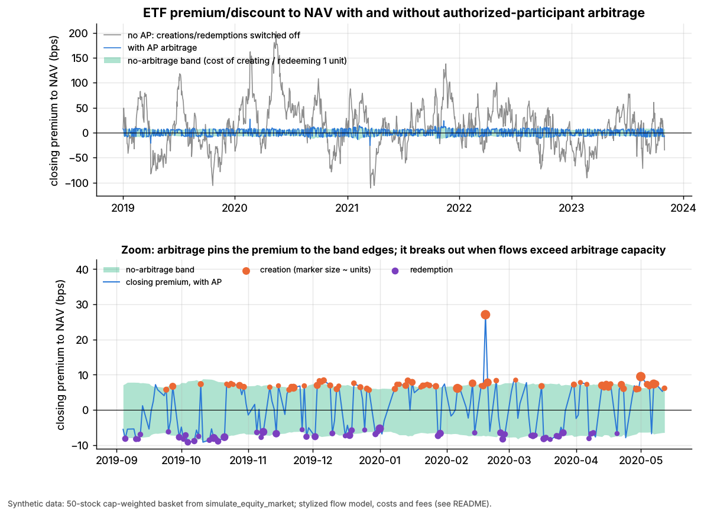
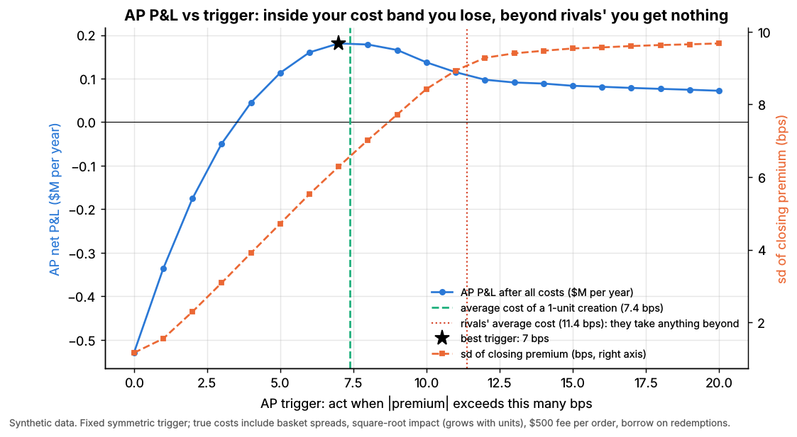

# Lab 07: ETF NAV arbitrage and the no-arbitrage band

## What it demonstrates

An exchange-traded fund (ETF) trades at a price that can drift away from the value of what it
holds (its NAV). **Authorized participants (APs)** pull the two back together by creating and
redeeming ETF shares, but only when the gap is big enough to pay their costs. This lab builds the
whole loop on synthetic data.

1. **The fund.** The ETF holds a 50-stock cap-weighted basket: the 50 largest names of a simulated
   200-stock market (`simulate_equity_market`, 5 years of daily data). One **creation unit** is
   50,000 ETF shares, worth \$2.5M at the start. It holds a fixed whole number of shares of each
   stock plus a small cash component that absorbs the rounding. **NAV** per share is
   `(sum shares_i x price_i + cash) / 50,000`.
2. **The premium.** The ETF's closing price is `NAV x (1 + premium)`. The premium is driven by
   **flow shocks**: net demand for ETF shares that the secondary market has not absorbed. It is a
   stylized AR(1) process, about 2 bps of premium per unit of unmet demand, with 5% of the
   imbalance absorbed naturally each day. Shocks are fat-tailed, larger in high-vol regimes and
   correlated with the market's move, so investors dump the ETF on down days.
3. **Creation and redemption.** When the ETF is rich, an AP **creates**: it buys the basket,
   delivers it to the issuer, receives new ETF shares and sells them. When the ETF is cheap, it
   **redeems**: it buys ETF shares, hands them in for the basket and sells the stocks. To lock in
   the price on the same day, the AP sells the stocks short and borrows them until the redeemed
   shares arrive. All-in costs, in bps of the unit's value:

   | Cost component (day 0, 1-unit order) | bps |
   |---|---|
   | ETF half-spread (sell or buy the ETF shares) | 1.53 |
   | Basket half-spreads, cap-weighted | 1.77 |
   | Basket market impact (square-root law) | 1.69 |
   | Creation or redemption fee (\$500 per order) | 2.00 |
   | Borrow for redemptions only (25 bps/yr for 1 day) | 0.07 |
   | **Total: the no-arbitrage band on day 0** | **-7.1 (redeem) to +7.0 (create)** |

   Borrow is a rounding error for liquid large caps. It matters for hard-to-borrow names or long
   settlement. Spreads are scaled by the square of the vol regime (stylized), so the band widens
   in stress, averaging ±7.4 bps and reaching 14.9 bps.
4. **Competition.** Rival arbitrageurs (other APs and ETF market makers) have costs 4 bps higher
   and take any premium beyond that. "Our" AP trades what is left beyond its own trigger. Each
   unit created and sold moves the premium by 2 bps, and daily capacity is limited by balance
   sheet: 10 units for us and 15 for rivals.
5. **Results:**
    - premium statistics with and without AP activity;
    - recovery of the planted flow persistence;
    - our AP's P&L vs its trigger threshold, which is negative if it trades inside its own cost
      band;
    - two pitfalls: the band widens in stress, and the premium breaks out of the band when flows
      exceed arbitrage capacity.

The model runs in **daily** steps. APs act at the close, when creations and redemptions are struck
at NAV. The core functions in `lab.py` (`# === CORE ALGORITHM ===`) are `nav(prices,
basket_shares, cash_per_unit, cu_size)`, `no_arbitrage_band(weights, half_spread_bps, daily_vol,
adv_usd, unit_value, n_units, ...)` and `arb_decision(premium_bps, create_cost_bps,
redeem_cost_bps, impact_bps_per_unit, max_units, buffer_bps)`:

```python
def arb_decision(premium_bps, create_cost_bps, redeem_cost_bps, impact_bps_per_unit, max_units, buffer_bps=0):
    up, dn = create_cost_bps + buffer_bps, redeem_cost_bps + buffer_bps      # triggers
    # trade the units whose AVERAGE premium (each unit moves it by impact) still beats the trigger
    n_create = floor((premium_bps - up) / impact_bps_per_unit + 0.5)
    n_redeem = floor((-premium_bps - dn) / impact_bps_per_unit + 0.5)
    units = n_create if n_create > 0 else (-n_redeem if n_redeem > 0 else 0)
    return clip(units, -max_units, max_units)          # +create, -redeem; balance-sheet limit
```

## Supports

- [ETF market making](../../docs/02-strategies/a-liquidity-provision/etf-market-making.md)
- [ETF and index arbitrage](../../docs/02-strategies/b-speed-and-structural/etf-and-index-arbitrage.md)

## How to run

```bash
cd /home/user/quant_trading_claude && export PATH=/home/user/venv-qt/bin:$PATH
python labs/07-etf-nav-arbitrage/lab.py              # full run (~2 s): 1,260 days
python labs/07-etf-nav-arbitrage/lab.py --smoke      # CI run (~2 s): 500 days, writes to labs/_smoke/
python labs/07-etf-nav-arbitrage/lab.py --seed 3     # another random world
```

## Expected output

Full run, seed 7, 1,260 trading days. All figures are closing premiums to NAV, in bps.

| Closing premium | sd | mean abs | 95th pct of abs | worst discount | days outside band | AR(1) | half-life (days) |
|---|---|---|---|---|---|---|---|
| No AP (creations and redemptions off) | 45.7 | 35.9 | 87.6 | -111 | 82% | 0.938 | 10.8 |
| With arbitrage, all days | 6.7 | 6.1 | 9.7 | -26 | 0.6% | 0.37 | 0.7 |
| With arbitrage, calm days | 6.6 | 6.0 | 9.2 | -26 | 0.7% | 0.36 | 0.7 |
| With arbitrage, stress days (42) | 9.2 | 9.0 | 13.6 | -14 | 0% | 0.43 | 0.8 |

"Outside band" means beyond the day's band by more than half a unit's impact (1 bp).

- **Arbitrage collapses the premium.** The premium's sd falls from 46 to 7 bps, and its
  half-life from about 11 days to under 1 day. The daily tracking error of the ETF price vs NAV
  halves, from 16.1 to 7.6 bps.
- **Truth recovery.** Without arbitrage, the premium's AR(1) coefficient is 0.938 against the
  planted 0.95, a half-life of 10.8 vs 13.5 days; other seeds give 0.953 and 0.955. With
  arbitrage the premium sits near the band edges, because arbitrage only pushes it back to the
  point where the next unit stops paying.
- **Primary-market activity.** All arbitrageurs together create 468 and redeem 404 units a year,
  about \$2.2B of gross primary-market flow. Our AP places 150 orders a year
  and nets **\$0.21M a year, about 2.8 bps per unit**: a thin-margin, scale business.
- **Pitfall 1, trading inside the band.** With a fixed trigger, our AP loses \$0.53M a year at a
  0 bps trigger and breaks even near 4 bps. It earns the most at 7 bps (\$0.18M a year), about its
  average one-unit cost of 7.4 bps. Above the rivals' cost (about 11.4 bps) it only picks up the
  rare days when the rivals' capacity is exhausted. The cost-aware rule, which triggers at each
  day's band, beats the best fixed trigger (\$0.21M vs \$0.18M a year).
- **Pitfall 2, the band is not fixed.** On stress days, basket and ETF spreads widen, and the
  premium is beyond the calm-market band on 69% of those days. It is still inside that day's
  wider band.
- **Pitfall 3, capacity.** On 8 days, flows exceeded everyone's balance-sheet limit. The premium
  then broke out of the band by up to 20 bps, reaching +27 / -26 bps. Arbitrage is only as strong
  as the capital behind it.





Numbers move with `--seed` (the vol regime, stress episodes and flow shocks change). The ordering
and the shape of the P&L curve do not.

## What this toy misses vs the real world

- **No intraday market making.** Real ETF market makers (often also APs) quote the ETF all day
  around an indicative NAV, hedge their inventory with the basket, futures or related ETFs, and
  create or redeem in bulk at the end of the day. That pulls liquid ETFs' premiums toward zero
  *inside* the band. Here only end-of-day arbitrage exists, so the premium sits at the band edges.
- **Stylized flow model.** The premium is a linear function of an AR(1) "unmet demand" state with
  made-up parameters: 2 bps per unit, 95% daily persistence, a \$20M daily shock sd. Real premium
  dynamics depend on the ETF's size, the liquidity of its holdings and who trades it. Petajisto
  (2017) documents much wider premiums for ETFs with illiquid or international holdings.
- **NAV is never stale.** All 50 stocks close at the same moment, as liquid US large caps do. For
  international, bond or illiquid baskets, NAV is computed from stale or matrix prices, so the
  measured "premium" is partly NAV error. How much of the March 2020 bond-ETF discounts was stale
  NAV is contested: issuers stressed stale bond prices, while Haddad, Moreira & Muir (2021) document
  a genuine dislocation driven by forced selling in the underlying bonds.
- **Fees, spreads and borrow are round, stylized numbers.** Real creation and redemption fees
  vary by issuer and basket. Some funds accept or require cash creations, with variable fees that
  pass the fund's own trading costs to the AP. Custom baskets let APs leave out illiquid or
  hard-to-borrow names.
- **No hedging or inventory risk.** The AP trades the ETF and the basket at the same closing
  prices. In practice the two legs are executed at slightly different times and prices. The ETF
  short or stock borrow can fail, and settlement and financing for large orders cost money.
- **A single fixed capacity per day.** Real arbitrage capacity depends on dealer balance sheets,
  risk limits and regulation, and it shrinks in exactly the stress episodes when flows are
  largest.
- **Daily steps only.** Intraday premiums, the closing auction and the ETF's role in price
  discovery are not modeled. Ben-David, Franzoni & Moussawi (2018) show that ETF arbitrage
  transmits ETF flow shocks into the underlying stocks, an effect this toy ignores: AP trades
  here do not move stock prices beyond the impact cost.

## Key parameters

All parameters are **stylized**: realistic orders of magnitude, not a calibration to any real
fund.

| Parameter | Value | Meaning |
|---|---|---|
| `simulate_equity_market` | `n_stocks=200, n_days=1260` (smoke: 500) | basket = top 50 by day-0 market cap, cap-weighted with fixed share counts |
| `CU_SIZE` | 50,000 ETF shares | creation unit; \$2.5M at `NAV0` = \$50 |
| `ETF_HALF_SPREAD_BPS` | 1.5 | ETF quoted spread 3 bps in calm markets `[Estimate]` |
| basket half-spreads | `spread_bps / 2` from the simulator | 1–3.5 bps for the 50 names; x vol-regime² in stress |
| `IMPACT_COEF` | 0.5 | square-root impact `0.5 x daily vol x sqrt(order / ADV)` (Tóth et al. 2011) `[Estimate]` |
| `FEE_USD` | \$500 per order | creation or redemption fee, fixed per order `[Estimate]` |
| `BORROW_BPS_PER_YEAR`, `SETTLE_DAYS` | 25 bps/yr, 1 day | borrow on the basket shorted during a redemption |
| `PREMIUM_PER_UNIT_BPS` | 2 bps per unit | premium move per unit of unmet demand, and per unit an arbitrageur trades |
| `FLOW_SD_UNITS`, `FLOW_PERSISTENCE`, `FLOW_MARKET_CORR` | 8 units/day, 0.95, 0.4 | flow shocks: size (x vol regime), persistence, correlation with the market |
| `MAX_UNITS`, `RIVAL_MAX_UNITS` | 10, 15 units/day | balance-sheet capacity: ours, rivals' combined |
| `RIVAL_EXTRA_BPS` | 4 bps | rivals' cost disadvantage; they arbitrage anything beyond band + 4 bps |
| trigger grid | 0–20 bps | fixed symmetric triggers for the P&L-vs-threshold curve |

Sources (bibliographic details checked against Crossref, 2026-11):

- [Verified] Lettau, M. & Madhavan, A. (2018). "Exchange-traded funds 101 for economists." *Journal of Economic Perspectives* 32(1), 135–154. <https://doi.org/10.1257/jep.32.1.135>
- [Verified] Petajisto, A. (2017). "Inefficiencies in the pricing of exchange-traded funds." *Financial Analysts Journal* 73(1), 24–54. <https://doi.org/10.2469/faj.v73.n1.7>
- [Verified] Engle, R. & Sarkar, D. (2006). "Premiums-discounts and exchange traded funds." *Journal of Derivatives* 13(4), 27–45. <https://doi.org/10.3905/jod.2006.635418>
- [Verified] Ben-David, I., Franzoni, F. & Moussawi, R. (2018). "Do ETFs increase volatility?" *Journal of Finance* 73(6), 2471–2535. <https://doi.org/10.1111/jofi.12727>
- [Verified] Pan, K. & Zeng, Y. (2017). "ETF arbitrage under liquidity mismatch." Working paper, SSRN. <https://doi.org/10.2139/ssrn.2895478>
- [Verified] Haddad, V., Moreira, A. & Muir, T. (2021). "When selling becomes viral: disruptions in debt markets in the COVID-19 crisis and the Fed's response." *Review of Financial Studies* 34(11), 5309–5351. <https://doi.org/10.1093/rfs/hhaa145>
- [Verified] Tóth, B., Lempérière, Y., Deremble, C., de Lataillade, J., Kockelkoren, J. & Bouchaud, J.-P. (2011). "Anomalous price impact and the critical nature of liquidity in financial markets." *Physical Review X* 1, 021006. <https://doi.org/10.1103/PhysRevX.1.021006>
