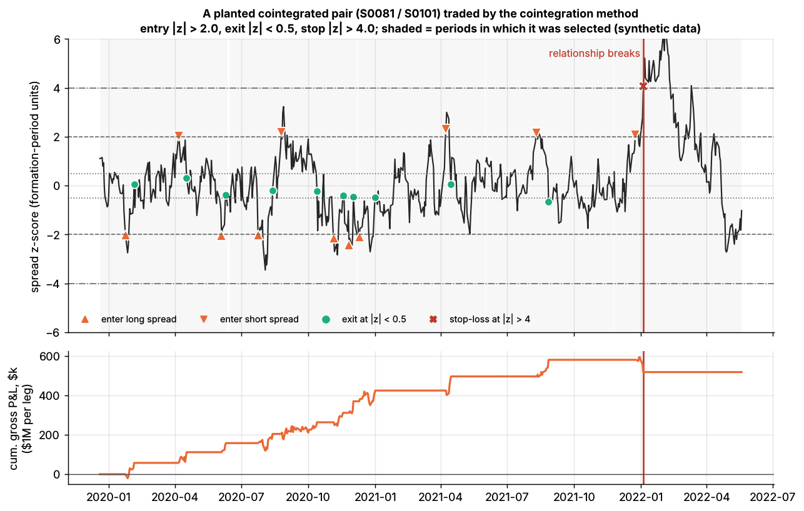
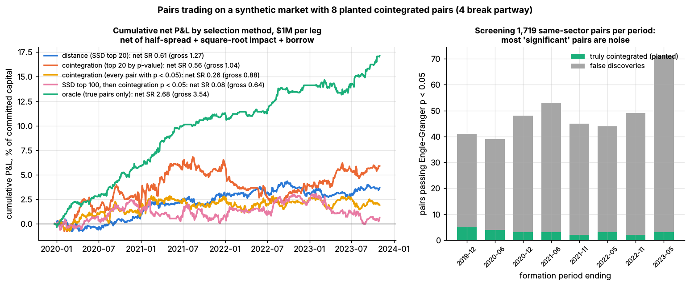

# Lab 08: Pairs trading, distance vs cointegration, with false discoveries and regime breaks

## What it demonstrates

The market has 200 synthetic stocks and 5 years of daily total-return prices
(`simulate_equity_market`). Stocks in the same sector share factor exposures, but their specific
returns are independent, so **no natural pair is cointegrated**. On top of that, the lab
**plants 8 cointegrated pairs**, clearly marked in `plant_pairs()`. For each pair, stock B's log
price is rebuilt as `c + gamma * log P_A + u`, where `u` is an Ornstein-Uhlenbeck spread with a
half-life of 4-20 days and a stationary sd of 1.5-3.5% (stylized). **Four of the pairs break
partway.** From a random day on, their spread drifts 6 stationary sd away over 60 days (a
re-rating after a merger, guidance shock or regulatory change) and then wanders as a random walk.
Every pair's status is known, so each screen can be scored.

Rolling 12-month formation and 6-month trading periods (8 trading periods, as in Gatev,
Goetzmann & Rouwenhorst 2006) compare five ways of picking pairs. All of them then trade the same
z-score rule: enter at |z| > 2.0, exit at |z| < 0.5, stop out at |z| > 4.0 (then sit out the rest
of the period), and close everything at the period end.

| Method | Selection | Hedge |
|---|---|---|
| **Distance** (GGR 2006) | 20 pairs with the smallest sum of squared differences (SSD) of normalized prices, among all 19,900 pairs | \$1 long / \$1 short |
| **Cointegration, top 20** (Engle & Granger 1987) | same-sector pairs (1,719) with Engle-Granger p < 0.05 (`statsmodels.coint`), lowest 20 p-values | OLS beta of log P_A on log P_B |
| Cointegration, every p < 0.05 | every same-sector pair that passes (about 49 per period) | OLS beta |
| Two-step | SSD top 100, then Engle-Granger p < 0.05, lowest 20 p-values | OLS beta |
| Oracle | the planted pairs that have not broken by the formation date (it cannot see future breaks) | OLS beta |

Costs are half the quoted spread plus square-root impact (`0.5 x daily vol x sqrt(trade / ADV)`)
on each leg at entry and exit, plus a 35 bps/yr general-collateral borrow fee on the short leg.
The lab shows:

1. **False discoveries.** About 46 null pairs pass the 5% screen each period, against at most 8
   true ones. A Benjamini-Hochberg correction across 1,719 tests leaves nothing.
2. **Low power.** On one year of daily data, Engle-Granger detects only about half of the true
   pairs. A spread with a 10-day half-life often fails the test.
3. **Double-dipping.** Testing only the SSD top 100 looks like a fix, but those pairs were picked
   because their prices moved together in the same window. 29% of them pass a 5% test, and only
   about 3 are real.
4. **Regime breaks.** A break wipes out about a period's profit on that pair. The stop-loss caps
   the damage but can also cut a position that would have recovered.
5. **Gross vs net Sharpe and capacity.** Both are reported for every method.

The core of the lab (`lab.py`, `# === CORE ALGORITHM ===`):

```python
def hedge_ratio(log_a, log_b):                       # Engle-Granger step 1
    X = np.column_stack([np.ones_like(log_b), log_b])
    (alpha, beta), *_ = np.linalg.lstsq(X, log_a, rcond=None)
    return beta, alpha, log_a - alpha - beta * log_b   # spread

def zscore_signals(z, entry=2.0, exit=0.5, stop=4.0):  # +1 long spread, -1 short, 0 flat
    pos, state, stopped = np.zeros(len(z), int), 0, False
    for t, zt in enumerate(z):
        if state == 0 and not stopped and entry < abs(zt) < stop:
            state = -1 if zt > 0 else 1                  # bet on convergence
        elif state != 0 and abs(zt) >= stop:
            state, stopped = 0, True                     # stop-loss, sit out the period
        elif (state == 1 and zt > -exit) or (state == -1 and zt < exit):
            state = 0                                    # converged
        pos[t] = state
    pos[-1] = 0
    return pos
```

The trading-period z-score uses formation-period parameters: `z = (spread - mean_formation) /
sd_formation`. `ssd_distance(norm_prices)` computes the GGR distance matrix in one matrix
product.

## Supports

- [Pairs trading and cointegration](../../docs/02-strategies/c-statistical-arbitrage/pairs-trading-and-cointegration.md)
- Also relevant: [Overfitting and multiple testing](../../docs/03-algorithms/c-validation-and-backtesting/overfitting-and-multiple-testing.md) (false discoveries), [Transaction cost and impact models](../../docs/03-algorithms/d-portfolio-construction/transaction-cost-and-impact-models.md)

## How to run

```bash
cd /home/user/quant_trading_claude && export PATH=/home/user/venv-qt/bin:$PATH
python labs/08-pairs-cointegration/lab.py            # full run (~16 s): plots + results.json
python labs/08-pairs-cointegration/lab.py --smoke    # CI run (~3 s, 80 stocks, 2 periods), writes to labs/_smoke/
python labs/08-pairs-cointegration/lab.py --seed 3   # another random market
```

## Expected output

Full run, seed 7. Each leg is \$1M at entry, so 20 pairs commit \$40M. Returns are on committed
capital; only about 24% of it is in use at any time.

**Screening** (average per formation period):

| | Pairs | Truly cointegrated among them |
|---|---|---|
| Same-sector pairs tested (Engle-Granger) | 1,719 | 6.4 planted, still intact |
| Pass p < 0.05 | 48.8 | **3.1** (false discovery share **94%**) |
| Pass Benjamini-Hochberg at 5% | 0 | 0 |
| Distance top 20 (SSD) | 20 | 5.4 |
| SSD top 100, then p < 0.05 | 29.0 (29% pass rate) | 2.9 |

**Backtests** (Sharpe ratios annualized; returns in % of committed capital per year):

| Method | Sharpe gross | Sharpe net | Return gross | Return net | Round trips | Avg hold (days) | Stop-outs | Cost, bps per $ traded |
|---|---|---|---|---|---|---|---|---|
| Distance (SSD top 20) | 1.27 | 0.61 | 1.9 | 0.9 | 267 | 17.9 | 105 | 14.5 |
| Cointegration, top 20 | 1.04 | 0.56 | 2.8 | 1.5 | 276 | 18.8 | 97 | 17.9 |
| Cointegration, every p < 0.05 | 0.88 | 0.26 | 1.7 | 0.5 | 617 | 22.1 | 243 | 17.5 |
| SSD top 100, then p < 0.05 | 0.64 | 0.08 | 1.3 | 0.2 | 291 | 17.0 | 117 | 15.7 |
| Oracle (true pairs only) | **3.54** | **2.68** | 5.7 | 4.3 | 94 | 16.2 | 10 | 18.6 |

- **Seed 7 is a lucky draw. Read the 8-seed range.** Over seeds 1-5, 7, 11 and 21, the median
  net Sharpe is about **-0.1 for distance** (range -1.05 to +0.69) and about **-0.4 for
  cointegration top 20** (-0.81 to +0.56). The **oracle** ranges from **+1.0 to +2.7**. On seed 7,
  the cointegration top 20's non-cointegrated pairs made +6.5% of capital gross. Across seeds
  that number ranges from -5.3% to +6.5%, so it is noise. With 8 true pairs among 19,900
  candidates, selection quality decides the result: both screens mostly trade noise, and only
  the true pairs pay for the costs.
- **Regime breaks** (oracle selection, 4 breaks): gross P&L after each break was **-2.2%, -4.0%,
  -0.5% and -7.2% of one leg**. An intact pair earns +6.5% of a leg per 6-month period, so a break
  costs about one period of profit. **Without the stop-loss**, the same four breaks would have
  made -11.3%, +20.8%, -0.4% and -7.2%. The stop caps the worst loss but cut one position that
  would have recovered. It is insurance, not alpha. On seeds 3 and 11 the stop helped on
  balance.
- **Capacity** (net Sharpe by leg size; committed capital is 40x the leg):

| $ per leg | \$0.25M | \$1M | \$4M | \$16M |
|---|---|---|---|---|
| Distance | 0.86 | 0.61 | 0.09 | -0.93 |
| Cointegration, top 20 | 0.75 | 0.56 | 0.17 | -0.60 |

  Each round trip trades every leg twice. At \$1M per leg, one-way cost is about 15-18 bps per
  dollar traded, mostly impact, since the median stock trades about \$63M a day. Committed
  capital turns over about 7x a year.



*A planted pair (S0081 / S0101, half-life 4.9 days) traded by the cointegration top-20 method
(synthetic data). Ten convergence trades make money. When the relationship breaks (red line)
the spread runs through the stop at |z| = 4, and the pair is never selected again.*



*Left: cumulative net P&L by selection method, % of committed capital. Right: same-sector pairs
passing Engle-Granger p < 0.05 in each formation period, true vs false discoveries.*

The null pass rate is about 2.7% (46 of about 1,710), below the nominal 5%. The tests overlap
heavily (each stock appears in about 17 pairs), and a fixed lag-1 Engle-Granger test is
slightly conservative on this data.

## What this toy misses vs the real world

- **No natural cointegration at all.** Real same-industry stocks (share classes, dual listings,
  merger arbitrage legs, close competitors) can share long-run drivers, and GGR found
  positive excess returns from unrestricted distance pairs in decades of US data. Here every
  natural pair is pure noise by construction, which makes the false-discovery lesson cleaner and
  the distance method look worse than it historically did.
- **Planted pairs are clean and stylized.** The spread is a single OU process with a constant hedge
  ratio. Real hedge ratios drift, spreads have fat tails and volatility clustering, and breaks
  come from news, so the break date is not random.
- **Fixed 12/6-month windows and one rule.** Practitioners re-estimate hedge ratios continuously
  (rolling or Kalman-filter betas). They use Johansen or total-least-squares instead of
  one-direction OLS, set thresholds from the OU half-life, and add a time stop (for example, exit
  after 2-3 half-lives).
- **Execution at the close, no shorting frictions beyond a flat fee.** Real pairs desks face
  hard-to-borrow fees, recalls, the uptick-style short-sale restriction in a falling market, and
  leg risk (one leg fills, the other doesn't).
- **Capacity is understated.** Each trade is executed in one day against the stock's average
  volume; real desks work orders over hours or days and trade larger, more liquid names.
- **Small universe and few trades.** 8 planted pairs, about 270 round trips per method and 4 years of
  trading make all Sharpe ratios noisy (see the 8-seed range above).

## Key parameters

| Parameter | Value | Meaning |
|---|---|---|
| `n_stocks`, `n_days` | 200, 1,260 (smoke 80, 504) | synthetic universe (5 years) |
| `FORMATION_DAYS`, `TRADING_DAYS` | 252, 126 | 12-month formation, 6-month trading (GGR) |
| `N_PAIRS` | 20 | pairs traded per period |
| `ENTRY_Z`, `EXIT_Z`, `STOP_Z` | 2.0, 0.5, 4.0 | z-score rule; after a stop the pair sits out the period |
| `P_VALUE` | 0.05 | Engle-Granger screen (`coint(..., trend="c", maxlag=1, autolag=None)`, fixed lag for speed) |
| hedge-ratio filter | 0.25 < beta < 4 | drop pairs with unusable hedge ratios |
| `N_PLANTED`, `N_BREAKING` | 8, 4 | planted pairs; how many break |
| planted spread | half-life U(4, 20) days, sd U(1.5%, 3.5%), gamma U(0.8, 1.2) | stylized |
| `BREAK_DAYS`, `BREAK_DRIFT_SD` | 60, 6.0 | a break = 6 stationary sd of drift over 60 days, then a random walk |
| `PRESCREEN` | 100 | SSD pre-screen for the two-step method |
| `LEG_USD` | \$1M | $ per leg at entry (gross \$2M per pair) |
| `IMPACT_COEF` | 0.5 | square-root impact coefficient `Y` in `Y x sigma x sqrt(Q / ADV)` (stylized; same as Labs 09, 10, 16) |
| `BORROW_BPS_PER_YEAR` | 35 | general-collateral borrow fee on the short leg (stylized) |

Sources. Bibliographic details checked against Crossref (2026-11).

- [Verified] Gatev, E., Goetzmann, W. N. & Rouwenhorst, K. G. (2006). "Pairs Trading: Performance of a Relative-Value Arbitrage Rule." *Review of Financial Studies* 19(3), 797-827. <https://doi.org/10.1093/rfs/hhj020> (accessed 2026-11)
- [Verified] Engle, R. F. & Granger, C. W. J. (1987). "Co-Integration and Error Correction: Representation, Estimation, and Testing." *Econometrica* 55(2). <https://doi.org/10.2307/1913236> (accessed 2026-11)
