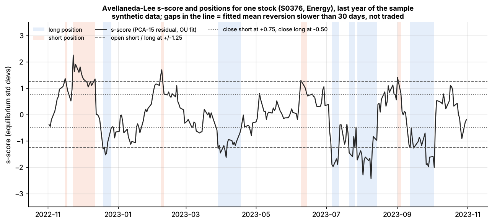
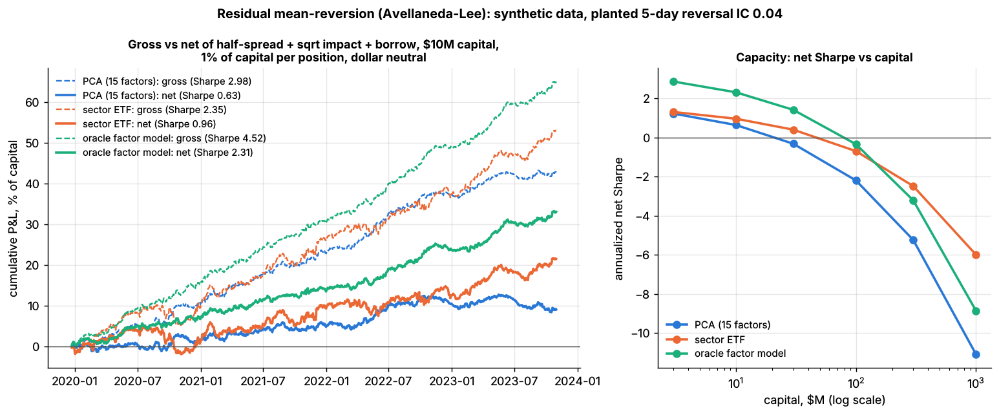

# Lab 09: PCA-residual statistical arbitrage (Avellaneda-Lee s-scores)

## What it demonstrates

The market has 500 synthetic stocks and 5 years of daily data (`simulate_equity_market` with
`reversal_strength = 0.04`). It contains a **real, known short-term reversal in specific
returns**: minus the past 5-day specific return predicts the next day's specific return with a
daily IC of 0.04. That is a strong, stylized effect. The lab runs the Avellaneda & Lee (2010)
recipe on it:

1. **Statistical factors.** Every week, take the correlation matrix of the last 252 days of
   returns and keep the top 15 eigenvectors. The eigenportfolio weights are `Q_ij = v_ij /
   sigma_i`.
2. **Residuals.** Regress each stock's last 60 daily returns on the 15 eigenportfolio returns,
   with an intercept for the stock's drift.
3. **OU fit and s-score.** Treat the cumulative residual `X_t` as an Ornstein-Uhlenbeck process,
   fitted as an AR(1): `X_{t+1} = a + b X_t + zeta`. Then `kappa = -ln(b) x 252`, `m = a / (1 - b)`,
   `sigma_eq = sqrt(var(zeta) / (1 - b^2))`, and the **s-score is `(X_today - m) / sigma_eq`**,
   with `m` centered across stocks (a common refinement). Only stocks whose mean-reversion time `1 / kappa` is under 30
   days are traded.
4. **Trading bands.** Open long if s < -1.25 and short if s > +1.25. Close longs when s > -0.50 and
   shorts when s < +0.75.
5. **Book.** Each open position is 1% of capital. The net long or short dollar amount is hedged
   with an equal-weighted basket of the universe, so the book is dollar neutral. Gross is about
   1.9x capital.

The same s-score machinery runs on two other residual definitions:

- **Sector ETF:** regress each stock on its own cap-weighted sector index, as in the paper's ETF
  variant.
- **Oracle factor model:** a daily cross-sectional regression on the simulator's **true**
  exposures (market beta, 4 styles, 11 sectors).

Costs are half the quoted spread plus square-root impact (`0.5 x daily vol x sqrt(trade / ADV)`)
plus a 35 bps/yr general-collateral borrow fee on the shorts.

What it shows:

- **Recovery of the truth.** PCA residuals correlate 0.86 with the true specific returns. The
  s-score captures only about a third of the planted reversal's predictive power.
- **Costs.** The gross Sharpe is about 3, but the strategy turns its gross book over about 57x a
  year. It works only with very low costs (break-even is about 10 bps per $ traded), and its
  capacity is tiny.
- **Factor count.** Using 30 factors is worse than 15: the residual regression overfits 60 days
  of data.

The core of the lab (`lab.py`, `# === CORE ALGORITHM ===`; all arrays are days x stocks, last row
= today):

```python
def pca_residuals(returns, n_factors=15, resid_window=60, eigenportfolios=None):
    Q = eigenportfolios
    if Q is None:                                     # steps 1-2: eigenportfolios
        sigma = returns.std(axis=0, ddof=1)
        Y = (returns - returns.mean(axis=0)) / sigma
        eigval, U = np.linalg.eigh(Y @ Y.T)            # days x days Gram trick
        top = np.argsort(eigval)[::-1][:n_factors]
        Q = (Y.T @ U[:, top] / np.sqrt(eigval[top])) / sigma[:, None]
    R = returns[-resid_window:]
    X = np.column_stack([np.ones(resid_window), R @ Q])          # drift + factor returns
    return R - X @ np.linalg.solve(X.T @ X, X.T @ R), Q          # residuals

def ou_sscore(residuals, max_reversion_days=30.0, center=True):
    X = np.cumsum(residuals, axis=0)                  # cumulative residual
    x0, x1 = X[:-1], X[1:]
    b = cov(x0, x1) / var(x0);  a = mean(x1) - b * mean(x0)       # AR(1) per stock
    m = a / (1 - b);  sigma_eq = sqrt(var(x1 - a - b * x0) / (1 - b**2))
    if center: m = m - mean(m)
    s = (X[-1] - m) / sigma_eq                        # = -m / sigma_eq when an intercept was used
    return where((0 < b < 1) & (1 / kappa < 30 days), s, nan)     # (pseudocode condensed)
```

`sscore_positions(s, prev)` applies the open and close bands day by day.

## Supports

- [Factor-residual mean reversion](../../docs/02-strategies/c-statistical-arbitrage/factor-residual-mean-reversion.md)
- Also relevant: [Short-term cross-sectional reversal](../../docs/02-strategies/c-statistical-arbitrage/short-term-cross-sectional-reversal.md), [Risk models](../../docs/03-algorithms/d-portfolio-construction/risk-models.md) (statistical vs fundamental factors), [Transaction cost and impact models](../../docs/03-algorithms/d-portfolio-construction/transaction-cost-and-impact-models.md)

## How to run

```bash
cd /home/user/quant_trading_claude && export PATH=/home/user/venv-qt/bin:$PATH
python labs/09-pca-residual-stat-arb/lab.py            # full run (~16 s): plots + results.json
python labs/09-pca-residual-stat-arb/lab.py --smoke    # CI run (~3 s, 120 stocks), writes to labs/_smoke/
python labs/09-pca-residual-stat-arb/lab.py --seed 3   # another random market
```

## Expected output

Full run, seed 7: 500 stocks, 1,007 trading days after the 252-day warm-up. The headline book
has **\$10M of capital**, with 1% of capital (\$100k) per position and about 180 open positions.

**Truth checks:**

| | PCA (15 factors) | Sector ETF | Oracle factor model |
|---|---|---|---|
| corr(residual, true specific return) | 0.86 | 0.92 | 0.98 |
| IC of -s-score vs next-day specific return | 0.013 | 0.015 | 0.016 |

The planted 5-day reversal has an IC of 0.04, and the oracle 5-day signal recovers 0.038. The
s-score uses a 60-day OU fit, so it picks up only about a third of that edge.

**Backtests** (Sharpe ratios annualized; returns in % of capital per year):

| Residuals | Sharpe gross | Sharpe net (\$10M) | Return gross | Return net | Turnover (x gross/yr) | Avg hold (days) | Cost, bps per $ traded | Break-even cost (bps) |
|---|---|---|---|---|---|---|---|---|
| PCA, 15 factors | **2.98** | **0.63** | 10.7 | 2.3 | 57 | 9.3 | 7.6 | 9.7 |
| Sector ETF | 2.35 | 0.96 | 13.3 | 5.4 | 53 | 9.9 | 7.4 | 12.8 |
| Oracle factor model | 4.52 | 2.31 | 16.3 | 8.3 | 54 | 9.8 | 7.5 | 15.6 |

- **Costs, as a flat cost per $ traded:** the PCA book's net Sharpe is 2.89 at 0 bps, 2.30 at
  2 bps, **1.40 at 5 bps** and **-0.10 at 10 bps**. The strategy needs an execution stack that pays
  a few bps per trade, all in.
- **Capacity** (net Sharpe by capital; 1% of capital per position):

| Capital | \$3M | \$10M | \$30M | \$100M | \$300M | \$1B |
|---|---|---|---|---|---|---|
| PCA (15 factors) | 1.22 | 0.63 | -0.32 | -2.20 | -5.24 | -11.09 |
| Sector ETF | 1.30 | 0.96 | 0.40 | -0.70 | -2.49 | -6.00 |
| Oracle factor model | 2.86 | 2.31 | 1.41 | -0.35 | -3.22 | -8.86 |

  Capacity looks tiny because every position is executed in one day against a median ADV of about
  \$56M, and the book makes about 5,000 round trips a year.
- **Number of PCA factors** (gross / net Sharpe at \$10M; IC of -s): 1 factor 2.26 / 1.06
  (0.0137); 5 factors 1.78 / 0.13 (0.0136); 15 factors 2.98 / 0.63 (0.0131); 30 factors 2.38 / -0.38
  (0.0110). With 30 factors, the 60-day regression fits 31 parameters to 60 observations. It
  absorbs part of the very residual it is supposed to expose, and the IC falls. The ranking
  between 1, 5 and 15 factors varies by seed; 30 is the worst on every seed tried.
- **Seeds 3 and 11:** PCA gross Sharpe 3.25 and 3.39, net at \$10M 1.13 and 1.17, break-even about
  11 bps. The oracle is best on every seed. Sector-ETF vs PCA varies by seed.



*s-score of one stock over the last year of the sample, with the Avellaneda-Lee bands and the
resulting long (blue) and short (orange) positions (synthetic data).*



*Left: cumulative P&L, % of capital, gross (dashed) vs net (solid) for the three residual models,
\$10M book. Right: net Sharpe vs capital.*

## What this toy misses vs the real world

- **The planted effect is clean, stationary and strong.** A daily IC of 0.04 for 5-day residual
  reversal, constant for 5 years, is generous. Real residual mean-reversion varies with
  volatility, liquidity and crowding, and its profitability has varied over time.
- **The factor structure is simple.** The simulator has 16 true factors with constant
  exposures, so a fundamental (oracle) model can recover the residual almost perfectly (0.98).
  Real exposures drift, and real statistical factors pick up transient themes (crowded trades,
  index events) that a fixed fundamental model misses. That is one reason practitioners use PCA
  at all.
- **Execution is one-shot at the close.** Real stat-arb desks trade continuously, net crossing
  trades between signals, post passive orders and pay a few bps per trade. Those costs are what
  the flat-cost sweep explores. Capacity numbers scale with the universe's liquidity and with
  execution quality.
- **No hedging cost or factor-hedge drift.** The net dollar hedge is an equal-weighted basket
  traded at the same cost as stocks. Real desks hedge with futures or ETFs, and Avellaneda-Lee
  hedge each position with its own factor loadings, which this toy does not do.
- **Volume-blind signals.** The paper also has a trading-time variant that scales returns by
  volume; it is not implemented here.
- **No short-sale constraints beyond a flat fee.** Hard-to-borrow names, recalls and
  short-sale restrictions are ignored.
- **One universe of 500 names.** With a larger universe the book diversifies more, but the cost
  per trade is what limits the strategy.

## Key parameters

| Parameter | Value | Meaning |
|---|---|---|
| `n_stocks`, `n_days` | 500, 1,260 (smoke 120, 420) | synthetic universe (5 years) |
| `REVERSAL_STRENGTH` | 0.04 | planted daily IC of minus the 5-day specific return (stylized, strong) |
| `N_FACTORS` | 15 | PCA factors (also run: 1, 5, 30) |
| `CORR_WINDOW` | 252 days | correlation-matrix window |
| `RESID_WINDOW` | 60 days | residual regression and OU fit window |
| `PCA_REFIT_EVERY` | 5 days | eigenportfolios re-estimated weekly, to save time |
| `max_reversion_days` | 30 | trade only if `1 / kappa` is under 30 trading days |
| `s_open`, `s_close_long`, `s_close_short` | 1.25, 0.50, 0.75 | Avellaneda-Lee bands |
| `POSITION_SIZE` | 1% of capital | per open position; net $ hedged with an equal-weight basket |
| `BOOK_USD` | \$10M | capital of the headline book |
| `IMPACT_COEF` | 0.5 | square-root impact coefficient `Y` in `Y x sigma x sqrt(Q / ADV)` (stylized; same as Labs 08, 10, 16) |
| `BORROW_BPS_PER_YEAR` | 35 | general-collateral borrow fee on shorts (stylized) |

Sources. Bibliographic details checked against Crossref (2026-11).

- [Verified] Avellaneda, M. & Lee, J.-H. (2010). "Statistical arbitrage in the US equities market." *Quantitative Finance* 10(7), 761-782. <https://doi.org/10.1080/14697680903124632> (accessed 2026-11)
