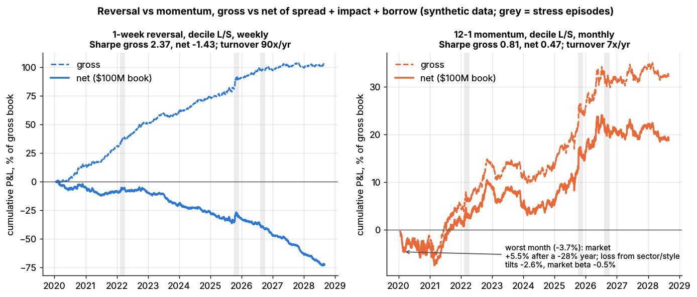
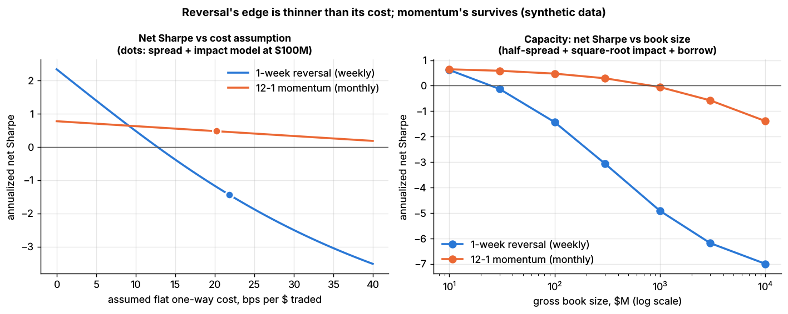

# Lab 10: Short-term reversal vs momentum, gross and net of trading costs

## What it demonstrates

A synthetic 500-stock market (10 years of daily data from `simulate_equity_market`) has two
planted effects of known size in the specific (residual) returns: a **1-week reversal** (daily IC
0.03 of minus the past 5-day specific return) and a **12-1 month momentum** (daily IC 0.01). Both
magnitudes are stylized. The lab builds the two textbook books from **total** returns, as a trader
would, and charges realistic costs:

1. **1-week reversal** (Lehmann 1990; Lo & MacKinlay 1990): buy last week's losers and sell last
   week's winners relative to the equal-weighted market. Headline book: equal-weighted
   decile long-short, rebalanced weekly. Variants: the Lo-MacKinlay linear weights
   `w_i ∝ -(r_i - r_mkt)`, and the decile book rebalanced daily.
2. **12-1 momentum** (Jegadeesh & Titman 1993): rank on the return from 12 months ago to 1 month
   ago (the most recent month is skipped because it reverses), decile long-short, rebalanced monthly.
   Variant: the same book with its market beta hedged by an equal-weighted index basket.
3. **Costs** on every dollar traded: half the quoted spread, plus square-root market impact
   `impact_coef x daily vol x sqrt(trade $ / ADV $)`, plus a 35 bps/yr general-collateral borrow
   fee on the short side. The book is sized in gross dollars (long + short), so impact grows with
   the book size.
4. **Results:** reversal has about 3x momentum's gross Sharpe but trades about 14x as much. Above
   a small book size (about \$30M here), costs wipe it out. Momentum survives. The lab shows this three ways: gross vs
   net P&L of a \$100M book, net Sharpe against a flat cost-per-trade assumption (the break-even
   cost), and net Sharpe against book size (capacity).
5. **Truth check:** the measured ICs are compared with the planted ones.
6. **Pitfall: momentum's worst month.** After a bear market the book is short the losers, which
   carry high beta and sit in the beaten-down sectors. When the market rebounds, the book loses.
   This is the Daniel & Moskowitz (2016) crash mechanism. Using the true exposures, the lab splits
   that month's loss into market beta, sector and style tilts, and specific returns.

The core of the lab (`lab.py`, `# === CORE ALGORITHM ===`):

```python
def reversal_signal(returns, lookback=5):            # + = past loser = buy
    past = returns.rolling(lookback).sum()
    return -past.sub(past.mean(axis=1), axis=0)

def momentum_signal(returns, lookback=252, skip=21):   # 12-1: days t-251 .. t-21
    return np.log1p(returns).rolling(lookback - skip).sum().shift(skip)

def apply_costs(weights, returns, book_usd, spread_bps, adv_usd, daily_vol,
                impact_coef=0.5, borrow_bps_per_year=35.0):
    traded = weights.diff().abs()                                  # fraction of book traded
    cost_rate = spread_bps / 2e4 + impact_coef * daily_vol * np.sqrt(traded * book_usd / adv_usd)
    trading_cost = (traded * cost_rate).sum(axis=1)
    borrow_cost = weights.shift(1).clip(upper=0).abs().sum(axis=1) * borrow_bps_per_year / 1e4 / 252
    gross = (weights.shift(1) * returns).sum(axis=1)               # weights set at t-1 earn day t
    return gross - trading_cost - borrow_cost                      # (lab returns all columns)
```

## Supports

- [Short-term cross-sectional reversal](../../docs/02-strategies/c-statistical-arbitrage/short-term-cross-sectional-reversal.md)
- [Momentum](../../docs/02-strategies/e-risk-premia-and-factors/momentum.md)
- [Transaction cost and impact models](../../docs/03-algorithms/d-portfolio-construction/transaction-cost-and-impact-models.md) (the cost model)

## How to run

```bash
cd /home/user/quant_trading_claude && export PATH=/home/user/venv-qt/bin:$PATH
python labs/10-reversal-momentum-costs/lab.py            # full run (~6 s): plots + results.json
python labs/10-reversal-momentum-costs/lab.py --smoke    # CI run (~3 s), writes to labs/_smoke/
python labs/10-reversal-momentum-costs/lab.py --seed 3   # another random market
```

## Expected output

Full run, seed 7: 500 stocks, 2,246 evaluation days (about 8.9 years after the 13-month warm-up).
Universe ADV is \$36B/day in total, with a median stock ADV of \$55M. The headline book is \$100M
gross (\$50M long, \$50M short), with `impact_coef = 0.5` and 35 bps/yr borrow.

| Book | Sharpe gross | Sharpe net (\$100M) | Return gross %/yr | Return net %/yr | Turnover (x gross/yr) | Avg cost, bps per $ traded |
|---|---|---|---|---|---|---|
| 1-week reversal, decile, weekly | 2.37 | -1.43 | 11.6 | -8.1 | 90 | 21.8 |
| 1-week reversal, Lo-MacKinlay weights, weekly | 2.58 | -0.54 | 8.8 | -2.0 | 73 | 14.6 |
| 1-week reversal, decile, daily | 3.84 | -5.30 | 18.5 | -24.9 | 213 | 20.3 |
| 12-1 momentum, decile, monthly | 0.81 | 0.47 | 3.6 | 2.1 | 6.5 | 20.2 |
| 12-1 momentum, beta-hedged | 0.82 | 0.46 | 3.5 | 2.0 | 6.8 | 19.5 |

Returns are per \$1 of gross book. Per \$1 long plus \$1 short, multiply them by 2.
The Lo-MacKinlay weights trade every stock a little instead of the deciles a lot, so they pay
less impact per dollar traded.

- **IC recovery** (mean daily IC vs next-day specific return): the 1-week reversal signal built
  from total returns gets **0.026** (planted 0.03; the oracle signal built from specific returns
  gets 0.028). 12-1 momentum gets **0.0077** (planted 0.01; oracle 0.0085). Factor noise in total
  returns dilutes both.
- **Break-even cost** (the flat one-way cost per $ traded at which net return is zero): **12.7 bps**
  for weekly reversal and 8.6 bps for daily reversal, vs **52.5 bps** for momentum. The daily book has
  the highest gross Sharpe and the lowest break-even cost.
- **Capacity** (net Sharpe by gross book size):

| Gross book | \$10M | \$30M | \$100M | \$300M | \$1B | \$3B |
|---|---|---|---|---|---|---|
| Reversal (weekly decile) | 0.62 | -0.13 | -1.43 | -3.06 | -4.92 | -6.19 |
| Momentum (monthly decile) | 0.64 | 0.59 | 0.47 | 0.29 | -0.06 | -0.58 |

  At \$10M the two books earn about the same net Sharpe. Above that, reversal's cost bill takes
  over: at \$100M it is 19.5% of gross book a year, vs 1.3% for momentum. With square-root impact, capacity scales roughly with the
  universe's dollar volume. This universe trades about \$36B a day, a small fraction of US equity
  volume, so read the dollar figures as relative, not absolute.

- **Momentum's worst month** ended 2020-02-27 (synthetic dates): **-3.7%** of gross, a -2.9 sd
  month. The market rose 5.5% after falling 28% over the trailing year. The book's beta going in
  was -0.19 per \$1 long plus \$1 short. The loss splits into **-2.6% from sector and style tilts**,
  -0.5% from market beta and -0.6% from specific returns, so hedging beta alone barely helps (the
  beta-hedged book lost -3.2%). Over the whole sample, the book's beta has a 0.71 correlation with
  the trailing 12-month market return: it is short beta after bear markets, as in Daniel &
  Moskowitz (2016). The simulator's crash is mild. Its stress episodes are sharp drops without
  violent rebounds, and its betas span only 0.6 to 1.5.



*Cumulative P&L, % of gross book, \$100M book (synthetic data). Dashed = gross, solid = net of
half-spread, square-root impact and borrow. Grey bands = the simulator's stress episodes.*



*Left: net Sharpe if every dollar traded cost a flat amount. Dots mark the spread-plus-impact
model at \$100M. Right: net Sharpe vs gross book size under the spread-plus-impact model.*

Across seeds 1, 3 and 7, the ranking is unchanged at \$100M. Reversal gross Sharpe is 1.6-2.5 and
net is -1.3 to -1.9. Momentum gross is 0.8-1.3 and net is 0.5-1.0. Seed 3's worst momentum month
is larger (-7.2%, a -5 sd month): the market rose 11% after a -30% trailing year, and sector and
style tilts again caused most of the loss.

## What this toy misses vs the real world

- **Costs are a formula, not fills.** Every trade executes at the close in one day at half-spread
  plus a stylized square-root impact (`impact_coef = 0.5`). Real desks spread trades over days, net
  crossing flows, trade passively, and buffer the turnover (trade only when a name moves well past
  the decile cutoff). These tactics can cut reversal costs a lot, so a backtest's break-even cost says
  as much about its execution model as about the signal.
- **The effects are planted and stationary.** The reversal and momentum ICs are constant for 10
  years. Real reversal and momentum profits vary over time with market conditions, liquidity
  and crowding. The simulator has no alpha decay, no regime in the effects themselves and no
  competing traders.
- **Equal-weighted deciles of a 500-name universe.** Real books trade 1,000-3,000 names, weight by
  liquidity or risk, and neutralize sectors and betas in an optimizer. Capacity numbers scale with
  the universe's ADV: this universe trades about \$36B a day in total.
- **Mild momentum crashes.** The simulator's betas span only 0.6-1.5 and its stress episodes are
  drops without violent rebounds. Historical momentum crashes after bear markets were far larger
  (Daniel & Moskowitz 2016). The drawdown here is a lower bound on that risk.
- **No microstructure in the reversal.** Real 1-week reversal is partly bid-ask bounce and liquidity
  provision around order imbalances. Here it is a clean planted effect in specific returns, with no
  relation to spreads or volume.
- **Simplified borrow.** A flat 35 bps/yr fee on every short. Real borrow fees on hard-to-borrow
  names run to percent per year and more. Past losers, which the momentum book shorts, are
  more often hard to borrow. Recalls and short-sale restrictions are ignored.
- **Close-to-close timing without slippage.** Signals at the close of day t trade at that same close.
  A one-day delay matters more for reversal than for momentum.

## Key parameters

| Parameter | Value | Meaning |
|---|---|---|
| `n_stocks`, `n_days` | 500, 2,520 (smoke 150, 600) | synthetic universe, 10 years of business days |
| `REVERSAL_STRENGTH` | 0.03 | planted daily IC of minus the 5-day specific return (stylized) |
| `MOMENTUM_STRENGTH` | 0.01 | planted daily IC of 12-1 month specific momentum (stylized) |
| reversal `lookback`, rebalance | 5 days, every 5 days | Lehmann-style weekly reversal |
| momentum `lookback`, `skip`, rebalance | 252, 21 days, every 21 days | Jegadeesh-Titman 12-1, monthly |
| decile `q` | 0.10 | long top 10%, short bottom 10%, equal weight, gross 1 |
| `BASE_BOOK_USD` | \$100M gross | headline book size for net numbers |
| `IMPACT_COEF` | 0.5 | square-root-law coefficient `Y` in `Y x sigma x sqrt(Q / ADV)`; stylized, `Y` is of order 1 in the square-root-law literature (Tóth et al. 2011) |
| spread | from `m.spread_bps` (2-19 bps, median 5.8) | pay half per trade |
| `daily_vol` | trailing 60-day realized vol | impact scale |
| `BORROW_BPS_PER_YEAR` | 35 | general-collateral borrow fee on shorts (stylized) |

Sources. Bibliographic details checked against Crossref (2026-11).

- [Verified] Lehmann, B. N. (1990). "Fads, Martingales, and Market Efficiency." *Quarterly Journal of Economics* 105(1). <https://doi.org/10.2307/2937816> (accessed 2026-11)
- [Verified] Lo, A. W. & MacKinlay, A. C. (1990). "When Are Contrarian Profits Due to Stock Market Overreaction?" *Review of Financial Studies* 3(2), 175-205. <https://doi.org/10.1093/rfs/3.2.175> (accessed 2026-11)
- [Verified] Jegadeesh, N. & Titman, S. (1993). "Returns to Buying Winners and Selling Losers: Implications for Stock Market Efficiency." *Journal of Finance* 48(1), 65-91. <https://doi.org/10.1111/j.1540-6261.1993.tb04702.x> (accessed 2026-11)
- [Verified] Daniel, K. & Moskowitz, T. J. (2016). "Momentum Crashes." *Journal of Financial Economics* 122(2), 221-247. <https://doi.org/10.1016/j.jfineco.2015.12.002> (accessed 2026-11)
- [Verified] Tóth, B., Lempérière, Y., Deremble, C., de Lataillade, J., Kockelkoren, J. & Bouchaud, J.-P. (2011). "Anomalous Price Impact and the Critical Nature of Liquidity in Financial Markets." *Physical Review X* 1(2), 021006. <https://doi.org/10.1103/PhysRevX.1.021006> (square-root impact law; accessed 2026-11)
