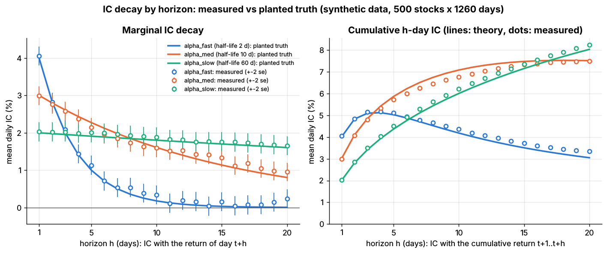
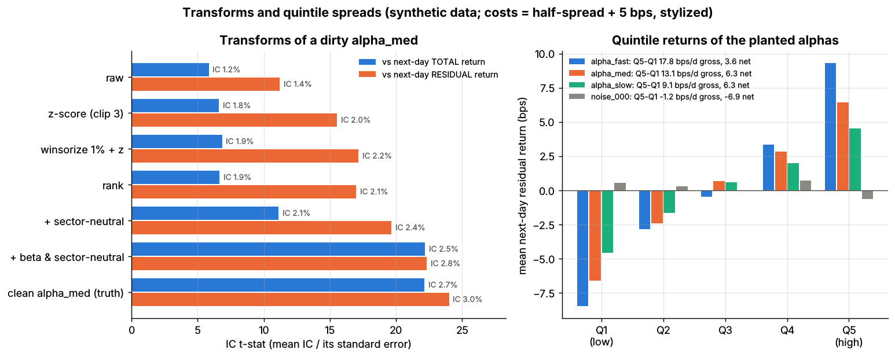

# Lab 11: Signal transforms and information-coefficient diagnostics

## What it demonstrates

The synthetic equity market (`labs/common/simulate.py`, 500 stocks x 1,260 days) plants three
alphas whose strength and persistence are known exactly: `alpha_fast` (daily IC 0.04, half-life
2 days), `alpha_med` (0.03, 10 days) and `alpha_slow` (0.02, 60 days). The **information
coefficient (IC)** is the cross-sectional correlation, on one date, between a signal and the
return that follows; a signal is judged by the average and the stability of its daily IC.

1. **Transforms on a dirty signal.** Real research signals arrive in raw units, with bad prints
   and with unintended factor bets. The lab builds one: `alpha_med` plus a beta tilt
   (correlation with beta ~0.3), a slowly drifting sector tilt and 1% of observations hit by huge
   Student-t outliers (all stylized). It then applies, step by step: z-score clipped at +-3,
   winsorize at the 1st/99th percentile then z-score, cross-sectional rank, sector
   neutralization and beta + sector neutralization (regression residual). Each step is scored
   against next-day **total** returns (what a naive backtest sees) and **residual** returns
   (after removing factor moves).
2. **Evaluating the planted alphas against the truth:** measured vs planted IC, Pearson vs rank
   IC, IC decay by horizon (1-20 days) and the half-life recovered from it, cumulative h-day IC,
   day-over-day signal autocorrelation (which drives turnover), quintile returns, and a quintile
   long-short book gross and net of a stylized cost.
3. **Pitfalls shown:**
    - the raw signal's IC against total returns is diluted by outliers and its day-to-day
      volatility is inflated by the beta and sector bets it carries; neutralizing more than
      triples its t-stat;
    - clipping after z-scoring does not neutralize outliers (they inflate the standard
      deviation first); winsorize before z-scoring;
    - a 5-day IC sampled daily uses overlapping returns, so the naive t-stat is inflated by
      ~1.8x; a Newey-West standard error fixes it;
    - pure-noise signals clear |t| > 2 about 5% of the time (a preview of
      [Lab 13](../13-backtest-overfitting-dsr-pbo/README.md));
    - the alpha with the highest IC (`alpha_fast`) loses 80% of its quintile spread to costs
      because its signal changes so quickly; the slow alpha keeps 70%.

The three core functions (`lab.py`, `=== CORE ALGORITHM ===`):

```python
def zscore(x, clip=3.0):                 # per date (last axis); NaN-safe
    z = (x - np.nanmean(x)) / np.nanstd(x)
    return np.clip(z, -clip, clip)

def neutralize(signal, exposures):       # exposures: N x K, e.g. [beta, sector dummies]
    coef, *_ = np.linalg.lstsq(exposures, signal, rcond=None)   # one regression per date
    return signal - exposures @ coef     # residual: zero beta tilt, zero sector means

def ic_series(signal, fwd_ret, method="pearson"):   # "spearman" = rank IC
    # per date: correlation of signal(t) with fwd_ret(t) over the names present on both sides
```

The noise in a daily IC is mostly sampling noise from a finite cross-section: its standard
deviation is close to 1/sqrt(N), so the t-stat of the mean IC is about IC x sqrt(N x T). This is
the breadth argument of Grinold's fundamental law of active management (Grinold 1989, *Journal
of Portfolio Management* 15(3), 30-37, <https://doi.org/10.3905/jpm.1989.409211>; Grinold & Kahn,
*Active Portfolio Management*, 2nd ed., McGraw-Hill, 2000).

## Supports

- [Signal transforms](../../docs/03-algorithms/a-data-and-signals/signal-transforms.md) (algorithm card D3)
- [Evaluating signals](../../docs/03-algorithms/a-data-and-signals/evaluating-signals.md) (algorithm card D4)
- [Cross-sectional alpha and neutralization](../../docs/02-strategies/d-mid-frequency-alpha/cross-sectional-alpha-and-neutralization.md) (strategy dossier)

## How to run

```bash
python labs/11-signal-transforms-ic/lab.py            # full run: 500 stocks x 1,260 days, ~13 s
python labs/11-signal-transforms-ic/lab.py --smoke    # 200 stocks x 500 days, ~3 s
python labs/11-signal-transforms-ic/lab.py --seed 3   # another random world
```

The full run writes the two plots to `docs/assets/labs/` and the key numbers to `results.json`;
`--smoke` writes only to `labs/_smoke/`.

## Expected output

Full run, seed 7 (synthetic data). **Transforms of the dirty `alpha_med`** (mean daily IC with
the next-day return; the t-stat is mean IC / its standard error over 1,259 days):

| Step | IC vs total return | Rank IC vs total | IC std vs total | t-stat vs total | IC vs residual return | Corr. with beta |
|---|---|---|---|---|---|---|
| raw | 0.012 | 0.020 | 0.075 | 5.8 | 0.014 | 0.28 |
| z-score (clip 3) | 0.018 | 0.020 | 0.094 | 6.6 | 0.020 | 0.42 |
| winsorize 1% + z-score | 0.019 | 0.020 | 0.100 | 6.8 | 0.022 | 0.46 |
| rank | 0.019 | 0.020 | 0.101 | 6.6 | 0.021 | 0.47 |
| + sector-neutral | 0.021 | 0.022 | 0.067 | 11.1 | 0.024 | 0.35 |
| + beta and sector-neutral | 0.025 | 0.027 | 0.040 | 22.2 | 0.028 | 0.00 |
| clean `alpha_med` (truth) | 0.027 | 0.028 | 0.043 | 22.2 | 0.030 | 0.01 |

Rank IC does not change under monotone transforms (raw, z-score and winsorized z-score all
have rank IC 0.020), which is why practitioners quote it. Neutralization does most of the work
on stability: it cuts the IC's daily standard deviation from 0.10 to 0.04 and lifts the t-stat
from 6.8 to 22.2, close to the clean signal's.

**Planted alphas vs truth:**

| Alpha | Planted IC | Measured IC (+-2 se) | Rank IC | True half-life | Half-life fitted to IC decay | Autocorrelation (true) | 20-day cumulative IC |
|---|---|---|---|---|---|---|---|
| `alpha_fast` | 0.040 | 0.041 (+-0.0025) | 0.044 | 2 d | 2.2 d | 0.706 (0.707) | 0.034 |
| `alpha_med` | 0.030 | 0.030 (+-0.0025) | 0.033 | 10 d | 11.5 d | 0.933 (0.933) | 0.075 |
| `alpha_slow` | 0.020 | 0.020 (+-0.0026) | 0.022 | 60 d | 60.0 d | 0.988 (0.989) | 0.082 |

- Daily IC standard deviation of `alpha_med`: 0.0443 vs 1/sqrt(500) = 0.0447.
- `alpha_med` 5-day IC 0.057: naive t-stat 45.1, Newey-West (4 lags) t-stat 25.2.
- 20 noise signals: IC t-stats have mean -0.24 and standard deviation 1.01; 1 of 20 has |t| > 2
  (max |t| = 2.43).



*Left: IC of the signal at t with the return of day t+h, measured (circles, +-2 standard
errors) vs the planted IC x decay^(h-1) (lines). Right: IC with the cumulative return over
t+1..t+h. The fast alpha's cumulative IC peaks at ~4 days; the slow alpha is still rising at 20.*

**Quintile long-short book** (\$1 long the top quintile, \$1 short the bottom, equal weights,
rebalanced daily, next-day residual returns; cost per dollar traded = half the quoted spread,
3.2 bps on average, plus 5 bps stylized impact and fees):

| Signal | Q1 | Q5 | Q5-Q1 gross | Turnover (traded / gross, per day) | Cost | Net | Sharpe gross | Sharpe net |
|---|---|---|---|---|---|---|---|---|
| `alpha_fast` | -8.5 | +9.3 | 17.8 | 86% | 14.1 | 3.6 | 12.6 | 2.6 |
| `alpha_med` | -6.6 | +6.4 | 13.1 | 41% | 6.8 | 6.3 | 9.2 | 4.4 |
| `alpha_slow` | -4.6 | +4.5 | 9.1 | 17% | 2.8 | 6.3 | 6.3 | 4.4 |
| `noise_000` | +0.6 | -0.6 | -1.2 | 35% | 5.7 | -6.9 | -0.8 | -4.8 |

Returns and costs are in bps per day. The Sharpe ratios are those of a toy: the planted ICs
sit at the generous end of real daily signals, the book trades 200 names per day for free
except for spread and a flat impact charge, and residual returns assume factor risk is hedged
at no cost. Quote the ordering (gross vs net, fast vs slow), not the levels.



*Left: IC t-stat of each transform step against total and residual next-day returns (labels:
mean IC). Right: mean next-day residual return by quintile for the three planted alphas and one
noise signal.*

Across seeds 1, 2, 3 and 7 the measured ICs stay within about +-0.002 of the planted values;
the fitted half-lives range over 1.8-2.2, 10.2-13.5 and 55-61 days; the neutralized signal's
t-stat vs total returns over 18.8-22.2 (raw: 4.9-7.4); and 0 to 3 of the 20 noise signals have
|t| > 2. The orderings above do not change.

## What this toy misses vs the real world

- **Clean, complete cross-sections.** No missing data, no stocks entering or leaving the
  universe, no corporate actions, no stale or point-in-time issues. In practice handling NaNs
  and universe changes is a large share of transform code (see point-in-time data and cleaning).
- **Static exposures and a known risk model.** Betas, sectors and styles never change here, and
  neutralization uses the true exposures. Real exposures are estimated with error and drift,
  so neutralization removes less than it does here.
- **Contamination that is easy to remove.** The dirty signal's factor bets are exactly linear in
  beta and sector, so a regression removes them completely. Real signals also load on styles,
  nonlinear functions of size and liquidity, and on each other.
- **Generous, stationary ICs.** The planted ICs (0.02-0.04 daily) do not decay over the five
  years and are not crowded; real alphas weaken after publication and vary by regime.
- **Simple costs.** Half-spread plus a flat 5 bps, no market-impact curve, no borrow fees, no
  capacity limits and no partial trading toward a target, so the net Sharpe ratios are far too
  high (Lab 15, trading toward the aim, covers trading-rate choices).
- **Equal-weighted quintiles.** Real books size positions by risk and liquidity and are built
  by an optimizer; a quintile spread is a diagnostic, not a portfolio.
- **One horizon structure.** Each planted alpha's IC decays geometrically by construction;
  real decay curves can be humped (e.g. post-earnings drift) or reverse sign.

## Key parameters

| Parameter | Value | Meaning |
|---|---|---|
| `n_stocks`, `n_days` | 500, 1,260 (smoke: 200, 500) | size of the synthetic market |
| planted alphas | IC 0.04 / 0.03 / 0.02, half-life 2 / 10 / 60 days | `DEFAULT_ALPHAS` in `simulate.py` |
| `clip` in `zscore` | 3.0 | clip z-scores at +-3 standard deviations |
| winsorization | 1st / 99th percentile per date | applied before the z-score |
| dirty signal: `beta_tilt`, `sector_sd`, `sector_half_life` | 0.6, 0.6, 120 days | stylized factor contamination of `alpha_med` |
| dirty signal: `outlier_prob`, `outlier_scale` | 1%, 15 x Student-t(3) | stylized bad prints |
| neutralization exposures | beta + 11 sector dummies | true exposures from the simulator |
| IC horizons | 1-20 days | marginal (day t+h) and cumulative (t+1..t+h) |
| Newey-West lags | 4 for the 5-day IC | h - 1 for an h-day overlapping return |
| noise signals | 20 (smoke: 6) | `simulate.iter_noise_signals`, true IC 0 |
| cost per dollar traded | half-spread (avg 3.2 bps) + 5 bps | stylized |
