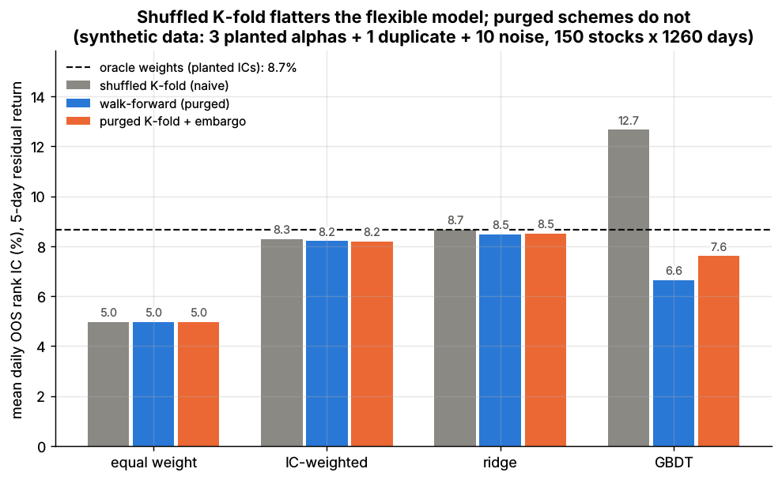
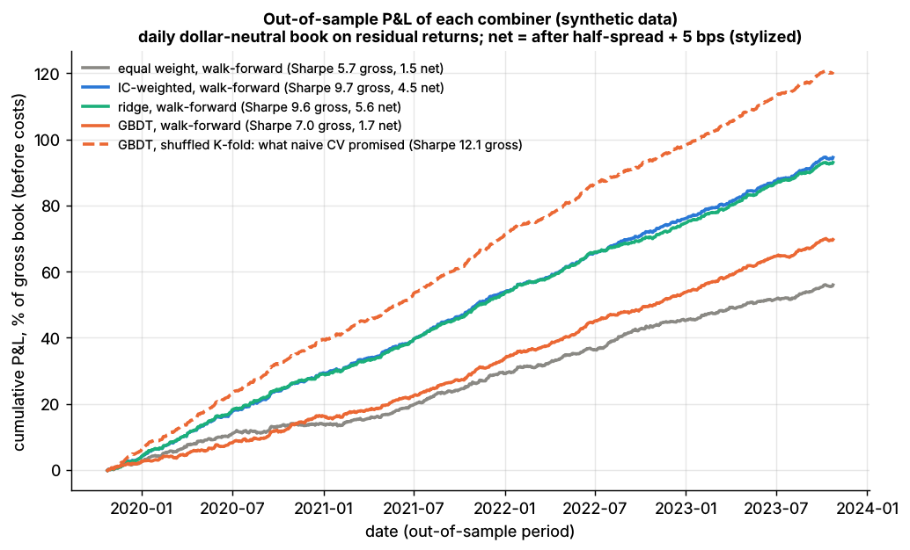

# Lab 12: Alpha combination and purged cross-validation

## What it demonstrates

Fourteen signals on a synthetic 150-stock market (1,260 days) are combined into one forecast
of each stock's **5-day forward residual return**, ranked per date. The signals are the three
planted alphas (`alpha_fast`, `alpha_med`, `alpha_slow`: daily ICs 0.04 / 0.03 / 0.02,
uncorrelated with each other), `alpha_fast_v2` (a noisier second measurement of `alpha_fast`,
correlation ~0.85, as when two researchers build similar reversal signals) and 10 pure-noise
signals. Because the planted ICs are known, there is an **oracle**: weight the three real
alphas by their true 5-day ICs.

Four combiners:

1. **equal weight**: average of all 14 z-scored signals (no fitting);
2. **IC-weighted**: weights proportional to each signal's positive training-sample IC;
3. **ridge**: pooled regression of the ranked target on the signals, lambda = 0.1 x rows;
4. **GBDT**: gradient-boosted trees, LightGBM if installed, else scikit-learn's
   `HistGradientBoostingRegressor` (31 leaves, 50 rows per leaf, 150 rounds of 0.05: the loose
   settings of a first attempt).

Three ways to estimate out-of-sample (OOS) skill, scored on the same 1,045 test dates:

- **shuffled K-fold (naive)**: 5 folds of randomly shuffled (date, stock) rows;
- **walk-forward (purged)**: 6 time blocks; fold k trains on everything whose label is known
  before block k starts;
- **purged K-fold + embargo** (López de Prado 2018, *Advances in Financial Machine Learning*,
  Wiley, ch. 7): 5 contiguous test blocks; training dates whose 5-day label window overlaps a
  test label are purged, plus a 10-day embargo after each test block.

The **pitfall**: a 5-day return sampled daily shares 4 of its 5 days with its neighbors, and a
persistent signal hardly changes from one day to the next. Shuffled K-fold therefore trains on
near-copies of every test row. A flexible model memorizes them (GBDT in-sample IC 0.24) and
the leak shows up as fake OOS skill; a 14-coefficient linear model cannot memorize, so it
barely leaks.

The core functions (`lab.py`, `=== CORE ALGORITHM ===`):

```python
def purged_kfold_splits(n_dates, n_folds=5, horizon=5, embargo=10):
    dates = arange(n_dates)
    for test in array_split(dates, n_folds):                # contiguous test blocks
        keep = (dates + horizon <= test[0]) | (dates >= test[-1] + horizon + embargo)
        yield dates[keep], test                             # purged + embargoed training dates

def combine_ic_weighted(X, ic):                             # ic from TRAINING data only
    w = clip(ic, 0, None) / sum(clip(ic, 0, None))
    return X @ w, w

def fit_ridge(X, y, lam):
    return solve(X.T @ X + lam * eye(K), X.T @ y)

def rank_target(ret, dates):                                # per-date rank in [-0.5, 0.5]
```

`walk_forward_splits(n_dates, n_folds, horizon)` is the expanding-window counterpart.

## Supports

- [Alpha combination and ensembling](../../docs/03-algorithms/b-forecasting-models/alpha-combination-and-ensembling.md) (algorithm card F5)
- [Time-series cross-validation](../../docs/03-algorithms/c-validation-and-backtesting/time-series-cross-validation.md) (algorithm card V1)
- [Linear models and regularization](../../docs/03-algorithms/b-forecasting-models/linear-models-and-regularization.md) (F1) and [tree ensembles](../../docs/03-algorithms/b-forecasting-models/tree-ensembles.md) (F2)

## How to run

```bash
python labs/12-alpha-combination-purged-cv/lab.py            # full run: 150 stocks x 1,260 days, ~25 s
python labs/12-alpha-combination-purged-cv/lab.py --smoke    # 60 stocks x 400 days, ~4 s
python labs/12-alpha-combination-purged-cv/lab.py --seed 3   # another random world
```

Without LightGBM the scikit-learn fallback gives the same picture but takes 2-3x longer
(about 60 s for the full run). The full run writes the two plots to `docs/assets/labs/` and the
key numbers to `results.json`; `--smoke` writes only to `labs/_smoke/`.

## Expected output

Full run, seed 7, LightGBM (synthetic data). **Mean daily OOS rank IC** against the 5-day
residual return:

| Combiner | Shuffled K-fold (naive) | Walk-forward (purged) | Purged K-fold + embargo |
|---|---|---|---|
| equal weight | 0.050 | 0.050 | 0.050 |
| IC-weighted | 0.083 | 0.082 | 0.082 |
| ridge | 0.087 | 0.085 | 0.085 |
| GBDT | **0.127** | 0.066 | 0.076 |
| *oracle (planted ICs as weights)* | | 0.087 | |
| *best single signal (`alpha_fast`)* | | 0.051 | |

- **Naive CV picks the wrong model.** Shuffled K-fold ranks GBDT first by a wide margin
  (0.127); both purged schemes rank it last among the fitted combiners. GBDT's in-sample IC in
  the last walk-forward fold is 0.238 against 0.066 out of sample. Ridge leaks only +0.002
  (in-sample 0.084, OOS 0.085).
- **Ridge wins out of sample** and matches the oracle (0.085 vs 0.087). IC weighting comes
  close but double-counts the duplicate: in the last fold it gives `alpha_fast` +
  `alpha_fast_v2` 43% of the weight, while ridge gives the duplicate only 6% of its absolute
  weight against 22% for the original. The double-counting also raises turnover (61% vs 47%
  of the book per day).
- **Equal weight is diluted by noise**: averaging in 10 useless signals leaves it no better than
  the best single signal (0.050 vs 0.051).
- Purged K-fold scores GBDT higher than walk-forward (0.076 vs 0.066) because its folds train
  on about 80% of the sample instead of 17-83%; for the linear models the two schemes agree.



*Mean daily out-of-sample rank IC for each combiner under each validation scheme; dashed line =
oracle combination with the planted ICs.*

**Out-of-sample P&L** of a daily dollar-neutral book with weights proportional to the demeaned
forecast rank (\$1 gross), on next-day residual returns, over the walk-forward test period
(October 2019 to October 2023 in simulator dates, 1,045 days). Net = after half the quoted spread plus 5 bps
(stylized):

| Combiner (walk-forward) | Sharpe gross | Sharpe net | Turnover per day |
|---|---|---|---|
| equal weight | 5.7 | 1.5 | 49% |
| IC-weighted | 9.7 | 4.5 | 61% |
| ridge | 9.6 | 5.6 | 47% |
| GBDT | 7.0 | 1.7 | 63% |
| GBDT as promised by shuffled K-fold | 12.1 | 6.8 | 62% |

These Sharpe ratios are far above anything achievable: the planted ICs are generous, residual
returns assume factor risk is hedged for free and costs ignore impact curves and capacity. Use
them only to compare rows.



*Cumulative out-of-sample P&L (before costs) of each combiner, walk-forward; dashed: what the
naive shuffled K-fold promised for GBDT.*

With `--seed 3` the same pattern holds: GBDT 0.123 shuffled vs 0.065 walk-forward and 0.077
purged; ridge 0.094 / 0.089 / 0.092 against an oracle of 0.093.

## What this toy misses vs the real world

- **Linear truth.** The planted alphas act linearly and independently, so there is nothing for
  trees to find beyond what ridge finds. Real signals have interactions and regime dependence
  where a well-regularized GBDT can add value; the lesson here is about validation, not a
  verdict that trees never help.
- **No hyperparameter search.** GBDT settings are fixed (and loose). Real pipelines tune
  depth, leaf size and early stopping, and tuning on a leaky split makes the leak worse.
- **Few, stationary signals.** 14 signals with constant ICs over five years. Real libraries
  hold hundreds of correlated signals whose ICs drift and decay, which is where trailing-window
  IC weights and shrinkage matter most.
- **Clean labels.** The target is a clean 5-day residual return with known exposures; real
  residuals come from an estimated risk model, and labels can be contaminated by corporate
  actions, delistings and survivorship.
- **One leakage channel.** Only overlapping labels leak here. Real pipelines also leak through
  full-sample normalization, look-ahead in features, and data revisions.
- **Simplified P&L.** No optimizer, risk model, position limits, borrow costs or market
  impact; the Sharpe ratios are only for ranking the rows.
- **Small universe.** 150 stocks keep the run short; real cross-sections of 1,000-3,000 names
  raise breadth and make each daily IC less noisy.

## Key parameters

| Parameter | Value | Meaning |
|---|---|---|
| `n_stocks`, `n_days` | 150, 1,260 (smoke: 60, 400) | size of the synthetic market |
| signals | 3 planted + 1 near-duplicate + 10 noise | `alpha_fast_v2` = `alpha_fast` + 0.6 x noise, re-z-scored |
| label `horizon` | 5 days | target = per-date rank of the 5-day forward residual return |
| `n_folds` | 5 | K-fold folds; walk-forward uses 5 test blocks out of 6 |
| `embargo` | 10 days | dropped after each purged K-fold test block |
| ridge `lam` | 0.1 x number of training rows | about 10% shrinkage of unit-variance signals |
| GBDT | 31 leaves, min 50 rows per leaf, learning rate 0.05, 150 rounds, 80% row and feature sampling | LightGBM or sklearn fallback |
| cost per dollar traded | half the quoted spread + 5 bps | stylized |
