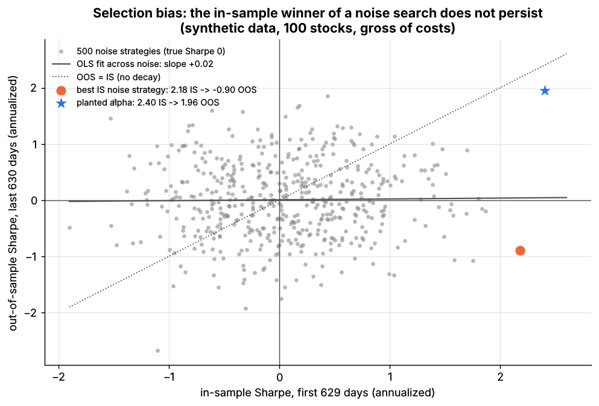
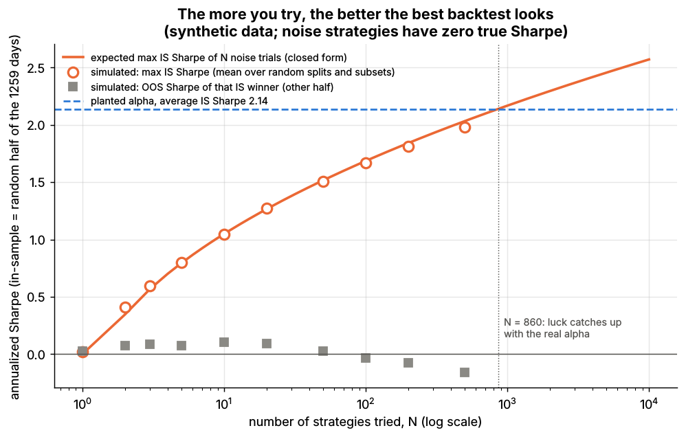

# Lab 13: Backtest overfitting, the Deflated Sharpe Ratio and PBO

## What it demonstrates

A researcher tries many strategies and reports the best backtest. This lab shows how much of
that "best" is luck, and how two published corrections measure it.

**Setup** (synthetic data). A 100-stock market over 1,260 days (5 years) with one genuinely
planted alpha (daily IC 0.015, half-life 20 days). Each strategy is a daily dollar-neutral book
(\$1 gross, weights proportional to the demeaned signal) traded on next-day total returns,
gross of costs. There are **500 noise strategies** (built on `simulate.iter_noise_signals`,
true Sharpe exactly 0) and **one planted-alpha strategy** (true gross Sharpe about 2).

1. **Selection bias.** Pick the best of the 500 noise strategies on the first half of the
   sample (in-sample, IS) and look at the second half (out-of-sample, OOS). Across all 500,
   IS and OOS Sharpe ratios are uncorrelated.
2. **Expected maximum Sharpe vs number of trials.** With N zero-skill trials, the best IS
   Sharpe is about sd(Sharpe) x ((1 - g) Z^-1(1 - 1/N) + g Z^-1(1 - 1/(N e))), g = 0.5772
   (Euler-Mascheroni), which grows roughly like sqrt(2 ln N). The lab checks this closed form
   against random IS/OOS splits and random subsets of the 500 strategies.
3. **Deflated Sharpe Ratio (DSR)** (Bailey & López de Prado 2014, *Journal of Portfolio
   Management* 40(5), 94-107, <https://doi.org/10.3905/jpm.2014.40.5.094>): the probability
   that the true Sharpe exceeds SR0, the best Sharpe expected from N noise trials, corrected
   for track-record length, skewness and fat tails. With N = 1 it is the Probabilistic Sharpe
   Ratio (PSR).
4. **Probability of Backtest Overfitting (PBO)** by combinatorially symmetric cross-validation,
   CSCV (Bailey, Borwein, López de Prado & Zhu 2017, *Journal of Computational Finance*,
   <https://doi.org/10.21314/JCF.2016.322>; also López de Prado 2018, *Advances in Financial
   Machine Learning*, Wiley): cut the sample into 16 blocks, use every one of the 12,870 ways
   to choose 8 of them as IS, and count how often the IS winner lands at or below the OOS
   median.

The core functions (`lab.py`, `=== CORE ALGORITHM ===`; Sharpe ratios per period, not
annualized):

```python
def expected_max_sharpe(n_trials, sr_std):
    g = 0.5772156649                                   # Euler-Mascheroni
    return sr_std * ((1 - g) * Zinv(1 - 1/n_trials) + g * Zinv(1 - 1/(n_trials * e)))

def deflated_sharpe(returns, n_trials, sr_std_trials):
    sr, T = mean(r) / std(r), len(r)
    sr0 = expected_max_sharpe(n_trials, sr_std_trials)  # 0 when n_trials = 1 (PSR)
    stat = (sr - sr0) * sqrt(T - 1) / sqrt(1 - skew * sr + (kurt - 1) / 4 * sr**2)
    return Phi(stat), sr0

def pbo_cscv(R, n_blocks=16):        # R: T x N returns of the N variants tried
    # for each of C(16, 8) IS/OOS splits: best IS strategy -> its OOS rank w in (0, 1)
    # logit = ln(w / (1 - w));  PBO = share of splits with logit <= 0
```

## Supports

- [Overfitting and multiple testing](../../docs/03-algorithms/c-validation-and-backtesting/overfitting-and-multiple-testing.md) (algorithm card V4)

## How to run

```bash
python labs/13-backtest-overfitting-dsr-pbo/lab.py            # full run: 500 trials, 12,870 CSCV splits, ~6 s
python labs/13-backtest-overfitting-dsr-pbo/lab.py --smoke    # 60 trials, 504 days, 8 blocks, ~2 s
python labs/13-backtest-overfitting-dsr-pbo/lab.py --seed 3   # another random world
```

The full run writes the two plots to `docs/assets/labs/` and the key numbers to `results.json`;
`--smoke` writes only to `labs/_smoke/`.

## Expected output

Full run, seed 7 (synthetic data, annualized Sharpe ratios, gross of costs).

**Pick the best in-sample** (IS = first 629 days, OOS = last 630):

| Strategy | IS Sharpe | OOS Sharpe |
|---|---|---|
| best of 500 noise strategies | 2.18 | -0.90 |
| planted alpha | 2.40 | 1.96 |

Across the 500 noise strategies, corr(IS, OOS) = +0.015 and the IS Sharpe ratios have a
standard deviation of 0.68 (theory for 2.5 years of daily data: sqrt(252 / 629) = 0.63).



*Each gray dot is a noise strategy: its first-half Sharpe says nothing about its second half.
The in-sample winner (orange) falls to -0.90; the planted alpha (star) holds up.*

**Expected maximum IS Sharpe** (IS = a random half of the sample):

| N trials | 1 | 10 | 50 | 100 | 500 |
|---|---|---|---|---|---|
| closed form | 0.00 | 1.05 | 1.52 | 1.69 | 2.03 |
| simulated max IS Sharpe | 0.02 | 1.05 | 1.51 | 1.67 | 1.98 |
| simulated OOS Sharpe of that winner | +0.02 | +0.11 | +0.03 | -0.04 | -0.16 |

The planted alpha's average IS Sharpe on the same random halves is 2.14; the closed form says
the luckiest of about **860** noise strategies is expected to match it.



*The best in-sample Sharpe of N noise strategies (closed form and simulation) rises with N
while the winner's out-of-sample Sharpe stays near zero.*

**Deflated Sharpe Ratio** (full 1,259-day sample; SR0 uses the dispersion of the 500 noise
Sharpe ratios):

| Strategy | Sharpe | N trials assumed | SR0 | PSR / DSR |
|---|---|---|---|---|
| best noise strategy | 1.31 | 1 (PSR) | 0 | 0.998 |
| best noise strategy | 1.31 | 500 | 1.49 | **0.34** |
| planted alpha | 2.18 | 1 (PSR) | 0 | 1.000 |
| planted alpha | 2.18 | 10 | 0.77 | 0.999 |
| planted alpha | 2.18 | 100 | 1.23 | 0.983 |
| planted alpha | 2.18 | 500 | 1.49 | 0.940 |

The PSR calls the best noise strategy 99.8% significant; deflating for 500 trials drops it to
34%. Even the real alpha falls just short of a 95% DSR if it had to be found among 500
candidates: five years of a Sharpe-2 strategy is not much evidence after a large search.

**PBO by CSCV** (16 blocks, 12,870 splits):

| Search set | PBO | IS winner: mean IS Sharpe | mean OOS Sharpe | OOS Sharpe < 0 |
|---|---|---|---|---|
| 500 noise strategies | 0.64 | 1.98 | -0.18 | 62% of splits |
| 500 noise + planted alpha | 0.22 | 2.28 | +1.25 | 22% of splits |

For a noise-only search PBO should be about one half: on five disjoint groups of 100 noise
strategies it is 0.53, 0.47, 0.45, 0.49 and 0.57 (mean 0.50); 0.64 for all 500 is within the
sampling scatter of a single 5-year history.

**Across seeds** (1, 2, 3, 7) the planted alpha's realized 5-year Sharpe ranges from 1.36 to
2.18 around its true value of about 2, and the conclusions move with it: its DSR at N = 500 is
0.95, 0.85, 0.56 and 0.94; PBO with the alpha in the set is 0.20, 0.29, 0.58 and 0.22 (noise
only: 0.64, 0.47, 0.63, 0.64). In seeds 2 and 3, one or two noise strategies beat the real
alpha in-sample. The best noise strategy's OOS Sharpe is negative in all four (-0.18 to -0.90).

## What this toy misses vs the real world

- **Independent trials.** The 500 noise strategies are nearly uncorrelated, so N is the number
  of independent trials. Real searches (parameter grids, variants of one idea) are highly
  correlated; the effective N must be estimated, e.g. by clustering the trials, and getting it
  wrong moves the DSR a lot.
- **Researchers know N here.** In practice the number of trials includes every abandoned idea,
  colleague's attempt and published paper that shaped the search; it is usually undercounted.
- **No costs and no capacity.** Strategies are gross of costs. Costs penalize fast-trading
  variants and shift the null distribution of Sharpe ratios below zero.
- **Stationary truth.** The planted alpha keeps the same IC for five years. Real alphas decay
  and change regime, so a strategy can be real in-sample and dead out of sample without any
  overfitting.
- **Only Sharpe-based selection.** Real research also overfits through data choices, universe
  filters, look-ahead and survivorship, which no multiple-testing statistic detects.
- **One history.** Every statistic here comes from one simulated path. PBO and DSR are
  themselves noisy (see the seed ranges above), and real markets give only one history.

## Key parameters

| Parameter | Value | Meaning |
|---|---|---|
| `n_stocks`, `n_days` | 100, 1,260 (smoke: 100, 504) | size of the synthetic market |
| planted alpha | IC 0.015, half-life 20 days | true gross Sharpe of the book about 2 (stylized) |
| `n_trials` | 500 noise strategies (smoke: 60) | `simulate.iter_noise_signals`, half-lives 1-60 days |
| strategy | weights = demeaned signal / sum of absolute values | daily, dollar-neutral, \$1 gross, total returns, no costs |
| IS / OOS | first half / second half | for the selection experiment and the scatter |
| `n_blocks` (CSCV) | 16 (smoke: 8) | C(16, 8) = 12,870 IS/OOS splits |
| random splits for the max-Sharpe curve | 400 x 10 subsets per N | IS = random half of the blocks |
| DSR inputs | sd of the 500 per-day Sharpe estimates; sample skew and kurtosis | Bailey & López de Prado (2014) |
