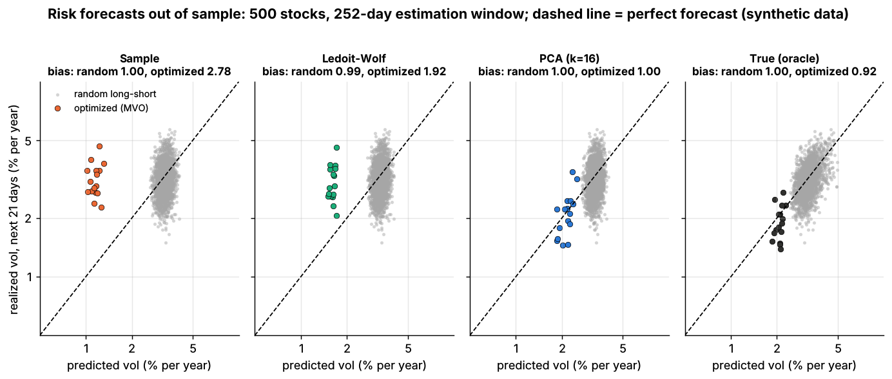
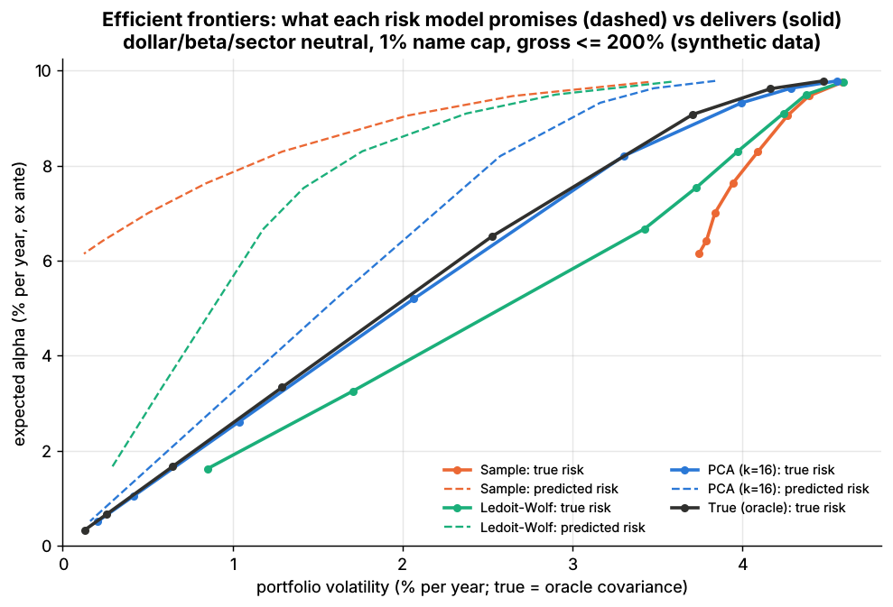

# Lab 14: Risk models, covariance shrinkage and constrained mean-variance optimization

## What it demonstrates

- **Four covariance estimators** for 500 simulated stocks, each fitted on a trailing 252-day window
  of daily returns. Because N = 500 > T = 252, the sample covariance is singular (rank 251).
  1. the **sample covariance**;
  2. **Ledoit-Wolf (2004) shrinkage** toward a scaled identity, via scikit-learn's `LedoitWolf`;
  3. a **statistical PCA factor model**: the top k = 16 principal components plus a diagonal of
     specific variances;
  4. the **true covariance** of the simulator (oracle), for the day being forecast.
- **Out-of-sample risk-forecast accuracy** over 47 monthly forecast dates. The **bias statistic**
  is the standard deviation of realized return divided by predicted volatility. A value of 1 means
  unbiased; above 1 means risk was underpredicted. It is computed for 200 random dollar-neutral
  portfolios, 100 random long-only portfolios, and the portfolio an optimizer builds with each
  estimate.
- **A cvxpy mean-variance optimizer** (`optimize_portfolio`). It maximizes
  `alpha'w - risk_aversion * w'Sigma w - sum(cost_i * |w_i - w_prev_i|)` subject to dollar
  neutrality, beta neutrality, sector neutrality, a 1% cap per name and a 200% gross cap. Every
  risk model is passed in factor form `Sigma = L'L + diag(specific_var)`, so even the dense
  sample covariance solves in well under a second for 500 names.
- **Pitfall 1, error maximization** (Michaud 1989). The sample covariance is unbiased for any
  portfolio chosen *independently* of it: its bias statistic on random portfolios is 1.00.
  An optimizer, however, seeks out exactly the directions where the estimate understates risk,
  and with N > T some directions have zero estimated variance. Optimized portfolios built on
  the sample covariance are 2.8 times riskier than predicted. Their promised efficient frontier
  is a mirage.
- **Pitfall 2, costs.** In a biweekly backtest of the same optimizer (PCA risk model, last two
  years), the turnover penalty matters. With none (`cost_aversion = 0`) the book trades 19 times
  its capital a year and pays 316 bps a year in costs. With a large penalty it keeps less of its
  expected alpha. The best penalty is well below 1, because each trade's cost is spread over
  the signal's roughly 20-day life rather than charged against two weeks of alpha (see Lab 15).

The alpha is a planted signal (daily IC 0.01, half-life 20 days) and the optimizer is given its
**true** conditional expected return. Every difference between runs therefore comes from the risk
model or the costs, not from alpha estimation.

Core functions to mirror in pseudocode: `pca_factor_cov(returns, n_factors=16)`,
`optimize_portfolio(alpha, cov, w_prev, risk_aversion, cost, beta, sectors, max_weight, max_gross)`
and `bias_statistic(realized_returns, predicted_vol)`.

## Supports

- [Risk models](../../docs/03-algorithms/d-portfolio-construction/risk-models.md)
- [Covariance estimation and shrinkage](../../docs/03-algorithms/d-portfolio-construction/covariance-estimation-and-shrinkage.md)
- [Mean-variance optimization](../../docs/03-algorithms/d-portfolio-construction/mean-variance-optimization.md)

## How to run

```bash
cd /home/user/quant_trading_claude && export PATH=/home/user/venv-qt/bin:$PATH
python labs/14-risk-model-mvo/lab.py              # full run (~32 s): plots + results.json
python labs/14-risk-model-mvo/lab.py --smoke      # CI run (~4 s, 150 stocks), writes to labs/_smoke/
python labs/14-risk-model-mvo/lab.py --seed 3     # another simulated market
```

## Expected output

Full run, seed 7: 500 stocks, 1,260 days, 252-day estimation window. The optimizer runs every 63
days, giving 16 dates and 336 holding days.

| Estimator | Bias, random long-short | Bias, random long-only | Bias, optimized (MVO) | Optimized: predicted vol | Optimized: realized vol |
|---|---|---|---|---|---|
| Sample covariance | 1.00 | 1.00 | **2.78** | 1.2% | 3.2% |
| Ledoit-Wolf (mean shrinkage 0.08) | 0.99 | 1.05 | **1.92** | 1.6% | 3.1% |
| PCA, 16 factors | 1.00 | 1.00 | 1.00 | 2.1% | 2.2% |
| True (oracle) | 1.00 | 1.01 | 0.92 | 2.1% | 1.9% |

Volatilities are annualized. With about 336 daily observations, a correctly specified forecast
lands within roughly 0.92–1.08 about 95% of the time. Fat tails and vol-regime shifts widen that
band, which is why even the oracle reads 0.92.



*Each panel shows one estimator. Grey dots are random dollar-neutral portfolios; colored dots
are the optimizer's portfolios. The dashed line is a perfect forecast.*

- **Random portfolios cannot tell the estimators apart:** all four have bias statistics of
  0.99–1.05. Validating a risk model only on random or benchmark portfolios misses its biggest
  failure.
- **Optimized portfolios can.** At risk aversion 50, on the frontier date, the true risk of the
  optimized portfolio is **3.2 times** the predicted risk for the sample covariance, **2.3 times**
  for Ledoit-Wolf, 1.3 times for PCA and 1.0 for the oracle
  (`frontier_true_over_predicted_vol_at_risk_aversion_50`).
- **Shrinkage toward the identity helps only partly.** The Ledoit-Wolf intensity is small (0.08),
  because the identity is a poor target for returns with a strong factor structure. The PCA
  factor model, which keeps 16 factors and drops the rest of the off-diagonal noise, is close to
  the oracle.
- **Alpha per unit of true risk** (ex ante, at the same risk aversion) is 2.03 with the sample
  covariance, 2.09 with Ledoit-Wolf, 2.48 with PCA and 2.58 with the oracle. A bad covariance
  costs about 20% of the achievable information ratio, even though the alpha is known exactly.



*Dashed lines are the risk each model promises; solid lines are the true risk, measured with the
oracle covariance, of the same portfolios. The oracle's curve is the true efficient frontier.*

Biweekly rebalancing, PCA risk model, last two years. Costs are the half-spread plus 5 bps per
unit traded:

| Cost aversion | Turnover (× capital per year) | Costs (bps/yr) | Expected alpha (bps/yr) | Expected net (bps/yr) | Realized Sharpe, gross / net |
|---|---|---|---|---|---|
| 0 (ignore costs) | 19.4 | 316 | 810 | 493 | 3.65 / 2.42 |
| 0.25 | 15.0 | 244 | 793 | **549** | 3.57 / 2.63 |
| 1 (cost charged against one period's alpha) | 7.4 | 119 | 660 | 541 | 2.92 / 2.43 |

"Expected" uses the true alpha model, so it carries no return noise. The realized Sharpe ratios
over two years have a standard error of about ±0.7. They are high because the alpha is known
perfectly and never decays (see the caveats below). Plausible live figures would be far lower.

## What this toy misses vs the real world

- **Exposures are constant and the factor count is known.** Commercial and in-house equity risk
  models use fundamental and industry exposures that drift, country and currency factors, and
  factor covariances that are re-estimated and regime-adjusted. Statistical PCA factors rotate
  from window to window. Here k = 16 matches the truth exactly; in practice k is a tuning choice.
- **The window is equally weighted.** Production models weight recent data more (exponential
  half-lives of weeks to months) and add volatility-regime adjustments. A 252-day equal-weight
  window lags stress episodes, which is part of why even the PCA model is off in some months.
- **The return panel is clean.** Real panels are ragged, with IPOs, delistings, missing days,
  corporate actions and asynchronous closes. Pairwise-complete sample covariances can fail to be
  positive semi-definite.
- **Only one shrinkage target is tested.** Ledoit-Wolf toward the identity is the generic
  version. For equities, a single-index or constant-correlation target (Ledoit & Wolf 2004, JPM)
  or nonlinear shrinkage is usually better. This lab does not test those.
- **The alpha is known exactly.** In practice alpha estimation error drives error maximization
  at least as much as covariance error. Desks shrink alphas, cap factor bets and use robust or
  resampled optimization.
- **Costs are linear in trade size.** Real costs include concave (square-root-like) market impact
  that depends on each name's ADV. The trade-off between cost and alpha is also multi-period (Lab 15).
- **The constraint set is short.** There are no borrow costs or hard-to-borrow names, no style
  factor limits beyond beta and sector, no tracking-error budget, no liquidity-based position
  limits and no integer lots.
- **Validation uses 16 rebalance dates.** Real risk-model validation uses years of history, many
  portfolio types (factor-mimicking, optimized, benchmark) and statistics beyond the bias
  statistic.

## Key parameters

All values are **stylized**. They are chosen for illustration, not calibrated to a particular
market.

| Parameter | Value | Meaning / how chosen |
|---|---|---|
| `n_stocks`, `n_days` | 500, 1,260 | simulator default universe (5 years) |
| `window` | 252 days | estimation window; N > T on purpose, so the sample covariance is singular |
| `horizon` | 21 days | holding period of each risk forecast |
| forecast dates | every 21 days (47) | random-portfolio test |
| optimizer dates | every 63 days (16) | optimized-portfolio test |
| `n_factors` | 16 | PCA factors; the true model has 1 market + 4 style + 11 sector factors |
| planted alpha | IC 0.01, half-life 20 days | the optimizer gets its true expected return |
| `risk_aversion` | 50 | utility = `alpha'w - 50 w'Sigma w`; the same at any horizon if alpha and Sigma cover the same horizon |
| `max_weight`, `max_gross` | 1%, 200% | 100/100 long-short book |
| neutrality | dollar, beta, 11 sectors | equality constraints |
| costs | half-spread (simulated spreads 2–30 bps) + 5 bps | per unit of weight traded |
| cost test | biweekly, 2 years, PCA model, cost aversion 0 / 0.25 / 1 | turnover experiment |
| frontier | risk aversion 3 to 1,000 on one date | predicted vs oracle risk |
| solver | SCS (eps 1e-6), CLARABEL fallback | SCS is fastest on the dense 252 x 500 sample-covariance problems |

Sources. Bibliographic details checked against Crossref (2026-11).

- [Verified] Ledoit, O. & Wolf, M. (2004). "A well-conditioned estimator for large-dimensional covariance matrices." *Journal of Multivariate Analysis* 88(2), 365–411. <https://doi.org/10.1016/S0047-259X(03)00096-4> (accessed 2026-11)
- [Verified] Ledoit, O. & Wolf, M. (2004). "Honey, I shrunk the sample covariance matrix." *Journal of Portfolio Management* 30(4), 110–119. <https://doi.org/10.3905/jpm.2004.110> (accessed 2026-11)
- [Verified] Michaud, R. O. (1989). "The Markowitz optimization enigma: is 'optimized' optimal?" *Financial Analysts Journal* 45(1), 31–42. <https://doi.org/10.2469/faj.v45.n1.31> (accessed 2026-11)
